<p align="center">
  
</p>
<h1 align="center">Bloxkeep</h1>
<p align="center">Manage and launch several Roblox accounts on Windows. Accounts are encrypted and stay on your PC.</p>
<p align="center">English | <a href="README.vi.md">Tiếng Việt</a></p>
<p align="center">
  <a href="https://github.com/Bloxkeep/roblox-account-manager/releases/latest"></a>
  <a href="https://github.com/Bloxkeep/roblox-account-manager/releases"></a>
  
  
  <a href="LICENSE"></a>
  <a href="https://bloxkeep-bot.bloxkeep-app.workers.dev/discord"></a>
</p>
<p align="center"><a href="https://github.com/Bloxkeep/roblox-account-manager/releases/latest/download/Bloxkeep-Setup.exe"></a> <a href="https://bloxkeep-bot.bloxkeep-app.workers.dev/discord"></a></p>
<p align="center"><a href="#download-and-install">Download</a> · <a href="#getting-started">Getting started</a> · <a href="docs/guide.md">User guide</a> · <a href="https://bloxkeep.github.io/roblox-account-manager/">Website</a> · <a href="https://bloxkeep.github.io/roblox-account-manager/whats-new/">What's new</a> · <a href="#community">Community</a> · <a href="#data-and-security">Security</a> · <a href="#faq">FAQ</a> · <a href="PRIVACY.md">Privacy</a></p>

<p align="center">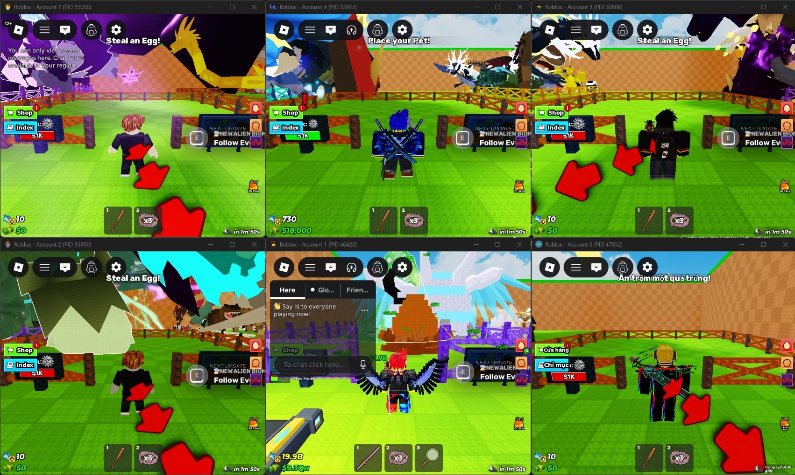</p>

Keep your Roblox accounts in one place, pick a game, pick accounts, press **Play**. Everything stays on your PC, encrypted with your master password. Bloxkeep has no server of its own.

*Bloxkeep is an independent project, not affiliated with or endorsed by Roblox Corporation. Roblox is a trademark of Roblox Corporation.*

## Features

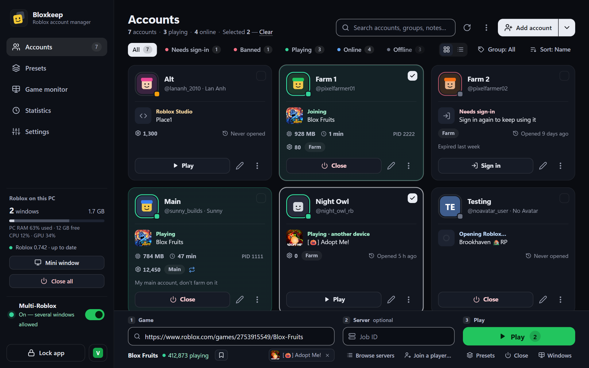

<table>
<tr>
<td width="50%" valign="top"><a href="docs/guide/accounts.md">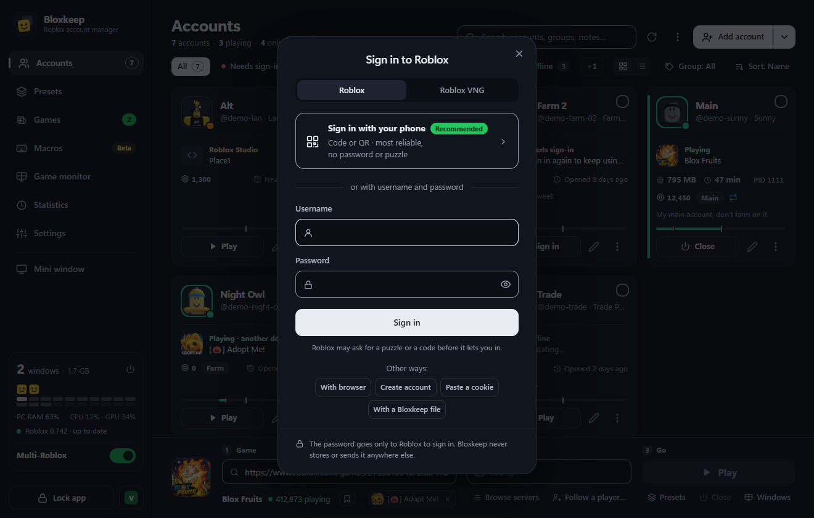</a><br><b>Add accounts</b><br>With your phone (code or QR), username and password (2-step verification and captchas work), a browser window, a cookie or another Bloxkeep file. <a href="docs/guide/accounts.md">Accounts</a></td>
<td width="50%" valign="top"><a href="docs/guide/accounts.md">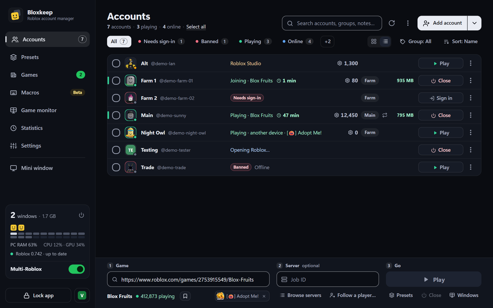</a><br><b>See every account</b><br>Online, in game here or on another device, why it disconnected, RAM, play time, needs sign-in, banned. Search, groups, cards or list. Mark your main account, and make your accounts Roblox friends. <a href="docs/guide/accounts.md">Accounts</a></td>
</tr>
<tr>
<td width="50%" valign="top"><a href="docs/guide/playing.md">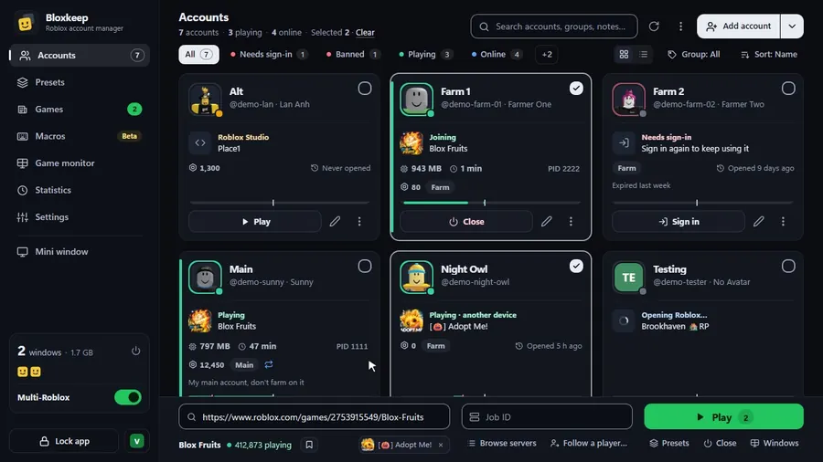</a><br><b>Play</b><br>Pick a game by name, link or Place ID, and a server: most or fewest players, lowest ping, room for N accounts, your private servers, a friend's or any player's server. <a href="docs/guide/playing.md">Playing</a></td>
<td width="50%" valign="top"><a href="docs/guide/multi-roblox.md">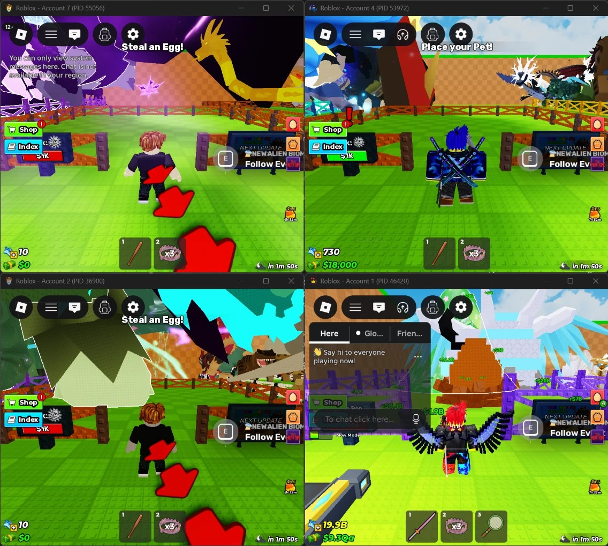</a><br><b>Multi-Roblox</b><br>Several Roblox windows at once. Off until you turn it on; every new Roblox build is checked. <a href="docs/guide/multi-roblox.md">Multi-Roblox</a></td>
</tr>
<tr>
<td width="50%" valign="top"><a href="docs/guide/presets.md">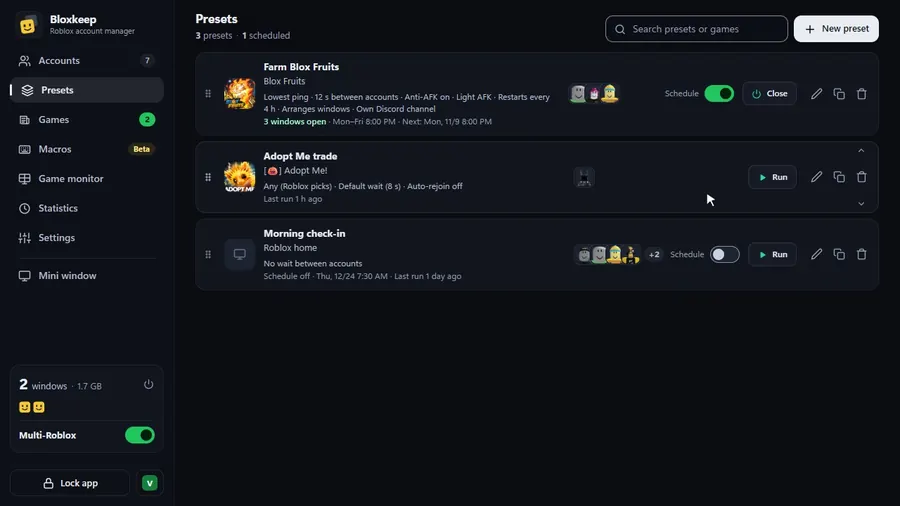</a><br><b>Presets</b><br>Accounts, game and server saved for one click, with a schedule to start and stop. <a href="docs/guide/presets.md">Presets</a></td>
<td width="50%" valign="top"><a href="docs/guide/staying-in-game.md">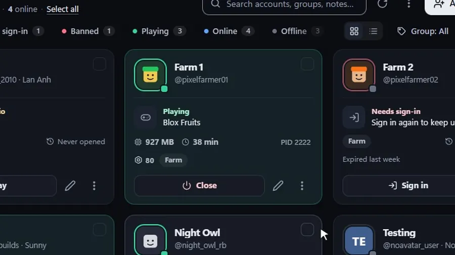</a><br><b>Stay in game</b><br>Anti-AFK against idle kicks, auto-rejoin after a disconnect. <a href="docs/guide/staying-in-game.md">Staying in game</a></td>
</tr>
<tr>
<td width="50%" valign="top"><a href="docs/guide/macros.md">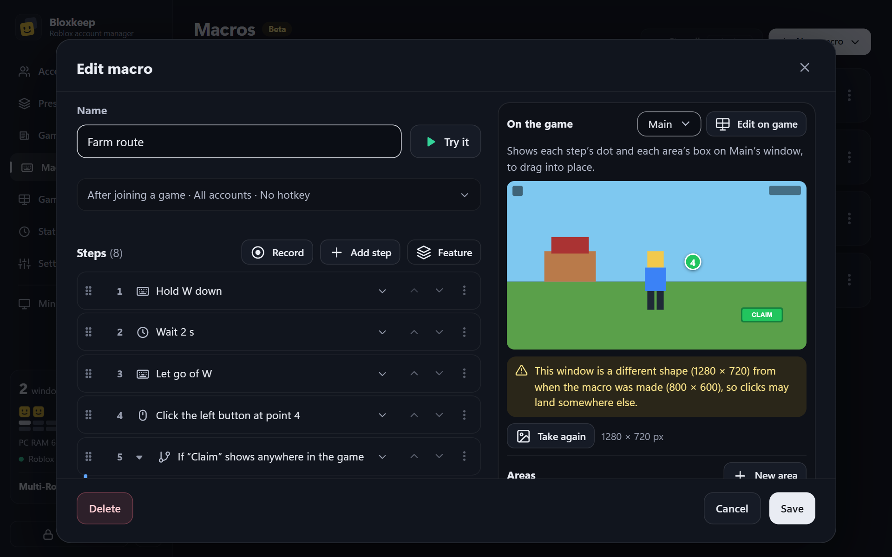</a><br><b>Macros (Beta)</b><br>Steps written as plain sentences: press keys, click, wait for a picture, a colour or text, repeat, If. Record one or start from a template, try it, then move its points and areas right on the game. Each macro gets a small panel beside the game with tabs, switches, lists to tick and points the player sets. Stuck? It runs your recovery steps. <a href="docs/guide/macros.md">Macros</a></td>
<td width="50%" valign="top"><a href="docs/guide/windows-and-stats.md">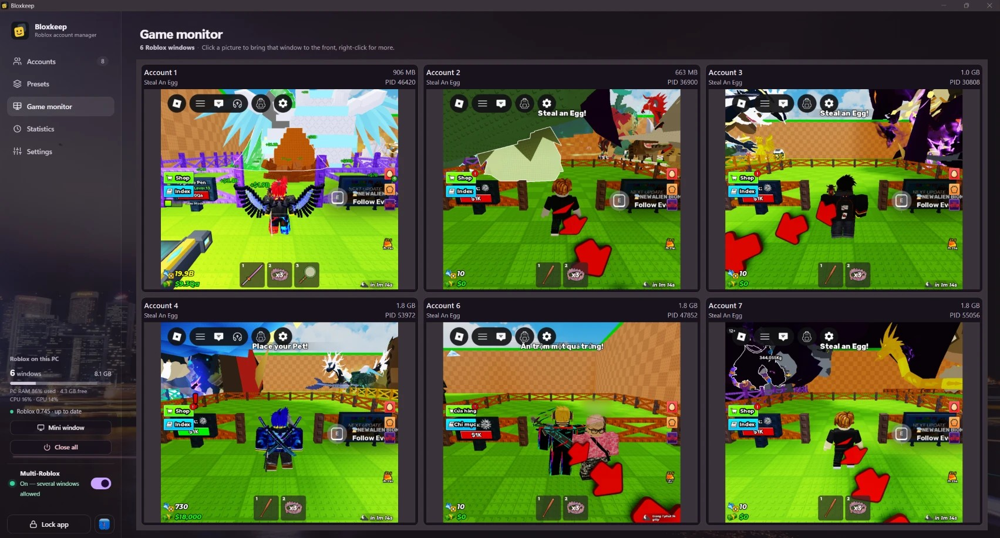</a><br><b>Windows</b><br>Arrange layouts picked from pictures (as Windows' snap layouts) or a size of your own, the Game monitor with a minimise button on each window, a mini window, RAM warnings. <a href="docs/guide/windows-and-stats.md">Windows and stats</a></td>
</tr>
<tr>
<td width="50%" valign="top"><a href="docs/guide/settings.md">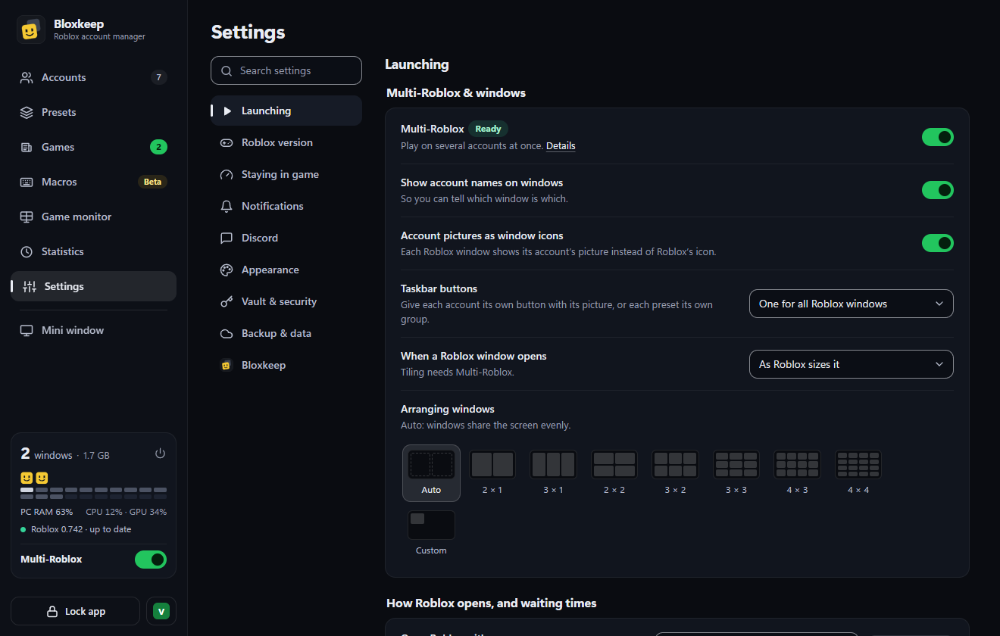</a><br><b>Roblox your way</b><br>Graphics, FPS and volume per account; open with Roblox, Bloxstrap, Fishstrap, Voidstrap or your own launcher. <a href="docs/guide/settings.md">Settings</a></td>
<td width="50%" valign="top"><a href="docs/guide/discord.md">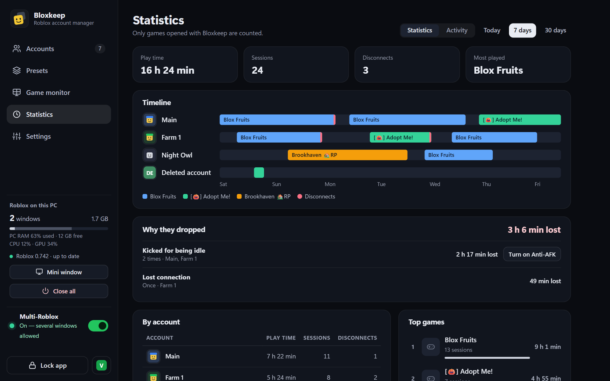</a><br><b>Stats and alerts</b><br>Play time compared with the days before, a timeline of each account, why accounts dropped and the time it cost; alerts and a live status in your Discord channel or on your phone (ntfy); <code>/pc</code> in Discord to check and control your PC from anywhere, and <code>/pc screenshot</code> to see a picture of your accounts' Roblox windows. <a href="docs/guide/discord.md">Discord</a></td>
</tr>
<tr>
<td width="50%" valign="top"><a href="docs/guide/playing.md#the-games-tab">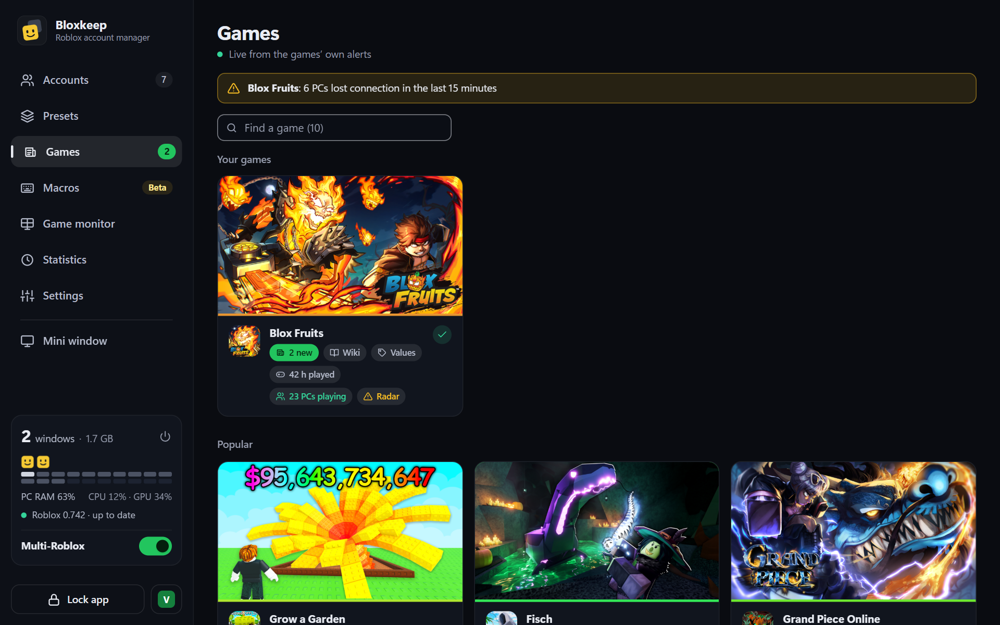</a><br><b>Games</b><br>Popular games with their wiki inside Bloxkeep: search, item tables, recent buffs and nerfs, live stock and spawns, Blox Fruits prices. <a href="docs/guide/playing.md#the-games-tab">The Games tab</a></td>
<td width="50%" valign="top"><a href="docs/guide/backup-and-security.md">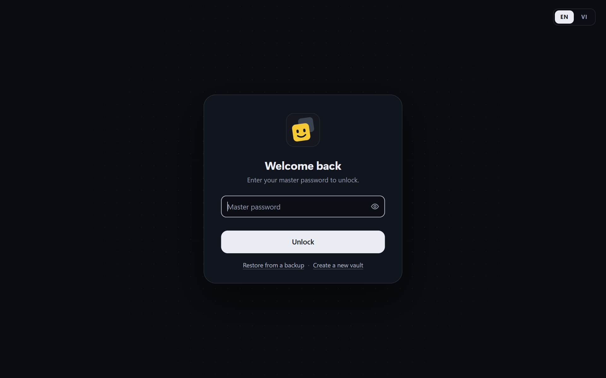</a><br><b>Safe by default</b><br>Encrypted vault, lock, backups to a OneDrive or Google Drive folder, hide names for streams. <a href="docs/guide/backup-and-security.md">Backup and security</a></td>
</tr>
<tr>
<td width="50%" valign="top">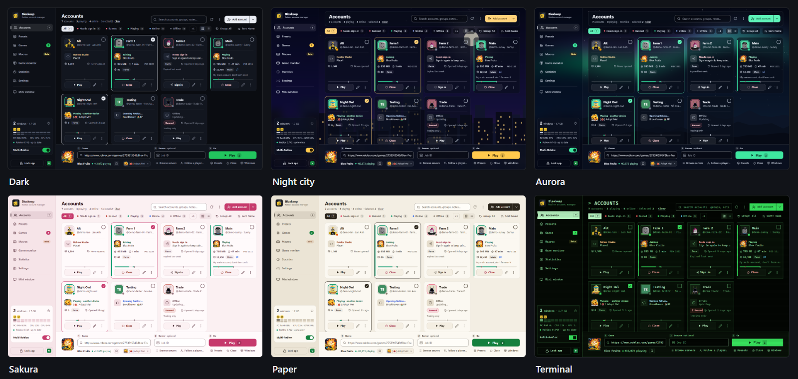<br><b>Yours</b><br>98 themes, English and Vietnamese, quick search with <code>Ctrl+K</code>.</td>
<td width="50%"></td>
</tr>
</table>

### Every feature

**Accounts**

- Add Roblox accounts with the Roblox phone app (code or QR), a username and password (2-step verification and captchas work), the roblox.com sign-in page, a .ROBLOSECURITY cookie or another Bloxkeep file
- See every account at a glance: online, in a game on this PC or another device, why it disconnected, RAM, play time, needs sign-in, banned
- Appeal a ban: a banned account opens Roblox's Violations & Appeals page, already signed in
- Search by name, username, nickname, group, note, game or user ID; filters, groups, sorting, cards or a list
- Save a password and an authenticator key per account: copy the password or the current 2FA code, and the code is filled in at sign-in
- A daily sign-in check finds accounts Roblox signed out before you press Play
- roblox.com signed in as each account, in tabs side by side, without touching your own browser
- Mark your main account, and make your accounts Roblox friends with each other in one click
- Roblox VNG accounts too (being tested)

**Play**

- Pick a game by name, link or Place ID, with each game's page, recent games and saved servers
- Server browser: most or fewest players, lowest ping, best FPS, or room for all your accounts
- Join your private servers, a friend's server, any player's server or a Job ID
- Join this server: bring your other accounts into one account's server
- Switch an account to another server, or leave crowded servers by itself
- Launch order and a wait between accounts; Stop while they open
- Solve Roblox's bot check in Bloxkeep's own window when a join asks for one

**Multi-Roblox**

- Several Roblox windows at once, one per account, without injecting anything into Roblox
- Every new Roblox build is checked for changes that could stop it, even builds not out yet
- Open Roblox with Roblox, Bloxstrap, Fishstrap, Voidstrap, Roblox directly, the Microsoft Store Roblox (being tested) or your own launcher
- Roblox can always open windowed, so one fullscreen setting never mixes the windows up

**Presets and schedules**

- Save accounts, a game and a server, and start them in one click
- Server for a preset: any, most or fewest players, lowest ping, random, a fixed Job ID or a player's server
- Schedules on chosen weekdays or a date, stopping after some hours or at a time; missed runs are handled
- Per preset: anti-AFK, auto-rejoin, rejoin with another account, Light AFK, restart Roblox every few hours, arrange windows and its own Discord channel

**AFK farming and staying in game**

- Anti-AFK against idle kicks, also while you use another window
- Auto-rejoin after a disconnect, waiting a little longer each try
- Modes: AFK farming, Play and farm, or your own graphics, FPS limit and volume for chosen accounts; an FPS cap per account
- Light AFK and Fast Flags for lower graphics and less RAM
- RAM tools: low RAM warning, lower memory priority and a RAM limit for background or minimized windows, restart a window that grows too heavy
- Background Roblox windows run in Windows' efficiency mode, so the one you play stays smooth
- Roblox updates: close, update and reopen in one click, or update by itself while no window is open

**Roblox windows**

- Arrange windows in a grid picked from pictures, or a size of your own; Ctrl+Alt+A from any app
- Game monitor: live pictures of every window, with minimize all, open all and close all
- A mini window that stays on top
- Hide Roblox windows while their games keep running; hotkeys to hide, minimize, switch and open Bloxkeep
- The account name and process ID in each window title, the account's picture as the window icon, and a taskbar button per account or per preset

**Macros (Beta)**

- Steps written as plain sentences: press keys, click, wait for a picture, a colour or text, repeat, If
- Record a macro or start from a template, then move its points and areas right on the game
- Read numbers and text from the game, a file or a web page; counters on a small panel beside the game
- Recovery steps when a macro gets stuck; Ctrl+Alt+1 to 9 runs a macro, Ctrl+Alt+0 stops them all

**Stats, alerts and Discord**

- Statistics: today on a 24-hour clock, play time by day and hour, why accounts dropped and the time it cost, top games, each account and preset
- An activity log you can filter and export as CSV
- Discord alerts, a live status message and play-time summaries in your own channel, with pings and quiet hours
- /pc in Discord: see your accounts, take a screenshot of their Roblox windows, run a preset, close windows or switch server, from your phone
- "Playing Bloxkeep" on your Discord profile, without account names
- Windows notifications, and alerts on your phone through ntfy

**Games**

- A Games tab with popular games' wikis inside Bloxkeep: search, item tables, compare, recent buffs and nerfs
- Live news from the games' own alerts, such as stock and spawns, with notifications for the words you pick
- Blox Fruits values

**Safe and yours**

- Accounts encrypted with AES-256 and your master password, kept only on your PC; no server of its own
- Lock by hand or after a while away; several vaults with a picker at start
- Backups to a OneDrive or Google Drive folder, restore on a new PC, import from another Bloxkeep file
- Hide account names for screenshots and streams
- Nearly 100 themes, some moving, or your own colours, picture or video; themes shared as files
- English and Vietnamese, Ctrl+K quick search, a tray menu, start with Windows
- Free and open source (MIT), updates itself; installer, offline installer or portable ZIP for Windows 10 and 11

## Download and install

Windows 10 or 11, 64-bit. Nothing else to install first.

| File | For |
|---|---|
| [`Bloxkeep-Setup.exe`](https://github.com/Bloxkeep/roblox-account-manager/releases/latest/download/Bloxkeep-Setup.exe) | A normal install: small, downloads the newest version, any folder, no admin rights. |
| `Bloxkeep-Setup-Offline.exe` | The same with everything inside, for a PC without internet. |
| `Bloxkeep-Portable.zip` | No install: unzip and run `Bloxkeep.exe`. |

All three are on [Releases](https://github.com/Bloxkeep/roblox-account-manager/releases/latest).

> [!CAUTION]
> Only download Bloxkeep from this repository's Releases. A copy from anywhere else may steal your accounts.

The files aren't code-signed yet, so SmartScreen warns the first time: **More info › Run anyway**. Check a file against `SHA256SUMS.txt` in the release if you like. Details: [Install](docs/guide/getting-started.md#install).

### Updates

Bloxkeep updates itself in the background and installs when you aren't using it, coming back unlocked where you left it. **Restart to update** does it now. **Settings › Bloxkeep** turns it off or adds beta versions. [Updates](docs/guide/getting-started.md#updates)

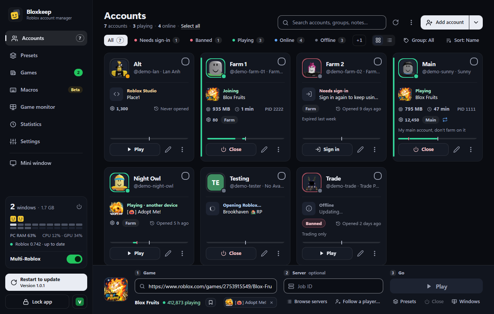

### Uninstall

Windows **Settings › Apps › Installed apps › Bloxkeep › Uninstall**. Tick **Also delete my accounts and settings** to remove your data too; otherwise it's kept for a reinstall. [Uninstall](docs/guide/getting-started.md#uninstall)

## Getting started

1. **Set a master password.** It unlocks Bloxkeep and **can't be recovered**. New PC? Choose **Restore from a backup**.
2. **Add accounts.** **Add account**, then **Sign in with your phone** (recommended), username and password, or a browser window.
3. **Play.** Type a game in the bar at the bottom, click accounts to choose them, press **Play**.

<table>
<tr>
<td width="33%" valign="top"><br><b>1.</b> Master password</td>
<td width="33%" valign="top"><br><b>2.</b> Add accounts</td>
<td width="33%" valign="top">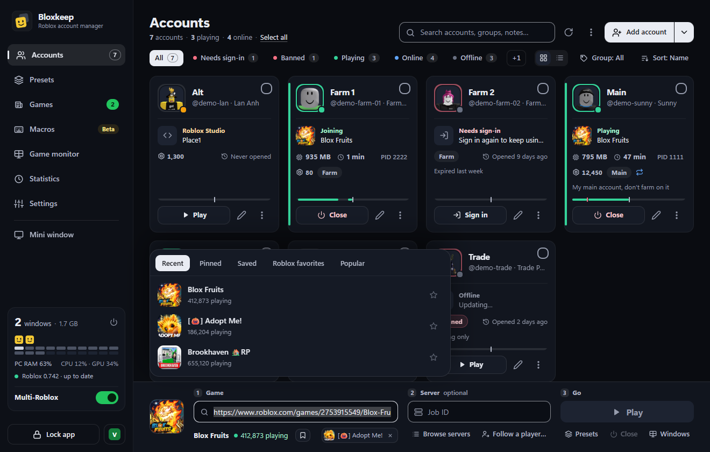<br><b>3.</b> Pick a game, press Play</td>
</tr>
</table>

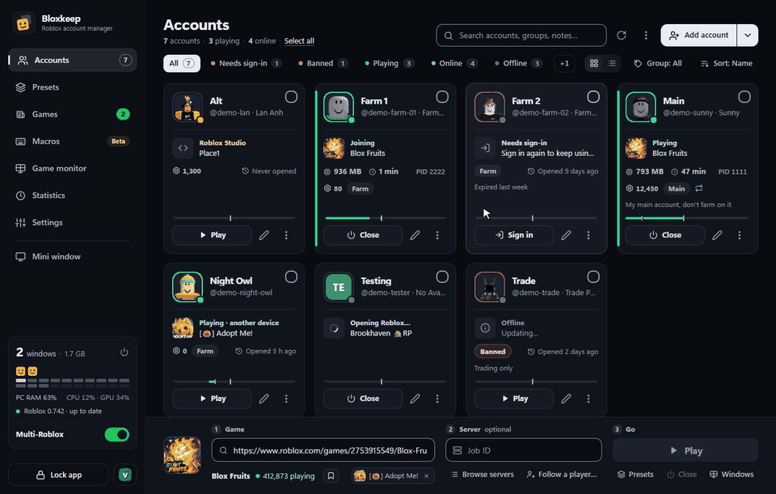

Step by step, with pictures: [Getting started](docs/guide/getting-started.md).

## Community

<a href="https://bloxkeep-bot.bloxkeep-app.workers.dev/discord"></a>

Ask for help, share an idea, and hear about Roblox updates and new Bloxkeep versions as they happen. A quick check when you join keeps scam bots out.

| Channel | For |
|---|---|
| `#announcements` | New Bloxkeep versions and news |
| `#roblox-updates` | Roblox builds coming and live, and outages |
| `#help` | One question per post: what you did, what happened, your version |
| `#bug-reports` | Something broke? The steps and what happened |
| `#ideas` | One idea per post. React to the ones you want |
| `#general-vn` | Trò chuyện bằng tiếng Việt |

Type `/multi` to the bot to see whether Multi-Roblox works on the current Roblox and the one coming next. Nobody from Bloxkeep will ever ask for your cookie, password or 2-step codes.

## Keyboard shortcuts

`Ctrl+K` quick search · `Ctrl+F` search · `Ctrl+L` game box · `Ctrl+A` select all · `Enter` play · `F2` edit · `Delete` delete · `Esc` clear the selection · `Ctrl+Alt+1`–`9` run a macro, `Ctrl+Alt+0` stop them all. Right-click an account for its menu. All of them: [Keyboard shortcuts](docs/guide/troubleshooting.md#keyboard-shortcuts).

## Data and security

- **On your PC only**, in `%LOCALAPPDATA%\Bloxkeep` (the portable copy: a `data` folder beside it).
- **Encrypted** with AES-256-GCM, the key made from your master password (PBKDF2-HMAC-SHA256, 600,000 rounds). The master password is never stored.
- **Your password and cookies only go to Roblox.** Bloxkeep has no analytics. Besides Roblox it talks to GitHub (updates), Roblox's captcha providers (only in a puzzle window), and its own bot for the online count, which you can turn off (a code made from this PC that can't be traced back, the version, the language, the games your accounts are in, how many run and why one dropped out; never an account); plus whatever you choose to send (feedback, your Discord webhook, your backup folder). Every host and what goes there: [privacy policy](PRIVACY.md).
- **Locking** drops every decrypted cookie and password from memory. Copied secrets are wiped from the clipboard after 30 seconds.

> [!WARNING]
> Forget the master password and your saved accounts are gone. A backup only opens with the password it was saved with.

Never send anyone a cookie, `vault.rmv` or a backup: each is a full sign-in to your accounts. More: [Backup and security](docs/guide/backup-and-security.md).

## Backup and restore

Turn on **Settings › Backup & data › Back up to a folder** and pick a OneDrive or Google Drive folder: the encrypted vault is copied there after each change. On a new PC: install, **Restore from a backup**, enter the password it was saved with. [Backups](docs/guide/backup-and-security.md#automatic-backups)

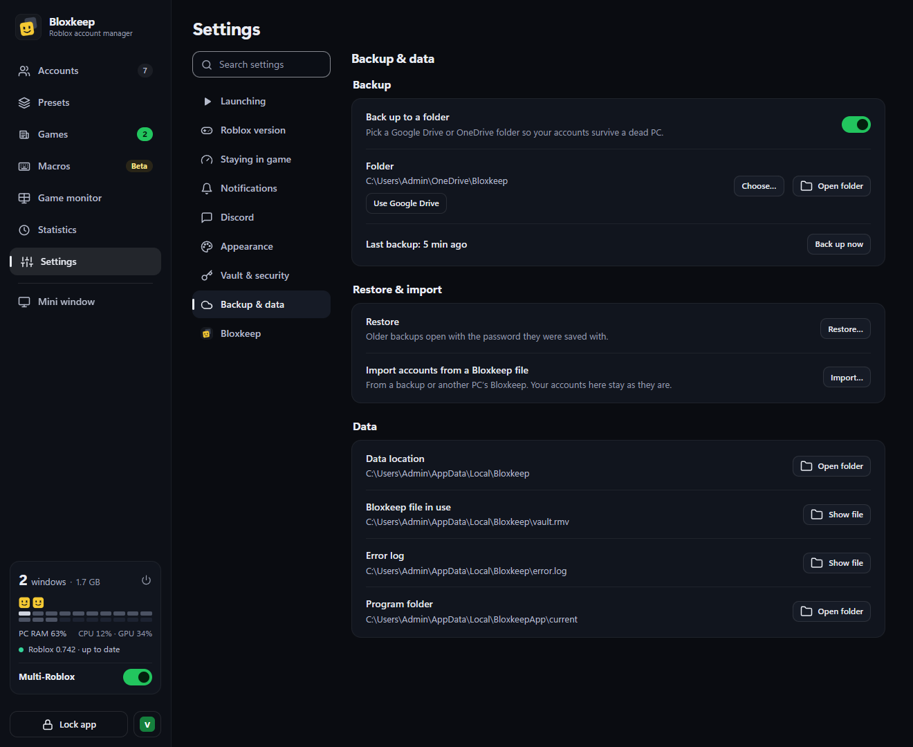

## FAQ

**Is this a virus?** No. New unsigned files get warnings. Compare the SHA-256 with `SHA256SUMS.txt`, read the source or [build it yourself](#build-from-source). If your antivirus removed it, report it as a false positive.

**Does Multi-Roblox really work?** Yes, the picture at the top is real. Roblox can change how it blocks extra windows in any update, so Bloxkeep checks every new build. [Multi-Roblox](docs/guide/multi-roblox.md)

**Will my account get banned?** No one can promise that. Roblox doesn't officially support several clients, and some games forbid alt accounts. Bloxkeep signs in and opens games the way roblox.com does and never touches the game's memory.

**Are macros cheating?** A macro only presses keys and clicks in the Roblox window and looks at its picture, like a person would. It never reads or changes the game's memory. Some games still forbid macros: check the game's rules.

**Can I use it in Vietnam without roblox.com?** Partly: phone and password sign-in go through Roblox's API, not www.roblox.com; the browser sign-in needs www.roblox.com. Bloxkeep has no VPN. Roblox VNG accounts can be added and opened too (still being tried out).

**I forgot my master password.** It can't be recovered. Restore a backup whose password you remember, or start over.

**Mac or Linux?** No, Windows 10 and 11 only.

**Found a bug or want a feature?** **Settings › Bloxkeep › Send feedback** (it shows exactly what it sends), post in `#bug-reports` or `#ideas` on [Discord](#community), or [open an issue](https://github.com/Bloxkeep/roblox-account-manager/issues).

More answers: [Troubleshooting](docs/guide/troubleshooting.md).

## Not tried with real accounts yet

Macros in real games over many hours · auto-rejoin and **Restart Roblox** over many hours · scheduled presets · Discord · **Light AFK** · very small windows · filling in 2FA codes · a really banned account · **Join a player…** · the last step of phone sign-in · Windows 10. If something breaks, please send feedback from the app.

## Build from source

Needs Windows and the .NET 10 SDK. A C# core (.NET 10, WinForms) with an HTML/React interface in WebView2.

```bat
scripts\build.bat 1.0.1
```

It runs the checks in `Tests\Bloxkeep.Tests` first, then puts the installers, the portable zip, the update packages and `SHA256SUMS.txt` in `dist\releases\`. Each version needs its notes, in English and Vietnamese, in `RobloxManager\whatsnew.json`. To try the interface without building, serve the repository root (`python -m http.server 5178`) and open `/ui/dev/preview.html`.

| Folder | What's in it |
|---|---|
| `RobloxManager/` | The app: C# core, `wwwroot/` interface, `whatsnew.json` |
| `ui/` | The React parts of the interface |
| `Tests/` | The app's checks and the interface checks |
| `services/` | The Discord bot, the feedback service, the Roblox and domain watches |
| `site/`, `docs/` | The website and the user guide |

## Code signing policy

Releases are built from this repository by the [Release workflow](.github/workflows/release.yml) on GitHub's Windows machines. They aren't code-signed yet: see the [code signing policy](docs/CODE_SIGNING_POLICY.md).

## License

[MIT](LICENSE) © 2026 minhhoang0122

Made your own version with other features? Please give it its own name and logo, so people can tell it from Bloxkeep. See [TRADEMARKS.md](TRADEMARKS.md).
