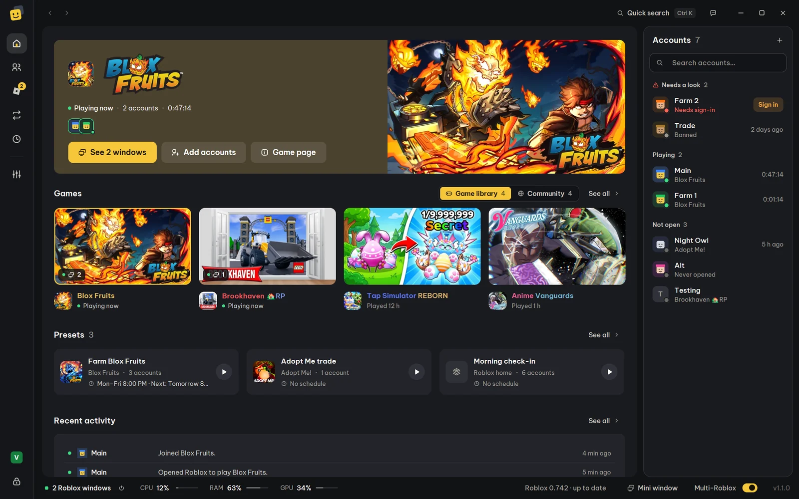
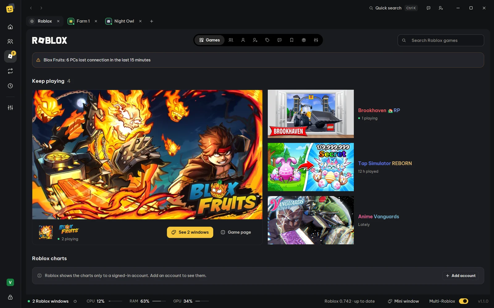
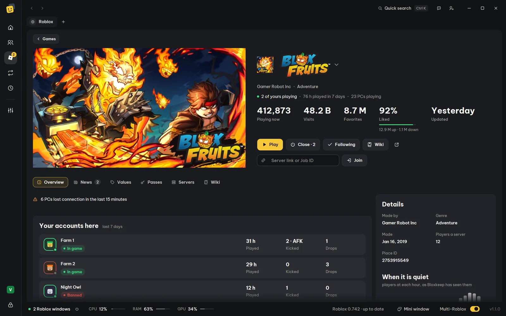
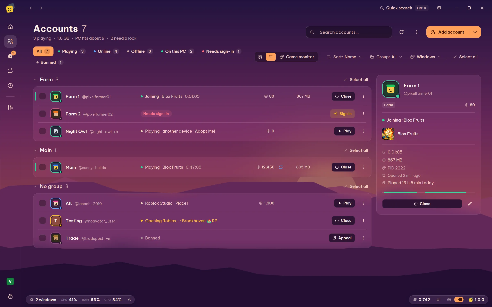
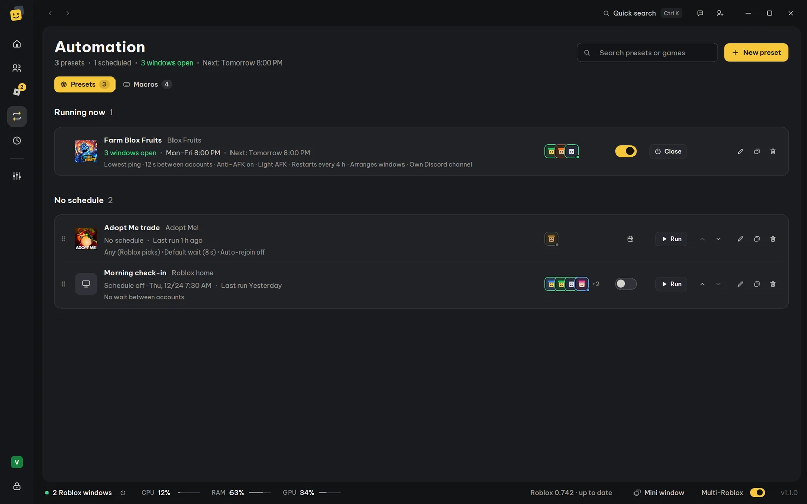
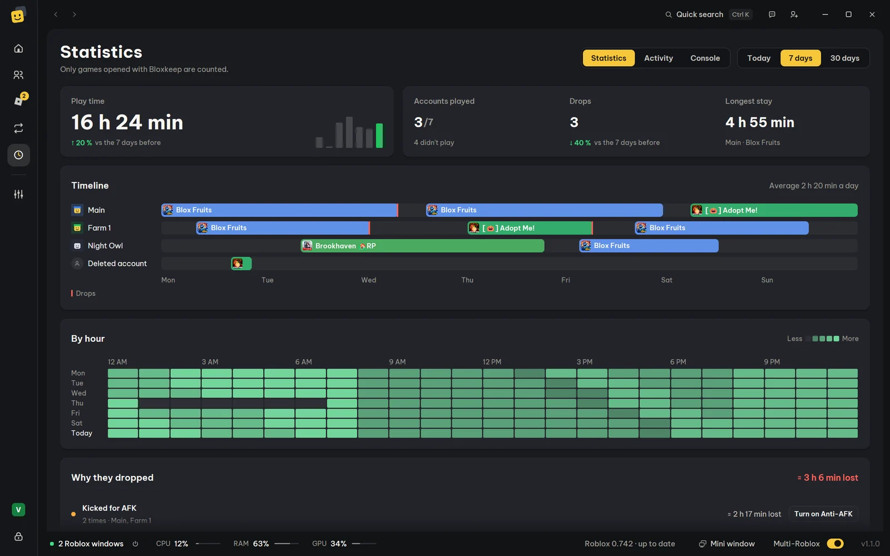
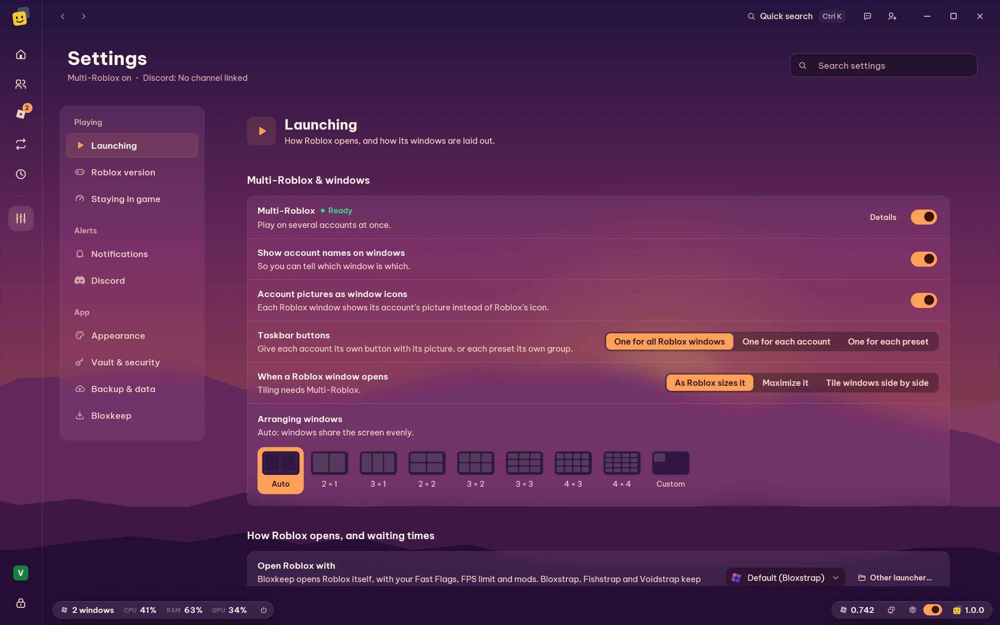

<p align="center">
  
</p>
<h1 align="center">Bloxkeep</h1>
<p align="center">Manage and launch several Roblox accounts on Windows. Accounts are encrypted and stay on your PC.</p>
<p align="center">English | <a href="README.vi.md">Tiếng Việt</a></p>
<p align="center">
  <a href="https://github.com/Bloxkeep/roblox-account-manager/releases/latest"></a>
  <a href="https://github.com/Bloxkeep/roblox-account-manager/releases"></a>
  
  
  <a href="LICENSE"></a>
  <a href="https://bloxkeep-bot.bloxkeep-app.workers.dev/discord"></a>
</p>
<p align="center"><a href="https://github.com/Bloxkeep/roblox-account-manager/releases/latest/download/Bloxkeep-Setup.exe"></a> <a href="https://bloxkeep-bot.bloxkeep-app.workers.dev/discord"></a></p>
<p align="center"><a href="#download-and-install">Download</a> · <a href="#getting-started">Getting started</a> · <a href="https://bloxkeep.github.io/roblox-account-manager/guide/">User guide</a> · <a href="https://bloxkeep.github.io/roblox-account-manager/">Website</a> · <a href="https://bloxkeep.github.io/roblox-account-manager/whats-new/">What's new</a> · <a href="#community">Community</a> · <a href="#data-and-security">Security</a> · <a href="#faq">FAQ</a> · <a href="PRIVACY.md">Privacy</a></p>

<p align="center"></p>

Keep your Roblox accounts in one place, pick a game, pick accounts, press **Play**. Everything stays on your PC, encrypted with your master password. Bloxkeep has no server of its own.

**New in 1.1:** Bloxkeep is redrawn from scratch, and Roblox itself is inside it: games, friends, avatar, profile, shop and inbox for each account, every account in a tab of its own. [What's new](https://bloxkeep.github.io/roblox-account-manager/whats-new/)

This repository holds Bloxkeep's source code, its releases and the issue tracker. The user guide lives on the [website](https://bloxkeep.github.io/roblox-account-manager/).

*Bloxkeep is an independent project, not affiliated with or endorsed by Roblox Corporation. Roblox is a trademark of Roblox Corporation.*

## Features

<table>
<tr>
<td width="50%" valign="top"><br><b>Roblox inside Bloxkeep</b><br>Games, friends, avatar (in 3D), profile, shop and inbox for each account, every account in a tab of its own. Search Roblox's games as you type, even by initials (gpo, ps99) or with a typo.</td>
<td width="50%" valign="top"><br><b>A page for every game</b><br>Roblox's figures, events, news, item values, passes, servers and the game's wiki, with how each of your accounts did there this week. <a href="https://bloxkeep.github.io/roblox-account-manager/guide/playing/">Playing</a></td>
</tr>
<tr>
<td width="50%" valign="top"><br><b>Every account at a glance</b><br>Add accounts with your phone, username and password (2-step and captchas work), a browser window, a cookie or another Bloxkeep file. See who is playing, where, why one dropped, who needs to sign in again or is banned. <a href="https://bloxkeep.github.io/roblox-account-manager/guide/accounts/">Accounts</a></td>
<td width="50%" valign="top"><br><b>Presets and macros</b><br>Accounts, game and server saved for one click, on a schedule if you like. Macros (Beta) written as plain sentences, with a small panel beside the game. <a href="https://bloxkeep.github.io/roblox-account-manager/guide/presets/">Presets</a> · <a href="https://bloxkeep.github.io/roblox-account-manager/guide/macros/">Macros</a></td>
</tr>
<tr>
<td width="50%" valign="top"><br><b>Stats and alerts</b><br>Play time against the days before, each account's timeline, why accounts dropped and the time it cost. Alerts in your Discord channel or on your phone, and <code>/pc</code> in Discord to check and control your PC from anywhere. <a href="https://bloxkeep.github.io/roblox-account-manager/guide/discord/">Discord</a></td>
<td width="50%" valign="top"><br><b>Roblox your way</b><br>Multi-Roblox, window layouts, graphics, FPS and volume per account; open with Roblox, Bloxstrap, Fishstrap, Voidstrap or your own launcher. <a href="https://bloxkeep.github.io/roblox-account-manager/guide/settings/">Settings</a></td>
</tr>
</table>

Also: anti-AFK and auto-rejoin to stay in game, the Game monitor and a mini window, an encrypted vault with backups to a OneDrive or Google Drive folder, names hidden for streams, 99 themes, English and Vietnamese.

Every feature in one list, the illustrated guide and a version to try in your browser: [Bloxkeep's website](https://bloxkeep.github.io/roblox-account-manager/#all).

## Download and install

Windows 10 or 11, 64-bit. Nothing else to install first.

| File | For |
|---|---|
| [`Bloxkeep-Setup.exe`](https://github.com/Bloxkeep/roblox-account-manager/releases/latest/download/Bloxkeep-Setup.exe) | A normal install: small, downloads the newest version, any folder, no admin rights. |
| `Bloxkeep-Setup-Offline.exe` | The same with everything inside, for a PC without internet. |
| `Bloxkeep-Portable.zip` | No install: unzip and run `Bloxkeep.exe`. |

All three are on [Releases](https://github.com/Bloxkeep/roblox-account-manager/releases/latest).

> [!CAUTION]
> Only download Bloxkeep from this repository's Releases. A copy from anywhere else may steal your accounts.

The files aren't code-signed yet, so SmartScreen warns the first time: **More info › Run anyway**. Check a file against `SHA256SUMS.txt` in the release if you like. Details: [Install](https://bloxkeep.github.io/roblox-account-manager/guide/getting-started/#install).

### Updates

Bloxkeep updates itself in the background and installs when you aren't using it, coming back unlocked where you left it. **Restart to update** in the bar at the bottom does it now. **Settings › Bloxkeep** turns it off or adds beta versions. [Updates](https://bloxkeep.github.io/roblox-account-manager/guide/getting-started/#updates)

### Uninstall

Windows **Settings › Apps › Installed apps › Bloxkeep › Uninstall**. Tick **Also delete my accounts and settings** to remove your data too; otherwise it's kept for a reinstall. [Uninstall](https://bloxkeep.github.io/roblox-account-manager/guide/getting-started/#uninstall)

## Getting started

1. **Set a master password.** It unlocks Bloxkeep and **can't be recovered**. New PC? Choose **Restore from a backup**.
2. **Add accounts.** **Add account**, then **Sign in with your phone** (recommended), username and password, or a browser window.
3. **Play.** Open a game from Home or the Roblox tab, choose the accounts, press **Play**.

Step by step, with pictures: [Getting started](https://bloxkeep.github.io/roblox-account-manager/guide/getting-started/).

## Community

<a href="https://bloxkeep-bot.bloxkeep-app.workers.dev/discord"></a>

Ask for help, share an idea, and hear about Roblox updates and new Bloxkeep versions as they happen. A quick check when you join keeps scam bots out.

| Channel | For |
|---|---|
| `#announcements` | New Bloxkeep versions and news |
| `#roblox-updates` | Roblox builds coming and live, and outages |
| `#help` | One question per post: what you did, what happened, your version |
| `#bug-reports` | Something broke? The steps and what happened |
| `#ideas` | One idea per post. React to the ones you want |
| `#general-vn` | Trò chuyện bằng tiếng Việt |

Type `/multi` to the bot to see whether Multi-Roblox works on the current Roblox and the one coming next. Nobody from Bloxkeep will ever ask for your cookie, password or 2-step codes.

## Keyboard shortcuts

`Ctrl+K` quick search · `Ctrl+F` search · `Ctrl+L` game box · `Ctrl+A` select all · `Enter` play · `F2` edit · `Delete` delete · `Esc` clear the selection · `Ctrl+Alt+1`–`9` run a macro, `Ctrl+Alt+0` stop them all. Right-click an account for its menu. All of them: [Keyboard shortcuts](https://bloxkeep.github.io/roblox-account-manager/guide/troubleshooting/#keyboard-shortcuts).

## Data and security

- **On your PC only**, in `%LOCALAPPDATA%\Bloxkeep` (the portable copy: a `data` folder beside it).
- **Encrypted** with AES-256-GCM, the key made from your master password (PBKDF2-HMAC-SHA256, 600,000 rounds). The master password is never stored.
- **Your password and cookies only go to Roblox.** Bloxkeep has no analytics. Besides Roblox it talks to GitHub (updates), Roblox's captcha providers (only in a puzzle window), and its own bot for the online count, which you can turn off (a code made from this PC that can't be traced back, the version, the language, the games your accounts are in, how many run and why one dropped out; never an account); plus whatever you choose to send (feedback, your Discord webhook, your backup folder). Every host and what goes there: [privacy policy](PRIVACY.md).
- **Locking** drops every decrypted cookie and password from memory. Copied secrets are wiped from the clipboard after 30 seconds.

> [!WARNING]
> Forget the master password and your saved accounts are gone. A backup only opens with the password it was saved with.

Never send anyone a cookie, `vault.rmv` or a backup: each is a full sign-in to your accounts. More: [Backup and security](https://bloxkeep.github.io/roblox-account-manager/guide/backup-and-security/).

## Backup and restore

Turn on **Settings › Backup & data › Back up to a folder** and pick a OneDrive or Google Drive folder: the encrypted vault is copied there after each change. On a new PC: install, **Restore from a backup**, enter the password it was saved with. [Backups](https://bloxkeep.github.io/roblox-account-manager/guide/backup-and-security/#automatic-backups)

## FAQ

**Is this a virus?** No. New unsigned files get warnings. Compare the SHA-256 with `SHA256SUMS.txt`, read the source or [build it yourself](#build-from-source). If your antivirus removed it, report it as a false positive.

**Found a bug or want a feature?** **Settings › Bloxkeep › Send feedback** (it shows exactly what it sends), post in `#bug-reports` or `#ideas` on [Discord](#community), or [open an issue](https://github.com/Bloxkeep/roblox-account-manager/issues).

More answers (bans, macros, Vietnam, a forgotten master password): [the website](https://bloxkeep.github.io/roblox-account-manager/#faq) and [Troubleshooting](https://bloxkeep.github.io/roblox-account-manager/guide/troubleshooting/).

## Not tried with real accounts yet

Macros in real games over many hours · auto-rejoin and **Restart Roblox** over many hours · scheduled presets · Discord · **Light AFK** · very small windows · filling in 2FA codes · a really banned account · **Join a player…** · the last step of phone sign-in · Windows 10. If something breaks, please send feedback from the app.

## Build from source

Since 1.1 the app is written in Rust: its window is drawn with [GPUI](https://www.gpui.rs/), and the sign-in, captcha and a few small windows use WebView2. Needs Windows, Rust, Node.js and the .NET 10 SDK (for the installer tool).

```bat
scripts\build.bat 1.1.0
```

It builds the app (`ui-gpui`), runs its checks (`Bloxkeep.exe --core-suites`), then puts the installers, the portable zip, the update packages and `SHA256SUMS.txt` in `dist\releases\`. Each version needs its notes, in English and Vietnamese, in `RobloxManager\whatsnew.json`.

| Folder | What's in it |
|---|---|
| `ui-gpui/` | The app: the window (`src/pages`), the core (`src/core`), its pictures and words (`assets`) |
| `RobloxManager/` | `whatsnew.json`, the icons and the small web pages (`wwwroot`) |
| `ui/` | The React parts of those small pages |
| `services/` | The Discord bot, the feedback service, the Roblox and domain watches |
| `site/`, `docs/` | The website and the user guide |

## Code signing policy

Releases are built from this repository by the [Release workflow](.github/workflows/release.yml) on GitHub's Windows machines. They aren't code-signed yet: see the [code signing policy](docs/CODE_SIGNING_POLICY.md).

## License

[MIT](LICENSE) © 2026 minhhoang0122

Made your own version with other features? Please give it its own name and logo, so people can tell it from Bloxkeep. See [TRADEMARKS.md](TRADEMARKS.md).
