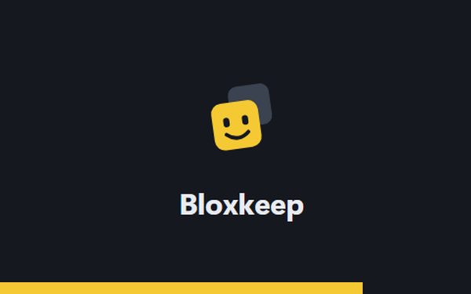
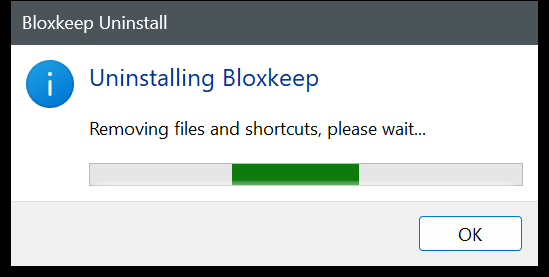
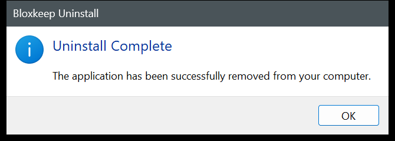

<p align="center">
  
</p>
<h1 align="center">Bloxkeep</h1>
<p align="center">Quản lý và mở nhiều acc Roblox trên Windows. Acc được mã hóa và chỉ lưu trên máy của bạn.</p>
<p align="center">Tiếng Việt | <a href="README.en.md">English</a></p>
<p align="center">  <a href="LICENSE"></a></p>
<p align="center"><a href="#tải-về-và-cài-đặt">Tải về</a> · <a href="#bắt-đầu">Bắt đầu</a> · <a href="#dữ-liệu-và-bảo-mật">Bảo mật</a> · <a href="#câu-hỏi-thường-gặp">Câu hỏi thường gặp</a></p>

<p align="center"></p>

Bloxkeep dành cho người chơi nhiều acc Roblox trên một máy Windows: giữ các acc ở một chỗ, chọn game, chọn acc rồi bấm **Vào game**. Dữ liệu chỉ nằm trên máy của bạn, được mã hóa bằng mật khẩu chủ; Bloxkeep không có máy chủ riêng.

*Bloxkeep là dự án độc lập, không liên kết, không được Roblox Corporation bảo trợ hay tài trợ. Roblox là thương hiệu của Roblox Corporation.*

## Tính năng

- Thêm acc bằng tên đăng nhập và mật khẩu (có xác minh 2 bước, captcha giải trong một cửa sổ nhỏ), bằng mã hoặc QR quét bằng app Roblox trên điện thoại, bằng trang roblox.com trong cửa sổ trình duyệt, bằng cookie, hoặc nhập từ Roblox Account Manager hay từ một file dữ liệu Bloxkeep khác.
- Xem trạng thái từng acc: online, đang chơi trên máy này hay thiết bị khác, bị văng vì lý do gì, RAM, thời gian đã chơi, PID, cần đăng nhập lại hay bị ban. Tìm, lọc theo trạng thái hoặc nhóm, sắp xếp, xem dạng thẻ hoặc dạng danh sách.
- Chọn game theo tên, link hoặc Place ID. Chọn server (đông nhất, vắng nhất, ping thấp nhất, đủ chỗ cho N acc, ngẫu nhiên), vào cùng bạn bè, hoặc vào đúng server của một người chơi theo tên đăng nhập.
- Chạy nhiều cửa sổ Roblox cùng lúc với Multi-Roblox, mở cửa sổ đồng loạt ở chế độ cửa sổ và tự xếp chúng thành lưới. Tính năng này tắt sẵn, bạn tự bật khi cần.
- Preset: lưu sẵn acc, game và cách chọn server để chạy bằng một lần bấm, có hẹn giờ chạy và dừng, và tùy chọn riêng (chống AFK, tự vào lại game, chế độ treo máy nhẹ, mở lại Roblox theo giờ).
- Tự vào lại game khi Roblox bị văng, bị kick hoặc mất kết nối, thử lại giãn dần chứ không bỏ cuộc.
- Màn hình theo dõi: xem hình trực tiếp của mọi cửa sổ Roblox trong một tab. Thống kê thời gian chơi theo acc và theo game, kèm nhật ký hoạt động.
- Mã 2FA ngay trong app, ẩn tên acc khi chụp màn hình hay livestream, kiểm tra đăng nhập mỗi ngày và phát hiện acc bị ban.
- Gửi tổng kết thời gian chơi, tin trạng thái và cảnh báo lên kênh Discord của bạn.
- Sao lưu vào thư mục OneDrive hoặc Google Drive. Ngoài ra còn có 32 chủ đề, tìm nhanh bằng `Ctrl+K`, giao diện tiếng Anh và tiếng Việt, chạy ngầm ở khay hệ thống và thông báo Windows.


## Tải về và cài đặt

Cần Windows 10 hoặc 11, bản 64-bit. Không cần cài .NET. Bộ cài tự cài Microsoft Edge WebView2 nếu máy chưa có.

Tải ở trang [Releases](../../releases/latest):

| File | Dùng khi |
|---|---|
| `Bloxkeep-Setup.exe` | Cài bình thường. Cài cho người dùng Windows hiện tại, không cần quyền admin, tạo shortcut ở Start Menu và Desktop. |
| `Bloxkeep-Portable.zip` | Không muốn cài. Giải nén rồi chạy `Bloxkeep.exe`; dữ liệu nằm trong thư mục `data` bên cạnh. Bản portable cũng tự cập nhật. |

> [!CAUTION]
> Chỉ tải Bloxkeep ở trang Releases của repo này. Bản tải ở nơi khác có thể đã bị sửa để lấy cắp acc.

File chưa có chữ ký số, nên lần đầu chạy Windows SmartScreen sẽ cảnh báo. Bấm **More info** rồi **Run anyway** (trên Windows tiếng Việt, hai nút này mang tên tiếng Việt tương ứng). Bạn có thể đối chiếu mã SHA-256 của file với `SHA256SUMS.txt` trong cùng bản phát hành.



### Cập nhật

Bloxkeep tự kiểm tra bản mới trên GitHub và tải về ở nền. Tải xong, thanh bên hiện nút **Khởi động lại để cập nhật**; Roblox vẫn chạy bình thường trong lúc đó. Nếu bạn không bấm, bản mới được cài khi tắt app. Sau khi cập nhật, app hiện bảng **Có gì mới trong Bloxkeep**.

Tự cập nhật chỉ hoạt động khi repo trên GitHub ở chế độ công khai.

Muốn tắt tự cập nhật: bỏ chọn **Cài đặt › Cập nhật Bloxkeep › Tự động cập nhật**. Nút **Kiểm tra ngay** vẫn dùng được.

Chạy `Bloxkeep-Setup.exe` bản mới hơn đè lên bản đã cài cũng được: bộ cài hỏi cập nhật (hoặc sửa lại nếu cùng phiên bản) và giữ nguyên dữ liệu.

### Gỡ cài đặt

Nếu Bloxkeep đang chạy, hãy thoát trước (chuột phải biểu tượng ở khay › **Thoát Bloxkeep**): trình gỡ sẽ tắt app ngay mà không hỏi, và biểu tượng của app vừa bị tắt có thể còn nằm ở khay cho đến khi bạn rê chuột qua. Sau đó vào **Settings › Apps › Installed apps** của Windows, tìm **Bloxkeep** (publisher `minhhoang0122`) và chọn **Uninstall**. Hộp thoại của bộ cài và trình gỡ chỉ có tiếng Anh.

| Bị xóa | Được giữ |
|---|---|
| Chương trình trong `%LOCALAPPDATA%\BloxkeepApp`, shortcut ở Start menu và Desktop (kể cả shortcut bạn đã ghim vào Start hay thanh tác vụ), bộ nhớ đệm của giao diện, và mục Bloxkeep trong Installed apps. Bloxkeep không thêm gì khác vào Windows: không có mục khởi động cùng Windows, không có service, không chiếm giao thức `roblox-player:`. | Acc và cài đặt trong `%LOCALAPPDATA%\Bloxkeep` (`vault.rmv`, `prefs.json`, `error.log`), nên cài lại là dùng tiếp; và các file sao lưu trong thư mục sao lưu. Muốn xóa cả những thứ này thì tự xóa thư mục đó và các file sao lưu. |

<details>
<summary>Ảnh: cập nhật và gỡ cài đặt</summary>

  
 
</details>

## Bắt đầu

1. **Đặt mật khẩu chủ** ở lần mở đầu tiên (ít nhất 6 ký tự). Mật khẩu này dùng để mở khóa Bloxkeep và **không khôi phục được** nếu quên, xem [Dữ liệu và bảo mật](#dữ-liệu-và-bảo-mật). Giao diện mặc định là tiếng Anh: bấm nút **VI** ở góc trên màn hình này để chuyển sang tiếng Việt. Nếu đang chuyển sang máy mới, bấm **Khôi phục từ bản sao lưu** thay vì tạo mới, xem [Sao lưu và khôi phục](#sao-lưu-và-khôi-phục).

   

2. **Thêm acc**: bấm **Thêm acc**. Hộp thoại **Đăng nhập Roblox** có các cách:
   - **Đăng nhập bằng điện thoại** (nên dùng): Bloxkeep hiện mã và QR. Trên điện thoại, mở **app Roblox**, vào **Cài đặt › Đăng nhập nhanh**, nhập mã hoặc quét QR rồi xác nhận. Không cần mật khẩu hay giải đố. Thêm xong một acc thì có mã mới cho acc tiếp theo.
   - **Tên đăng nhập** và **Mật khẩu**: mật khẩu chỉ gửi tới máy chủ đăng nhập của Roblox. Đăng nhập bằng mật khẩu không lưu mật khẩu đó. Có **Xác minh 2 bước** (**App xác thực** hoặc **Email**); nếu acc đã có khóa app xác thực trong Bloxkeep thì mã được điền sẵn, bạn chỉ cần bấm xác nhận. Nếu Roblox đòi captcha, bấm **Giải câu đố** và làm trong cửa sổ nhỏ hiện ra.
   - **Cách khác: Đăng nhập bằng trình duyệt**: trang đăng nhập roblox.com chính thức mở trong một cửa sổ tạm. Đăng nhập xong, Bloxkeep lấy phiên đăng nhập rồi xóa cửa sổ tạm đó. Bloxkeep không đọc mật khẩu bạn gõ ở đây.
   - **Cách khác: Nhập cookie**, hoặc **Nhập từ: Roblox Account Manager** / **File Bloxkeep**: xem [Chuyển acc từ nơi khác](#chuyển-acc-từ-nơi-khác).

   

3. **Chọn game, chọn acc, bấm Vào game.** Gõ tên game hoặc dán link / Place ID vào ô ở thanh dưới, bấm vào các thẻ acc để chọn (giữ `Shift` khi bấm để chọn liền một dãy), rồi bấm **Vào game**. Để trống ô game thì nút đổi thành **Mở Roblox**: mỗi acc đã chọn mở Roblox ở trang chủ.

   

4. Phím tắt: `Ctrl+K` tìm nhanh acc, preset, game và cài đặt; `Ctrl+F` tìm acc; `Ctrl+A` chọn tất cả; `Enter` vào game; `F2` sửa; `Delete` xóa; `Esc` bỏ chọn. Chuột phải vào một acc để xem thêm thao tác.

## Sử dụng

### Danh sách acc

- Lọc theo **Tất cả**, **Đang chơi**, **Online**, **Offline**, **Trên máy này**, **Cần đăng nhập lại**, **Bị ban**, và theo nhóm ở ô **Nhóm**; sắp xếp theo **Tên**, **Trạng thái**, **Chơi gần đây** hoặc **Thứ tự mở**; tìm theo tên, nhóm, ghi chú. Chuyển giữa **Dạng thẻ** và **Dạng danh sách**.
- Trạng thái tự làm mới mỗi 30 giây. Khi bị văng, thẻ ghi rõ lý do đọc từ log của Roblox: **Bị kick vì AFK**, **Bị game kick**, **Đăng nhập ở thiết bị khác**, **Rớt mạng**, **Không vào được server**.
- Acc hết phiên được đánh dấu **Cần đăng nhập lại**; bấm **Đăng nhập** để đăng nhập lại. **Kiểm tra đăng nhập** có trong menu ⋯ của từng acc, và **Kiểm tra đăng nhập của tất cả acc** ở menu ⋯ phía trên danh sách. **Kiểm tra đăng nhập mỗi ngày** (bật sẵn, trong **Cài đặt › Hiệu năng**) tự làm việc này một lần mỗi ngày, để bạn biết trước khi bấm **Vào game**.
- Lúc kiểm tra, Bloxkeep cũng xem acc có **Bị ban** không (thông tin công khai của Roblox). Acc bị ban có nhãn đỏ, và **Vào game** cũng như preset sẽ bỏ qua acc đó.
- **Sửa…** (`F2`) để đặt **Tên gợi nhớ**, **Nhóm**, **Ghi chú**. Tại đây bạn có thể tự lưu **Mật khẩu Roblox** nếu muốn (không bắt buộc); mật khẩu nằm trong kho đã mã hóa.
- **Khóa app xác thực** (trong **Sửa…**): dán khóa 2FA hoặc link `otpauth://` của acc, Bloxkeep hiện mã 6 số đang chạy. **Sao chép mã 2FA** có trong menu ⋯. Ai biết mật khẩu chủ của bạn cũng tạo được mã, nên chỉ lưu khóa khi bạn chấp nhận điều đó.
- **Sao chép mật khẩu**, **Sao chép cookie** và **Sao chép mã 2FA** không vào lịch sử clipboard của Windows và tự xóa sau 30 giây.
- **Ẩn tên acc** (trong **Cài đặt › Giao diện**): mọi chỗ hiện **Acc 1**, **Acc 2**… thay cho tên, kể cả tiêu đề cửa sổ Roblox, tiện khi chụp màn hình hay livestream.


### Chọn game và server

- Ô game nhận tên game, Place ID, link `roblox.com/games/…` (kể cả link server riêng), link chia sẻ server và link `roblox://`. Gõ tên thì chọn game trong danh sách hiện ra.
- Bảng chọn game có các tab **Gần đây**, **Đã ghim**, **Yêu thích trên Roblox**, **Phổ biến**. Bấm ☆ để ghim game.
- **Job ID (tùy chọn)**: vào đúng một server, để nhiều acc vào chung.
- Nút **Server** liệt kê server công khai còn chỗ: sắp theo **Đông nhất**, **Vắng nhất**, **Ping thấp nhất**, **FPS cao nhất**; lọc **Đủ chỗ cho N acc**; hoặc bấm **Server ngẫu nhiên**. Mục **Bạn bè trong game này** cho bạn vào cùng bạn bè của các acc (nếu cài đặt riêng tư của họ cho phép). Ping hiển thị là ping trung bình của người chơi trong server, không phải ping từ máy bạn.
- **Vào cùng người chơi…** (nút cạnh ô Job ID): gõ tên đăng nhập hoặc ID của một người chơi, các acc đang chọn vào đúng server người đó đang ở. Bloxkeep hỏi trạng thái người đó bằng chính các acc bạn chọn; nếu cài đặt riêng tư của họ không cho xem thì app nói rõ, chứ không kết bạn hay theo dõi ai để lách.
- Trên một acc đang chơi, chọn **Vào cùng server** để các acc khác vào đúng server đó.


### Preset

Một preset lưu tên, danh sách acc (theo thứ tự), game, cách chọn server và thời gian chờ giữa các acc. Ô **Game** chọn như ở thanh dưới. Để trống thì chỉ mở **Màn hình chính Roblox**. Server có thể là **Bất kỳ (Roblox tự chọn)**, **Đông nhất**, **Vắng nhất**, **Ping thấp nhất**, **Ngẫu nhiên** hoặc **Server cố định (Job ID)**.

Quản lý preset ở tab **Preset**: **Thêm preset**, sửa, nhân bản, đổi thứ tự, **Chạy**. Nút preset ở thanh dưới có **Lưu thành preset…** và chạy nhanh. Lưu được tối đa 50 preset.

Phần **Cho cửa sổ Roblox** của mỗi preset áp dụng cho các cửa sổ mà preset đó mở (kể cả khi chúng tự vào lại game). Bấm **Vào game** bình thường cho cùng acc thì vẫn theo cài đặt chung.

- **Chống AFK**: **Theo Cài đặt**, **Bật** hoặc **Tắt**.
- **Tự vào lại game**: **Theo từng acc**, **Bật** hoặc **Tắt**.
- **Hiệu năng**: **Treo máy nhẹ** chọn đồ họa thấp nhất, 30 FPS, tắt tiếng, và thu nhỏ cửa sổ khi đã vào game. Cửa sổ mở không có tùy chọn này vẫn giữ cài đặt Roblox của bạn.
- **Mở lại Roblox**: mỗi 2, 4, 6 hoặc 12 giờ, từng cửa sổ được đóng rồi mở lại vào đúng game, lần lượt từng cái. Cửa sổ bạn đang dùng sẽ được để sau.

**Hẹn giờ**: preset tự chạy vào **Giờ bắt đầu**, một lần hoặc lặp lại theo các ngày trong tuần, và có thể **Dừng** sau vài giờ hoặc lúc một giờ nhất định (chỉ đóng các cửa sổ mà lần chạy đó mở). Bloxkeep phải đang chạy và đã mở khóa vào lúc đó.


### Multi-Roblox

Multi-Roblox **tắt sẵn**. Roblox không chính thức hỗ trợ chạy nhiều client cùng lúc; bạn tự chịu rủi ro khi bật. Bật bằng công tắc Multi-Roblox ở thanh bên hoặc trong **Cài đặt › Khởi chạy**.

- Bloxkeep phải mở **trước** Roblox và để mở trong lúc chơi.
- Đèn trạng thái: **Đang tắt**, **Đang bật — mở được nhiều cửa sổ**, hoặc **Chưa hoạt động — bấm để xem cách sửa** (đèn vàng). Cách sửa: đóng hết Roblox, kể cả Roblox ở khay hệ thống; nếu Roblox tự chạy cùng Windows, bấm **Tắt tự khởi động** (giống tắt trong Task Manager › Startup apps, bật lại được ở đó). Sau đó đèn chuyển xanh.
- Bấm **Chi tiết** cạnh Multi-Roblox để chỉnh thêm:
  - **Luôn mở Roblox ở chế độ cửa sổ** (bật sẵn): các cửa sổ Roblox dùng chung một cài đặt toàn màn hình nên dễ lệch nhau, cái toàn màn hình cái không. Bloxkeep mở mọi cửa sổ ở chế độ cửa sổ, rồi trả lại cài đặt của bạn.
  - **Xếp các cửa sổ cạnh nhau sau khi mở** (tắt sẵn): mở xong các acc thì các cửa sổ Roblox được xếp thành lưới trên màn hình chính.
- Mỗi acc một trang chủ riêng: chọn các acc, để trống ô game, bấm **Mở Roblox**.

Cách hoạt động: Roblox dùng một đối tượng tên `ROBLOX_singletonEvent` để chỉ cho chạy một cửa sổ; từ bản tháng 10/2026, cửa sổ mới dùng nó để đóng các cửa sổ cũ. Bloxkeep giữ trước cái tên đó khi chưa có Roblox nào chạy, nên Roblox không lập được cơ chế này và các cửa sổ không đóng nhau. Bloxkeep không chèn gì vào Roblox và không đọc gì từ tiến trình Roblox.

Nếu một bản Roblox mới lại đóng cửa sổ khi cửa sổ khác mở, **Cài đặt › Phiên bản & đồ họa** hiện cảnh báo vàng. Cảnh báo tự mất khi từ 2 acc trở lên cùng ở trong game, khi Roblox cập nhật bản mới, hoặc khi bạn bấm **Ẩn**.

### Tự vào lại game

Bật cho từng acc trong menu ⋯ › **Tự vào lại game** (preset có thể ghi đè, xem [Preset](#preset)). Khi Roblox của acc đó bị văng, bị kick hoặc mất kết nối, Bloxkeep vào lại cùng game (hoặc cùng server riêng) sau 10 giây, nhưng không chắc vào đúng server cũ. Nếu cứ bị văng liên tục, từ lần thứ ba Bloxkeep chờ 2, 5, 10 rồi 15 phút giữa các lần thử (thẻ acc hiện thời gian chờ và nút **Hủy**); ở lại trong game 10 phút thì đếm lại từ đầu. Nếu mất mạng, Bloxkeep thử lại mỗi 30 giây, tối đa 20 lần.

Bloxkeep không vào lại khi bạn tự thoát game, khi acc đăng nhập ở thiết bị khác, khi acc bị ban, hoặc khi chính Roblox đóng cửa sổ vì có cửa sổ khác mở. Tự tay đóng cửa sổ Roblox cũng tính là thoát game, nên hãy dùng nút **Đóng** trong app.

### Cấu hình Roblox theo acc

Trong **Cài đặt › Phiên bản & đồ họa › Cấu hình Roblox**, mục **Áp dụng cho** chọn **Không áp dụng**, **Mọi acc** hoặc **Acc được chọn** (chọn từng acc bằng **Dùng cấu hình Roblox** trong menu ⋯). Đặt **Đồ họa** từ 1 đến 10, **Giới hạn FPS** 30/60/144/240, **Âm lượng** từ **Tắt tiếng** đến 100 %, hoặc **Giữ nguyên**.

Bloxkeep ghi các giá trị này vào file cài đặt của Roblox ngay trước khi mở acc, rồi trả lại cài đặt của bạn khi Roblox đã chạy.

Cùng trang này, nhóm **Cập nhật Roblox** cho biết bản Roblox đã cài, bản mới nhất Roblox đang phát hành, và lịch sử các bản đã thấy trên máy, mỗi bản có link **Ghi chú** phát hành của Roblox.

### Mở Roblox bằng

Chọn trong **Cài đặt › Khởi chạy › Mở Roblox bằng**. Bloxkeep tự tìm các bản đã cài.

| Lựa chọn | Ghi chú |
|---|---|
| **Mặc định** | Trình đang mở link Roblox trên máy (Roblox, Bloxstrap, Fishstrap…) |
| **Bloxstrap**, **Fishstrap** | Giữ nguyên mod và FFlag của bạn |
| Trình mở kiểu Bloxstrap khác | Tự hiện nếu đã cài |
| **Roblox (chính thức)** | Bản cài từ roblox.com |
| **Chạy thẳng RobloxPlayerBeta (không qua ứng dụng mở Roblox)** | Không qua trình mở nào; thử khi trình mở chặn nhiều cửa sổ |
| **Chọn ứng dụng mở Roblox khác…** | File exe bạn tự chọn |
| **Roblox (Microsoft Store)** | Không hỗ trợ: không mở được acc đã chọn. Hãy cài Roblox từ roblox.com |

### Cửa sổ, RAM và màn hình theo dõi

- Thẻ **Roblox trên máy này** ở thanh bên hiện số cửa sổ Roblox, RAM chúng dùng, RAM máy còn trống, cùng nút **Cửa sổ nhỏ** và **Đóng tất cả**. Dòng phiên bản cho biết bản Roblox đã cài có phải mới nhất không.
- **Màn hình theo dõi** (tab ở thanh bên): hình trực tiếp của mọi cửa sổ Roblox, kèm tên acc, game, RAM và PID. Bấm vào một hình để đưa cửa sổ đó lên trước; chuột phải để xem thêm thao tác. Cửa sổ đang thu nhỏ thì không có hình trực tiếp. Hình do chính Windows vẽ (giống ảnh xem trước khi rê chuột lên taskbar), nên gần như không tốn thêm tài nguyên.
- **Cửa sổ nhỏ**: một cửa sổ gọn để theo dõi các acc đang chơi mà không cần mở cửa sổ chính.
- **Xếp lưới cửa sổ Roblox** (nút ở thanh dưới) và **Kiểu xếp cửa sổ** (trong **Cài đặt › Khởi chạy**): **Lấp đầy màn hình**, hoặc **Ô nhỏ** / **Ô vừa** / **Ô lớn** xếp từ góc trên bên trái và chừa phần màn hình còn lại. Cửa sổ Roblox càng nhỏ thì card đồ họa càng đỡ tải.
- **Báo khi sắp hết RAM** (bật sẵn): cảnh báo trước khi mở nhiều acc hơn RAM trống chịu được, và khi máy dùng quá 92 % RAM.
- **Tiết kiệm RAM cho cửa sổ chạy nền** (tắt sẵn): khi máy sắp hết RAM, cửa sổ chạy nền nhường RAM cho cửa sổ bạn đang chơi. Roblox có thể không nhả RAM; khi đó Bloxkeep bỏ qua.
- **Hiện tên acc trên cửa sổ** (bật sẵn): ghi tên acc lên tiêu đề cửa sổ Roblox để dễ phân biệt trên taskbar.
- **Chờ giữa các acc**: từ 0 đến 60 giây, mặc định 8 giây. Mở quá nhiều acc một lúc dễ bị lỗi.

### Thống kê và hoạt động

Tab **Thống kê** tính thời gian chơi, số lượt chơi và số lần mất kết nối theo **Hôm nay**, **7 ngày** hoặc **30 ngày**, theo từng acc và từng game. Chỉ tính các game mở bằng Bloxkeep.

Chuyển sang **Hoạt động** để xem nhật ký: mở acc, vào game, rời game, bị văng (kèm lý do), tự vào lại, preset hẹn giờ chạy và dừng, acc cần đăng nhập lại. Lọc theo acc và loại sự kiện, **Xuất CSV** khi cần. Bloxkeep giữ 1.000 sự kiện gần nhất, trong kho đã mã hóa.


### Chạy ngầm, thông báo, Discord, giao diện

- **Thu xuống khay khi đóng cửa sổ** (bật sẵn): bấm X thì Bloxkeep thu xuống khay hệ thống, tự vào lại game và Multi-Roblox vẫn chạy. Muốn thoát hẳn, chuột phải biểu tượng ở khay và chọn **Thoát Bloxkeep**. Lần mở sau, cửa sổ Bloxkeep về đúng vị trí, kích thước và trạng thái phóng to như lúc bạn để.
- **Thông báo Windows** (bật sẵn): chỉ khi Bloxkeep chạy nền. Bật tắt từng loại trong **Cài đặt › Thông báo**: acc bị văng hoặc tự vào lại, preset hẹn giờ, acc cần đăng nhập lại, sắp hết RAM, lỗi khi mở game.
- **Discord** (tắt sẵn): dán link webhook của một kênh vào **Cài đặt › Discord**. **Gửi tự động** tổng kết thời gian chơi **Hằng ngày**, **Hằng tuần** hoặc cả hai; một **Tin trạng thái** tự cập nhật; và **Cảnh báo** cho các sự kiện như trên, có **Tag** người hoặc vai trò. Có **Giờ yên lặng**, và **Tùy chỉnh tin nhắn** (tên và ảnh người gửi, ngôn ngữ, kiểu tin, **Ẩn tên acc trong tin nhắn**).
- **Cài đặt › Giao diện**: 32 **Chủ đề** cộng **Theo Windows** (mặc định **Tối**), **Ngôn ngữ** English / Tiếng Việt, và **Ẩn tên acc**.
- **Tăng tốc phần cứng** (trong **Cài đặt › Hiệu năng**): vẽ giao diện bằng card đồ họa thay vì CPU; tự tắt nếu driver card đồ họa gặp lỗi liên tục.


### Chuyển acc từ nơi khác

**Roblox Account Manager**: chương trình này mã hóa file `AccountData.json`, nên trước tiên hãy giải mã nó bằng công cụ chính thức [RAMDecrypt](https://github.com/ic3w0lf22/RAMDecrypt). Sau đó trong hộp thoại **Thêm acc**, bấm **Nhập từ: Roblox Account Manager** và chọn file đã giải mã. Tên gợi nhớ, nhóm, ghi chú và mật khẩu (nếu RAM có lưu) được chép sang. Acc đã có thì được cập nhật cookie, và cookie được kiểm tra ngay sau khi nhập.

**File dữ liệu Bloxkeep khác** (ví dụ `vault.rmv` hay bản sao lưu từ máy khác): bấm **Nhập từ: File Bloxkeep**, hoặc **Nhập…** trong **Cài đặt › Sao lưu & dữ liệu**. Nhập mật khẩu chủ của chính file đó, chọn các acc muốn lấy, rồi bấm nhập. File gốc không bị sửa; acc nhập vào được khóa lại bằng mật khẩu chủ hiện tại của bạn.

**Cookie**: chọn **Nhập cookie** rồi dán cookie `.ROBLOSECURITY`.

### Roblox VNG

Thêm được acc Roblox VNG bằng tab **Roblox VNG** (đăng nhập bằng điện thoại hoặc bằng mật khẩu). Acc VNG có nhãn "VNG". Hiện Bloxkeep **chưa mở được game** cho acc VNG; nút **Vào game** của chúng tắt và có ghi lý do.

<details>
<summary>Thêm ảnh</summary>

 
</details>

## Dữ liệu và bảo mật

**Lưu những gì.** Acc (cookie, tên đăng nhập, ID, tên gợi nhớ, nhóm, ghi chú, mật khẩu và khóa app xác thực nếu bạn tự nhập), cài đặt, preset, game gần đây và đã ghim, lịch sử chơi và nhật ký hoạt động, link webhook Discord.

**Lưu ở đâu.** Mọi thứ nằm trên máy của bạn. **Cài đặt › Sao lưu & dữ liệu › Nơi lưu dữ liệu** hiện thư mục này, có nút **Mở thư mục**.

| Đường dẫn | Nội dung |
|---|---|
| `%LOCALAPPDATA%\Bloxkeep\` | Thư mục dữ liệu (bản cài). Bản portable dùng thư mục `data\` cạnh app. |
| `vault.rmv` | Kho đã mã hóa: acc, cài đặt, preset, game gần đây và đã ghim, lịch sử chơi, nhật ký hoạt động, link webhook |
| `vault.rmv.bak` | Lần lưu trước đó, tự dùng nếu `vault.rmv` bị hỏng |
| `vault.rmv.damaged-…`, `vault.rmv.spare-…`, `vault-before-restore-….rmv` | Bản giữ lại sau khi tự sửa kho hoặc sau khi khôi phục; app không bao giờ xóa |
| `prefs.json` | Cài đặt không bí mật: ngôn ngữ, chủ đề, cập nhật, thông báo, thư mục sao lưu, vị trí cửa sổ, lịch sử bản Roblox |
| `roblox-settings.json` | Cài đặt đồ họa, FPS, âm lượng, toàn màn hình của bạn, để trả lại sau khi mở acc |
| `error.log` | Lỗi và ghi chú ngắn khi đăng nhập, không chứa thông tin acc |
| `webview\`, `webview-safe\` | Bộ nhớ đệm của giao diện, bị xóa khi gỡ app |
| `%LOCALAPPDATA%\BloxkeepApp\` | Chương trình đã cài (bị xóa khi gỡ) |

**Bảo vệ thế nào.** Kho được mã hóa bằng AES-256-GCM. Khóa sinh từ mật khẩu chủ qua PBKDF2-HMAC-SHA256 với 600.000 vòng và salt ngẫu nhiên. Phần đầu file cũng được xác thực, nên sai mật khẩu hoặc file bị sửa đều bị phát hiện. Mật khẩu chủ không bao giờ được lưu. Mỗi lần lưu được ghi trọn vẹn rồi mới thay file cũ, và lần lưu trước được giữ trong `vault.rmv.bak`. Khi bạn khóa app, Bloxkeep bỏ hết dữ liệu đã giải mã mà nó đang giữ (cookie, mật khẩu, khóa app xác thực).

> [!WARNING]
> Quên mật khẩu chủ thì không khôi phục được acc đã lưu. Bản sao lưu cũng chỉ mở được bằng mật khẩu lúc nó được lưu.

**Những gì rời khỏi máy.** Bloxkeep không có telemetry hay analytics. Dữ liệu chỉ đi tới:

| Nơi nhận | Khi nào, gửi gì |
|---|---|
| Máy chủ API của Roblox (`auth`, `users`, `presence`, `friends`, `games`… `.roblox.com`) | Đăng nhập (mật khẩu chỉ gửi tới `auth.roblox.com`), kiểm tra phiên và tình trạng ban, trạng thái mỗi 30 giây, tìm game, server, bạn bè, người chơi, vé vào game, phiên bản Roblox mới nhất |
| `www.roblox.com` | Cửa sổ đăng nhập bằng trình duyệt, trang cá nhân, link vào game giao cho Roblox |
| `*.rbxcdn.com` | Ảnh đại diện và ảnh game |
| `*.robloxapp.vnggames.com` | Như trên, chỉ cho acc Roblox VNG |
| Nhà cung cấp captcha của Roblox (Arkose Labs, HUMAN Security) | Chỉ trong cửa sổ câu đố, khi Roblox đòi captcha lúc đăng nhập bằng mật khẩu |
| GitHub | Kiểm tra và tải bản cập nhật, không gửi dữ liệu acc; tắt được |
| Microsoft (`go.microsoft.com`) | Chỉ khi phải cài WebView2 |
| Thư mục sao lưu bạn chọn | Bản sao của kho đã mã hóa; app OneDrive / Google Drive của bạn có thể đồng bộ nó |
| Webhook Discord của bạn (`discord.com`) | Chỉ khi bạn bật **Cài đặt › Discord** (tắt sẵn): tên acc (hoặc **Acc 1**, **Acc 2**… nếu bật **Ẩn tên acc trong tin nhắn**), tên game, thời gian chơi, số lượt, PID, RAM. Không bao giờ gửi cookie, mật khẩu hay chính link webhook; link được lưu trong kho đã mã hóa |

**Trong app.** Giao diện bị khóa bằng Content Security Policy nên không tự gửi request ra mạng; mọi kết nối đi qua phần lõi của app. Mật khẩu hay cookie chỉ tới giao diện khi bạn bấm hiện hoặc sao chép. Bản sao chép không vào lịch sử clipboard và tự xóa sau 30 giây. `error.log` không chứa thông tin acc.

**Giữ cookie an toàn.** Cookie là chìa khóa đăng nhập đầy đủ của acc. Đừng gửi cookie, file `vault.rmv` hay file sao lưu cho ai. Nếu lỡ lộ, hãy đăng xuất khỏi mọi phiên khác trong phần cài đặt của Roblox (trên roblox.com hoặc trong app Roblox).

**Tự kiểm tra.** Đối chiếu SHA-256 với `SHA256SUMS.txt`, đọc mã nguồn, hoặc [tự build](#tự-build-từ-mã-nguồn).

## Sao lưu và khôi phục

Bật **Cài đặt › Sao lưu & dữ liệu › Sao lưu vào thư mục**, rồi bấm **Chọn…** hoặc dùng gợi ý thư mục OneDrive / Google Drive mà Bloxkeep tìm thấy trên máy (ví dụ **Dùng Google Drive**). Bloxkeep chỉ chép file vào thư mục đó; app OneDrive hoặc Google Drive của bạn tự tải lên.

- Bản sao lưu là bản sao của kho đã mã hóa, tên bắt đầu bằng `Bloxkeep-backup-` và kèm ngày giờ sao lưu.
- Sao lưu sau mỗi thay đổi (tối đa 10 phút một lần), khi khóa hoặc tắt app nếu có thay đổi, và ngay sau khi đổi mật khẩu chủ hay chọn thư mục mới. Bấm **Sao lưu ngay** để sao lưu tức thì.
- Giữ 10 bản mới nhất, cộng bản mới nhất của mỗi ngày trong 30 ngày gần đây. Bản vừa sao lưu không bao giờ bị dọn, kể cả khi đồng hồ máy bị chỉnh lùi. Bloxkeep chỉ dọn bản sao lưu của chính kho này, nên hai máy dùng chung một thư mục không xóa bản của nhau.
- Nếu mật khẩu chủ dễ đoán và thư mục là thư mục đám mây, app sẽ nhắc bạn đặt mật khẩu dài hơn.

**Khôi phục**: bấm **Khôi phục…** trong **Cài đặt › Sao lưu & dữ liệu**, hoặc **Khôi phục từ bản sao lưu** ở màn hình đầu tiên trên máy mới. Dữ liệu hiện tại được giữ lại thành `vault-before-restore-….rmv`, sau đó app khóa lại; mở khóa bằng mật khẩu lúc bản sao lưu được lưu.

**Chuyển sang máy mới**: cài Bloxkeep, bấm **Khôi phục từ bản sao lưu**, chọn file sao lưu mới nhất, nhập mật khẩu lúc nó được lưu. Muốn gộp acc của hai máy thay vì thay hẳn, dùng **Nhập…** (xem [Chuyển acc từ nơi khác](#chuyển-acc-từ-nơi-khác)).


## Giới hạn và tình trạng thử nghiệm

- Trạng thái online của Roblox bị trễ: thoát game rồi mà Roblox vẫn có thể báo "đang chơi" thêm vài phút.
- Không dùng được Roblox bản Microsoft Store.
- Roblox VNG: thêm được acc, chưa mở được game.
- Multi-Roblox: Bloxkeep phải mở trước Roblox và để mở trong lúc chơi. Nếu Roblox (kể cả bản ở khay hệ thống) mở trước, đèn sẽ vàng đến khi đóng hết Roblox. Roblox không chính thức hỗ trợ nhiều client, và một bản Roblox sau này có thể đổi cách chặn.
- VPN chỉ áp cho một số app: nếu Roblox đi qua VPN mà Bloxkeep thì không, mở game có thể báo lỗi 403. Xem [câu hỏi thường gặp](#câu-hỏi-thường-gặp).
- Ping của server là ping trung bình của người chơi, không phải của bạn. Server của bạn bè hay của người chơi bạn tìm chỉ hiện nếu cài đặt riêng tư của họ cho phép.
- Tiết kiệm RAM: Roblox có thể không nhả RAM.
- File chưa có chữ ký số nên SmartScreen cảnh báo lần đầu. Tự cập nhật chỉ hoạt động khi repo GitHub để công khai.
- Quên mật khẩu chủ thì không khôi phục được dữ liệu.

Đã thử với acc thật trên Windows 11 (Roblox 0.742 và 0.743, tháng 10/2026): đăng nhập bằng mật khẩu qua bước proof-of-work và captcha nhấn-giữ của HUMAN, vào game, 5 acc cùng vào một game bằng Multi-Roblox với bản Roblox tháng 10/2026, mở nhiều trang chủ riêng.

**Chưa thử với acc thật:**

- Tự vào lại game và **Mở lại Roblox** theo giờ trong thời gian dài.
- Hẹn giờ preset, gửi lên Discord, **Treo máy nhẹ**, kiểu xếp **Ô nhỏ**.
- Mã 2FA điền sẵn khi đăng nhập, nhãn **Bị ban** với một acc bị ban thật, **Vào cùng người chơi…** với người chơi thật.
- Bước cuối của **Đăng nhập bằng điện thoại**, xác minh 2 bước, và captcha xoay hình (Arkose).
- Chạy trên Windows 10.

Nếu gặp lỗi, hãy [mở issue](../../issues) kèm nội dung lỗi.

## Câu hỏi thường gặp

<details>
<summary>Acc của tôi có bị ban không?</summary>

Không ai đảm bảo được. Roblox không chính thức hỗ trợ chạy nhiều client cùng lúc, nên dùng Multi-Roblox là bạn tự chịu rủi ro. Bloxkeep đăng nhập và mở game theo cùng cách trang roblox.com làm, và không đụng vào bộ nhớ của game. Một số game cấm dùng acc phụ; hãy đọc luật của game bạn chơi.
</details>

<details>
<summary>Đây có phải virus không? Sao Windows hay antivirus cảnh báo?</summary>

Không. File chưa có chữ ký số nên SmartScreen và một số antivirus cảnh báo với file mới. Bạn có thể đối chiếu SHA-256 với `SHA256SUMS.txt`, đọc mã nguồn trong repo này, hoặc [tự build](#tự-build-từ-mã-nguồn).
</details>

<details>
<summary>Tôi quên mật khẩu chủ.</summary>

Không khôi phục được. Mật khẩu chủ không được lưu ở đâu cả. Bạn có thể xóa `vault.rmv` và `vault.rmv.bak` trong `%LOCALAPPDATA%\Bloxkeep` (mất toàn bộ acc đã lưu) rồi thiết lập lại, hoặc khôi phục một bản sao lưu mà bạn còn nhớ mật khẩu.
</details>

<details>
<summary>Làm sao chuyển sang máy mới?</summary>

Bật sao lưu vào thư mục OneDrive hoặc Google Drive trên máy cũ. Trên máy mới, cài Bloxkeep, bấm **Khôi phục từ bản sao lưu** và nhập mật khẩu lúc sao lưu. Xem [Sao lưu và khôi phục](#sao-lưu-và-khôi-phục).
</details>

<details>
<summary>Đèn Multi-Roblox màu vàng.</summary>

Có Roblox đã mở trước Bloxkeep. Đóng hết Roblox, kể cả Roblox ở khay hệ thống. Nếu Roblox tự chạy cùng Windows, bấm **Tắt tự khởi động** trong bảng hướng dẫn. Đèn sẽ chuyển xanh. Lần sau hãy mở Bloxkeep trước Roblox.
</details>

<details>
<summary>Cửa sổ Roblox lúc toàn màn hình, lúc không.</summary>

Các cửa sổ Roblox dùng chung một cài đặt toàn màn hình, nên khi mở nhiều cái dễ bị lệch nhau. Bật **Luôn mở Roblox ở chế độ cửa sổ** trong bảng **Chi tiết** của Multi-Roblox (bật sẵn): mọi cửa sổ mở ở chế độ cửa sổ, cài đặt của bạn được trả lại sau đó. Muốn xếp chúng gọn trên màn hình thì dùng **Kiểu xếp cửa sổ**.
</details>

<details>
<summary>Dùng Bloxstrap / Fishstrap thì mod còn không?</summary>

Còn, nếu chọn **Bloxstrap** hoặc **Fishstrap** trong **Mở Roblox bằng**. Nếu trình mở chặn nhiều cửa sổ, chọn **Chạy thẳng RobloxPlayerBeta (không qua ứng dụng mở Roblox)**; khi đó Roblox mở không qua trình mở.
</details>

<details>
<summary>Thoát game rồi mà vẫn hiện "đang chơi".</summary>

Trạng thái của Roblox bị trễ, có khi vài phút. Với cửa sổ chạy trên máy này, Bloxkeep tự bỏ qua báo cáo cũ; trạng thái từ thiết bị khác vẫn có thể trễ.
</details>

<details>
<summary>Mở game báo lỗi 403 "An error was encountered during authentication".</summary>

Thường do VPN chỉ áp cho một số app: Roblox đi qua VPN còn Bloxkeep thì không. Vé vào game gắn với địa chỉ IP đã xin nó, nên hãy cho Bloxkeep đi cùng đường với Roblox.
</details>

<details>
<summary>Ở Việt Nam không vào được roblox.com thì có dùng được không?</summary>

Thêm acc thì được. Đăng nhập bằng tên và mật khẩu không cần vào www.roblox.com, vì chỉ gọi tới máy chủ API và captcha của Roblox. Cách **Đăng nhập bằng trình duyệt** thì cần roblox.com. Bloxkeep không có VPN hay cách vượt chặn theo vùng nào. Acc Roblox VNG thêm được nhưng chưa mở được game.
</details>

<details>
<summary>Bloxkeep có gửi mật khẩu hay cookie đi đâu không?</summary>

Chỉ tới Roblox. Mật khẩu chỉ gửi tới máy chủ đăng nhập của Roblox, cookie chỉ dùng để gọi máy chủ Roblox cho chính acc đó. Danh sách đầy đủ ở bảng [Những gì rời khỏi máy](#dữ-liệu-và-bảo-mật).
</details>

<details>
<summary>Sao không hỗ trợ Roblox bản Microsoft Store?</summary>

Bản Microsoft Store không mở được acc bạn chọn, nên Bloxkeep không dùng được nó. Hãy cài Roblox từ roblox.com (có thể dùng kèm Bloxstrap hoặc Fishstrap).
</details>

<details>
<summary>Làm sao xóa sạch Bloxkeep?</summary>

Gỡ Bloxkeep trong **Settings › Apps** của Windows, rồi xóa thư mục `%LOCALAPPDATA%\Bloxkeep`. Với bản portable, xóa thư mục chứa app (gồm cả `data`).
</details>

## Tự build từ mã nguồn

Cần Windows và **.NET 10 SDK**. App gồm phần lõi C# (.NET 10, WinForms) và giao diện HTML/CSS/JS chạy trong WebView2. Công cụ đóng gói [Velopack](https://velopack.io) (`vpk`) được khai báo trong `dotnet-tools.json` và script tự tải.

```bat
build.bat 1.0.1
```

Kết quả nằm trong `dist\releases\`: `Bloxkeep-Setup.exe`, `Bloxkeep-Portable.zip`, các gói cập nhật và `SHA256SUMS.txt`. Tham số thứ hai là link repo GitHub mà bản build sẽ tìm cập nhật (mặc định là repo này); truyền repo khác khi build bản fork.

```bat
release.bat 1.0.1 https://github.com/minhhoang0122/bloxkeep
```

`release.bat` đăng lên GitHub Releases, cần biến môi trường `GITHUB_TOKEN` có quyền ghi release. Mỗi phiên bản cần ghi chú (tiếng Anh và tiếng Việt) trong `RobloxManager\whatsnew.json`; ghi chú này hiện trong app sau khi cập nhật và trên trang phát hành. Để thử cập nhật trước khi đăng, đặt `BLOXKEEP_UPDATE_SOURCE` là một thư mục chứa các file phát hành.

**Xem thử giao diện không cần build**: chạy một web server tĩnh ở thư mục gốc repo (ví dụ `python -m http.server 5178`), rồi mở `http://127.0.0.1:5178/dev/preview.html`. Trang này dùng dữ liệu giả trong `dev/mock.js`.

```
RobloxManager/             mã nguồn C#
  wwwroot/                 giao diện (nhúng vào exe); chuỗi EN/VI trong i18n.js
  AppController*.cs        nhận lệnh từ giao diện, mở game, theo dõi tiến trình, tự vào lại game, preset,
                           hẹn giờ, Discord, thống kê, sao lưu (mỗi phần một file)
  RobloxApi.cs             gọi API Roblox (đăng nhập, trạng thái, game, server)
  RobloxLauncher.cs        mở Roblox qua trình mở đã chọn
  RobloxLogWatcher.cs      đọc log của Roblox để biết vào game / bị kick
  RobloxGameSettings.cs    ghi cấu hình Roblox trước khi mở acc rồi trả lại
  MultiInstance.cs         Multi-Roblox
  MonitorTab.cs            tab Màn hình theo dõi
  Vault.cs                 kho mã hóa
  AppUpdater.cs            tự cập nhật (Velopack)
  whatsnew.json            ghi chú từng phiên bản
Installer/                 ảnh màn hình chờ của bộ cài
dev/                       xem thử giao diện với dữ liệu giả (không đóng gói)
docs/screenshots/          ảnh chụp màn hình
```

## Giấy phép

[MIT](LICENSE) © 2026 minhhoang0122

*Bloxkeep là dự án độc lập, không liên kết, không được Roblox Corporation bảo trợ hay tài trợ. Roblox là thương hiệu của Roblox Corporation.*
