<p align="center">
  
</p>
<h1 align="center">Bloxkeep</h1>
<p align="center">Manage and launch several Roblox accounts on Windows. Accounts are encrypted and stay on your PC.</p>
<p align="center">English | <a href="README.vi.md">Tiếng Việt</a></p>
<p align="center">
  
  
  <a href="LICENSE"></a>
</p>
<p align="center"><a href="#download-and-install">Download</a> · <a href="#getting-started">Getting started</a> · <a href="docs/guide.md">User guide</a> · <a href="https://minhhoang0122.github.io/Bloxkeep/">Website</a> · <a href="#data-and-security">Security</a> · <a href="#faq">FAQ</a> · <a href="CODE_SIGNING_POLICY.md">Code signing policy</a> · <a href="PRIVACY.md">Privacy</a></p>

<p align="center">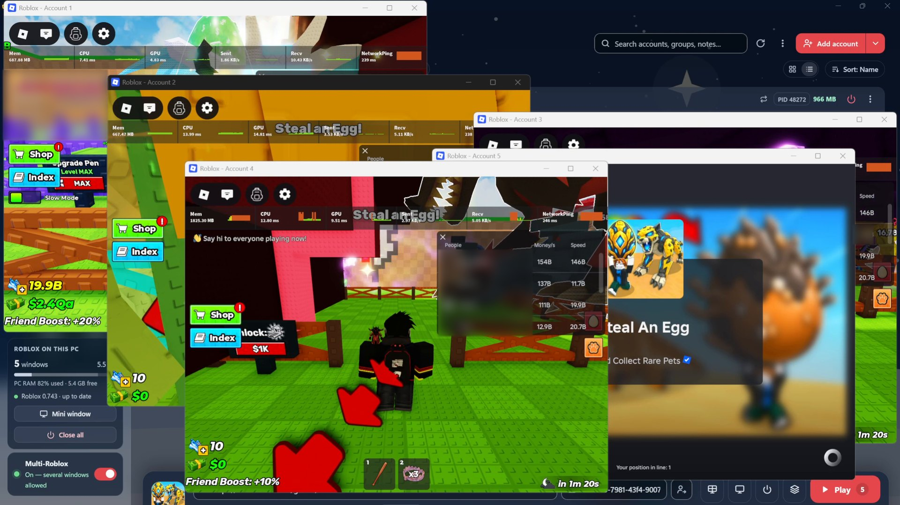</p>
<p align="center"><sub>A real screenshot from one PC: five Roblox accounts open at once with Bloxkeep, four in the game and the fifth joining. Names in the game are blurred.</sub></p>

Bloxkeep is for people who play on several Roblox accounts on one Windows PC: keep the accounts in one place, pick a game, pick accounts and press **Play**. Your data stays on your PC, encrypted with your master password; Bloxkeep has no server of its own.

*Bloxkeep is an independent project. It is not affiliated with, endorsed or sponsored by Roblox Corporation. Roblox is a trademark of Roblox Corporation.*

## Features

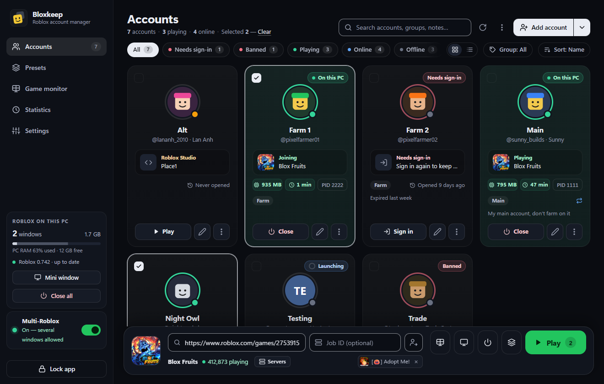

Each item is explained in [Using Bloxkeep](#using-bloxkeep) and, step by step, in the [user guide](docs/guide.md).

- **Add accounts** with your phone (a code or QR), a username and password (2-step verification works, and captchas are solved in a small window), a browser window, a cookie or another Bloxkeep file; or sign in on roblox.com and press **Save to Bloxkeep**. [Getting started](#getting-started), [Bringing accounts over](#bringing-accounts-over)
- **See every account's status**: online, in a game on this PC or on another device, why it was disconnected, RAM, play time, PID, needs to sign in, banned. Search, filter, group, sort, cards or list. [Account list](#account-list)
- **A menu for each account**: play, close, edit, check sign-in, join the same server, auto-rejoin, open the website, copy the username, password or 2FA code. [The account menu](#the-account-menu)
- **Authenticator (2FA) codes and saved passwords**, kept in the encrypted vault if you choose to save them. [Passwords and 2FA codes](#passwords-and-2fa-codes)
- **roblox.com inside Bloxkeep**: the website signed in as any account, one tab per account, apart from your own browser. [Open website](#open-website)
- **Games and servers**: pick a game by name, link or Place ID; a server by most players, fewest, lowest ping, room for N accounts or random; join friends, or the exact server a player is in. [Choosing a game and server](#choosing-a-game-and-server)
- **Presets**: accounts, a game and a server choice saved to start in one click, with a schedule to start and stop, and options of their own. [Presets](#presets)
- **Multi-Roblox**: several Roblox windows at once, opened windowed and tiled, with a check of every new Roblox build. Off until you turn it on. [Multi-Roblox](#multi-roblox), [Roblox updates](#roblox-updates)
- **Staying in game**: [Anti-AFK](#anti-afk) keeps a window from being kicked for idling, and [Auto-rejoin](#auto-rejoin) goes back in after a disconnect, retrying with longer waits instead of giving up.
- **Roblox settings per account** (graphics, frame rate, volume), and a choice of what opens Roblox: Roblox, Bloxstrap, Fishstrap, RobloxPlayerBeta directly, Roblox from the Microsoft Store (being tested) or your own launcher. [Roblox settings per account](#roblox-settings-per-account), [Open Roblox with](#open-roblox-with)
- **Windows and RAM**: live pictures of every Roblox window in the Game monitor, a mini window, tiling, warnings before RAM or Windows' virtual memory runs out. [Windows, RAM and the game monitor](#windows-ram-and-the-game-monitor)
- **Statistics and an activity log**: play time, sessions and disconnects per account, game and preset. [Statistics and activity](#statistics-and-activity)
- **Discord**: alerts, a live status message and play-time summaries sent to your channel. [Discord](#discord)
- **Lock, tray and notifications**: lock Bloxkeep with the master password, run from the tray, get Windows notifications. [Tray, lock and notifications](#tray-lock-and-notifications)
- **Look and language**: 74 themes, English and Vietnamese, hiding account names for screenshots and streams, quick search with `Ctrl+K`. [Appearance](#appearance)
- **Backup**: copy the encrypted vault to a OneDrive or Google Drive folder, and restore it on a new PC. [Backup and restore](#backup-and-restore)
- **Roblox VNG accounts** can be added; opening games for them isn't supported yet. [Roblox VNG](#roblox-vng)
- **Help in the app**: a user guide, and **Send feedback**, which shows exactly what it sends. [Help and feedback](#help-and-feedback)

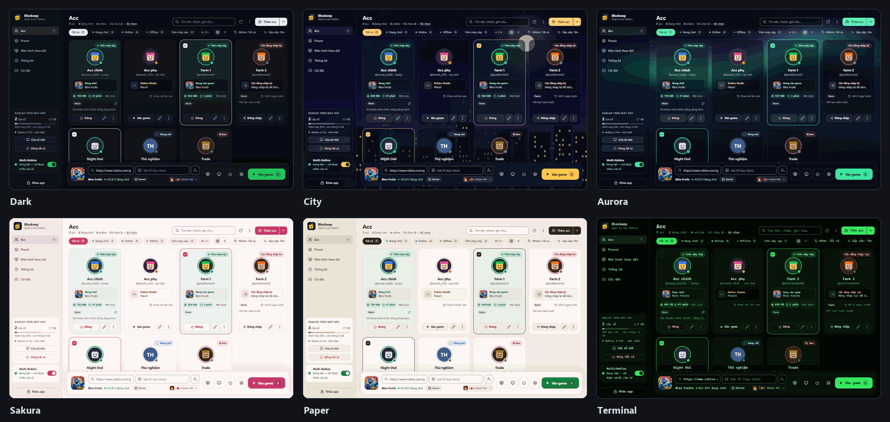

## Download and install

You need Windows 10 or 11, 64-bit. You don't need to install .NET. The installer installs Microsoft Edge WebView2 if it's missing.

Get it from [Releases](../../releases/latest):

| File | Use it when |
|---|---|
| `Bloxkeep-Setup.exe` | You want a normal install. A small file that downloads the newest Bloxkeep from this page as it installs (about 60 MB). You choose the folder, on any drive (pick `D:\` and it goes to `D:\Bloxkeep`). It installs for your Windows user, needs no admin rights, and adds Start menu and Desktop shortcuts. |
| `Bloxkeep-Setup-Offline.exe` | The same installer with everything inside (about 60 MB), for a PC without internet or to keep for later. |
| `Bloxkeep-Portable.zip` | You'd rather not install. Unzip and run `Bloxkeep.exe`; its data goes into a `data` folder next to it. The portable copy updates itself too. |

> [!CAUTION]
> Only download Bloxkeep from this repository's Releases page. A copy from anywhere else may have been changed to steal accounts.

The files aren't code-signed yet: Bloxkeep is applying to SignPath Foundation for free code signing ([code signing policy](CODE_SIGNING_POLICY.md)). Until then Windows SmartScreen warns the first time. Click **More info**, then **Run anyway**. You can compare the file's SHA-256 with `SHA256SUMS.txt` in the same release. `Bloxkeep-Setup.exe` is the same file in every release (only what it downloads changes), so SmartScreen gets to know it over time; the web installer checks its download against `SHA256SUMS.txt` itself.

Setup shows where Bloxkeep will go (`%LOCALAPPDATA%\BloxkeepApp` unless you choose another folder; the program takes about 230 MB), copies it with a progress bar and can open it when it's done. Your accounts and settings stay apart from the program, in `%LOCALAPPDATA%\Bloxkeep` (a few MB). Setup and the uninstaller speak English and Vietnamese.

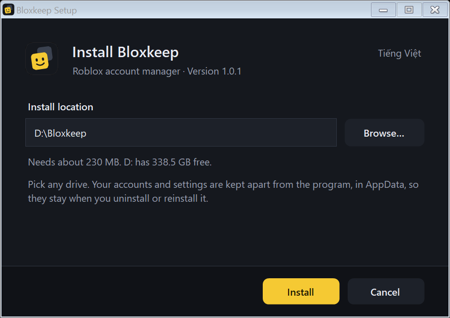 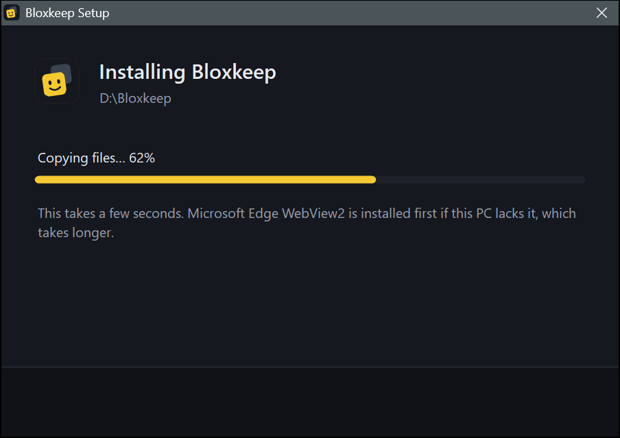 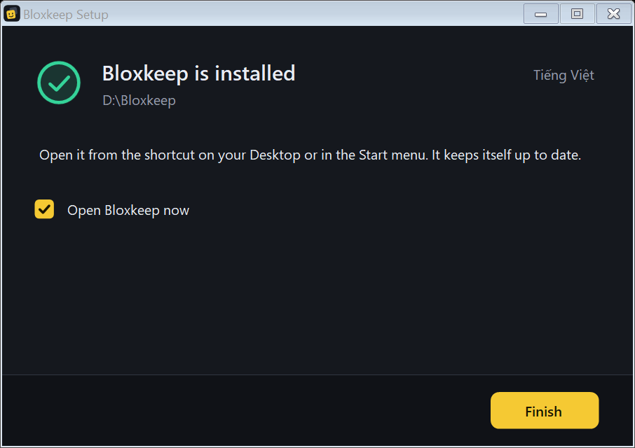

### Updates

Bloxkeep checks GitHub for a new version when it starts and every hour after, and downloads it in the background. It then installs it by itself the next time you aren't using it, and comes back in a few seconds as it was: still unlocked, on the same tab, the window still in the tray or minimised. Roblox windows keep running all along and are followed again.

"Not using it" means the window is in the tray or minimised, or nobody has touched the PC for 10 minutes, and Bloxkeep is in the middle of nothing: no Roblox opening, auto-rejoin or planned restart under way, no sign-in, backup, import or half-filled form. A Roblox window that is just running doesn't hold the update back.

To update right away, click **Restart to update** in the sidebar as soon as it shows. Quitting Bloxkeep installs it too. After updating, the app shows **What's new in Bloxkeep**.

To come back unlocked, the running copy hands the vault key to the new one in a file that only your Windows account can read (Windows DPAPI, mixed with a random value given to the new copy alone). The new copy deletes it as it reads it, and refuses one older than 3 minutes. If you would rather type the master password again after each update, lock Bloxkeep: a locked copy hands over nothing.

A small watcher (the uninstaller's program, run from a temporary copy) waits for the new version to come up. If it doesn't within a minute or so (the install failed, the new version crashed), the watcher deletes that file and starts Bloxkeep itself: back in the tray, locked, with a notification saying so. An update that didn't install isn't tried again by itself for a day; **Restart to update** still works.

Updating itself only works while the GitHub repository is public.

To turn automatic updates off, untick **Settings › Bloxkeep updates › Update automatically**: nothing is downloaded or installed by itself then. **Check now** still works.

To get new features before everyone else, tick **Settings › Bloxkeep updates › Get beta versions** (off by default): updates then also bring beta versions, which may still have bugs. Turn it off while on a beta and you keep that beta until the next regular version. On the Releases page betas are marked **Pre-release** and numbered after the version they lead to (1.0.6-beta.2 comes before 1.0.6).

Running a newer `Bloxkeep-Setup.exe` over an installed copy works too: it installs into the same folder, closes a running Bloxkeep first, and keeps your data. To move Bloxkeep to another drive, uninstall it, then install it again in the new folder.

### Uninstall

Open Windows **Settings › Apps › Installed apps**, find **Bloxkeep** (publisher `minhhoang0122`) and choose **Uninstall**. Bloxkeep's uninstaller asks whether to **Also delete my accounts and settings**: leave it unticked to keep them for a later reinstall, or tick it to remove them for good. It closes Bloxkeep first if it's running.

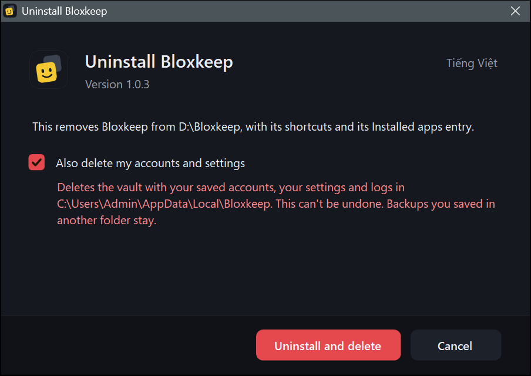

| Always removed | Removed only when you tick **Also delete my accounts and settings** | Never touched |
|---|---|---|
| The program folder (`%LOCALAPPDATA%\BloxkeepApp` unless you chose another one), the Start menu and Desktop shortcuts (including ones you pinned to Start or the taskbar), the interface cache, and the Installed apps entry. Bloxkeep adds nothing else to Windows: no startup entry, no service, and it doesn't take over the `roblox-player:` protocol. | Your accounts and settings in `%LOCALAPPDATA%\Bloxkeep`: the vault (`vault.rmv` and its spare copies), `prefs.json` and `error.log`. | The backup files in your backup folder, and any other file you put in `%LOCALAPPDATA%\Bloxkeep`. |

<details>
<summary>Pictures: updating</summary>

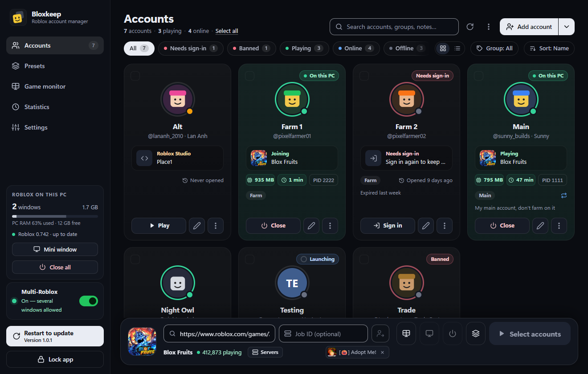 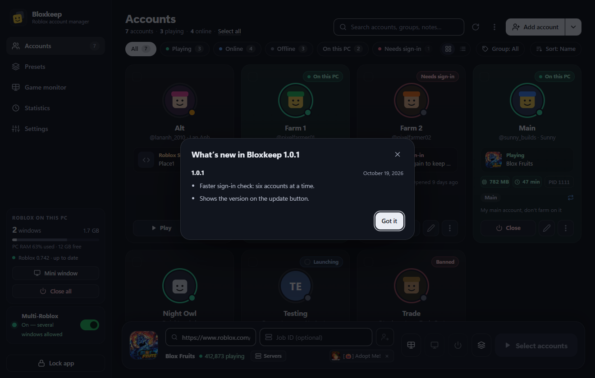 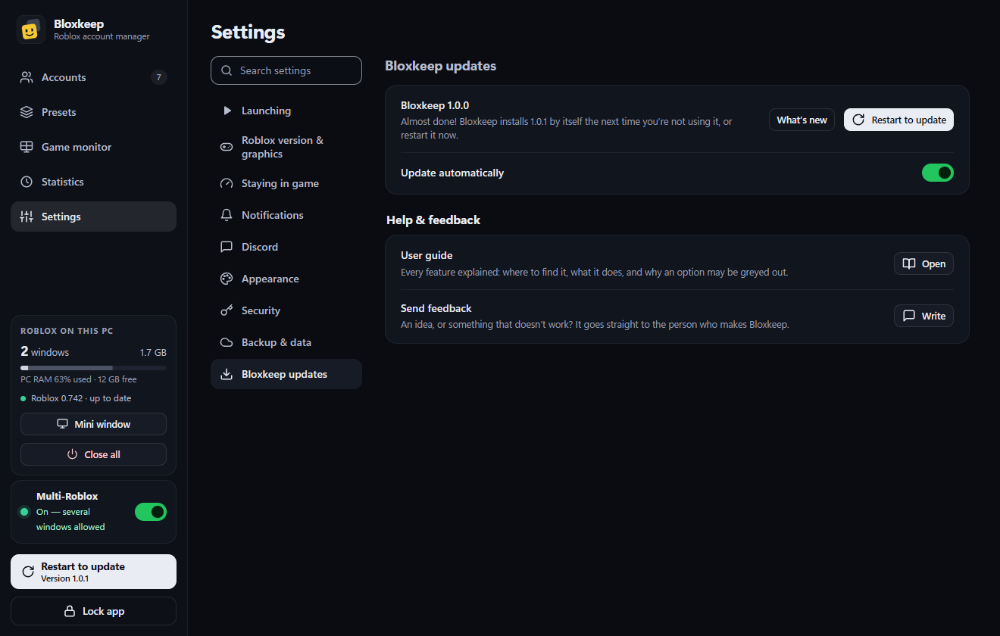
</details>

## Getting started

1. **Set a master password** the first time (at least 6 characters). It unlocks Bloxkeep and **can't be recovered** if you forget it; see [Data and security](#data-and-security). Moving to a new PC? Choose **Restore from a backup** instead; see [Backup and restore](#backup-and-restore).

   The app opens in English; the EN/VI switch in the top corner of this screen, or **Settings › Appearance › Language**, changes it.

   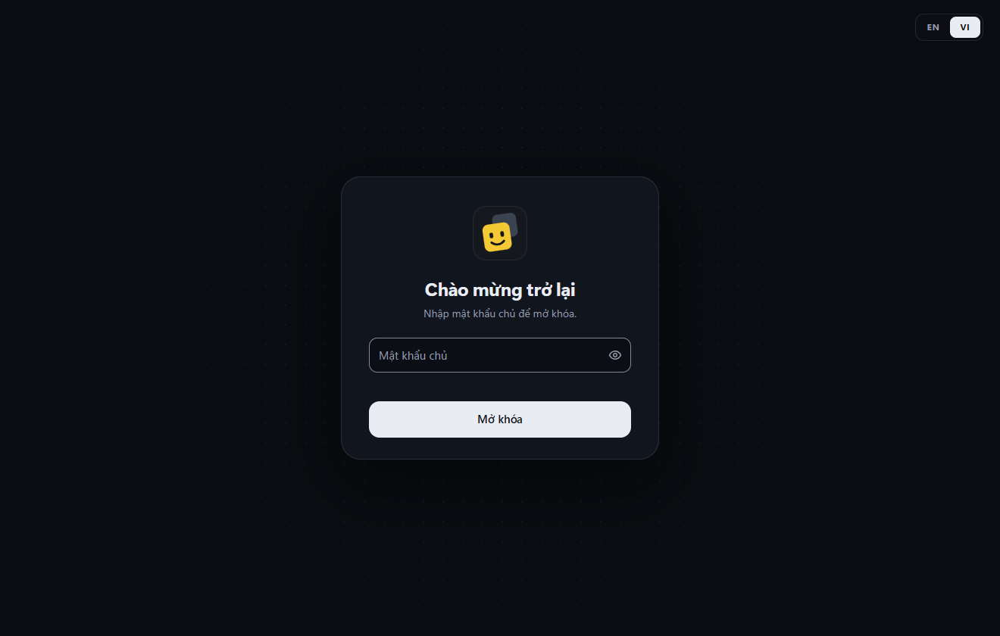

2. **Add accounts**: click **Add account**. The **Sign in to Roblox** dialog offers:
   - **Sign in with your phone** (recommended): Bloxkeep shows a code and a QR. In the **Roblox app** on your phone, open **Settings › Quick Log In**, enter the code or scan the QR, and confirm. No password or puzzle needed. After one account is added you get a new code for the next.
   - **Username** and **Password**: the password only goes to Roblox's sign-in server. Signing in with a password doesn't save it. 2-step verification works (**Authenticator app** or **Email**); if the account already has an authenticator key in Bloxkeep, the code is filled in and you only confirm. If Roblox asks for a captcha, click **Solve the puzzle** and do it in the small window that opens.
   - **Other ways: Sign in with a browser**: the official roblox.com sign-in page opens in a temporary window. Once you're in, Bloxkeep takes the session and deletes that temporary window. Bloxkeep doesn't read the password you type there.
   - **Other ways: Paste a cookie**, or **Import from: Bloxkeep file**: see [Bringing accounts over](#bringing-accounts-over).

   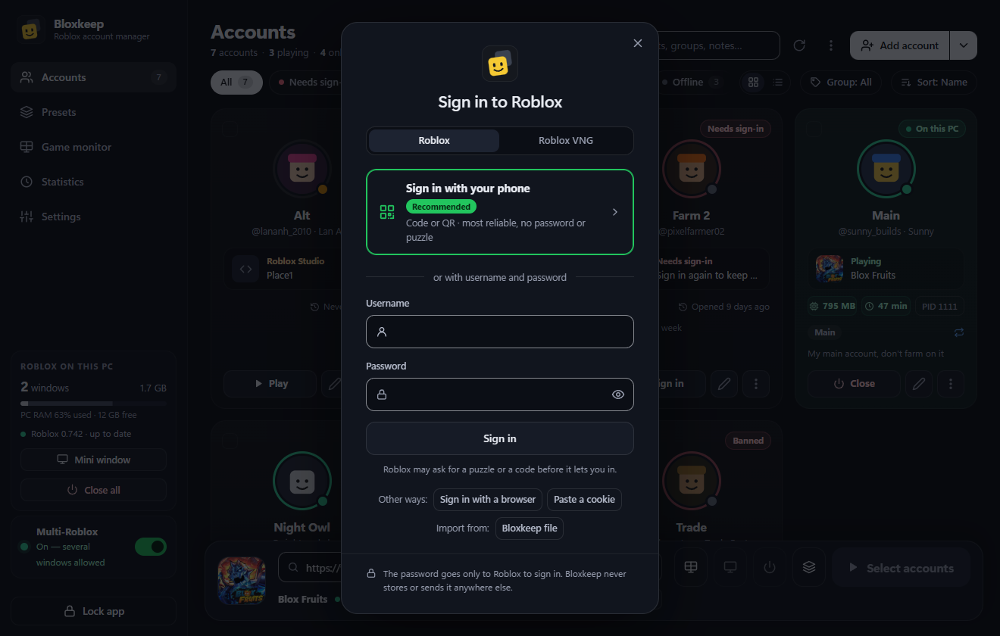

3. **Pick a game, pick accounts, press Play.** Type a game name or paste a link / Place ID in the bar at the bottom, click account cards to choose them (`Shift`-click for a range), then press **Play**. With the game box empty the button becomes **Open Roblox**: each chosen account opens Roblox on its home screen.

   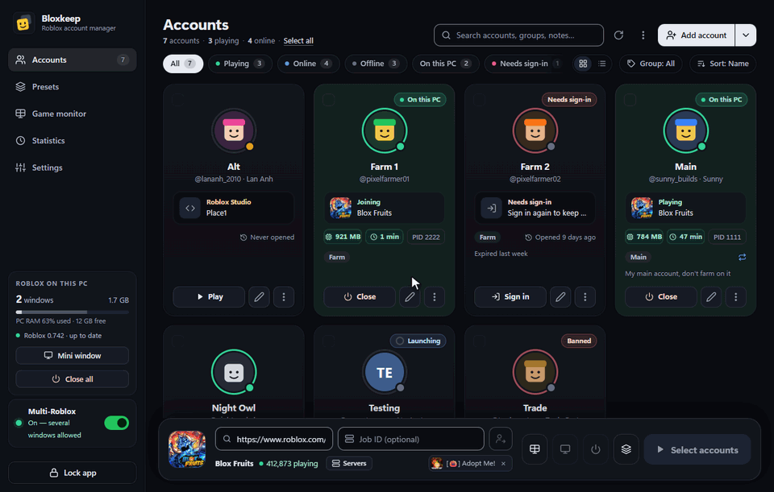

4. Shortcuts: `Ctrl+K` quick search for accounts, presets, games and settings; `Ctrl+F` search accounts; `Ctrl+A` select all; `Enter` play; `F2` edit; `Delete` delete; `Esc` clear the selection. Right-click an account for more.

## Using Bloxkeep

What each part does, where it is, and the details that are easy to miss. Menu paths read like **Settings › Launching › Open Roblox with**, and "⋯" is a three-dot **More** button. Every button and every step is in the [user guide](docs/guide.md).

### Account list

The **Accounts** tab shows one card per account, or one row each in **List** view.

#### What a card shows

The dot on an account's picture shows where it is:

| Dot | Meaning |
|---|---|
| Green | In a game |
| Blue | Online on the Roblox website or app, not in a game |
| Amber | In Roblox Studio |
| Yellow | Disconnected, but its Roblox window is still open |
| Grey | Offline |
| Red ring | Needs to sign in again, or is banned |

- The status line says more: **Opening Roblox…**, **Playing** with the game's name, **Rejoining · this PC** (auto-rejoin waiting its turn, with a **Cancel** button), **Restarting · this PC** (a preset's planned restart), **Playing · another device**, **Online**, **Roblox Studio**, **Offline**. A badge in the corner says **On this PC**, **Launching**, **Banned** or **Needs sign-in**.
- A disconnected window says why, read from Roblox's own log: **Kicked for being idle**, **Kicked by the game**, **Signed in on another device**, **Connection lost**, **Couldn't join the server**, or Roblox's error code.
- An account open on this PC also shows its **RAM in use**, **Play time** and **PID** (click the PID to copy it). Below that: its group, a loop icon when auto-rejoin is on, when Bloxkeep last opened it, and its note.
- Status refreshes every 30 seconds, or at once with **Refresh online status**. Roblox's status for other devices can lag a few minutes; for windows on this PC, Bloxkeep follows Roblox's own log instead.


#### Finding and choosing accounts

- **Filters** show a count: **All**, **Needs sign-in** and **Banned** (only when some accounts are), **Playing**, **Online**, **Offline**, **On this PC** (only while a window is open here). The **Group** menu appears once an account has a group. **Sort** by **Name**, **Status**, **Last played** or **Launch order**, and switch between **Cards** and **List**. Bloxkeep remembers the layout and the sort.
- **Search** (`Ctrl+F`) reads names, usernames (`@name` works), display names, nicknames, groups, notes, the game being played and user IDs. Accents don't matter.
- Click a card to select it, `Shift`-click for a range, `Ctrl+A` for every account shown, double-click to play that account alone, `Esc` to clear. If the search or a filter hides some of the selected accounts, the header says how many; **Play** and **Delete** still act on them.
- **Launch order…** (the ⋯ menu above the list) sets the order **Play** opens the selected accounts in. A preset keeps its own order.

#### Sign-in checks and bans

- Roblox can end a saved sign-in without telling anyone (a password change, "log out of all sessions"). The account is then marked **Needs sign-in**: click **Sign in** on its card, which opens the same dialog, or add the account again in any way. It is updated, not copied.
- **Check sign-in** is in each account's ⋯ menu, and **Check sign-in of all accounts** in the ⋯ menu above the list. **Check sign-ins every day** (**Settings › Staying in game**, on by default, shows when it last ran) does it once a day by itself: one account at a time, 2 seconds apart, about 45 seconds after you unlock, then one notification naming the accounts that need to sign in.
- The same check looks at whether Roblox reports the account as **Banned** (public information). A banned account gets a red tag, **Play** and presets skip it, and auto-rejoin doesn't reopen it. Once the ban is over, **Check sign-in** clears the tag.

#### Passwords and 2FA codes

- **Edit…** (`F2`) sets a **Nickname**, **Group** and **Note**, and can store a **Roblox password** and an **Authenticator key**. Both are optional and stay in the encrypted vault.
- **Copy password** works only after you have saved the password under **Edit**: no way of signing in keeps it (the phone, browser and cookie ways never see it, and a password sign-in sends it to Roblox and forgets it). Until then, picking it says why. Bloxkeep never uses the saved password to sign in; it is only there for you.
- **Copy 2FA code** needs the account's authenticator key. Paste the key, or the `otpauth://` link, under **Edit › Authenticator key**; Bloxkeep shows the code it makes, so you can check it against your authenticator app. After that **Edit** shows the running 6-digit code with the seconds left, and a password sign-in fills the code in for you. Anyone with your master password can make the codes too, so save the key only if that's fine with you.
- Copied passwords and codes stay out of Windows clipboard history and are wiped after 30 seconds, or when you lock Bloxkeep.

#### The account menu

Open it with an account's ⋯ button or a right-click. If the account isn't selected, it becomes the only selection; if it's part of a selection, the menu acts on all of them, except the items that need exactly one account, which are greyed out while several are selected.

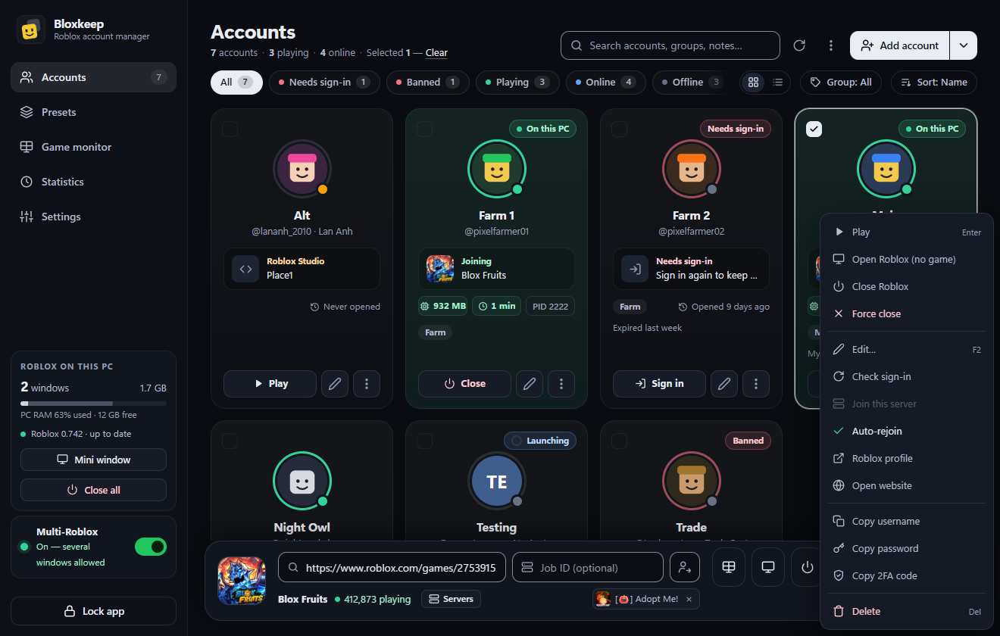

- **Play** / **Play (N accounts)** (`Enter`): opens the game in the game box, or Roblox's home screen when the box is empty, in launch order.
- **Open Roblox (no game)**: Roblox's home screen, one window per account.
- **Close Roblox** closes the window normally. **Force close** ends a frozen window at once, and anything not saved in the game is lost. Both are greyed out unless a selected account is open on this PC.
- **Edit…** (`F2`) and **Check sign-in**: see above. **Edit…** needs exactly one account.
- **Join this server**: puts this account's game and server in the game bar. Select other accounts and press **Play**, and they land in the same server. One account, in a server Bloxkeep knows.
- **Auto-rejoin**: on or off for these accounts; the tick shows which. When a preset decides for an open window, the item says so.
- **Use Roblox settings**: includes these accounts in [Roblox settings per account](#roblox-settings-per-account). Shown only when **Apply to** is **Chosen accounts**.
- **Roblox profile**: the account's page on roblox.com, in your own browser. One account.
- **Open website**: roblox.com signed in as this account, in Bloxkeep's own browser window (see [Open website](#open-website)). One account, and not a Roblox VNG one.
- **Copy username**, **Copy password**, **Copy 2FA code**: one account at a time ([Passwords and 2FA codes](#passwords-and-2fa-codes)).
- **Delete** (`Del`): asks first, and can't be undone. Statistics keep a deleted account's play time as "Deleted account".

The ⋯ menu above the list has **Check sign-in of all accounts**, **Select all**, **Arrange Roblox windows**, **Launch order…**, **Close all Roblox**, **Force close all Roblox** (both ask first) and **User guide**.

More in the user guide: [The account list](docs/guide/accounts.md), [The account menu](docs/guide/accounts.md#the-account-menu).

### Open website

- **Open website** (in an account's ⋯ menu) opens roblox.com signed in as that account, in a window of Bloxkeep's own with **one tab per account**. Opening an account that already has a tab goes back to that tab.
- **Open roblox.com** (in the menu next to **Add account**, or on the empty list) opens a blank tab on roblox.com's sign-in page, for an account you only want to use on the website. Press **Save to Bloxkeep** to keep it: the account joins your list and opens signed in next time. Without saving, closing the tab signs it out.
- Each tab has its own private sign-in, kept in memory only. Nothing goes into your own Chrome or Edge, and it is gone when the tab closes. Each tab has its own Back, Forward and Reload.
- **+** at the end of the tab strip or `Ctrl+T` opens a blank tab. ✕, a middle click or `Ctrl+W` closes one, and `Ctrl+Tab` switches between tabs.
- Signing out in a saved account's tab would also sign it out of Bloxkeep, so Bloxkeep stops it and asks: **Close tab** or **Keep browsing**.
- Closing the window closes every tab, and so does locking Bloxkeep. It isn't available for Roblox VNG accounts.

More in the user guide: [Open website](docs/guide/playing.md#open-website).

### Choosing a game and server

- The game box (`Ctrl+L` or `/`) takes a game name, a Place ID, a `roblox.com/games/…` link (private-server links too), a server share link, or a `roblox://` link. When you type a name, pick the game from the list that appears; a name you typed but didn't pick doesn't count.
- Under the box: the game's name, creator, how many are playing, and a **Servers** button. A private server, a share link and a Job ID each show a label. Up to three recent games sit there as shortcuts.
- The game picker (click the picture, or the empty box) has **Recent**, **Pinned**, **Roblox favorites** and **Popular** tabs. Click ☆ to pin a game.
- **Job ID (optional)**: joins one exact server, so several accounts land together. It is cleared when you change game.
- **Servers** lists public servers with room: sort by **Most players**, **Fewest players**, **Lowest ping**, **Best FPS**; filter **Room for N** (when several accounts are selected); or click **Random server**. **Use** puts that server's Job ID in the bar; a full server is greyed out. **Friends in this game** lists friends of your accounts to join, when their privacy settings allow it. The ping shown is the average of the players in that server, not yours.
- **Join a player…** (the button next to the Job ID box): type a player's username or user ID (a profile link works too) and the chosen accounts join the server that player is in. Bloxkeep asks Roblox with the accounts you chose. When it can't (no such user, the player is offline, not in a game, or their privacy settings hide the server), the dialog says which, and Bloxkeep never friends or follows anyone to get around that.
- On an account that's playing, **Join this server** sends the other accounts into that same server.

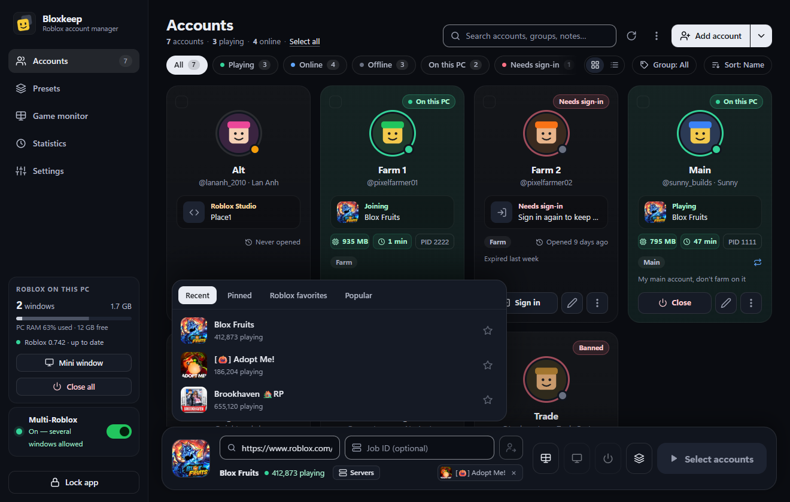

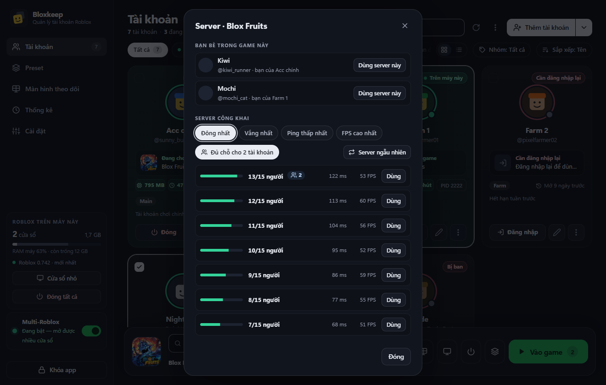

**What Play does**

- The button reads **Select accounts** (greyed out) until you choose some, **Play** and the number of accounts with a game in the box, or **Open Roblox** with the box empty: each chosen account opens Roblox on its home screen. Next to it: **Open Roblox without joining a game**, and **Close**, which closes Roblox for the selected accounts.
- Accounts open one after another, with **Wait between accounts** in between (8 seconds by default; a preset can have its own). While they open, **Play** becomes **Stop**.
- An account already in this game is left as it is. One in another game is asked about first, then closed and opened again in the new game. Banned and Roblox VNG accounts are skipped, with a line in the result, and **Some accounts didn't open** says why for any that failed.

More in the user guide: [Playing](docs/guide/playing.md).

### Presets

A preset saves a name, a list of accounts (in order), a game, how to pick the server, and the wait between accounts. Leave the game empty to open only the **Roblox home screen**. The server can be **Any (Roblox picks)**, **Most players**, **Fewest players**, **Lowest ping**, **Random** or a **Fixed server (Job ID)**. It is picked when the preset runs, among servers with room for its accounts; if none has room, Roblox picks.

Make one in the **Presets** tab (**New preset**), with **Save as preset…** in the presets button of the bottom bar (it starts from the accounts, game and Job ID you have chosen), or from `Ctrl+K`. Each row shows its game, a line about what it does, "Next: Today 20:00" or "Last run 2 h ago", and the accounts' avatars. You can edit, **Duplicate**, delete (asks first), reorder and **Run** them; the presets button in the bottom bar and `Ctrl+K` run them too. While a preset has windows open, its row says how many and **Run** becomes **Close**, which closes those windows (and no others). Up to 50 presets.

A preset's **For the Roblox windows** options apply to the windows that preset opens (also when they rejoin). Pressing **Play** for the same accounts the normal way still follows your general settings.

How the levels fit together, for each Roblox window: a preset's option set to **On** or **Off** decides for the windows that preset opened, until they close; left on **Follow…**, the account's own switch decides (auto-rejoin) or else **Settings** (Anti-AFK, arranging windows, the wait between accounts). An account in two presets follows the one that opened its window; running the other preset leaves an open window alone.

- **Anti-AFK**: **Follow Settings**, **On** or **Off**.
- **Auto-rejoin**: **Follow each account**, **On** or **Off**.
- **Performance**: **Light AFK** sets the lowest graphics, 30 FPS, no sound, and minimises the window once it's in the game. Windows opened without it keep your Roblox settings. A **Light AFK** window isn't tiled, since it is minimised.
- **Restart Roblox**: every 2, 4, 6 or 12 hours, each window is closed and opened again into the same game, one at a time. The window you're using waits. It needs a game.
- **Arrange windows**: **Follow Settings**, **On** or **Off**: tiles the Roblox windows once the preset has opened them.

**Discord**: a preset can send its messages to **A webhook of its own** instead of the channel in Settings: its schedule messages, its summary after a scheduled stop (that preset's accounts only), and the alerts about the windows it opened. **Send test** checks the link before saving. Everything else, and the on/off switch, quiet hours and pings, stay in **Settings › Discord**. If Discord deletes that webhook, the preset goes back to the channel in Settings.

**Schedule**: a preset runs by itself at its **Start time**, once on a date or on chosen weekdays, and can **Stop** after some hours (half an hour to 168) or at a set time. Bloxkeep has to be running (the tray is fine) and unlocked at that moment.

- A start time that passes while Bloxkeep is closed or locked, or the PC sleeps, isn't made up later. After a lock or a sleep you're told once.
- If opening would need a confirmation (Multi-Roblox off or not ready, low RAM, an account in another game), the run is skipped and you're told. A question you answered **Don't ask again** doesn't stop it.
- At the stop, only the windows that run opened are closed. A stop still happens while Bloxkeep is locked.
- A one-off schedule switches itself off once it has run.

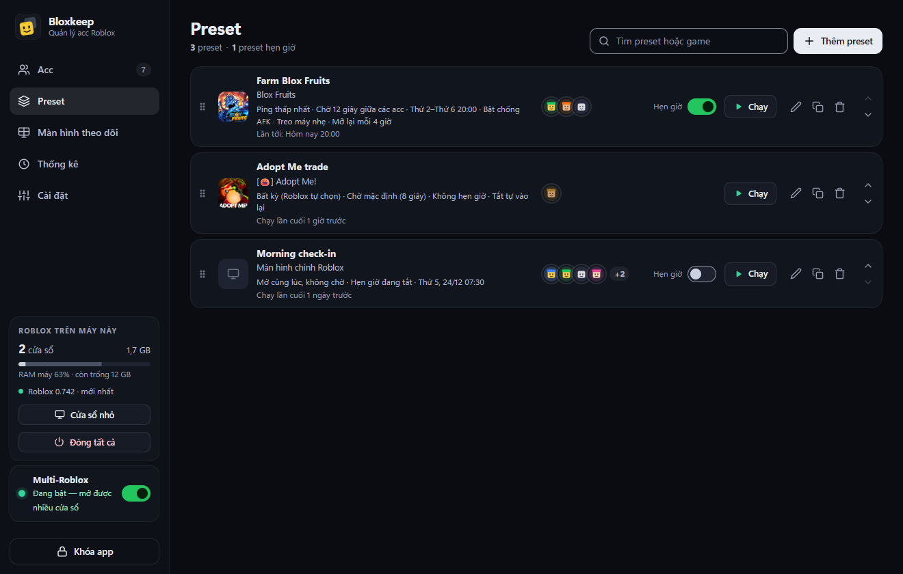

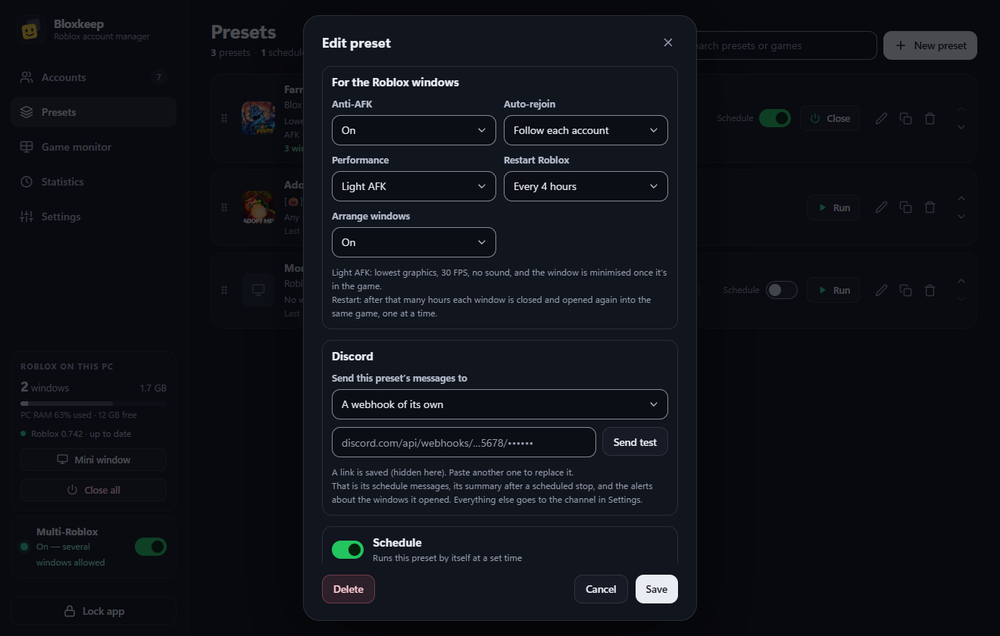

More in the user guide: [Presets and schedules](docs/guide/presets.md).

### Multi-Roblox

Multi-Roblox is **off by default**. Roblox doesn't officially support running several clients; use it at your own risk (turning it on asks **Turn on Multi-Roblox?** first). Turn it on with the Multi-Roblox switch in the sidebar or in **Settings › Launching**.

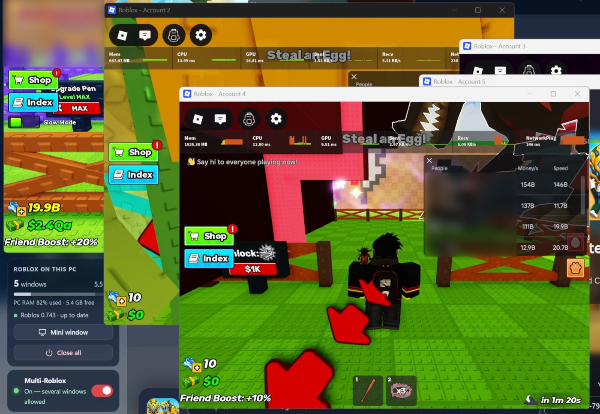

A real screenshot: the sidebar counts 5 Roblox windows and Multi-Roblox is on. Names in the game are blurred.

- Bloxkeep has to be open **before** Roblox and stay open while you play. The tray is fine.
- The sidebar card's light tells you how it's going:

  | Light | Text | Meaning |
  |---|---|---|
  | Grey | **Off** | Off: each new Roblox window closes the one before |
  | Green | **On — several windows allowed** | Working: you can open several accounts at once |
  | Yellow | **Not working yet — click to fix** | Roblox was already open before Multi-Roblox was turned on; click for the fix |
  | Yellow | **Roblox closed windows — click to see** | Roblox closed a window when another one opened; see [Roblox updates](#roblox-updates) |
  | Yellow | **A Roblox update may stop it — click to see** | The Multi-Roblox check found a change in the Roblox build; see [Roblox updates](#roblox-updates) |

- **Details** (next to the switch, or by clicking the card's text) opens the dialog with the fix and two more options:
  - **Not working yet**, step by step: close every Roblox, including one in the system tray (**Close all Roblox**); if Roblox starts with Windows, click **Turn off autostart** (the same as switching it off in Task Manager › Startup apps, and you can switch it back there). The light then turns green by itself. Next time, open Bloxkeep before Roblox.
  - **Always open Roblox windowed** (on by default): all Roblox windows share one fullscreen setting, so with several open some end up fullscreen and some don't. Bloxkeep opens every window windowed and puts your setting back afterwards.
  - **Tile the windows after opening** (off by default): once the accounts are open, the Roblox windows are laid out in a grid on the main screen. It is the same as **Settings › Launching › When a Roblox window opens › Tile them side by side**.
- One home screen per account: choose the accounts, leave the game box empty, press **Open Roblox**.

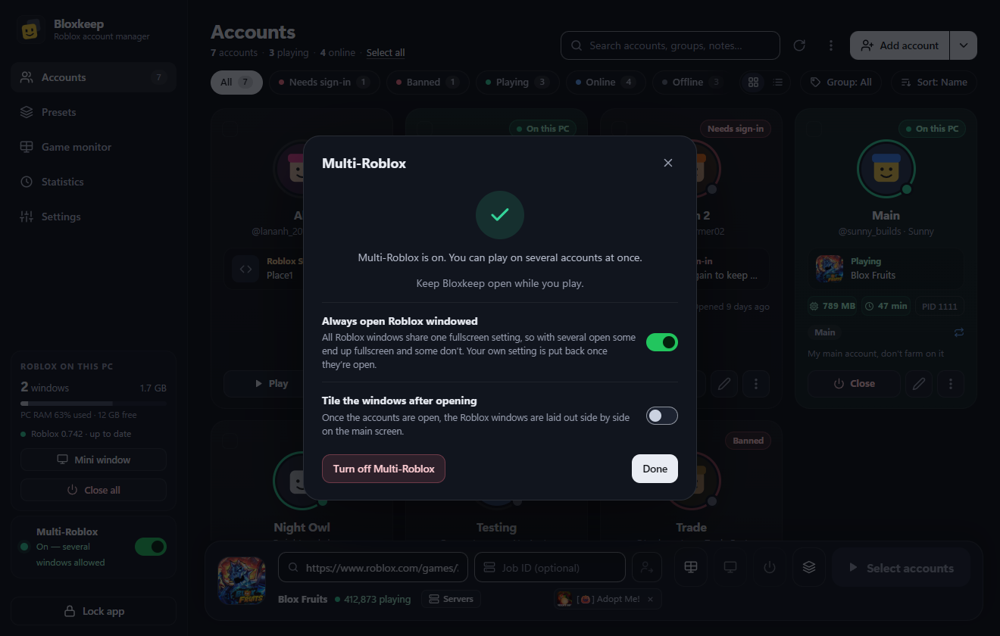

**Before you open.** Press **Play** for two accounts while Multi-Roblox is off, and Bloxkeep stops and asks, because each new window would close the one before. **Turn on Multi-Roblox and play** turns it on and opens them in one click; **Open anyway** goes ahead without it.

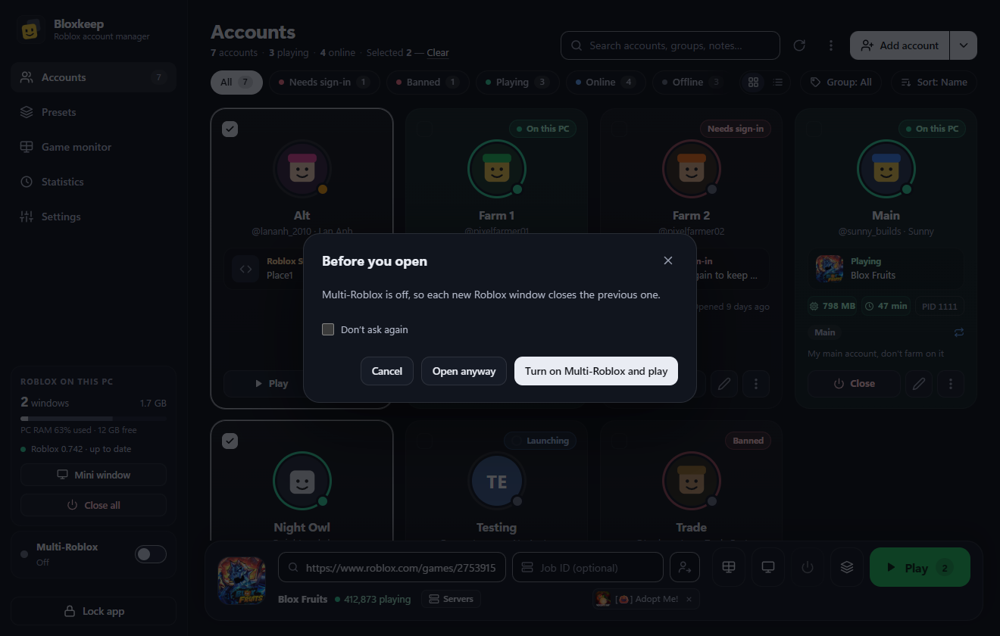

The **Before you open** dialog can also ask about:

- an account that is already in another game, which would leave it (always asked);
- Multi-Roblox turned on but not working yet: **Fix Multi-Roblox** or **Open anyway** (always asked);
- a Roblox build where the Multi-Roblox check found a change and no two windows have played together yet;
- low RAM: how much is free, against what the new windows need.

When every question in the dialog can be skipped, a **Don't ask again** box shows. Tick it and press **Open anyway**, and each of those kinds is skipped from then on. **Settings › Notifications › Questions › Ask again** brings them back. A scheduled preset that would need an answer is skipped instead, and you're told.

How it works: Roblox uses an object named `ROBLOX_singletonEvent` to allow only one window; since its October 2026 builds, a new window uses it to close the older ones. Bloxkeep takes that name first, while no Roblox is running, so Roblox can't set this up and the windows don't close each other. Bloxkeep injects nothing into Roblox and reads nothing from the Roblox process.

More in the user guide: [Multi-Roblox](docs/guide/multi-roblox.md), [The "Before you open" questions](docs/guide/playing.md#before-you-open).

### Roblox updates

**Settings › Roblox version & graphics › Roblox updates** is where Bloxkeep tells you about Roblox's builds.

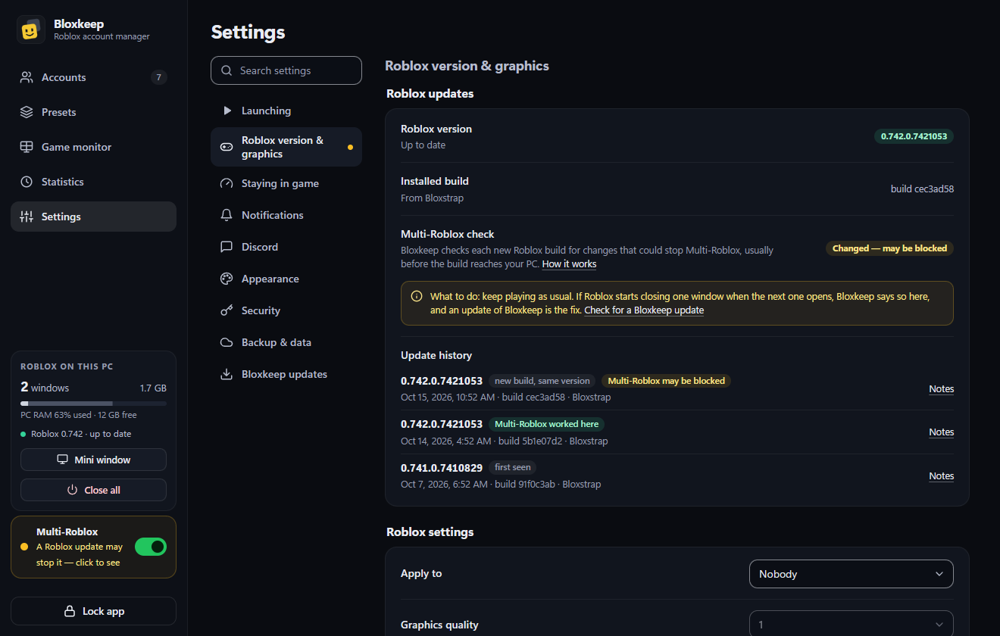

- **Roblox version** says "Up to date", or that a newer one is out and how you get it: Roblox updates the next time it opens; with **RobloxPlayerBeta directly**, open Roblox normally once; the Store's Roblox updates through the Microsoft Store. **Installed build** shows which launcher it comes from, and **Newest from Roblox** shows only when it differs.
- **Multi-Roblox check**: Bloxkeep's Roblox watch checks each new Roblox build as soon as Roblox offers it, often before it reaches players. It downloads the build and compares the lock Multi-Roblox relies on with the build before ([how it works](docs/roblox-watch.md)). **Next Roblox build** shows the result for a build not released yet.

  | Result | Meaning |
  |---|---|
  | **No change found** | The lock is as before |
  | **Worked on this PC** | Two windows played together on this build here. That is proof |
  | **Changed — Bloxkeep adapted** | Roblox renamed the lock; Bloxkeep holds the new name too, without an app update. Not proven yet |
  | **Changed — may be blocked** | The one-window code changed |
  | **Likely blocked** | The lock Multi-Roblox holds is gone |
  | **Not checked yet** / **Couldn't check right now** | No result yet |

- The check can't prove Multi-Roblox works; two windows playing together can, and Bloxkeep remembers that for each build. Until then, opening several accounts on a build that changed asks first.
- When it warns, keep playing as usual. If Roblox starts closing one window when the next opens, Bloxkeep says so ("Roblox closed N windows when another one opened"): press **Check for a Bloxkeep update**, and play one account at a time until an update fixes it. **Hide** removes the note, and it also goes once two or more accounts are in a game at the same time, or when Roblox updates.
- **Update history** lists every Roblox build seen on this PC, tagged with what the check found (for example "Multi-Roblox worked here"), each with a link to Roblox's release **Notes**.

More in the user guide: [The Multi-Roblox check](docs/guide/multi-roblox.md#the-multi-roblox-check).

### Anti-AFK

Roblox kicks an account after 20 minutes without input. With **Settings › Staying in game › Anti-AFK** on (a preset can override it), Bloxkeep brings each Roblox window that is in a game to the front for a moment, moves the mouse a few pixels over it and back, and returns you to the window you were in. No key is pressed and nothing is clicked.

- It steps in from 12 minutes after a window's last input, at the first minute nobody uses the PC.
- A window two minutes from its kick gets it even while you use the PC, in a 2-second pause, but never over a full-screen app.
- It can't work while the PC is locked.
- If an account is kicked anyway, Bloxkeep says why: the PC was in use, it was locked, a full-screen app was in front, or Windows kept the window in the background.

The **Staying in game** page (called **Performance** before 1.0.3) holds the switches for [Auto-rejoin](#auto-rejoin) and Anti-AFK, **Check sign-ins every day**, the low RAM warning and **Save RAM on background windows** (see [Windows, RAM and the game monitor](#windows-ram-and-the-game-monitor)), **Keep running in the tray when closed** and **Hardware acceleration**.

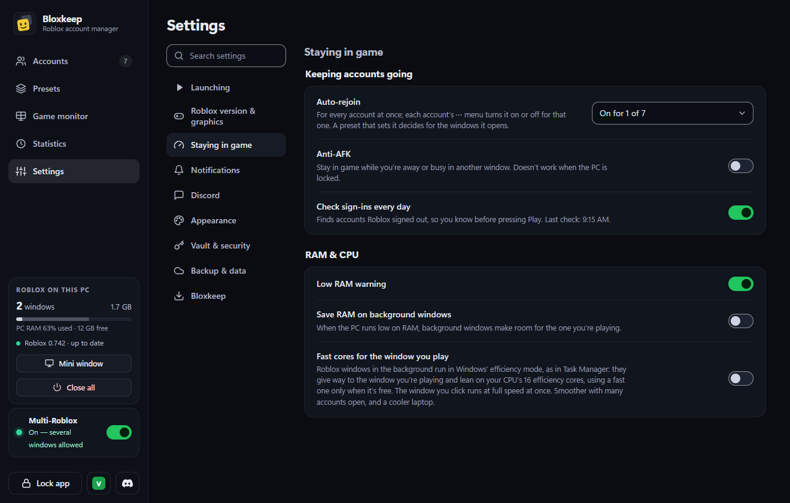

### Auto-rejoin

Turn it on for one account in its ⋯ menu › **Auto-rejoin**, for every account at once in **Settings › Staying in game › Auto-rejoin** (it reads "On for 3 of 10" when mixed), or for a preset's windows with the preset's own option (see [Presets](#presets)).

- When that account's Roblox disconnects, gets kicked or loses its connection, Bloxkeep rejoins the same game (or the same private server) after 10 seconds, though not necessarily the same server. After the PC wakes up, it waits for the connection first.
- If it keeps dropping, from the third time Bloxkeep waits 2, 5, 10, then 15 minutes between tries. The card shows the wait ("In 2 min") with a **Cancel** button; 10 minutes in the game resets the count. Without a network, it retries every 30 seconds, up to 20 times.
- It doesn't rejoin when you leave the game yourself, when the account signed in on another device, when it's banned, when Roblox itself closed the window because another one opened, or while Bloxkeep is locked. Closing the Roblox window by hand counts as leaving, so use **Close** in the app.
- If Roblox ended an account's sign-in, auto-rejoin turns itself off for it, and back on once the account is signed in again. With Multi-Roblox not ready, a rejoin is skipped (a new window would close the open one) and you're told.

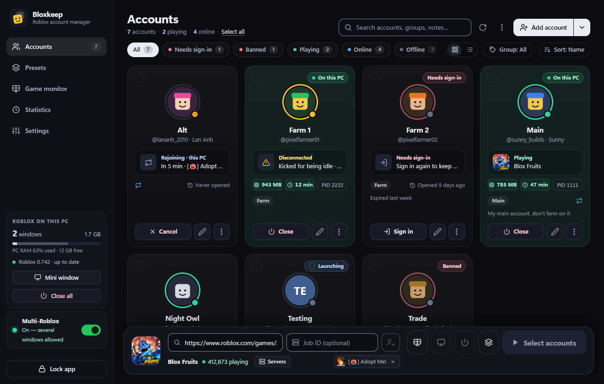

More in the user guide: [Keeping accounts in game](docs/guide/staying-in-game.md).

### Roblox settings per account

In **Settings › Roblox version & graphics › Roblox settings**, **Apply to** chooses **Nobody**, **All accounts** or **Chosen accounts** (pick them with **Use Roblox settings** in an account's ⋯ menu, or **Choose accounts…**). Set **Graphics quality** from 1 to 10, **Frame rate limit** 30/60/144/240, **Volume** from **Muted** to 100 %, or **Leave as is**. The three are greyed out while **Apply to** is **Nobody**.

Bloxkeep writes these values into Roblox's settings file just before opening the account, and puts your own settings back once Roblox is running. They aren't applied to Roblox from the Microsoft Store yet.

### Open Roblox with

Choose in **Settings › Launching › Open Roblox with**. Bloxkeep finds what's installed; a launcher that isn't shows "not installed" and is greyed out.

| Choice | Notes |
|---|---|
| **Default** | Whatever opens Roblox links on this PC (Roblox, Bloxstrap, Fishstrap…) |
| **Bloxstrap**, **Fishstrap** | Keeps your mods and FFlags |
| Other Bloxstrap-style launchers | Listed when installed |
| **Roblox (official)** | The client from roblox.com |
| **RobloxPlayerBeta directly (skip launchers)** | No launcher at all; try it when a launcher blocks several windows |
| **Choose another launcher…** | An exe you pick. If it is moved or deleted, launching says so |
| **Roblox (Microsoft Store)** | Being tested, new in 1.0.3: each account opens in a Store Roblox window of its own, skipping Microsoft's launcher (which allows only one). The Microsoft Store keeps it updated. If it doesn't work for you, say so with **Send feedback** |

### Windows, RAM and the game monitor

- The sidebar card **Roblox on this PC** shows the number of Roblox windows (point at it to see each account and PID), the RAM they use, a bar of the PC's RAM (red from 90 %) and the free RAM. Your Roblox version has a light: green "up to date", yellow when a newer one is out. **Mini window** and **Close all** (asks first) are there too. If Roblox isn't installed, a card says so.
- **Game monitor** (a sidebar tab): live pictures of every Roblox window with the account, game, RAM and PID. Click a picture to bring that window to the front; right-click for **Show**, **Close Roblox** and **Copy PID**. A minimised window has no live picture. Windows draws the pictures itself (like the previews when you hover the taskbar), so they cost next to nothing.
- **Mini window**: a small window that stays on top, to watch the accounts that are playing without the main window: game, RAM and PID for each, with **Show** and **Close**, plus **Close all** and **Open Bloxkeep**. Open it from the sidebar, the tray menu or `Ctrl+K`; it keeps working while the main window is in the tray. `Esc` hides it, and it remembers its place.
- **When a Roblox window opens** (in **Settings › Launching**): **As Roblox sizes it**, **Maximise it** (still a window, so the windows don't fight over Roblox's one fullscreen setting), or **Tile them side by side** (needs Multi-Roblox). A preset can tile its own windows whatever this says.
- **Arrange** in the game bar, **Arrange Roblox windows** in the ⋯ menu above the list and **Arranging windows** (in **Settings › Launching**): **Fill the screen**, or **Small tiles** / **Medium tiles** / **Large tiles** laid out from the top-left, leaving the rest of the screen free. The smaller a Roblox window, the less work for the graphics card. With several screens you pick one first.
- **Low RAM warning** (on by default): warns before you open more accounts than the free RAM can take, and when the PC uses more than 92 % of its RAM. When RAM is free but Windows' virtual memory is almost full, it says that instead, before **Play** and while you play, because a Roblox window then crashes as it opens ([what to do](#q-a-roblox-window-crashes-as-it-opens-memory-dump-captured-or-bloxstraps-roblox-failed-to-launch)).
- **Save RAM on background windows** (off by default): the windows you aren't playing in get a low memory priority, so Windows takes RAM from them first, and when RAM runs low they are asked to give some back. Roblox may refuse; then Bloxkeep leaves it.
- **Fast cores for the window you play** (off by default): Roblox windows in the background run on the CPU's efficiency cores in power-saving mode, and the window you're playing keeps the fast cores (Windows' own settings; nothing in Roblox is changed).
- **Show account names and pictures on windows** (on by default): puts the account's name in the Roblox window title and its picture as the window's icon, to tell windows apart on the taskbar and in Alt+Tab.
- **Wait between accounts**: 0 to 60 seconds, 8 by default. Opening too many at once can fail.

More in the user guide: [Game monitor, windows and statistics](docs/guide/windows-and-stats.md).

### Statistics and activity

The **Statistics** tab counts play time, sessions and disconnects for **Today**, **7 days** or **30 days**, per account and per game, with a chart (by hour for today, by day otherwise) and the top games. Only games opened with Bloxkeep count. On a wide window it also shows how many accounts played, the longest stay, and play time by preset.

Switch to **Activity** for the log, newest first: accounts opened, games joined and left, drops (with the reason), rejoins, scheduled presets starting and stopping, accounts that need to sign in again, updates. Filter by account and by kind (**Games**, **Disconnects and problems**, **Schedules**, **Sign-in**, **Updates**), load older events with **Show more**, and **Export CSV** when you need it. Bloxkeep keeps the last 1,000 events, in the encrypted vault.

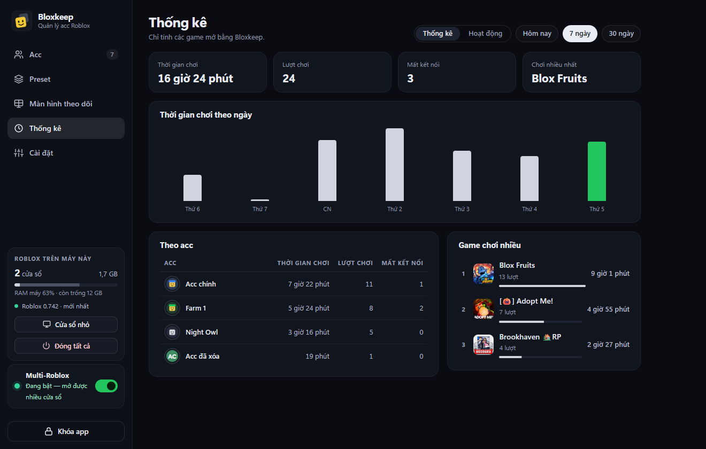

### Discord

Bloxkeep can post to a channel of yours through a webhook (a link that lets a program post in one channel). It is **off by default**.

1. In Discord: **Channel settings › Integrations › Webhooks › New Webhook › Copy Webhook URL**.
2. In Bloxkeep: **Settings › Discord › Webhook link › Paste link…** (switching **Send to Discord** on without a link asks for it).
3. Switch **Send to Discord** on and press **Send test**.

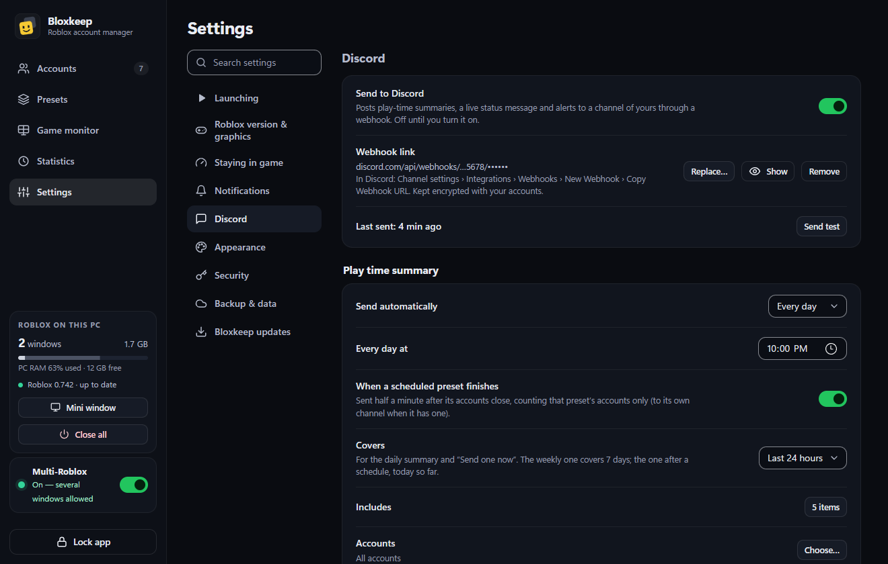

It sends three kinds of message, each with its own settings.

**Alerts** tell you at once when something needs a look. One alert is one card: a coloured bar for how serious it is, a short title, the account's name and avatar above it, the game's icon beside it, and the game, time played and Roblox's reason side by side. The five kinds are **Account dropped or auto-rejoin**, **Scheduled presets**, **Sign-in needs renewing** (bans too), **Low RAM** and **Launch problems**, each with its own switch and ping. Alerts that happen within 10 seconds of each other go out as one message with an entry for each, and its bar takes the colour of the most serious one.

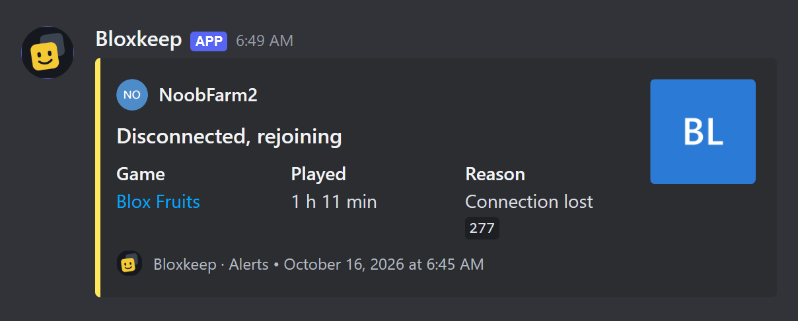 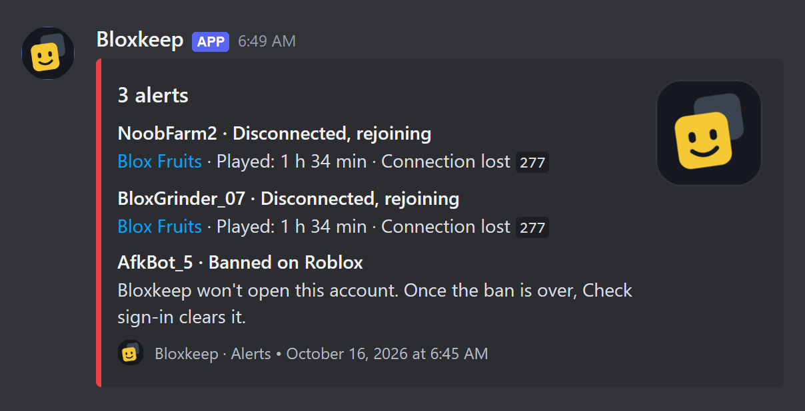

On the left, one alert. On the right, several alerts sent at once.

The **status board** (**Keep a status message up to date**, every 2, 5, 10, 15, 30 or 60 minutes) is one message that Bloxkeep edits in place. Its title says how many accounts are in game ("3 of 6 accounts in game"), a line counts how many are disconnected, joining or on the home screen and how much RAM Roblox uses, and each open account has its own field: game, state and time, PID and RAM. It never pings. When Bloxkeep is locked or closed, it says so.

The **play-time summary** goes out **every day**, **every week** or **both** (**Send automatically**), when a scheduled preset finishes (half a minute after its accounts close, counting that preset's accounts only), or when you press **Send summary**. It holds a picture of play time by hour (or day) coloured by game with a row per account and its avatar, the totals against the period before, drops with Roblox's codes, the longest stay, the most windows at once, the top games, and a block per preset with its accounts. **Covers** picks the last 24 hours, 7 days or 30 days (the weekly one always covers 7), **Includes** which parts, and **Accounts** which accounts.

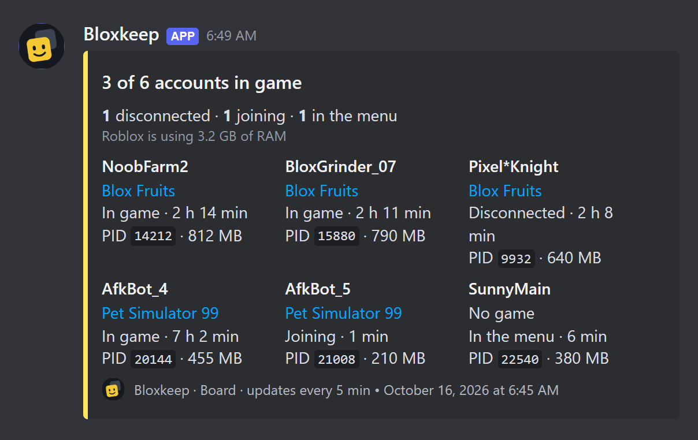 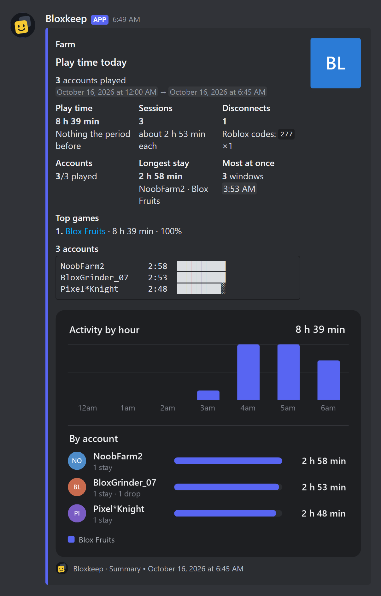

On the left, the status board. On the right, a play-time summary.

- **Pings**: each kind can ping **Nobody**, **@here**, **@everyone**, a person or a role. A person or a role needs its ID: in Discord, turn on **Settings › Advanced › Developer Mode**, then right-click it › **Copy ID**. **Quiet hours** (**From** and **To**) keep the messages coming without pings.
- **Customise messages**: the sender's name and picture, the language (**Same as Bloxkeep**, English or Tiếng Việt), the style (**Cards**, or **Plain text**, which suits phone notifications) and **Hide account names in messages**.
- **A preset's own webhook** sends that preset's messages to another channel (see [Presets](#presets)).
- The link is kept encrypted with your accounts. **Show** displays it for 30 seconds, **Replace…** pastes another and **Remove** asks first. If Discord says the webhook is gone, sending stops and the **Discord** page gets a red dot: paste a new link. Nothing is sent while Bloxkeep is locked. Messages that couldn't go while offline wait.
- Messages carry account names (or **Account 1**, **Account 2**…), game names, play time, sessions, PID, RAM and links to Roblox's own pictures. Never cookies, passwords or the webhook link. See [Data and security](#data-and-security).

More in the user guide: [Sending to Discord](docs/guide/discord.md).

### Tray, lock and notifications

- **Keep running in the tray when closed** (on by default, **Settings › Staying in game**): the X button hides Bloxkeep to the tray, and auto-rejoin, Multi-Roblox and schedules keep working. Click the tray icon for the quick panel (Multi-Roblox's switch, the accounts playing, **Play**, **Presets** and **New Roblox**), and right-click it for the menu, which also has **Mini window**, **Open Bloxkeep** and **Quit Bloxkeep** ([the tray](docs/guide/staying-in-game.md#the-tray)). With it off, X quits. Next time, the Bloxkeep window comes back where you left it, at the same size, maximised or not.
- **Lock app** (bottom of the sidebar) locks Bloxkeep with the master password. Every Roblox window stays open; auto-rejoin, scheduled presets and Discord messages pause until you unlock. Locking also stops a launch under way, closes the Bloxkeep browser window, clears a copied password or 2FA code and drops the decrypted data from memory. If something would pause, **Lock Bloxkeep?** lists it first ("Auto-rejoin for 3 accounts", "2 scheduled presets"); tick **Don't ask again** to skip the question.
- While locked, a scheduled start doesn't run (after you unlock, Bloxkeep tells you once, and doesn't run it late), but a scheduled stop still closes its windows on time. The lock screen reminds you that Roblox windows are still open.
- **Windows notifications** (on by default): only while Bloxkeep is in the background (hidden, minimised or behind another window), at most one per account and kind every 5 minutes. Turn each kind on or off in **Settings › Notifications**: account dropped or auto-rejoin, scheduled presets, sign-in needs renewing, low RAM, launch problems. Messages inside Bloxkeep show either way.
- **Hardware acceleration** (in **Settings › Staying in game**): draws the interface with the graphics card instead of the CPU; it turns itself off if the graphics driver keeps failing. Switching reloads the window.

### Appearance

- **Settings › Appearance › Theme**: 74 themes in five groups (Basic, Scenery, Colourful, Styles, Seasonal) plus **Sync with Windows** (light or dark like Windows). **Dark** by default. The arrow keys try themes, and the pick is saved once you stop. Scenery and Seasonal themes have a drawn scene behind glass panels; Styles change the shapes too (Windows 98, macOS with working window buttons, GNOME, Ubuntu, KDE, Game Boy, Notebook…).
- **Language**: English or Tiếng Việt (also on the unlock screen).
- **Hide account names**: every place shows **Account 1**, **Account 2**… (each account's place in the list) instead of names, Roblox window titles included, for screenshots and streams. @usernames disappear and **Edit** hides the user ID. Discord messages have their own switch.
- **Quick search** (`Ctrl+K`) finds accounts, presets (type a name to run it), games, Settings pages and actions. **Search settings** at the top of Settings finds a row on any page.

### Keyboard shortcuts

| Keys | What they do |
|---|---|
| `Ctrl+K` | Quick search |
| `Ctrl+F` | The search box of the tab you're on |
| `Ctrl+L` or `/` | The game box |
| `Ctrl+A`, `Enter`, `F2`, `Delete`, `Esc` | Accounts: select all shown, play the selected, edit one, delete (asks first), clear the selection |
| Click, `Shift`-click, double-click, right-click | Select, select a range, play that account alone, open its menu |
| `Ctrl+Enter` / `Shift+Enter` | In quick search, on an account: play / edit |
| `Ctrl+T`, `Ctrl+W`, `Ctrl+Tab` | In Bloxkeep's browser window: new tab, close the tab, switch tabs |

More in the user guide: [Keyboard shortcuts](docs/guide/troubleshooting.md#keyboard-shortcuts).

### Bringing accounts over

**Another Bloxkeep file** (a `vault.rmv` or a backup from another PC): click **Import from: Bloxkeep file**, or **Import…** in **Settings › Backup & data**. Choose the file, enter that file's own master password, tick the accounts you want (each says **New** or **Already here**) and import.

- The file itself isn't changed; the imported accounts are locked with your current master password.
- For an account that is already here, only a sign-in that no longer works is replaced; your names, groups and notes stay.
- **Also import presets** brings them with their schedules switched off, leaving out accounts that aren't here.
- You can't import the vault you are using. After three wrong passwords, **Open** counts down before the next try.

**Cookie**: choose **Paste a cookie** and paste the `.ROBLOSECURITY` cookie. It is a full key to the account, so never share it.

**Other account managers**: Bloxkeep can't read their files. Add those accounts any other way; if the tool shows an account's cookie, **Paste a cookie** works.

To replace everything instead, as on a new PC, use **Restore** (see [Backup and restore](#backup-and-restore)).

### Roblox VNG

You can add Roblox VNG accounts on the **Roblox VNG** tab (with your phone, confirming in the Roblox VNG app, or with a password; there is no browser sign-in for them). They get a "VNG" tag. Bloxkeep **can't open games** for VNG accounts yet: their **Play** button is off, with the reason. When you play several accounts at once they are left out, and the result says so. **Open website** is off for them too.

### Help and feedback

- **User guide**: ⋯ menu above the list › **User guide**, or **Settings › Bloxkeep updates › Help & feedback › User guide › Open**. It opens the [user guide](docs/guide.md).
- **Send feedback** (**Settings › Bloxkeep updates › Help & feedback › Send feedback**, or `Ctrl+K`, "feedback"): choose **Something doesn't work** or **An idea**, write a message, and add how to reach you if you'd like an answer. For a bug it can add Bloxkeep's error log, with account names, cookies and passwords taken out (Bloxkeep must be unlocked), and **See exactly what will be sent** shows everything before it goes. One message a minute ([how it works](docs/feedback.md)).
- **What's new** shows the headline features of each version as cards, then a short list of the rest. It opens after an update, and from **Settings › Bloxkeep updates**.
- **Online count** (**Settings › Bloxkeep updates › Privacy › Add me to the online count**, on by default): while Bloxkeep is open it tells its developer so every 10 minutes, with only a random code, the version and the language, so they can see how many people use it right now. Turned off, it says once that you've gone and sends nothing more ([privacy policy](PRIVACY.md)).

<details>
<summary>More pictures</summary>

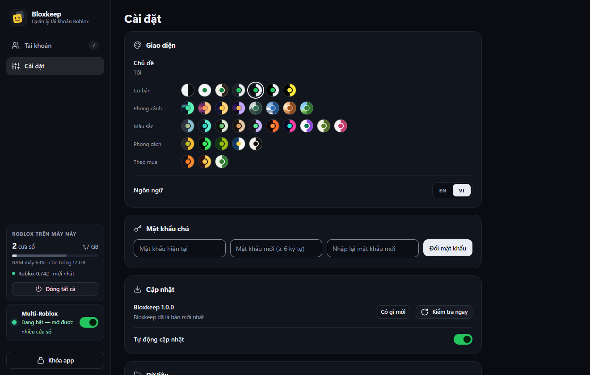 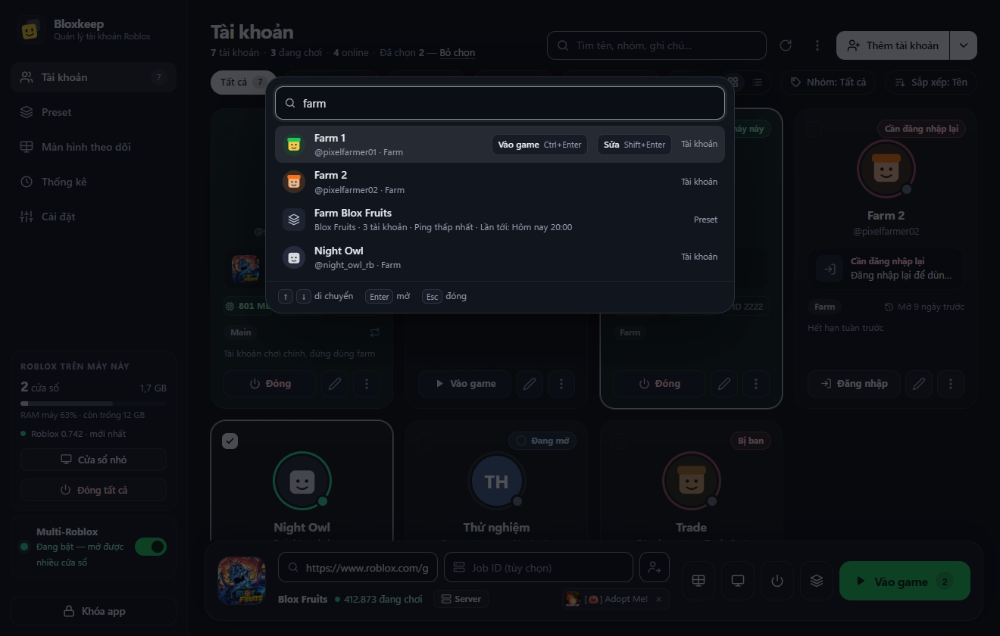
</details>

## Data and security

**What's stored.** Accounts (cookie, username, ID, nickname, group, note, and the password and authenticator key if you entered them), settings, presets, recent and pinned games, play history and the activity log, the Discord webhook link.

**Where.** Everything stays on your PC. **Settings › Backup & data › Data location** shows the folder, with **Open folder**.

| Path | Contents |
|---|---|
| `%LOCALAPPDATA%\Bloxkeep\` | The data folder (installed copy). The portable copy uses a `data\` folder next to the app. |
| `vault.rmv` | The encrypted vault: accounts, settings, presets, recent and pinned games, play history, activity log, webhook link |
| `vault.rmv.bak` | The previous save, used automatically if `vault.rmv` is damaged |
| `vault.rmv.damaged-…`, `vault.rmv.spare-…`, `vault-before-restore-….rmv` | Copies kept after a self-repair or a restore; the app never deletes them |
| `prefs.json` | Non-secret settings: language, theme, updates, notifications, backup folder, window position, Roblox build history |
| `roblox-settings.json` | Your graphics, FPS, volume and fullscreen settings, to put back after opening an account |
| `error.log` | Errors and short sign-in notes, with no account details |
| `webview\`, `webview-safe\` | The interface cache, removed on uninstall |
| `%LOCALAPPDATA%\BloxkeepApp\`, or the folder you chose in Setup | The installed program (removed on uninstall) |

**How it's protected.** The vault is encrypted with AES-256-GCM. The key comes from your master password through PBKDF2-HMAC-SHA256 with 600,000 iterations and a random salt. The file header is authenticated too, so a wrong password or a tampered file is detected. The master password is never stored. Every save is written in full before it replaces the old file, and the previous save is kept in `vault.rmv.bak`. When you lock the app, Bloxkeep drops all the decrypted data it was holding (cookies, passwords, authenticator keys).

> [!WARNING]
> If you forget the master password, your saved accounts can't be recovered. A backup also only opens with the password it was saved with.

**What leaves your PC.** Bloxkeep has no analytics: apart from an anonymous "open now" note, which you can turn off, nothing about you or how you use it is sent. Data only goes to (also in the [privacy policy](PRIVACY.md)):

| Where | When, and what |
|---|---|
| Roblox's API hosts (`auth`, `users`, `presence`, `friends`, `games`… `.roblox.com`) | Signing in (the password only goes to `auth.roblox.com`), session and ban checks, status every 30 seconds, game, server, friend and player lookups, join tickets, the newest Roblox version |
| `www.roblox.com` | The browser sign-in window, profiles, and the join link handed to Roblox |
| `*.rbxcdn.com` | Avatars and game pictures |
| `*.robloxapp.vnggames.com` | The same as the Roblox API hosts, for Roblox VNG accounts only |
| Roblox's captcha providers (Arkose Labs, HUMAN Security) | Only in the puzzle window, when Roblox asks for a captcha during password sign-in |
| GitHub | Checking for and downloading updates, with no account data (can be turned off), and reading the [Roblox watch](docs/roblox-watch.md)'s findings |
| Bloxkeep's feedback service (a Cloudflare Worker that forwards to the developer's Discord) | Only when you press **Send** in **Send feedback**, and only what **See exactly what will be sent** shows ([details](docs/feedback.md)) |
| Bloxkeep's Discord bot (`bloxkeep-bot.bloxkeep-app.workers.dev`, a Cloudflare Worker) | While Bloxkeep is open, unless **Settings › Bloxkeep updates › Privacy › Add me to the online count** is off: every 10 minutes (further apart when many people have it open), and once as it closes, a random id made for your Bloxkeep (linked to nothing else), its version and the app's language. The bot counts how many are open now and keeps each id only while that Bloxkeep is open; never your IP address |
| Microsoft (`go.microsoft.com`) | Only when WebView2 has to be installed |
| The backup folder you choose | A copy of the encrypted vault; your OneDrive / Google Drive app may sync it |
| Your Discord webhook (`discord.com`) | Only when **Settings › Discord** is on (off by default): account names (or **Account 1**, **Account 2**… with **Hide account names in messages**), game names, play time, sessions, PID, RAM, and links to Roblox's own pictures of the games and of the accounts' avatars (no avatar when names are hidden). Never cookies, passwords or the webhook link itself; the link is kept in the encrypted vault |

**Inside the app.** The interface is locked down with a Content Security Policy, so it can't send requests by itself; every connection goes through the app's core. A password or cookie only reaches the interface when you show or copy it. Copies stay out of clipboard history and are wiped after 30 seconds. `error.log` has no account details.

**Keep cookies safe.** A cookie is a full sign-in key for its account. Never send anyone your cookies, `vault.rmv` or a backup file. If one leaks, sign out of all other sessions in Roblox's settings (on roblox.com or in the Roblox app).

**Check it yourself.** Compare the SHA-256 with `SHA256SUMS.txt`, read the source, or [build it yourself](#build-from-source).

## Backup and restore

Turn on **Settings › Backup & data › Back up to a folder**, then click **Choose…** or use a OneDrive / Google Drive folder Bloxkeep found on your PC (for example **Use Google Drive**). Bloxkeep only copies files into that folder; your OneDrive or Google Drive app uploads them.

- A backup is a copy of the encrypted vault, named `Bloxkeep-backup-` plus the date and time.
- It backs up after every change (at most every 10 minutes), when you lock or quit if something changed, and right after you change the master password or pick a new folder. **Back up now** backs up at once.
- It keeps the 10 newest, plus the newest of each day for the last 30 days. The backup just made is never cleaned up, even after the PC clock is set back. Bloxkeep only cleans up backups of its own vault, so two PCs sharing a folder never delete each other's.
- If the master password is easy to guess and the folder is a cloud folder, the app suggests a longer one.

**Restore**: click **Restore…** in **Settings › Backup & data**, or **Restore from a backup** on the first screen of a new PC. Your current data is kept as `vault-before-restore-….rmv`, then the app locks; unlock it with the password the backup was saved with.

**Moving to a new PC**: install Bloxkeep, click **Restore from a backup**, pick the newest backup and enter the password it was saved with. To merge the accounts of two PCs instead of replacing them, use **Import…** (see [Bringing accounts over](#bringing-accounts-over)).

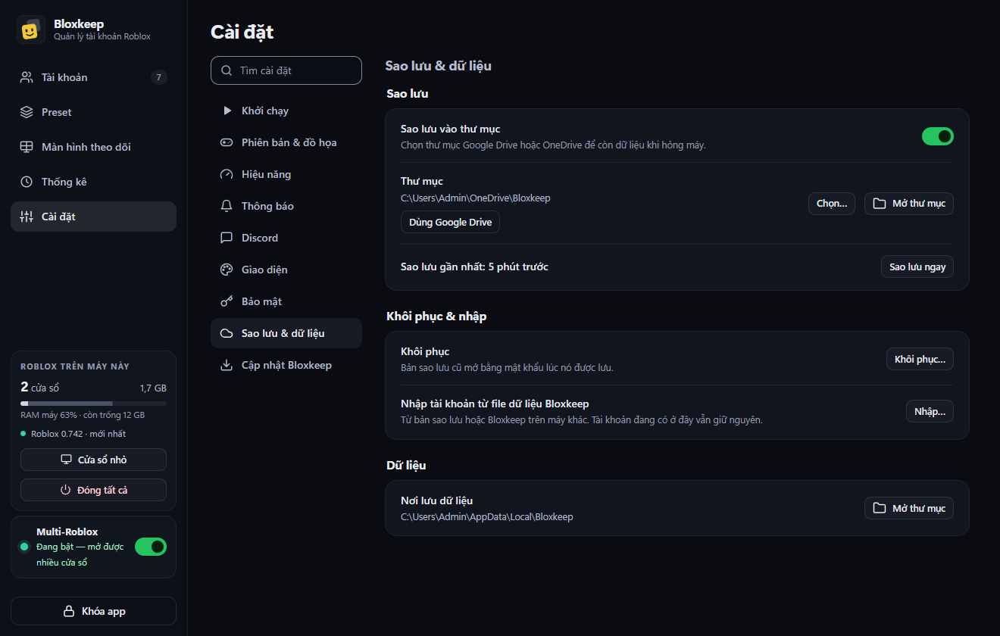

## Known limits and testing status

- Roblox's online status lags: after you leave a game, Roblox can still report "playing" for a few minutes.
- Roblox from the Microsoft Store is still being tested (**Settings › Launching › Open Roblox with**). Bloxkeep's Roblox settings for the windows (windowed, graphics) aren't applied to it yet.
- Roblox VNG accounts can be added, but games can't be opened for them yet.
- Multi-Roblox: Bloxkeep has to be open before Roblox and stay open while you play. If Roblox (including one in the tray) opened first, the light stays yellow until every Roblox is closed. Roblox doesn't officially support several clients, and a later Roblox build may change how it blocks them.
- Per-app VPNs: if Roblox goes through a VPN and Bloxkeep doesn't, opening a game can fail with error 403. See the [FAQ](#faq).
- A server's ping is its players' average, not yours. Friends' servers, and the server of a player you look up, only show when their privacy settings allow it.
- Saving RAM: Roblox may not give RAM back.
- The files aren't code-signed, so SmartScreen warns the first time. Updating itself only works while the GitHub repository is public.
- A forgotten master password can't be recovered.

Tried with real accounts on Windows 11 (Roblox 0.742 and 0.743, October 2026): password sign-in through the proof-of-work step and HUMAN's press-and-hold captcha, joining a game, 5 accounts in one game with Multi-Roblox on Roblox's October 2026 build (the picture at the top), several separate home screens.

**Not tried with real accounts yet:**

- Auto-rejoin and **Restart Roblox** over many hours.
- Scheduled presets, sending to Discord, **Light AFK**, **Small tiles**.
- The 2FA code filled in at sign-in, the **Banned** tag on an actually banned account, **Join a player…** with a real player.
- The last step of **Sign in with your phone**, 2-step verification, and the rotating-picture captcha (Arkose).
- Windows 10.

If something breaks, tell me from the app: **Settings › Bloxkeep updates › Send feedback** (or `Ctrl+K`, "feedback"). It can add Bloxkeep's error log, with account names, ids, passwords and cookies taken out, and **See exactly what will be sent** shows it before it goes ([how it works](docs/feedback.md)). Or [open an issue](../../issues) with the error.

## FAQ

Every feature is explained step by step in the [user guide](docs/guide.md).

### **Q:** Is this a virus? Why do Windows or antivirus apps warn?

**A:** No. The files aren't code-signed yet (Bloxkeep is applying for free signing through SignPath Foundation), so SmartScreen and some antivirus apps warn about any new file. You can compare the SHA-256 with `SHA256SUMS.txt`, read the source in this repository, or [build it yourself](#build-from-source).

### **Q:** My antivirus deleted Bloxkeep. Should I not use it?

**A:** Check the download first: its SHA-256 must match `SHA256SUMS.txt` on the release page, and it must come from this repository's [Releases](https://github.com/minhhoang0122/bloxkeep/releases). If it matches, restore it from your antivirus's quarantine and report the file as a false positive (for Windows Defender: [microsoft.com/wdsi/filesubmission](https://www.microsoft.com/wdsi/filesubmission)). Never use a "Bloxkeep" from anywhere else.

### **Q:** Does Multi-Roblox really work?

**A:** Yes. The picture at the top of this page is a real screenshot of one PC with five accounts open at once (Roblox 0.743, October 2026). Roblox can change how it blocks several windows in any update, so Bloxkeep checks every new Roblox build and remembers each build on which two windows played together on your PC; see [Roblox updates](#roblox-updates).

### **Q:** How do I turn on Multi-Roblox?

**A:** Flip the **Multi-Roblox** switch at the bottom of the sidebar (or **Settings › Launching › Multi-Roblox**) and confirm. Open Bloxkeep before Roblox, and keep it open while you play. The light tells you how it's going:

| Light | Meaning |
|---|---|
| Green | On: you can open several accounts at once |
| Yellow | Not working yet (a Roblox was already open), or a Roblox update may stop it. Click the card to see what to do |
| Grey | Off: each new Roblox window closes the one before |

If you press **Play** for two accounts while it's off, Bloxkeep offers **Turn on Multi-Roblox and play**.

### **Q:** The Multi-Roblox light is yellow.

**A:** A Roblox was open before Bloxkeep. Close every Roblox, including one in the system tray. If Roblox starts with Windows, click **Turn off autostart** in the help dialog. The light turns green. Next time, open Bloxkeep before Roblox. If the card says a Roblox update may stop it, keep playing; Bloxkeep tells you if Roblox starts closing windows, and an update of Bloxkeep is the fix.

### **Q:** I can't open several accounts: each new window closes the last one.

**A:** Multi-Roblox is off or not working yet: see the two answers above. If the light is green and windows still close, Roblox has changed how it blocks several windows. Look for a Bloxkeep update (**Settings › Bloxkeep updates › Check now**) and [send feedback](#q-you-should-add-a-feature--i-found-a-bug).

### **Q:** A Roblox window crashes as it opens ("Memory dump captured", or Bloxstrap's "Roblox failed to launch")

**A:** Windows' virtual memory is full, even if RAM is free: each Roblox window reserves about 2.5 GB of it. Bloxkeep warns before **Play** when this is about to happen.

- Close apps you don't need, or
- Increase virtual memory. It can go on any drive, so drive C needs no space: **Win+R** › `sysdm.cpl` › **Advanced › Performance › Settings › Advanced › Virtual memory › Change**. Untick **Automatically manage**, pick a drive with room, set **Custom size** 16384 / 32768 MB, press **Set**, **OK**, and restart the PC.

### **Q:** What do the coloured dots on an account mean?

**A:** The dot on the picture shows where the account is: **green** in a game, **blue** online on the website or app, **amber** in Roblox Studio, **yellow** disconnected while its window is still open, **grey** offline. A **red ring** means it needs to sign in again, or is banned. The **Needs sign-in** and **Banned** filters above the list show just those.

### **Q:** Adding an account doesn't work.

**A:** Try another way under **Add account**: **Sign in with your phone** (a code or QR, no password or puzzle; best when the account is signed in on your phone), **Sign in with a browser**, **Open roblox.com** (sign in on the site, then **Save to Bloxkeep**), or **Paste a cookie**. If the password sign-in keeps asking for a puzzle, the phone is the easy way round.

### **Q:** Copy password says no password is saved.

**A:** No way of signing in keeps the password: the phone, browser and cookie methods never see it, and the password sign-in sends it to Roblox and forgets it. To have it there, type it under **Edit (F2) › Roblox password**. The same goes for **Copy 2FA code**: paste the account's authenticator key under **Edit**.

### **Q:** Can I join private (VIP) servers?

**A:** Yes. Paste the private server link into the game box and press **Play**; Bloxkeep opens that server for every account you selected. A **Job ID** puts them in one particular server, and **Join a player** (next to the box) finds the server a player is in.

### **Q:** Some Roblox windows open fullscreen and some don't.

**A:** All Roblox windows share one fullscreen setting, so with several open they easily end up different. Keep **Always open Roblox windowed** on in Multi-Roblox's **Details** (it's on by default): every window opens windowed, and your setting is put back afterwards. To have each one fill the screen, choose **Maximise it** under **When a Roblox window opens**; to lay them out side by side, **Tile them side by side** or **Arranging windows**.

### **Q:** Do my Bloxstrap / Fishstrap mods still work?

**A:** Yes, if you choose **Bloxstrap** or **Fishstrap** in **Open Roblox with**. If the launcher blocks several windows, choose **RobloxPlayerBeta directly (skip launchers)**; Roblox then opens without the launcher.

### **Q:** Can I use Roblox from the Microsoft Store?

**A:** Yes, while it's being tested: choose **Roblox (Microsoft Store)** under **Settings › Launching › Open Roblox with**. Microsoft's own launcher lets only one Store Roblox run, so Bloxkeep starts the Store's Roblox itself, with each account's own sign-in, in a window of its own. Updates still come from the Microsoft Store. If it doesn't work for you, Roblox from roblox.com works the same way, with Bloxstrap or Fishstrap if you like.

### **Q:** I left the game but it still says "playing".

**A:** Roblox's status lags, sometimes by a few minutes. For windows on this PC Bloxkeep ignores the stale report; status from other devices can still lag.

### **Q:** Opening a game fails with 403 "An error was encountered during authentication".

**A:** Usually a per-app VPN: Roblox goes through it and Bloxkeep doesn't. A join ticket is tied to the IP address that asked for it, so let Bloxkeep take the same route as Roblox.

### **Q:** Can I use it in Vietnam without access to roblox.com?

**A:** Partly. Password sign-in and phone sign-in go through Roblox's API hosts, not www.roblox.com, and the captcha page is served by the app itself. The browser method needs www.roblox.com. Bloxkeep has no VPN or region bypass. Roblox VNG accounts can be added, but games can't be opened for them yet.

### **Q:** How do I back up my accounts?

**A:** Turn on **Settings › Backup & data › Back up automatically** and pick a folder, ideally one that OneDrive or Google Drive syncs. Each backup is encrypted with your master password. See [Backup and restore](#backup-and-restore).

### **Q:** How do I move to a new PC?

**A:** Turn on backups to a OneDrive or Google Drive folder on the old PC. On the new one, install Bloxkeep, click **Restore from a backup** and enter the password the backup was saved with.

### **Q:** I forgot my master password.

**A:** It can't be recovered; it isn't stored anywhere. You can delete `vault.rmv` and `vault.rmv.bak` in `%LOCALAPPDATA%\Bloxkeep` (losing every saved account) and start over, or restore a backup whose password you remember.

### **Q:** Does Bloxkeep send my password or cookies anywhere?

**A:** Only to Roblox. A password you sign in with only goes to Roblox's sign-in server, and each account's cookie is only sent to Roblox's own hosts (Roblox VNG's, for VNG accounts). Update checks to GitHub carry no account data. The full list is under [Data and security](#data-and-security).

### **Q:** Can I use it on Mac or Linux?

**A:** No. Bloxkeep runs on Windows 10 and 11 (64-bit) only.

### **Q:** Will my account get banned?

**A:** No one can promise that. Roblox doesn't officially support running several clients, so using Multi-Roblox is at your own risk. Bloxkeep signs in and opens games the same way roblox.com does, and doesn't touch the game's memory. Some games forbid alt accounts; check the rules of the game you play.

### **Q:** You should add (a feature) / I found a bug.

**A:** Tell us from the app: **Settings › Bloxkeep updates › Send feedback** (or Ctrl+K). A bug report can include Bloxkeep's error log, with account names, passwords and cookies taken out, and you see exactly what is sent. You can also open an [issue](https://github.com/minhhoang0122/bloxkeep/issues).

### **Q:** How do I remove Bloxkeep completely?

**A:** Uninstall it in Windows **Settings › Apps** and tick **Also delete my accounts and settings**. Backups in your backup folder stay; delete them yourself. For the portable copy, delete the app's folder (with its `data`).

## Build from source

You need Windows and the **.NET 10 SDK**. The app is a C# core (.NET 10, WinForms) with an HTML/CSS/JS interface in WebView2. The [Velopack](https://velopack.io) packager (`vpk`) is pinned in `dotnet-tools.json` and the scripts fetch it.

```bat
build.bat 1.0.1
```

It runs the checks in `Tests\Bloxkeep.Tests` first and stops if one fails (run them alone with `dotnet run --project Tests\Bloxkeep.Tests`; add `--online` for the ones that ask Roblox's servers). Each runs in its own process with throwaway data, never yours. The output goes to `dist\releases\`: `Bloxkeep-Setup.exe` (the web installer, copied as it is from `Installer\Web`), `Bloxkeep-Setup-Offline.exe`, `Bloxkeep-Portable.zip`, the update packages and `SHA256SUMS.txt`. The web installer is rebuilt only on purpose, with `Installer\Web\make.bat`: a new build is a new file to SmartScreen. A second argument is the GitHub repository the build looks for updates in (this one by default); pass another when you build a fork.

```bat
release.bat 1.0.1 https://github.com/minhhoang0122/bloxkeep
```

This uploads the build to GitHub Releases and needs a `GITHUB_TOKEN` environment variable with write access to releases. Each version needs its notes, in English and Vietnamese, in `RobloxManager\whatsnew.json`; they show in the app after an update and become the release notes. To test updates before publishing, set `BLOXKEEP_UPDATE_SOURCE` to a local folder of release files.

**Try the interface without building**: serve the repository root with any static web server (for example `python -m http.server 5178`) and open `http://127.0.0.1:5178/dev/preview.html`. It runs on the made-up data in `dev/mock.js`.

```
RobloxManager/             C# source
  wwwroot/                 the interface (embedded in the exe); EN/VI strings in i18n.js
  AppController*.cs        commands from the interface, launching, process tracking, auto-rejoin, presets,
                           schedules, Discord, statistics, backups (one file per part)
  RobloxApi.cs             Roblox API calls (sign-in, status, games, servers)
  RobloxLauncher.cs        opens Roblox through the chosen launcher
  RobloxLogWatcher.cs      reads Roblox's logs to see joins and kicks
  RobloxGameSettings.cs    writes Roblox settings before opening an account, then puts yours back
  MultiInstance.cs         Multi-Roblox
  MonitorTab.cs            the Game monitor tab
  Vault.cs                 the encrypted vault
  AppUpdater.cs            self-update (Velopack)
  whatsnew.json            notes for each version
Installer/                 the installer's splash image; Setup/ the installer and uninstaller windows
dev/                       interface preview with made-up data (not packaged)
docs/screenshots/          screenshots (vi/: the Vietnamese ones)
```

## Code signing policy

Releases are built from this repository by the [Release workflow](.github/workflows/release.yml) on GitHub's own Windows machines. Bloxkeep is applying to SignPath Foundation for free code signing; what gets signed, how, and who approves it is in the [code signing policy](CODE_SIGNING_POLICY.md). What the app sends and where is in the [privacy policy](PRIVACY.md).

## License

[MIT](LICENSE) © 2026 minhhoang0122

*Bloxkeep is an independent project. It is not affiliated with, endorsed or sponsored by Roblox Corporation. Roblox is a trademark of Roblox Corporation.*
