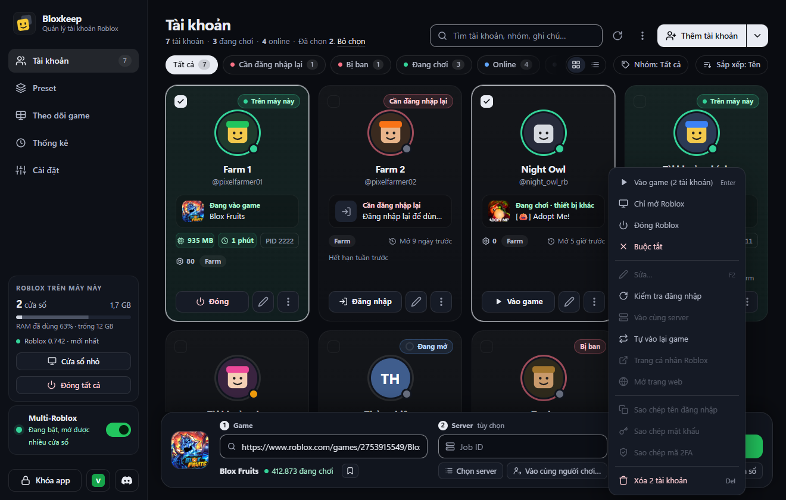
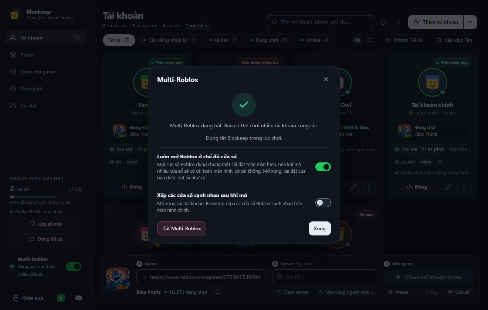
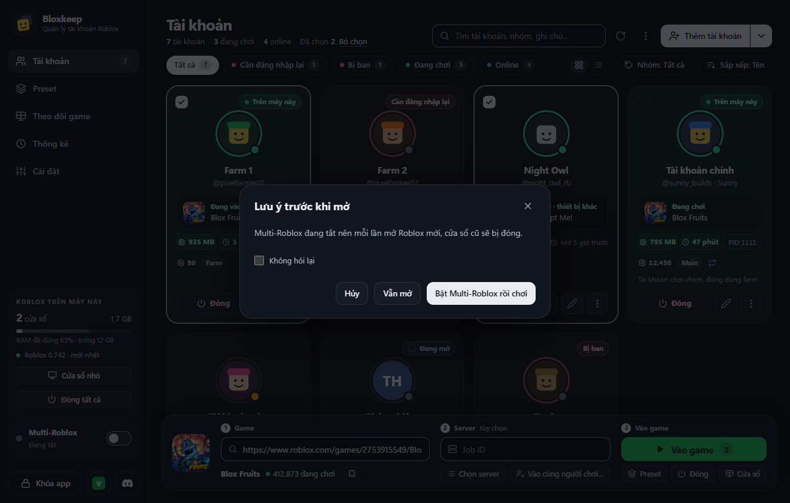
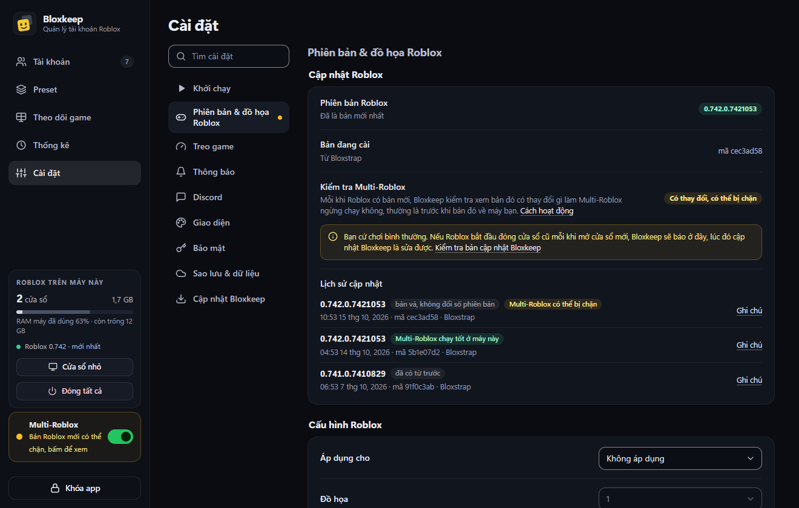

<p align="center">
  
</p>
<h1 align="center">Bloxkeep</h1>
<p align="center">Quản lý và mở nhiều tài khoản Roblox trên Windows. Tài khoản được mã hóa và chỉ lưu trên máy của bạn.</p>
<p align="center"><a href="README.md">English</a> | Tiếng Việt</p>
<p align="center">  <a href="LICENSE"></a></p>
<p align="center"><a href="#tải-về-và-cài-đặt">Tải về</a> · <a href="#bắt-đầu">Bắt đầu</a> · <a href="docs/guide.vi.md">Hướng dẫn</a> · <a href="https://minhhoang0122.github.io/Bloxkeep/vi/">Trang web</a> · <a href="#dữ-liệu-và-bảo-mật">Bảo mật</a> · <a href="#câu-hỏi-thường-gặp">Câu hỏi thường gặp</a> · <a href="CODE_SIGNING_POLICY.md">Code signing policy</a> · <a href="PRIVACY.md">Quyền riêng tư</a></p>

<p align="center"></p>
<p align="center"><sub>Ảnh chụp thật trên một máy: năm tài khoản Roblox mở cùng lúc bằng Bloxkeep, bốn tài khoản đã vào game, tài khoản thứ năm đang vào. Tên trong game đã được làm mờ.</sub></p>

Bloxkeep dành cho người chơi nhiều tài khoản Roblox trên một máy Windows: giữ các tài khoản ở một chỗ, chọn game, chọn tài khoản rồi bấm **Vào game**. Dữ liệu chỉ nằm trên máy của bạn, được mã hóa bằng mật khẩu chủ; Bloxkeep không có máy chủ riêng.

*Bloxkeep là dự án độc lập, không liên kết, không được Roblox Corporation bảo trợ hay tài trợ. Roblox là thương hiệu của Roblox Corporation.*

## Tính năng


Mỗi mục đều được giải thích ở phần [Sử dụng](#sử-dụng) và, từng bước một, trong [hướng dẫn sử dụng](docs/guide.vi.md).

- **Thêm tài khoản** bằng điện thoại (mã hoặc QR), tên đăng nhập và mật khẩu (có xác minh 2 bước, captcha giải trong một cửa sổ nhỏ), cửa sổ trình duyệt, cookie hoặc một file Bloxkeep khác; hoặc đăng nhập ngay trên roblox.com rồi bấm **Lưu vào Bloxkeep**. [Bắt đầu](#bắt-đầu), [Chuyển tài khoản từ nơi khác](#chuyển-tài-khoản-từ-nơi-khác)
- **Xem trạng thái từng tài khoản**: online, đang chơi trên máy này hay thiết bị khác, bị văng vì lý do gì, RAM, thời gian đã chơi, PID, cần đăng nhập lại, bị ban. Tìm, lọc, nhóm, sắp xếp, xem dạng thẻ hoặc dạng danh sách. [Danh sách tài khoản](#danh-sách-tài-khoản)
- **Một menu cho từng tài khoản**: vào game, đóng, sửa, kiểm tra đăng nhập, vào cùng server, tự vào lại game, mở trang web, sao chép tên đăng nhập, mật khẩu hay mã 2FA. [Menu của tài khoản](#menu-của-tài-khoản)
- **Mã 2FA và mật khẩu đã lưu**, nằm trong kho đã mã hóa nếu bạn chọn lưu. [Mật khẩu và mã 2FA](#mật-khẩu-và-mã-2fa)
- **roblox.com ngay trong Bloxkeep**: trang web đã đăng nhập sẵn bằng bất kỳ tài khoản nào, mỗi tài khoản một tab, tách biệt với trình duyệt của bạn. [Mở trang web](#mở-trang-web)
- **Game và server**: chọn game theo tên, link hoặc Place ID; chọn server (đông nhất, vắng nhất, ping thấp nhất, đủ chỗ cho N tài khoản, ngẫu nhiên); vào cùng bạn bè, hoặc vào đúng server của một người chơi. [Chọn game và server](#chọn-game-và-server)
- **Preset**: lưu sẵn tài khoản, game và cách chọn server để chạy bằng một lần bấm, có hẹn giờ chạy và dừng, và tùy chọn riêng. [Preset](#preset)
- **Multi-Roblox**: chạy nhiều cửa sổ Roblox cùng lúc, mở ở chế độ cửa sổ và xếp thành lưới, kèm kiểm tra từng bản Roblox mới. Tắt sẵn, bạn tự bật khi cần. [Multi-Roblox](#multi-roblox), [Cập nhật Roblox](#cập-nhật-roblox)
- **Treo game**: [Chống AFK](#chống-afk) giữ cửa sổ khỏi bị kick vì đứng yên, còn [Tự vào lại game](#tự-vào-lại-game) vào lại sau khi bị văng, cứ 10 giây thử một lần, chỉ dừng khi bị game ban.
- **Cấu hình Roblox theo tài khoản** (đồ họa, FPS, âm lượng), và chọn chương trình dùng để mở Roblox: Roblox, Bloxstrap, Fishstrap, RobloxPlayerBeta trực tiếp, Roblox bản Microsoft Store (đang thử nghiệm) hoặc launcher của riêng bạn. [Cấu hình Roblox theo tài khoản](#cấu-hình-roblox-theo-tài-khoản), [Mở Roblox bằng](#mở-roblox-bằng)
- **Cửa sổ và RAM**: hình trực tiếp của mọi cửa sổ Roblox trong tab Theo dõi game, cửa sổ nhỏ, xếp cửa sổ, cảnh báo trước khi hết RAM hoặc bộ nhớ ảo của Windows. [Cửa sổ, RAM và màn hình theo dõi](#cửa-sổ-ram-và-màn-hình-theo-dõi)
- **Thống kê và nhật ký hoạt động**: thời gian chơi, số lượt và số lần mất kết nối theo tài khoản, game và preset. [Thống kê và hoạt động](#thống-kê-và-hoạt-động)
- **Discord**: cảnh báo, tin trạng thái tự cập nhật và tổng kết thời gian chơi gửi vào kênh của bạn. [Discord](#discord)
- **Khóa app, khay hệ thống và thông báo**: khóa Bloxkeep bằng mật khẩu chủ, chạy ngầm ở khay, nhận thông báo Windows. [Khay hệ thống, khóa app và thông báo](#khay-hệ-thống-khóa-app-và-thông-báo)
- **Giao diện và ngôn ngữ**: 74 chủ đề, tiếng Anh và tiếng Việt, ẩn tên tài khoản khi chụp màn hình hay livestream, tìm nhanh bằng `Ctrl+K`. [Giao diện](#giao-diện)
- **Sao lưu**: chép kho dữ liệu đã mã hóa vào thư mục OneDrive hoặc Google Drive, rồi khôi phục trên máy mới. [Sao lưu và khôi phục](#sao-lưu-và-khôi-phục)
- **Tài khoản Roblox VNG** thêm được; chưa mở được game cho các tài khoản này. [Roblox VNG](#roblox-vng)
- **Trợ giúp ngay trong app**: hướng dẫn sử dụng, và **Gửi góp ý** cho bạn xem chính xác những gì sẽ được gửi đi. [Trợ giúp và góp ý](#trợ-giúp-và-góp-ý)


## Tải về và cài đặt

Cần Windows 10 hoặc 11, bản 64-bit. Không cần cài .NET. Bộ cài tự cài Microsoft Edge WebView2 nếu máy chưa có.

Tải ở trang [Releases](../../releases/latest):

| File | Dùng khi |
|---|---|
| `Bloxkeep-Setup.exe` | Cài bình thường. File nhỏ, trong lúc cài sẽ tải bản Bloxkeep mới nhất từ trang này (khoảng 60 MB). Bạn chọn thư mục cài, ở ổ nào cũng được (chọn `D:\` thì cài vào `D:\Bloxkeep`). Cài cho người dùng Windows hiện tại, không cần quyền admin, tạo shortcut ở Start Menu và Desktop. |
| `Bloxkeep-Setup-Offline.exe` | Cùng bộ cài đó nhưng có sẵn mọi thứ bên trong (khoảng 60 MB), để cài trên máy không có mạng hoặc giữ lại dùng sau. |
| `Bloxkeep-Portable.zip` | Không muốn cài. Giải nén rồi chạy `Bloxkeep.exe`; dữ liệu nằm trong thư mục `data` bên cạnh. Bản portable cũng tự cập nhật. |

> [!CAUTION]
> Chỉ tải Bloxkeep ở trang Releases của repo này. Bản tải ở nơi khác có thể đã bị sửa để lấy cắp tài khoản.

File chưa có chữ ký số: Bloxkeep đang đăng ký chữ ký số miễn phí của SignPath Foundation ([code signing policy](CODE_SIGNING_POLICY.md), tiếng Anh). Trong lúc chờ, lần đầu chạy Windows SmartScreen sẽ cảnh báo. Bấm **More info** rồi **Run anyway** (trên Windows tiếng Việt, hai nút này mang tên tiếng Việt tương ứng). Bạn có thể đối chiếu mã SHA-256 của file với `SHA256SUMS.txt` trong cùng bản phát hành. `Bloxkeep-Setup.exe` là cùng một file ở mọi bản phát hành (chỉ phần nó tải về là thay đổi), nên SmartScreen dần dần nhận ra nó; bộ cài này cũng tự đối chiếu file tải về với `SHA256SUMS.txt`.

Bộ cài cho bạn chọn nơi cài (mặc định là `%LOCALAPPDATA%\BloxkeepApp`; chương trình chiếm khoảng 230 MB), chép file kèm thanh tiến trình và có thể mở Bloxkeep khi xong. Tài khoản và cài đặt được lưu riêng với chương trình, trong `%LOCALAPPDATA%\Bloxkeep` (vài MB). Bộ cài và bộ gỡ có tiếng Việt và tiếng Anh.

  

### Cập nhật

Bloxkeep tự kiểm tra bản mới trên GitHub lúc mở và mỗi giờ một lần, rồi tải về ở nền. Sau đó app tự cài vào lần tới bạn không dùng nó, và quay lại sau vài giây y như cũ: vẫn mở khóa, đúng tab đang xem, cửa sổ vẫn ở khay hay vẫn thu nhỏ như trước. Các cửa sổ Roblox chạy suốt và được theo dõi lại như thường.

"Không dùng" nghĩa là cửa sổ đang ở khay hoặc thu nhỏ, hoặc không ai chạm vào máy trong 10 phút, và Bloxkeep không đang làm dở việc gì: không đang mở Roblox, tự vào lại hay khởi động lại theo lịch, không đang đăng nhập, sao lưu, nhập dữ liệu hay điền dở form. Cửa sổ Roblox đang chạy treo không làm việc cập nhật phải chờ.

Muốn cập nhật ngay thì bấm **Khởi động lại để cập nhật** ở thanh bên khi nút hiện ra. Thoát Bloxkeep cũng sẽ cài bản mới. Sau khi cập nhật, app hiện bảng **Có gì mới trong Bloxkeep**.

Để quay lại mà vẫn mở khóa, bản đang chạy chuyển chìa khóa vault cho bản mới qua một file chỉ tài khoản Windows của bạn đọc được (Windows DPAPI, kèm một giá trị ngẫu nhiên chỉ bản mới nhận được). Bản mới đọc xong là xóa ngay, và từ chối file quá 3 phút. Nếu bạn muốn nhập lại mật khẩu chủ sau mỗi lần cập nhật thì khóa Bloxkeep lại: bản đang khóa không chuyển gì cả.

Một chương trình canh nhỏ (chính chương trình gỡ cài đặt, chạy từ một bản sao tạm) chờ bản mới mở lên. Nếu khoảng một phút sau vẫn chưa thấy (cài lỗi, bản mới bị crash), nó xóa file kia và tự mở Bloxkeep: nằm ở khay, đang khóa, kèm một thông báo nói rõ. Bản cập nhật cài không được sẽ không tự thử lại trong một ngày; nút **Khởi động lại để cập nhật** vẫn dùng được.

Tự cập nhật chỉ hoạt động khi repo trên GitHub ở chế độ công khai.

Muốn tắt tự cập nhật: bỏ chọn **Cài đặt › Cập nhật Bloxkeep › Tự động cập nhật**; khi đó app không tự tải hay tự cài gì nữa. Nút **Kiểm tra ngay** vẫn dùng được.

Muốn dùng tính năng mới sớm hơn mọi người, bật **Cài đặt › Cập nhật Bloxkeep › Nhận bản beta** (tắt sẵn): khi cập nhật, app nhận cả bản beta, có thể vẫn còn lỗi. Đang dùng bản beta mà tắt đi thì bạn vẫn giữ bản đó tới khi có bản chính thức tiếp theo. Trên trang Releases, bản beta có nhãn **Pre-release** và mang số của bản chính thức sắp ra (1.0.6-beta.2 ra trước 1.0.6).

Chạy `Bloxkeep-Setup.exe` bản mới hơn đè lên bản đã cài cũng được: bộ cài cài vào đúng thư mục cũ, đóng Bloxkeep đang chạy trước và giữ nguyên dữ liệu. Muốn chuyển Bloxkeep sang ổ khác thì gỡ cài đặt rồi cài lại vào thư mục mới.

### Gỡ cài đặt

Vào **Settings › Apps › Installed apps** của Windows, tìm **Bloxkeep** (publisher `minhhoang0122`) và chọn **Uninstall**. Bộ gỡ của Bloxkeep hỏi có **Xóa luôn tài khoản và cài đặt** không: để trống thì dữ liệu được giữ cho lần cài sau, đánh dấu thì xóa hẳn. Nếu Bloxkeep đang chạy, bộ gỡ đóng nó trước.


| Luôn bị xóa | Chỉ xóa khi đánh dấu **Xóa luôn tài khoản và cài đặt** | Không bao giờ đụng tới |
|---|---|---|
| Thư mục chương trình (mặc định là `%LOCALAPPDATA%\BloxkeepApp`, hoặc thư mục bạn đã chọn), shortcut ở Start menu và Desktop (kể cả shortcut bạn đã ghim vào Start hay thanh tác vụ), bộ nhớ đệm của giao diện, và mục Bloxkeep trong Installed apps. Bloxkeep không thêm gì khác vào Windows: không có mục khởi động cùng Windows, không có service, không chiếm giao thức `roblox-player:`. | Tài khoản và cài đặt trong `%LOCALAPPDATA%\Bloxkeep`: vault (`vault.rmv` và các bản dự phòng của nó), `prefs.json` và `error.log`. | Các file sao lưu trong thư mục sao lưu, và file nào khác bạn tự để trong `%LOCALAPPDATA%\Bloxkeep`. |

<details>
<summary>Ảnh: cập nhật</summary>

  
</details>

## Bắt đầu

1. **Đặt mật khẩu chủ** ở lần mở đầu tiên (ít nhất 6 ký tự). Mật khẩu này dùng để mở khóa Bloxkeep và **không khôi phục được** nếu quên, xem [Dữ liệu và bảo mật](#dữ-liệu-và-bảo-mật). Giao diện mặc định là tiếng Anh: bấm nút **VI** ở góc trên màn hình này để chuyển sang tiếng Việt. Nếu đang chuyển sang máy mới, bấm **Khôi phục từ bản sao lưu** thay vì tạo mới, xem [Sao lưu và khôi phục](#sao-lưu-và-khôi-phục).

   

2. **Thêm tài khoản**: bấm **Thêm tài khoản**. Hộp thoại **Đăng nhập Roblox** có các cách:
   - **Đăng nhập bằng điện thoại** (nên dùng): Bloxkeep hiện mã và QR. Trên điện thoại, mở **app Roblox**, vào **Cài đặt › Đăng nhập nhanh**, nhập mã hoặc quét QR rồi xác nhận. Không cần mật khẩu hay giải đố. Thêm xong một tài khoản thì có mã mới cho tài khoản tiếp theo.
   - **Tên đăng nhập** và **Mật khẩu**: mật khẩu chỉ gửi tới máy chủ đăng nhập của Roblox. Đăng nhập bằng mật khẩu không lưu mật khẩu đó. Có **Xác minh 2 bước** (**App xác thực** hoặc **Email**); nếu tài khoản đã có khóa app xác thực trong Bloxkeep thì mã được điền sẵn, bạn chỉ cần bấm xác nhận. Nếu Roblox đòi captcha, bấm **Giải câu đố** và làm trong cửa sổ nhỏ hiện ra.
   - **Cách khác: Đăng nhập bằng trình duyệt**: trang đăng nhập roblox.com chính thức mở trong một cửa sổ tạm. Đăng nhập xong, Bloxkeep lấy phiên đăng nhập rồi xóa cửa sổ tạm đó. Bloxkeep không đọc mật khẩu bạn gõ ở đây.
   - **Cách khác: Dán cookie**, hoặc **Nhập từ: File Bloxkeep**: xem [Chuyển tài khoản từ nơi khác](#chuyển-tài-khoản-từ-nơi-khác).

   

3. **Chọn game, chọn tài khoản, bấm Vào game.** Gõ tên game hoặc dán link / Place ID vào ô ở thanh dưới, bấm vào các thẻ tài khoản để chọn (giữ `Shift` khi bấm để chọn liền một dãy), rồi bấm **Vào game**. Để trống ô game thì nút đổi thành **Mở Roblox**: mỗi tài khoản đã chọn mở Roblox ở trang chủ.

   

4. Phím tắt: `Ctrl+K` tìm nhanh tài khoản, preset, game và cài đặt; `Ctrl+F` tìm tài khoản; `Ctrl+A` chọn tất cả; `Enter` vào game; `F2` sửa; `Delete` xóa; `Esc` bỏ chọn. Chuột phải vào một tài khoản để xem thêm thao tác.

## Sử dụng

Từng tính năng làm gì, nằm ở đâu, và những chi tiết dễ bỏ sót. Đường dẫn trong menu được viết dạng **Cài đặt › Khởi chạy › Mở Roblox bằng**; "⋯" là nút ba chấm **Tùy chọn khác**. Mọi nút và từng bước đều có trong [hướng dẫn sử dụng](docs/guide.vi.md).

### Danh sách tài khoản

Tab **Tài khoản** hiện mỗi tài khoản một thẻ, hoặc một dòng ở **Dạng danh sách**.

#### Thẻ tài khoản cho biết gì

Chấm trên ảnh đại diện cho biết tài khoản đang ở đâu:

| Chấm | Nghĩa là |
|---|---|
| Xanh lá | Đang trong game |
| Xanh dương | Online trên web hoặc app Roblox, không ở trong game |
| Cam | Đang ở Roblox Studio |
| Vàng | Bị ngắt kết nối nhưng cửa sổ Roblox vẫn mở |
| Xám | Offline |
| Viền đỏ | Cần đăng nhập lại, hoặc đã bị ban |

- Dòng trạng thái nói rõ hơn: **Đang mở Roblox…**, **Đang chơi** kèm tên game, **Chờ vào lại · máy này** (tự vào lại game đang chờ tới lượt, có nút **Hủy**), **Đang mở lại · máy này** (preset sắp mở lại cửa sổ theo lịch), **Đang chơi · thiết bị khác**, **Online**, **Roblox Studio**, **Offline**. Nhãn ở góc thẻ là **Trên máy này**, **Đang mở**, **Bị ban** hoặc **Cần đăng nhập lại**.
- Khi cửa sổ bị văng, thẻ ghi lý do, đọc từ log của chính Roblox: **Bị kick vì AFK**, **Bị game kick**, **Đã đăng nhập ở thiết bị khác**, **Rớt mạng**, **Không vào được server**, hoặc mã lỗi của Roblox.
- Tài khoản đang mở trên máy này còn hiện **RAM đang dùng**, **Thời gian đã chơi** và **PID** (bấm vào PID để sao chép). Bên dưới là nhóm, biểu tượng vòng lặp khi đang bật tự vào lại game, lần cuối Bloxkeep mở tài khoản này, và ghi chú.
- Trạng thái tự làm mới mỗi 30 giây, hoặc làm ngay bằng **Làm mới trạng thái online**. Trạng thái Roblox báo cho thiết bị khác có thể trễ vài phút; với cửa sổ chạy trên máy này, Bloxkeep đọc theo log của chính Roblox.


#### Tìm và chọn tài khoản

- **Bộ lọc** có kèm số đếm: **Tất cả**, **Cần đăng nhập lại** và **Bị ban** (chỉ hiện khi có tài khoản như vậy), **Đang chơi**, **Online**, **Offline**, **Trên máy này** (chỉ hiện khi có cửa sổ đang mở ở đây). Menu **Nhóm** hiện ra khi có tài khoản được xếp nhóm. **Sắp xếp** theo **Tên**, **Trạng thái**, **Chơi gần đây** hoặc **Thứ tự mở**, và chuyển giữa **Dạng thẻ** với **Dạng danh sách**. Bloxkeep nhớ kiểu xem và cách sắp xếp của bạn.
- **Tìm** (`Ctrl+F`) theo tên, tên đăng nhập (gõ `@tên` cũng được), tên hiển thị, tên gợi nhớ, nhóm, ghi chú, game đang chơi và ID người dùng. Không cần gõ dấu: "hoang" vẫn tìm ra "Hoàng".
- Bấm vào thẻ để chọn, giữ `Shift` khi bấm để chọn liền một dãy, `Ctrl+A` để chọn mọi tài khoản đang hiện, bấm đúp để vào game riêng tài khoản đó, `Esc` để bỏ chọn. Nếu ô tìm kiếm hay bộ lọc đang che bớt tài khoản đã chọn, đầu trang ghi rõ số tài khoản bị che; **Vào game** và **Xóa** vẫn tính cả chúng.
- **Thứ tự mở tài khoản…** (menu ⋯ phía trên danh sách) đặt thứ tự mà **Vào game** mở các tài khoản đã chọn. Preset có thứ tự riêng của nó.

#### Kiểm tra đăng nhập và tài khoản bị ban

- Roblox có thể kết thúc phiên đăng nhập đã lưu mà không báo cho ai (đổi mật khẩu, "đăng xuất mọi phiên"). Khi đó tài khoản bị đánh dấu **Cần đăng nhập lại**: bấm **Đăng nhập** trên thẻ, hộp thoại giống lúc thêm tài khoản sẽ mở ra, hoặc thêm lại tài khoản đó bằng cách nào cũng được. Bloxkeep chỉ cập nhật chứ không tạo bản trùng.
- **Kiểm tra đăng nhập** có trong menu ⋯ của từng tài khoản, còn **Kiểm tra đăng nhập mọi tài khoản** ở menu ⋯ phía trên danh sách. **Kiểm tra đăng nhập mỗi ngày** (**Cài đặt › Treo game**, bật sẵn, có ghi lần chạy gần nhất) tự làm việc này mỗi ngày một lần: lần lượt từng tài khoản, cách nhau 2 giây, khoảng 45 giây sau khi bạn mở khóa, rồi gửi một thông báo nêu tên các tài khoản cần đăng nhập lại.
- Lần kiểm tra đó cũng xem Roblox có báo tài khoản **Bị ban** không (thông tin công khai). Tài khoản bị ban có nhãn đỏ, **Vào game** và preset bỏ qua nó, tự vào lại game cũng không mở lại nó. Hết ban thì bấm **Kiểm tra đăng nhập** để bỏ nhãn.

#### Mật khẩu và mã 2FA

- **Sửa…** (`F2`) để đặt **Tên gợi nhớ**, **Nhóm**, **Ghi chú**, và có thể lưu **Mật khẩu Roblox** cùng **Khóa app xác thực**. Cả hai đều không bắt buộc và nằm trong kho đã mã hóa.
- **Sao chép mật khẩu** chỉ dùng được sau khi bạn tự lưu mật khẩu ở mục **Sửa**: đăng nhập cách nào Bloxkeep cũng không giữ mật khẩu (cách điện thoại, trình duyệt và cookie không hề thấy mật khẩu, còn cách mật khẩu thì gửi thẳng cho Roblox rồi bỏ đi). Chưa lưu mà bấm vào mục này thì app nói rõ lý do. Bloxkeep không bao giờ dùng mật khẩu đã lưu để đăng nhập; nó chỉ để bạn xem lại.
- **Sao chép mã 2FA** cần khóa app xác thực của tài khoản. Dán khóa, hoặc link `otpauth://`, vào **Sửa › Khóa app xác thực**; Bloxkeep hiện mã nó tạo ra để bạn đối chiếu với app xác thực của mình. Từ đó mục **Sửa** hiện mã 6 số đang chạy kèm số giây còn lại, và khi đăng nhập bằng mật khẩu, mã được điền sẵn. Ai biết mật khẩu chủ của bạn cũng tạo được mã, nên chỉ lưu khóa khi bạn chấp nhận điều đó.
- Mật khẩu và mã đã sao chép không vào lịch sử clipboard của Windows, và tự xóa sau 30 giây hoặc khi bạn khóa Bloxkeep.

#### Menu của tài khoản

Mở bằng nút ⋯ trên thẻ hoặc bấm chuột phải vào tài khoản. Nếu tài khoản đó chưa được chọn, nó trở thành tài khoản duy nhất được chọn; nếu nó nằm trong nhóm đang chọn, menu áp dụng cho tất cả, trừ những mục chỉ làm được với đúng một tài khoản (các mục này bị mờ khi đang chọn nhiều tài khoản).



- **Vào game** / **Vào game (N tài khoản)** (`Enter`): mở game đang có trong ô game, hoặc màn hình chính Roblox nếu ô trống, theo thứ tự mở.
- **Mở Roblox (không vào game)**: màn hình chính Roblox, mỗi tài khoản một cửa sổ.
- **Đóng Roblox** đóng cửa sổ như bình thường. **Buộc tắt** tắt Roblox ngay, dùng khi cửa sổ bị treo; những gì chưa lưu trong game sẽ mất. Cả hai bị mờ nếu không tài khoản nào đã chọn đang mở trên máy này.
- **Sửa…** (`F2`) và **Kiểm tra đăng nhập**: xem ở trên. **Sửa…** chỉ dùng được với đúng một tài khoản.
- **Vào cùng server**: đưa game và server của tài khoản này vào thanh chọn game. Chọn các tài khoản khác rồi bấm **Vào game**, tất cả sẽ vào chung một server. Chỉ với một tài khoản, và Bloxkeep phải biết server đó.
- **Tự vào lại game**: bật hoặc tắt cho các tài khoản này; dấu tích cho biết đang bật hay tắt. Nếu preset đang quyết định cho cửa sổ đang mở, mục này ghi rõ.
- **Dùng cấu hình Roblox**: cho các tài khoản này dùng [cấu hình Roblox theo tài khoản](#cấu-hình-roblox-theo-tài-khoản). Chỉ hiện khi **Áp dụng cho** là **Tài khoản đã chọn**.
- **Trang cá nhân Roblox**: mở trang của tài khoản trên roblox.com bằng trình duyệt của bạn. Chỉ một tài khoản.
- **Mở trang web**: roblox.com đã đăng nhập sẵn bằng tài khoản này, trong cửa sổ trình duyệt riêng của Bloxkeep (xem [Mở trang web](#mở-trang-web)). Chỉ một tài khoản, và không dùng được cho tài khoản Roblox VNG.
- **Sao chép tên đăng nhập**, **Sao chép mật khẩu**, **Sao chép mã 2FA**: mỗi lần một tài khoản ([Mật khẩu và mã 2FA](#mật-khẩu-và-mã-2fa)).
- **Xóa** (`Del`): luôn hỏi lại và không hoàn tác được. Thống kê vẫn giữ thời gian chơi của tài khoản đã xóa, ghi là "Tài khoản đã xóa".

Menu ⋯ phía trên danh sách có **Kiểm tra đăng nhập mọi tài khoản**, **Chọn tất cả**, **Xếp cửa sổ Roblox**, **Thứ tự mở tài khoản…**, **Đóng tất cả Roblox**, **Buộc tắt tất cả Roblox** (hai mục này có hỏi trước) và **Hướng dẫn sử dụng**.

Xem thêm trong hướng dẫn: [Danh sách tài khoản](docs/guide/accounts.vi.md), [Menu của tài khoản](docs/guide/accounts.vi.md#menu-của-tài-khoản).

### Mở trang web

- **Mở trang web** (trong menu ⋯ của mỗi tài khoản) mở roblox.com đã đăng nhập sẵn tài khoản đó, trong một cửa sổ riêng của Bloxkeep, **mỗi tài khoản một tab**. Mở một tài khoản đã có tab thì Bloxkeep chuyển về tab đó.
- **Mở roblox.com** (trong menu cạnh **Thêm tài khoản**, hoặc ở danh sách trống) mở một tab trống ở trang đăng nhập roblox.com, cho tài khoản bạn chỉ muốn dùng trên web. Bấm **Lưu vào Bloxkeep** để giữ lại: tài khoản vào danh sách và lần sau mở là vào thẳng. Không lưu thì đóng tab là mất đăng nhập.
- Mỗi tab có phiên đăng nhập riêng, chỉ nằm trong bộ nhớ. Không có gì lọt vào Chrome hay Edge của bạn, và đóng tab là mất. Mỗi tab có nút Quay lại, Tiến tới và Tải lại riêng.
- Dấu **+** ở cuối dải tab hoặc `Ctrl+T` mở một tab trống. Dấu ✕, bấm chuột giữa hoặc `Ctrl+W` đóng một tab, còn `Ctrl+Tab` chuyển giữa các tab.
- Đăng xuất trong tab của một tài khoản đã lưu cũng sẽ đăng xuất tài khoản đó khỏi Bloxkeep, nên Bloxkeep chặn lại và hỏi: **Đóng tab** hoặc **Xem tiếp**.
- Đóng cửa sổ là đóng hết các tab, khóa Bloxkeep cũng vậy. Không dùng được cho tài khoản Roblox VNG.

Xem thêm trong hướng dẫn: [Mở trang web](docs/guide/playing.vi.md#mở-trang-web).

### Chọn game và server

- Ô game (`Ctrl+L` hoặc `/`) nhận tên game, Place ID, link `roblox.com/games/…` (kể cả link server riêng), link chia sẻ server và link `roblox://`. Gõ tên thì chọn game trong danh sách hiện ra; gõ tên mà không chọn thì không tính.
- Dưới ô game là tên game, người làm game, số người đang chơi và nút **Server**. Server riêng, link chia sẻ và Job ID đều có nhãn riêng. Tối đa ba game gần đây hiện thành lối tắt.
- Bảng chọn game (bấm vào ảnh game, hoặc vào ô khi đang trống) có các tab **Gần đây**, **Đã ghim**, **Yêu thích trên Roblox**, **Phổ biến**. Bấm ☆ để ghim game.
- **Job ID (tùy chọn)**: vào đúng một server, để nhiều tài khoản vào chung. Đổi sang game khác thì Job ID tự bị xóa.
- Nút **Server** liệt kê server công khai còn chỗ: sắp theo **Đông nhất**, **Vắng nhất**, **Ping thấp nhất**, **FPS cao nhất**; lọc **Đủ chỗ cho N tài khoản** (khi đang chọn nhiều tài khoản); hoặc bấm **Server ngẫu nhiên**. **Dùng** điền Job ID của server đó vào thanh dưới; server đã đầy thì bị mờ. Mục **Bạn bè trong game này** cho bạn vào cùng bạn bè của các tài khoản (nếu cài đặt riêng tư của họ cho phép). Ping hiển thị là ping trung bình của người chơi trong server, không phải ping từ máy bạn.
- **Vào cùng người chơi…** (nút cạnh ô Job ID): gõ tên đăng nhập hoặc ID của một người chơi (dán link trang cá nhân cũng được), các tài khoản đang chọn vào đúng server người đó đang ở. Bloxkeep hỏi Roblox bằng chính các tài khoản bạn chọn. Nếu không được (không có người dùng nào tên đó, người đó offline, không ở trong game, hoặc cài đặt riêng tư che mất server), hộp thoại nói rõ là trường hợp nào, và Bloxkeep không kết bạn hay theo dõi ai để lách điều đó.
- Trên một tài khoản đang chơi, chọn **Vào cùng server** để các tài khoản khác vào đúng server đó.


**Nút Vào game làm gì**

- Nút ghi **Chọn tài khoản** (bị mờ) cho tới khi bạn chọn tài khoản; có game trong ô thì ghi **Vào game** kèm số tài khoản; ô game để trống thì ghi **Mở Roblox**: mỗi tài khoản đã chọn mở Roblox ở màn hình chính. Bên cạnh có **Mở Roblox mà không vào game**, và **Đóng**, đóng Roblox của các tài khoản đã chọn.
- Các tài khoản mở lần lượt, cách nhau một khoảng **Chờ giữa các tài khoản** (mặc định 8 giây; preset có thể đặt riêng). Trong lúc đang mở, nút **Vào game** đổi thành **Dừng**.
- Tài khoản đang ở đúng game này thì được giữ nguyên. Tài khoản đang ở game khác thì Bloxkeep hỏi trước, rồi đóng và mở lại vào game mới. Tài khoản bị ban và tài khoản Roblox VNG bị bỏ qua, có ghi trong kết quả; tài khoản nào không mở được thì hộp **Một số tài khoản chưa mở được** nói rõ lý do.

Xem thêm trong hướng dẫn: [Vào game](docs/guide/playing.vi.md).

### Preset

Một preset lưu tên, danh sách tài khoản (theo thứ tự), game, cách chọn server và thời gian chờ giữa các tài khoản. Để trống game thì chỉ mở **Màn hình chính Roblox**. Server có thể là **Bất kỳ (Roblox tự chọn)**, **Đông nhất**, **Vắng nhất**, **Ping thấp nhất**, **Ngẫu nhiên** hoặc **Server cố định (Job ID)**. Server được chọn lúc preset chạy, trong số server còn đủ chỗ cho các tài khoản của preset; không có server nào đủ chỗ thì để Roblox tự chọn.

Tạo preset ở tab **Preset** (**Thêm preset**), bằng **Lưu thành preset…** trong nút preset ở thanh dưới (preset được điền sẵn từ các tài khoản, game và Job ID bạn đang chọn), hoặc từ `Ctrl+K`. Mỗi dòng hiện game, một dòng tóm tắt, "Lần tới: Hôm nay 20:00" hoặc "Chạy lần cuối 2 giờ trước", và ảnh đại diện các tài khoản. Bạn có thể sửa, **Nhân bản**, xóa (có hỏi lại), đổi thứ tự và **Chạy**; nút preset ở thanh dưới và `Ctrl+K` cũng chạy được preset. Khi preset đang có cửa sổ mở, dòng của nó ghi số cửa sổ và nút **Chạy** đổi thành **Đóng**, đóng đúng các cửa sổ đó (không đụng cửa sổ khác). Lưu được tối đa 50 preset.

Phần **Áp dụng cho cửa sổ Roblox** của mỗi preset áp dụng cho các cửa sổ mà preset đó mở (kể cả khi chúng tự vào lại game). Bấm **Vào game** bình thường cho cùng tài khoản thì vẫn theo cài đặt chung.

Thứ tự ưu tiên, tính cho từng cửa sổ Roblox: tùy chọn của preset đặt **Bật** hoặc **Tắt** quyết định cho các cửa sổ preset đó mở, cho tới khi chúng đóng; để **Theo…** thì công tắc riêng của tài khoản quyết định (tự vào lại game), không thì theo **Cài đặt** (chống AFK, xếp cửa sổ, thời gian chờ giữa các tài khoản). Tài khoản nằm trong hai preset thì theo preset đã mở cửa sổ của nó; chạy preset kia sẽ bỏ qua cửa sổ đang mở.

- **Chống AFK**: **Theo Cài đặt**, **Bật** hoặc **Tắt**.
- **Tự vào lại game**: **Theo từng tài khoản**, **Bật** hoặc **Tắt**.
- **Hiệu năng**: **Treo máy nhẹ** chọn đồ họa thấp nhất, 30 FPS, tắt tiếng, và thu nhỏ cửa sổ khi đã vào game. Cửa sổ mở không có tùy chọn này vẫn giữ cài đặt Roblox của bạn. Cửa sổ **Treo máy nhẹ** không được xếp vì đã thu nhỏ.
- **Mở lại Roblox**: mỗi 2, 4, 6 hoặc 12 giờ, từng cửa sổ được đóng rồi mở lại vào đúng game, lần lượt từng cái. Cửa sổ bạn đang dùng sẽ được để sau. Cần có game.
- **Xếp cửa sổ**: **Theo Cài đặt**, **Bật** hoặc **Tắt**: xếp các cửa sổ Roblox sau khi preset mở xong.

**Discord**: preset có thể gửi tin vào **Webhook riêng** thay cho kênh trong Cài đặt: tin hẹn giờ, bản tổng kết sau khi preset hẹn giờ dừng (chỉ tính tài khoản của preset đó), và cảnh báo của các cửa sổ preset đã mở. **Gửi thử** để kiểm tra link trước khi lưu. Các tin khác, cùng công tắc bật/tắt, giờ yên lặng và cách tag, vẫn nằm ở **Cài đặt › Discord**. Nếu webhook đó bị xóa trên Discord, preset quay về kênh trong Cài đặt.

**Hẹn giờ**: preset tự chạy vào **Giờ bắt đầu**, một lần vào một ngày hoặc lặp lại theo các ngày trong tuần, và có thể **Dừng** sau vài giờ (từ nửa giờ đến 168 giờ) hoặc lúc một giờ nhất định. Bloxkeep phải đang chạy (chạy ẩn dưới khay cũng được) và đã mở khóa vào lúc đó.

- Đến giờ mà Bloxkeep đang tắt, đang khóa hoặc máy đang ngủ thì lần đó bị bỏ, không chạy bù. Sau khi khóa hoặc máy ngủ, Bloxkeep báo bạn một lần.
- Nếu cần bạn xác nhận mới mở được (Multi-Roblox tắt hoặc chưa sẵn sàng, thiếu RAM, có tài khoản đang ở game khác), lần chạy đó bị bỏ qua và Bloxkeep báo cho bạn. Câu hỏi bạn đã chọn **Không hỏi lại** thì không chặn.
- Đến giờ dừng, chỉ đóng các cửa sổ do lần chạy đó mở. Giờ dừng vẫn có tác dụng khi Bloxkeep đang khóa.
- Hẹn giờ một lần tự tắt sau khi đã chạy.


Xem thêm trong hướng dẫn: [Preset và hẹn giờ](docs/guide/presets.vi.md).

### Multi-Roblox

Multi-Roblox **tắt sẵn**. Roblox không chính thức hỗ trợ chạy nhiều client cùng lúc; bạn tự chịu rủi ro khi bật (bật lên thì app hỏi **Bật Multi-Roblox?** trước). Bật bằng công tắc Multi-Roblox ở thanh bên hoặc trong **Cài đặt › Khởi chạy**.


Ảnh chụp thật: thanh bên đếm 5 cửa sổ Roblox và Multi-Roblox đang bật. Tên trong game đã được làm mờ.

- Bloxkeep phải mở **trước** Roblox và để mở trong lúc chơi. Chạy ẩn dưới khay hệ thống thì được.
- Đèn trên thẻ ở thanh bên cho biết tình trạng:

  | Đèn | Chữ | Nghĩa là |
  |---|---|---|
  | Xám | **Đang tắt** | Đang tắt: mỗi cửa sổ Roblox mới mở ra sẽ đóng cửa sổ trước |
  | Xanh | **Đang bật, mở được nhiều cửa sổ** | Đang chạy tốt: mở được nhiều tài khoản cùng lúc |
  | Vàng | **Chưa hoạt động, bấm để sửa** | Roblox đã mở từ trước khi bật Multi-Roblox; bấm vào để xem cách sửa |
  | Vàng | **Roblox đã đóng cửa sổ, bấm để xem** | Roblox đã đóng một cửa sổ khi cửa sổ khác mở ra; xem [Cập nhật Roblox](#cập-nhật-roblox) |
  | Vàng | **Bản Roblox mới có thể chặn, bấm để xem** | Kiểm tra Multi-Roblox thấy bản Roblox có thay đổi; xem [Cập nhật Roblox](#cập-nhật-roblox) |

- **Chi tiết** (cạnh công tắc, hoặc bấm vào chữ trên thẻ) mở hộp thoại có cách sửa lỗi và hai tùy chọn:
  - **Chưa hoạt động**, từng bước: đóng hết Roblox, kể cả Roblox ở khay hệ thống (**Đóng tất cả Roblox**); nếu Roblox tự chạy cùng Windows, bấm **Tắt tự khởi động** (giống tắt trong Task Manager › Startup apps, bật lại được ở đó). Sau đó đèn tự chuyển xanh. Lần sau nhớ mở Bloxkeep trước Roblox.
  - **Luôn mở Roblox ở chế độ cửa sổ** (bật sẵn): các cửa sổ Roblox dùng chung một cài đặt toàn màn hình nên dễ lệch nhau, cái toàn màn hình cái không. Bloxkeep mở mọi cửa sổ ở chế độ cửa sổ, rồi trả lại cài đặt của bạn.
  - **Xếp các cửa sổ cạnh nhau sau khi mở** (tắt sẵn): mở xong các tài khoản thì các cửa sổ Roblox được xếp thành lưới trên màn hình chính. Đây cũng là lựa chọn **Cài đặt › Khởi chạy › Khi cửa sổ Roblox mở ra › Xếp cạnh nhau**.
- Mỗi tài khoản một trang chủ riêng: chọn các tài khoản, để trống ô game, bấm **Mở Roblox**.



**Lưu ý trước khi mở.** Bấm **Vào game** cho hai tài khoản khi Multi-Roblox đang tắt thì Bloxkeep dừng lại hỏi, vì mỗi cửa sổ mới sẽ đóng cửa sổ trước. **Bật Multi-Roblox rồi chơi** vừa bật vừa mở trong một lần bấm; **Vẫn mở** thì mở luôn mà không bật.



Hộp thoại **Lưu ý trước khi mở** còn có thể hỏi về:

- tài khoản đang ở game khác, sẽ phải thoát game đó (luôn hỏi);
- Multi-Roblox đã bật nhưng chưa hoạt động: **Sửa Multi-Roblox** hoặc **Vẫn mở** (luôn hỏi);
- bản Roblox mà phần kiểm tra Multi-Roblox thấy có thay đổi và chưa có hai cửa sổ nào cùng chơi được;
- sắp hết RAM: RAM còn trống bao nhiêu, so với mức các cửa sổ mới cần.

Khi mọi câu hỏi trong hộp thoại đều bỏ qua được, ô **Không hỏi lại** sẽ hiện. Tích vào rồi bấm **Vẫn mở** thì từ đó những loại câu hỏi này không hỏi nữa. **Cài đặt › Thông báo › Câu hỏi xác nhận › Hỏi lại** đưa chúng trở lại. Preset hẹn giờ mà cần có câu trả lời thì bị bỏ qua, và Bloxkeep báo cho bạn.

Cách hoạt động: Roblox dùng một đối tượng tên `ROBLOX_singletonEvent` để chỉ cho chạy một cửa sổ; từ bản tháng 10/2026, cửa sổ mới dùng nó để đóng các cửa sổ cũ. Bloxkeep giữ trước cái tên đó khi chưa có Roblox nào chạy, nên Roblox không lập được cơ chế này và các cửa sổ không đóng nhau. Bloxkeep không chèn gì vào Roblox và không đọc gì từ tiến trình Roblox.

Xem thêm trong hướng dẫn: [Multi-Roblox](docs/guide/multi-roblox.vi.md), [Lưu ý trước khi mở](docs/guide/playing.vi.md#lưu-ý-trước-khi-mở).

### Cập nhật Roblox

**Cài đặt › Phiên bản & đồ họa Roblox › Cập nhật Roblox** là nơi Bloxkeep cho bạn biết về các bản Roblox.



- **Phiên bản Roblox** ghi "Đã là bản mới nhất", hoặc đã có bản mới và cách lấy về: Roblox tự cập nhật lần mở tới; nếu dùng **Chạy thẳng RobloxPlayerBeta** thì mở Roblox bình thường một lần; Roblox bản Microsoft Store thì cập nhật qua Microsoft Store. **Bản đang cài** cho biết nó đến từ launcher nào, còn **Bản mới nhất của Roblox** chỉ hiện khi khác bản đang cài.
- **Kiểm tra Multi-Roblox**: máy dò Roblox của Bloxkeep kiểm tra từng bản Roblox mới ngay khi Roblox đưa ra, thường là trước khi bản đó đến tay người chơi. Nó tải bản đó về rồi so khóa mà Multi-Roblox dựa vào với bản trước ([cách hoạt động](docs/roblox-watch.md), tiếng Anh). Dòng **Bản Roblox sắp ra** cho kết quả của bản chưa phát hành.

  | Kết quả | Nghĩa là |
  |---|---|
  | **Không thay đổi** | Khóa vẫn như bản trước |
  | **Đã chạy tốt trên máy này** | Đã có hai cửa sổ cùng chơi được trên bản này ở máy bạn. Đây là bằng chứng chắc chắn |
  | **Có thay đổi, Bloxkeep đã tự xử lý** | Roblox đổi tên khóa, Bloxkeep giữ thêm tên mới mà không cần cập nhật app. Chưa chắc chắn hẳn |
  | **Có thay đổi, có thể bị chặn** | Đoạn mã chặn mở nhiều cửa sổ đã thay đổi |
  | **Nhiều khả năng bị chặn** | Khóa mà Multi-Roblox giữ không còn nữa |
  | **Chưa kiểm tra** / **Chưa kiểm tra được** | Chưa có kết quả |

- Kết quả kiểm tra không chứng minh được Multi-Roblox chạy; chỉ hai cửa sổ cùng chơi được mới chứng minh, và Bloxkeep nhớ điều đó cho từng bản. Trước đó, mở nhiều tài khoản trên bản có thay đổi sẽ được hỏi trước.
- Khi có cảnh báo, cứ chơi bình thường. Nếu Roblox bắt đầu đóng cửa sổ cũ mỗi khi mở cửa sổ mới, Bloxkeep sẽ báo ("Roblox đã đóng N cửa sổ khi mở thêm cửa sổ khác"): bấm **Kiểm tra bản cập nhật Bloxkeep**, và chơi từng tài khoản một cho tới khi có bản sửa. **Ẩn** để tắt dòng báo này; dòng này cũng tự mất khi có từ hai tài khoản cùng ở trong game, hoặc khi Roblox cập nhật.
- **Lịch sử cập nhật** liệt kê mọi bản Roblox đã thấy trên máy, mỗi bản gắn nhãn kết quả kiểm tra và có link **Ghi chú** phát hành của Roblox.

Xem thêm trong hướng dẫn: [Kiểm tra Multi-Roblox](docs/guide/multi-roblox.vi.md#kiểm-tra-multi-roblox).

### Chống AFK

Roblox kick tài khoản sau 20 phút không có thao tác. Khi bật **Cài đặt › Treo game › Chống AFK** (preset có thể ghi đè), Bloxkeep lần lượt chuyển sang từng cửa sổ Roblox đang ở trong game trong chốc lát mà bạn không thấy: cửa sổ được làm trong suốt và cho bấm xuyên qua (lỡ bấm chuột lúc đó thì vẫn trúng cửa sổ bạn đang dùng), được bấm phím F15 một lần (bàn phím thường không có phím này nên game cũng không dùng), rồi bạn về lại cửa sổ đang dùng. Chuột không di chuyển, không click gì, cửa sổ đang thu nhỏ vẫn thu nhỏ.

- Bắt đầu từ phút thứ 12 kể từ thao tác cuối của cửa sổ, vào phút đầu tiên không ai dùng máy.
- Cửa sổ còn 2 phút nữa là bị kick thì được xử lý ngay cả khi bạn đang dùng máy, trong một khoảng dừng 2 giây, nhưng không bao giờ chen ngang ứng dụng toàn màn hình.
- Không chạy được khi máy đang khóa.
- Nếu tài khoản vẫn bị kick, Bloxkeep nói rõ lý do: bạn đang dùng máy, máy đang khóa, có ứng dụng toàn màn hình ở phía trước, hoặc Windows không cho đưa cửa sổ lên trước.

Trang **Treo game** (trước bản 1.0.3 tên là **Hiệu năng**) có công tắc của [Tự vào lại game](#tự-vào-lại-game) và Chống AFK, **Kiểm tra đăng nhập mỗi ngày**, cảnh báo sắp hết RAM và **Tiết kiệm RAM cho cửa sổ chạy nền** (xem [Cửa sổ, RAM và màn hình theo dõi](#cửa-sổ-ram-và-màn-hình-theo-dõi)), **Chạy ẩn dưới khay hệ thống khi đóng** và **Tăng tốc phần cứng**.


### Tự vào lại game

Bật cho từng tài khoản trong menu ⋯ › **Tự vào lại game**, cho mọi tài khoản cùng lúc ở **Cài đặt › Treo game › Tự vào lại game** (khi chỗ bật chỗ tắt sẽ ghi "Bật cho 3/10 tài khoản"), hoặc cho cửa sổ của một preset bằng tùy chọn riêng của preset (xem [Preset](#preset)).

- Khi Roblox của tài khoản đó bị văng, bị kick hoặc mất kết nối, Bloxkeep vào lại cùng game (hoặc cùng server riêng) sau 10 giây, nhưng không chắc vào đúng server cũ. Máy vừa thức dậy thì Bloxkeep chờ có mạng rồi mới vào lại.
- Nếu cứ bị văng liên tục, Bloxkeep vẫn tự vào lại sau mỗi 10 giây và báo một lần. Bị game ban thì dừng hẳn: thẻ ghi **Bị game ban**, Bloxkeep hỏi lại trước khi mở tài khoản đó vào game ấy, còn Preset thì bỏ qua tài khoản này. Nếu mất mạng, Bloxkeep thử lại mỗi 30 giây, tối đa 20 lần.
- Bloxkeep không vào lại khi bạn tự thoát game, khi tài khoản đăng nhập ở thiết bị khác, khi tài khoản bị ban, khi chính Roblox đóng cửa sổ vì có cửa sổ khác mở, hoặc khi Bloxkeep đang khóa. Tự tay đóng cửa sổ Roblox cũng tính là thoát game, nên hãy dùng nút **Đóng** trong app.
- Nếu Roblox kết thúc phiên đăng nhập của một tài khoản, tự vào lại game tự tắt cho tài khoản đó, và tự bật lại khi tài khoản được đăng nhập lại. Khi Multi-Roblox chưa sẵn sàng, Bloxkeep không vào lại (vì cửa sổ mới sẽ đóng mất cửa sổ đang mở) và báo cho bạn.


Xem thêm trong hướng dẫn: [Giữ tài khoản trong game](docs/guide/staying-in-game.vi.md).

### Cấu hình Roblox theo tài khoản

Trong **Cài đặt › Phiên bản & đồ họa Roblox › Cấu hình Roblox**, mục **Áp dụng cho** chọn **Không áp dụng**, **Mọi tài khoản** hoặc **Tài khoản đã chọn** (chọn từng tài khoản bằng **Dùng cấu hình Roblox** trong menu ⋯, hoặc bằng **Chọn tài khoản…**). Đặt **Đồ họa** từ 1 đến 10, **Giới hạn FPS** 30/60/144/240, **Âm lượng** từ **Tắt tiếng** đến 100 %, hoặc **Giữ nguyên**. Ba dòng này bị mờ khi **Áp dụng cho** là **Không áp dụng**.

Bloxkeep ghi các giá trị này vào file cài đặt của Roblox ngay trước khi mở tài khoản, rồi trả lại cài đặt của bạn khi Roblox đã chạy. Với Roblox bản Microsoft Store thì chưa áp dụng được.

### Mở Roblox bằng

Chọn trong **Cài đặt › Khởi chạy › Mở Roblox bằng**. Bloxkeep tự tìm các bản đã cài; launcher nào chưa cài thì ghi "chưa cài" và bị mờ.

| Lựa chọn | Ghi chú |
|---|---|
| **Mặc định** | Trình đang mở link Roblox trên máy (Roblox, Bloxstrap, Fishstrap…) |
| **Bloxstrap**, **Fishstrap** | Giữ nguyên mod và FFlag của bạn |
| Launcher kiểu Bloxstrap khác | Tự hiện nếu đã cài |
| **Roblox (chính thức)** | Bản cài từ roblox.com |
| **Chạy thẳng RobloxPlayerBeta (bỏ qua launcher)** | Không qua launcher nào; thử khi launcher chặn nhiều cửa sổ |
| **Chọn launcher khác…** | File exe bạn tự chọn. Nếu file bị chuyển đi hoặc xóa, lúc mở game app sẽ báo |
| **Roblox (Microsoft Store)** | Đang thử nghiệm, mới có từ bản 1.0.3: mỗi tài khoản mở trong một cửa sổ Roblox Store riêng, bỏ qua trình khởi động của Microsoft (vốn chỉ cho một cửa sổ). Microsoft Store vẫn tự cập nhật. Nếu không chạy được, hãy báo bằng **Gửi góp ý** |

### Cửa sổ, RAM và màn hình theo dõi

- Thẻ **Roblox trên máy này** ở thanh bên hiện số cửa sổ Roblox (rê chuột lên để xem từng tài khoản và PID), RAM chúng dùng, thanh RAM của cả máy (chuyển đỏ từ 90 %) và RAM còn trống. Phiên bản Roblox của bạn có đèn: xanh là mới nhất, vàng là đã có bản mới. Cũng có nút **Cửa sổ nhỏ** và **Đóng tất cả** (có hỏi trước). Máy chưa cài Roblox thì thẻ này báo như vậy.
- **Theo dõi game** (tab ở thanh bên): hình trực tiếp của mọi cửa sổ Roblox, kèm tài khoản, game, RAM và PID. Bấm vào một hình để đưa cửa sổ đó lên trước; chuột phải để chọn **Hiện**, **Đóng Roblox** hoặc **Sao chép PID**. Cửa sổ đang thu nhỏ thì không có hình trực tiếp. Hình do chính Windows vẽ (giống ảnh xem trước khi rê chuột lên taskbar), nên gần như không tốn thêm tài nguyên.
- **Cửa sổ nhỏ**: một cửa sổ gọn luôn nằm trên cùng, để theo dõi các tài khoản đang chơi mà không cần mở cửa sổ chính: mỗi tài khoản có game, RAM, PID và nút **Hiện**, **Đóng**, cùng nút **Đóng tất cả** và **Mở Bloxkeep**. Mở từ thanh bên, menu ở khay hoặc `Ctrl+K`; nó vẫn chạy khi cửa sổ chính đang ẩn dưới khay. Nhấn `Esc` để ẩn; vị trí được nhớ lại.
- **Khi cửa sổ Roblox mở ra** (trong **Cài đặt › Khởi chạy**): **Để Roblox tự chọn**, **Phóng to** (vẫn là cửa sổ nên các cửa sổ không giành nhau công tắc toàn màn hình chung của Roblox), hoặc **Xếp cạnh nhau** (cần Multi-Roblox). Preset có thể tự xếp cửa sổ của nó bất kể lựa chọn này.
- Nút **Xếp cửa sổ** ở thanh dưới, **Xếp cửa sổ Roblox** trong menu ⋯ phía trên danh sách và **Kiểu xếp cửa sổ** (trong **Cài đặt › Khởi chạy**): **Lấp đầy màn hình**, hoặc **Ô nhỏ** / **Ô vừa** / **Ô lớn** xếp từ góc trên bên trái và chừa phần màn hình còn lại. Cửa sổ Roblox càng nhỏ thì card đồ họa càng đỡ tải. Máy có nhiều màn hình thì chọn màn hình trước.
- **Báo khi sắp hết RAM** (bật sẵn): cảnh báo trước khi mở nhiều tài khoản hơn RAM trống chịu được, và khi máy dùng quá 92 % RAM. Nếu RAM vẫn trống mà bộ nhớ ảo của Windows sắp đầy thì app báo chuyện đó, trước khi bấm **Vào game** và cả lúc đang chơi, vì khi ấy cửa sổ Roblox sẽ bị văng ngay khi mở ([cách xử lý](#h-cửa-sổ-roblox-bị-văng-ngay-khi-mở-memory-dump-captured-hoặc-bloxstrap-báo-roblox-failed-to-launch)).
- **Tiết kiệm RAM cho cửa sổ chạy nền** (tắt sẵn): các cửa sổ bạn không chơi được đặt mức ưu tiên bộ nhớ thấp để Windows lấy RAM của chúng trước, và khi máy sắp hết RAM, chúng được yêu cầu nhả bớt. Roblox có thể không nhả; khi đó Bloxkeep bỏ qua.
- **Nhường nhân mạnh cho cửa sổ đang chơi** (tắt sẵn): cửa sổ Roblox chạy nền chỉ dùng nhân tiết kiệm của CPU ở chế độ tiết kiệm điện, cửa sổ bạn đang chơi giữ các nhân mạnh (công tắc của chính Windows; không có gì trong Roblox bị thay đổi).
- **Hiện tên và ảnh tài khoản trên cửa sổ** (bật sẵn): ghi tên tài khoản lên tiêu đề cửa sổ Roblox và lấy ảnh tài khoản làm biểu tượng cửa sổ, để dễ phân biệt trên taskbar và khi bấm Alt+Tab.
- **Chờ giữa các tài khoản**: từ 0 đến 60 giây, mặc định 8 giây. Mở quá nhiều tài khoản cùng lúc dễ bị lỗi.

Xem thêm trong hướng dẫn: [Theo dõi game, cửa sổ và thống kê](docs/guide/windows-and-stats.vi.md).

### Thống kê và hoạt động

Tab **Thống kê** tính thời gian chơi, số lượt chơi và số lần mất kết nối theo **Hôm nay**, **7 ngày** hoặc **30 ngày**, theo từng tài khoản và từng game, kèm biểu đồ (theo giờ cho hôm nay, theo ngày cho các khoảng còn lại) và các game chơi nhiều. Chỉ tính các game mở bằng Bloxkeep. Khi mở rộng cửa sổ, trang còn hiện số tài khoản đã chơi, lượt chơi dài nhất và thời gian chơi theo Preset.

Chuyển sang **Hoạt động** để xem nhật ký, mới nhất ở trên: mở tài khoản, vào game, rời game, bị văng (kèm lý do), tự vào lại, preset hẹn giờ chạy và dừng, tài khoản cần đăng nhập lại, cập nhật. Lọc theo tài khoản và loại sự kiện (**Vào/ra game**, **Văng và lỗi**, **Hẹn giờ**, **Đăng nhập**, **Cập nhật**), tải thêm sự kiện cũ bằng **Xem thêm**, và **Xuất CSV** khi cần. Bloxkeep giữ 1.000 sự kiện gần nhất, trong kho đã mã hóa.


### Discord

Bloxkeep có thể gửi tin vào một kênh Discord của bạn thông qua webhook (một đường link cho phép chương trình gửi tin vào đúng một kênh). Tính năng này **tắt sẵn**.

1. Trong Discord: **Cài đặt kênh › Tích hợp › Webhook › Webhook mới › Sao chép URL webhook**.
2. Trong Bloxkeep: **Cài đặt › Discord › Link webhook › Dán link…** (bật **Gửi lên Discord** khi chưa có link thì app cũng hỏi link).
3. Bật **Gửi lên Discord** rồi bấm **Gửi thử**.


Bloxkeep gửi ba loại tin, mỗi loại có cài đặt riêng.

**Cảnh báo** cho bạn biết ngay khi có chuyện cần xem. Mỗi cảnh báo là một thẻ: thanh màu cho biết mức nghiêm trọng, một tiêu đề ngắn, tên và avatar tài khoản ở phía trên, biểu tượng game bên cạnh, rồi game, thời gian đã chơi và lý do của Roblox xếp cạnh nhau. Có năm loại: **Tài khoản bị văng hoặc tự vào lại**, **Preset hẹn giờ**, **Tài khoản cần đăng nhập lại** (gồm cả bị ban), **Sắp hết RAM** và **Lỗi khi mở game**, mỗi loại có công tắc và cách tag riêng. Các cảnh báo cách nhau dưới 10 giây được gộp thành một tin, mỗi cảnh báo một dòng, và thanh màu lấy màu của cảnh báo nghiêm trọng nhất.

 

Bên trái là một cảnh báo. Bên phải là nhiều cảnh báo gửi cùng lúc.

**Tin trạng thái** (**Luôn cập nhật tin trạng thái**, mỗi 2, 5, 10, 15, 30 hoặc 60 phút) là một tin duy nhất, Bloxkeep sửa trực tiếp trên tin đó. Tiêu đề cho biết bao nhiêu tài khoản đang chơi ("3/6 tài khoản đang chơi"), một dòng đếm số tài khoản mất kết nối, đang vào game hay ở màn hình chính cùng lượng RAM Roblox đang dùng, và mỗi tài khoản đang mở có một ô riêng: game, trạng thái kèm thời gian, PID và RAM. Tin này không bao giờ tag ai. Khi Bloxkeep khóa hoặc tắt, tin ghi rõ như vậy.

**Tổng kết thời gian chơi** được gửi **hằng ngày**, **hằng tuần** hoặc **cả hai** (**Gửi tự động**), khi một preset hẹn giờ chạy xong (khoảng nửa phút sau khi các tài khoản đóng, chỉ tính tài khoản của preset đó), hoặc khi bạn bấm **Gửi tổng kết**. Trong tin có ảnh biểu đồ thời gian chơi theo giờ (hoặc ngày) tô màu theo game, mỗi tài khoản một dòng kèm avatar, so với kỳ trước, số lần văng kèm mã lỗi Roblox, lượt chơi dài nhất, số cửa sổ cùng lúc nhiều nhất, game chơi nhiều nhất, và mỗi preset một khung riêng với các tài khoản của nó. **Khoảng thời gian** chọn 24 giờ, 7 ngày hoặc 30 ngày qua (bản hằng tuần luôn tính 7 ngày), **Gồm** chọn những phần nào, **Tài khoản** chọn tài khoản nào.

 

Bên trái là tin trạng thái. Bên phải là bản tổng kết thời gian chơi.

- **Tag**: mỗi loại tin có thể tag **Không ai**, **@here**, **@everyone**, một người hoặc một vai trò. Tag một người hay một vai trò thì cần ID: trong Discord bật **Cài đặt › Nâng cao › Chế độ nhà phát triển**, rồi bấm chuột phải vào người hoặc vai trò › **Sao chép ID**. **Giờ yên lặng** (**Từ** và **Đến**) vẫn gửi tin nhưng không tag ai.
- **Tùy chỉnh tin nhắn**: tên và ảnh người gửi, ngôn ngữ (**Giống Bloxkeep**, English hoặc Tiếng Việt), kiểu tin (**Thẻ**, hoặc **Văn bản thường**, hợp với thông báo trên điện thoại) và **Ẩn tên tài khoản trong tin nhắn**.
- **Webhook riêng của preset** gửi tin của preset đó vào một kênh khác (xem [Preset](#preset)).
- Link webhook được mã hóa và lưu cùng các tài khoản. **Hiện** cho xem link trong 30 giây, **Thay…** để dán link khác, **Gỡ** có hỏi trước. Nếu Discord báo webhook không còn nữa, Bloxkeep ngừng gửi và trang **Discord** có chấm đỏ: hãy dán link mới. Khi Bloxkeep đang khóa thì không gửi gì. Tin không gửi được lúc mất mạng sẽ chờ.
- Tin có tên tài khoản (hoặc **Tài khoản 1**, **Tài khoản 2**…), tên game, thời gian chơi, số lượt, PID, RAM và link tới ảnh của chính Roblox. Không bao giờ có cookie, mật khẩu hay link webhook. Xem [Dữ liệu và bảo mật](#dữ-liệu-và-bảo-mật).

Xem thêm trong hướng dẫn: [Gửi lên Discord](docs/guide/discord.vi.md).

### Khay hệ thống, khóa app và thông báo

- **Chạy ẩn dưới khay hệ thống khi đóng** (bật sẵn, **Cài đặt › Treo game**): bấm X thì Bloxkeep thu xuống khay hệ thống, tự vào lại game, Multi-Roblox và preset hẹn giờ vẫn chạy. Bấm vào biểu tượng ở khay để mở bảng nhanh (công tắc Multi-Roblox, các tài khoản đang chơi, **Vào game**, **Preset** và **Roblox mới**), bấm chuột phải để mở menu, trong đó còn có **Cửa sổ nhỏ**, **Mở Bloxkeep** và **Thoát Bloxkeep** ([khay hệ thống](docs/guide/staying-in-game.vi.md#chạy-ẩn-dưới-khay-hệ-thống)). Tắt tùy chọn này thì bấm X là thoát hẳn. Lần mở sau, cửa sổ Bloxkeep về đúng vị trí, kích thước và trạng thái phóng to như lúc bạn để.
- **Khóa app** (cuối thanh bên) khóa Bloxkeep, cần mật khẩu chủ để mở lại. Mọi cửa sổ Roblox vẫn mở; tự vào lại game, preset hẹn giờ và tin nhắn Discord tạm dừng tới khi bạn mở khóa. Khóa cũng dừng lượt mở tài khoản đang chạy dở, đóng cửa sổ trình duyệt của Bloxkeep, xóa mật khẩu hay mã 2FA vừa sao chép và bỏ mọi dữ liệu đã giải mã khỏi bộ nhớ. Nếu có thứ sẽ bị tạm dừng, hộp **Khóa Bloxkeep?** liệt kê ra trước ("Tự vào lại game của 3 tài khoản", "2 preset hẹn giờ"); tích **Không hỏi lại** nếu không muốn bị hỏi nữa.
- Trong lúc khóa, preset đến giờ chạy sẽ không chạy (mở khóa xong Bloxkeep báo một lần và không chạy bù), nhưng preset đến giờ dừng vẫn đóng cửa sổ đúng giờ. Màn hình khóa nhắc rằng các cửa sổ Roblox vẫn đang mở.
- **Thông báo Windows** (bật sẵn): chỉ khi Bloxkeep chạy nền (đang ẩn, thu nhỏ, hoặc bị cửa sổ khác che), mỗi tài khoản, mỗi loại tối đa một thông báo trong 5 phút. Bật tắt từng loại trong **Cài đặt › Thông báo**: tài khoản bị văng hoặc tự vào lại, preset hẹn giờ, tài khoản cần đăng nhập lại, sắp hết RAM, lỗi khi mở game. Thông báo bên trong Bloxkeep thì vẫn hiện như thường.
- **Tăng tốc phần cứng** (trong **Cài đặt › Treo game**): vẽ giao diện bằng card đồ họa thay vì CPU; tự tắt nếu driver card đồ họa gặp lỗi liên tục. Bật hay tắt thì cửa sổ được tải lại.

### Giao diện

- **Cài đặt › Giao diện › Chủ đề**: 74 chủ đề chia năm nhóm (Cơ bản, Phong cảnh, Màu sắc, Phong cách, Theo mùa) cộng **Theo Windows** (sáng hay tối theo Windows). Mặc định là **Tối**. Dùng phím mũi tên để xem thử; chủ đề được lưu khi bạn dừng tay. Chủ đề Phong cảnh và Theo mùa có cảnh vẽ phía sau các khung mờ; Phong cách đổi cả hình khối (Windows 98, macOS với nút cửa sổ bấm được, GNOME, Ubuntu, KDE, Game Boy, Vở ô li…).
- **Ngôn ngữ**: English hoặc Tiếng Việt (cũng có ở màn hình mở khóa).
- **Ẩn tên tài khoản**: mọi chỗ hiện **Tài khoản 1**, **Tài khoản 2**… (theo vị trí trong danh sách) thay cho tên, kể cả tiêu đề cửa sổ Roblox, tiện khi chụp màn hình hay livestream. Tên đăng nhập @ cũng ẩn đi và mục **Sửa** không hiện ID người dùng. Tin nhắn Discord có công tắc riêng.
- **Tìm nhanh** (`Ctrl+K`) tìm tài khoản, preset (gõ tên preset để chạy nó), game, trang cài đặt và thao tác. Ô **Tìm cài đặt** ở đầu trang Cài đặt tìm được dòng cài đặt ở mọi trang.

### Phím tắt

| Phím | Tác dụng |
|---|---|
| `Ctrl+K` | Tìm nhanh |
| `Ctrl+F` | Ô tìm kiếm của tab đang mở |
| `Ctrl+L` hoặc `/` | Ô game |
| `Ctrl+A`, `Enter`, `F2`, `Delete`, `Esc` | Ở tab Tài khoản: chọn mọi tài khoản đang hiện, vào game với các tài khoản đã chọn, sửa một tài khoản, xóa (có hỏi trước), bỏ chọn |
| Bấm, `Shift` + bấm, bấm đúp, chuột phải | Chọn, chọn liền một dãy, vào game riêng tài khoản đó, mở menu của nó |
| `Ctrl+Enter` / `Shift+Enter` | Trong tìm nhanh, với một tài khoản: vào game / sửa |
| `Ctrl+T`, `Ctrl+W`, `Ctrl+Tab` | Trong cửa sổ trình duyệt của Bloxkeep: mở tab trống, đóng tab, chuyển tab |

Xem thêm trong hướng dẫn: [Phím tắt](docs/guide/troubleshooting.vi.md#phím-tắt).

### Chuyển tài khoản từ nơi khác

**File dữ liệu Bloxkeep khác** (ví dụ `vault.rmv` hay bản sao lưu từ máy khác): bấm **Nhập từ: File Bloxkeep**, hoặc **Nhập…** trong **Cài đặt › Sao lưu & dữ liệu**. Chọn file, nhập mật khẩu chủ của chính file đó, tích các tài khoản muốn lấy (mỗi tài khoản ghi **Mới** hay **Đã có**) rồi nhập.

- File gốc không bị sửa; tài khoản nhập vào được khóa lại bằng mật khẩu chủ hiện tại của bạn.
- Với tài khoản đã có, Bloxkeep chỉ thay phiên đăng nhập nếu phiên cũ không còn dùng được; tên, nhóm và ghi chú bạn đặt vẫn giữ nguyên.
- Tích **Nhập cả preset** thì preset được nhập kèm, với hẹn giờ bị tắt và bỏ ra những tài khoản chưa có ở đây.
- Không nhập được chính file dữ liệu bạn đang dùng. Nhập sai mật khẩu ba lần thì nút **Mở** đếm ngược rồi mới cho thử tiếp.

**Cookie**: chọn **Dán cookie** rồi dán cookie `.ROBLOSECURITY`. Đây là chìa khóa đầy đủ của tài khoản, đừng đưa cho ai.

**Trình quản lý tài khoản khác**: Bloxkeep không đọc được file của chúng. Hãy thêm những tài khoản đó bằng cách khác; nếu công cụ kia cho xem cookie của tài khoản thì **Dán cookie** là được.

Muốn thay toàn bộ dữ liệu, như khi chuyển sang máy mới, thì dùng **Khôi phục** (xem [Sao lưu và khôi phục](#sao-lưu-và-khôi-phục)).

### Roblox VNG

Thêm được tài khoản Roblox VNG bằng tab **Roblox VNG** (đăng nhập bằng điện thoại, xác nhận trong app Roblox VNG, hoặc bằng mật khẩu; loại này không có cách đăng nhập bằng trình duyệt). Tài khoản VNG có nhãn "VNG". Hiện Bloxkeep **chưa mở được game** cho tài khoản VNG; nút **Vào game** của chúng tắt và có ghi lý do. Khi bạn mở nhiều tài khoản cùng lúc, tài khoản VNG bị bỏ qua và kết quả có ghi rõ. **Mở trang web** cũng tắt với chúng.

### Trợ giúp và góp ý

- **Hướng dẫn sử dụng**: menu ⋯ phía trên danh sách › **Hướng dẫn sử dụng**, hoặc **Cài đặt › Cập nhật Bloxkeep › Hướng dẫn & góp ý › Hướng dẫn sử dụng › Mở**. Nó mở [hướng dẫn sử dụng](docs/guide.vi.md).
- **Gửi góp ý** (**Cài đặt › Cập nhật Bloxkeep › Hướng dẫn & góp ý › Gửi góp ý**, hoặc `Ctrl+K` rồi gõ "góp ý"): chọn **Báo lỗi** hoặc **Góp ý, ý tưởng**, viết nội dung, và để lại cách liên hệ nếu muốn được trả lời. Khi báo lỗi có thể gửi kèm nhật ký lỗi của Bloxkeep, đã xóa tên tài khoản, cookie và mật khẩu (Bloxkeep phải đang mở khóa), và **Xem đúng những gì sẽ gửi đi** cho bạn xem toàn bộ trước khi gửi. Mỗi phút gửi được một lần ([cách hoạt động](docs/feedback.md), tiếng Anh).
- **Có gì mới** cho thấy các tính năng nổi bật của mỗi phiên bản dưới dạng thẻ, rồi một danh sách ngắn những thay đổi còn lại. Bảng này hiện sau khi cập nhật, và mở lại được từ **Cài đặt › Cập nhật Bloxkeep**.
- **Số người đang dùng** (**Cài đặt › Cập nhật Bloxkeep › Quyền riêng tư › Tính vào số người đang dùng**, bật sẵn): khi Bloxkeep đang mở, cứ 10 phút app báo cho người làm Bloxkeep một lần, chỉ gồm một mã ngẫu nhiên, phiên bản và ngôn ngữ, để họ biết lúc này có bao nhiêu người đang dùng. Tắt đi thì app báo một lần là bạn đã rời, sau đó không gửi gì nữa ([chính sách quyền riêng tư](PRIVACY.md), tiếng Anh).

<details>
<summary>Thêm ảnh</summary>

 
</details>

## Dữ liệu và bảo mật

**Lưu những gì.** Tài khoản (cookie, tên đăng nhập, ID, tên gợi nhớ, nhóm, ghi chú, mật khẩu và khóa app xác thực nếu bạn tự nhập), cài đặt, preset, game gần đây và đã ghim, lịch sử chơi và nhật ký hoạt động, link webhook Discord.

**Lưu ở đâu.** Mọi thứ nằm trên máy của bạn. **Cài đặt › Sao lưu & dữ liệu › Nơi lưu dữ liệu** hiện thư mục này, có nút **Mở thư mục**.

| Đường dẫn | Nội dung |
|---|---|
| `%LOCALAPPDATA%\Bloxkeep\` | Thư mục dữ liệu (bản cài). Bản portable dùng thư mục `data\` cạnh app. |
| `vault.rmv` | Kho đã mã hóa: tài khoản, cài đặt, preset, game gần đây và đã ghim, lịch sử chơi, nhật ký hoạt động, link webhook |
| `vault.rmv.bak` | Lần lưu trước đó, tự dùng nếu `vault.rmv` bị hỏng |
| `vault.rmv.damaged-…`, `vault.rmv.spare-…`, `vault-before-restore-….rmv` | Bản giữ lại sau khi tự sửa kho hoặc sau khi khôi phục; app không bao giờ xóa |
| `prefs.json` | Cài đặt không bí mật: ngôn ngữ, chủ đề, cập nhật, thông báo, thư mục sao lưu, vị trí cửa sổ, lịch sử bản Roblox |
| `roblox-settings.json` | Cài đặt đồ họa, FPS, âm lượng, toàn màn hình của bạn, để trả lại sau khi mở tài khoản |
| `error.log` | Lỗi và ghi chú ngắn khi đăng nhập, không chứa thông tin tài khoản |
| `webview\`, `webview-safe\` | Bộ nhớ đệm của giao diện, bị xóa khi gỡ app |
| `%LOCALAPPDATA%\BloxkeepApp\`, hoặc thư mục bạn chọn khi cài | Chương trình đã cài (bị xóa khi gỡ) |

**Bảo vệ thế nào.** Kho được mã hóa bằng AES-256-GCM. Khóa sinh từ mật khẩu chủ qua PBKDF2-HMAC-SHA256 với 600.000 vòng và salt ngẫu nhiên. Phần đầu file cũng được xác thực, nên sai mật khẩu hoặc file bị sửa đều bị phát hiện. Mật khẩu chủ không bao giờ được lưu. Mỗi lần lưu được ghi trọn vẹn rồi mới thay file cũ, và lần lưu trước được giữ trong `vault.rmv.bak`. Khi bạn khóa app, Bloxkeep bỏ hết dữ liệu đã giải mã mà nó đang giữ (cookie, mật khẩu, khóa app xác thực).

> [!WARNING]
> Quên mật khẩu chủ thì không khôi phục được tài khoản đã lưu. Bản sao lưu cũng chỉ mở được bằng mật khẩu lúc nó được lưu.

**Những gì rời khỏi máy.** Bloxkeep không có analytics: ngoài lượt báo "đang mở" không kèm danh tính (tắt được), không có gì về bạn hay cách bạn dùng app được gửi đi. Dữ liệu chỉ đi tới:

| Nơi nhận | Khi nào, gửi gì |
|---|---|
| Máy chủ API của Roblox (`auth`, `users`, `presence`, `friends`, `games`… `.roblox.com`) | Đăng nhập (mật khẩu chỉ gửi tới `auth.roblox.com`), kiểm tra phiên và tình trạng ban, trạng thái mỗi 30 giây, tìm game, server, bạn bè, người chơi, vé vào game, phiên bản Roblox mới nhất |
| `www.roblox.com` | Cửa sổ đăng nhập bằng trình duyệt, trang cá nhân, link vào game giao cho Roblox |
| `*.rbxcdn.com` | Ảnh đại diện và ảnh game |
| `*.robloxapp.vnggames.com` | Như trên, chỉ cho tài khoản Roblox VNG |
| Nhà cung cấp captcha của Roblox (Arkose Labs, HUMAN Security) | Chỉ trong cửa sổ câu đố, khi Roblox đòi captcha lúc đăng nhập bằng mật khẩu |
| GitHub | Kiểm tra và tải bản cập nhật, không gửi dữ liệu tài khoản (tắt được), và đọc kết quả của [Roblox watch](docs/roblox-watch.md) |
| Dịch vụ góp ý của Bloxkeep (một Cloudflare Worker chuyển tiếp vào Discord của nhà phát triển) | Chỉ khi bạn bấm **Gửi** trong **Gửi góp ý**, và chỉ những gì **Xem chính xác những gì sẽ được gửi** hiển thị ([chi tiết](docs/feedback.md), tiếng Anh) |
| Bot Discord của Bloxkeep (`bloxkeep-bot.bloxkeep-app.workers.dev`, một Cloudflare Worker) | Khi Bloxkeep đang mở, trừ khi bạn tắt **Cài đặt › Cập nhật Bloxkeep › Quyền riêng tư › Tính vào số người đang dùng**: cứ 10 phút một lần (thưa hơn khi nhiều người đang mở) và một lần khi tắt app, gồm một mã ngẫu nhiên tạo riêng cho Bloxkeep của bạn (không gắn với gì khác), phiên bản Bloxkeep và ngôn ngữ của app. Bot đếm số người đang mở và chỉ giữ mã đó khi Bloxkeep đó còn mở; không bao giờ lưu địa chỉ IP |
| Microsoft (`go.microsoft.com`) | Chỉ khi phải cài WebView2 |
| Thư mục sao lưu bạn chọn | Bản sao của kho đã mã hóa; app OneDrive / Google Drive của bạn có thể đồng bộ nó |
| Webhook Discord của bạn (`discord.com`) | Chỉ khi bạn bật **Cài đặt › Discord** (tắt sẵn): tên tài khoản (hoặc **Tài khoản 1**, **Tài khoản 2**… nếu bật **Ẩn tên tài khoản trong tin nhắn**), tên game, thời gian chơi, số lượt, PID, RAM, và link tới ảnh của game và avatar tài khoản trên máy chủ của Roblox (không kèm avatar khi tên được ẩn). Không bao giờ gửi cookie, mật khẩu hay chính link webhook; link được lưu trong kho đã mã hóa |

**Trong app.** Giao diện bị khóa bằng Content Security Policy nên không tự gửi request ra mạng; mọi kết nối đi qua phần lõi của app. Mật khẩu hay cookie chỉ tới giao diện khi bạn bấm hiện hoặc sao chép. Bản sao chép không vào lịch sử clipboard và tự xóa sau 30 giây. `error.log` không chứa thông tin tài khoản.

**Giữ cookie an toàn.** Cookie là chìa khóa đăng nhập đầy đủ của tài khoản. Đừng gửi cookie, file `vault.rmv` hay file sao lưu cho ai. Nếu lỡ lộ, hãy đăng xuất khỏi mọi phiên khác trong phần cài đặt của Roblox (trên roblox.com hoặc trong app Roblox).

**Tự kiểm tra.** Đối chiếu SHA-256 với `SHA256SUMS.txt`, đọc mã nguồn, hoặc [tự build](#tự-build-từ-mã-nguồn).

## Sao lưu và khôi phục

Bật **Cài đặt › Sao lưu & dữ liệu › Sao lưu vào thư mục**, rồi bấm **Chọn…** hoặc dùng gợi ý thư mục OneDrive / Google Drive mà Bloxkeep tìm thấy trên máy (ví dụ **Dùng Google Drive**). Bloxkeep chỉ chép file vào thư mục đó; app OneDrive hoặc Google Drive của bạn tự tải lên.

- Bản sao lưu là bản sao của kho đã mã hóa, tên bắt đầu bằng `Bloxkeep-backup-` và kèm ngày giờ sao lưu.
- Sao lưu sau mỗi thay đổi (tối đa 10 phút một lần), khi khóa hoặc tắt app nếu có thay đổi, và ngay sau khi đổi mật khẩu chủ hay chọn thư mục mới. Bấm **Sao lưu ngay** để sao lưu tức thì.
- Giữ 10 bản mới nhất, cộng bản mới nhất của mỗi ngày trong 30 ngày gần đây. Bản vừa sao lưu không bao giờ bị dọn, kể cả khi đồng hồ máy bị chỉnh lùi. Bloxkeep chỉ dọn bản sao lưu của chính kho này, nên hai máy dùng chung một thư mục không xóa bản của nhau.
- Nếu mật khẩu chủ dễ đoán và thư mục là thư mục đám mây, app sẽ nhắc bạn đặt mật khẩu dài hơn.

**Khôi phục**: bấm **Khôi phục…** trong **Cài đặt › Sao lưu & dữ liệu**, hoặc **Khôi phục từ bản sao lưu** ở màn hình đầu tiên trên máy mới. Dữ liệu hiện tại được giữ lại thành `vault-before-restore-….rmv`, sau đó app khóa lại; mở khóa bằng mật khẩu lúc bản sao lưu được lưu.

**Chuyển sang máy mới**: cài Bloxkeep, bấm **Khôi phục từ bản sao lưu**, chọn file sao lưu mới nhất, nhập mật khẩu lúc nó được lưu. Muốn gộp tài khoản của hai máy thay vì thay hẳn, dùng **Nhập…** (xem [Chuyển tài khoản từ nơi khác](#chuyển-tài-khoản-từ-nơi-khác)).


## Giới hạn và tình trạng thử nghiệm

- Trạng thái online của Roblox bị trễ: thoát game rồi mà Roblox vẫn có thể báo "đang chơi" thêm vài phút.
- Roblox bản Microsoft Store vẫn đang thử nghiệm (**Cài đặt › Khởi chạy › Mở Roblox bằng**). Các cài đặt cửa sổ và đồ họa Roblox của Bloxkeep chưa áp dụng cho bản này.
- Roblox VNG: thêm được tài khoản, chưa mở được game.
- Multi-Roblox: Bloxkeep phải mở trước Roblox và để mở trong lúc chơi. Nếu Roblox (kể cả bản ở khay hệ thống) mở trước, đèn sẽ vàng đến khi đóng hết Roblox. Roblox không chính thức hỗ trợ nhiều client, và một bản Roblox sau này có thể đổi cách chặn.
- VPN chỉ áp cho một số app: nếu Roblox đi qua VPN mà Bloxkeep thì không, mở game có thể báo lỗi 403. Xem [câu hỏi thường gặp](#câu-hỏi-thường-gặp).
- Ping của server là ping trung bình của người chơi, không phải của bạn. Server của bạn bè hay của người chơi bạn tìm chỉ hiện nếu cài đặt riêng tư của họ cho phép.
- Tiết kiệm RAM: Roblox có thể không nhả RAM.
- File chưa có chữ ký số nên SmartScreen cảnh báo lần đầu. Tự cập nhật chỉ hoạt động khi repo GitHub để công khai.
- Quên mật khẩu chủ thì không khôi phục được dữ liệu.

Đã thử với tài khoản thật trên Windows 11 (Roblox 0.742 và 0.743, tháng 10/2026): đăng nhập bằng mật khẩu qua bước proof-of-work và captcha nhấn-giữ của HUMAN, vào game, 5 tài khoản cùng vào một game bằng Multi-Roblox với bản Roblox tháng 10/2026 (ảnh ở đầu trang), mở nhiều trang chủ riêng.

**Chưa thử với tài khoản thật:**

- Tự vào lại game và **Mở lại Roblox** theo giờ trong thời gian dài.
- Hẹn giờ preset, gửi lên Discord, **Treo máy nhẹ**, kiểu xếp **Ô nhỏ**.
- Mã 2FA điền sẵn khi đăng nhập, nhãn **Bị ban** với một tài khoản bị ban thật, **Vào cùng người chơi…** với người chơi thật.
- Bước cuối của **Đăng nhập bằng điện thoại**, xác minh 2 bước, và captcha xoay hình (Arkose).
- Chạy trên Windows 10.

Nếu gặp lỗi, bạn báo ngay trong app: **Cài đặt › Cập nhật Bloxkeep › Gửi góp ý** (hoặc `Ctrl+K`, gõ "góp ý"). Có thể gửi kèm nhật ký lỗi của Bloxkeep, đã xoá tên tài khoản, ID, mật khẩu và cookie; bấm **Xem đúng những gì sẽ gửi đi** để xem trước khi gửi ([cách hoạt động](docs/feedback.md), tiếng Anh). Hoặc [mở issue](../../issues) kèm nội dung lỗi.

## Câu hỏi thường gặp

Từng tính năng được giải thích từng bước trong [hướng dẫn sử dụng](docs/guide.vi.md).

### **H:** Đây có phải virus không? Sao Windows hay antivirus cảnh báo?

**Đ:** Không. File chưa có chữ ký số (Bloxkeep đang xin ký miễn phí qua SignPath Foundation), nên SmartScreen và một số antivirus cảnh báo với mọi file mới. Bạn có thể đối chiếu SHA-256 với `SHA256SUMS.txt`, đọc mã nguồn trong repo này, hoặc [tự build](#tự-build-từ-mã-nguồn).

### **H:** Antivirus xóa mất Bloxkeep. Có nên dùng tiếp không?

**Đ:** Kiểm tra file trước: SHA-256 phải khớp với `SHA256SUMS.txt` trên trang phát hành, và file phải tải từ [Releases](https://github.com/minhhoang0122/bloxkeep/releases) của repo này. Nếu khớp, khôi phục file từ khu cách ly của antivirus và báo là nhận nhầm (với Windows Defender: [microsoft.com/wdsi/filesubmission](https://www.microsoft.com/wdsi/filesubmission)). Đừng bao giờ dùng "Bloxkeep" tải từ nơi khác.

### **H:** Multi-Roblox có chạy được thật không?

**Đ:** Có. Ảnh ở đầu trang là ảnh chụp thật trên một máy đang mở năm tài khoản cùng lúc (Roblox 0.743, tháng 10/2026). Roblox có thể đổi cách chặn nhiều cửa sổ ở bất kỳ bản cập nhật nào, nên Bloxkeep kiểm tra từng bản Roblox mới và ghi nhớ những bản đã chạy được hai cửa sổ cùng lúc trên máy bạn; xem [Cập nhật Roblox](#cập-nhật-roblox).

### **H:** Bật Multi-Roblox thế nào?

**Đ:** Gạt công tắc **Multi-Roblox** ở cuối thanh bên (hoặc **Cài đặt › Khởi chạy › Multi-Roblox**) rồi xác nhận. Mở Bloxkeep trước Roblox và để nó mở trong lúc chơi. Màu đèn cho biết tình trạng:

| Đèn | Ý nghĩa |
|---|---|
| Xanh | Đang bật: mở được nhiều tài khoản cùng lúc |
| Vàng | Chưa hoạt động (đã có Roblox mở từ trước), hoặc bản Roblox mới có thể chặn. Bấm vào thẻ để xem cách xử lý |
| Xám | Đang tắt: mỗi lần mở Roblox mới, cửa sổ cũ bị đóng |

Nếu bấm **Vào game** cho hai tài khoản khi Multi-Roblox đang tắt, Bloxkeep sẽ gợi ý **Bật Multi-Roblox rồi chơi**.

### **H:** Đèn Multi-Roblox màu vàng.

**Đ:** Có Roblox đã mở trước Bloxkeep. Đóng hết Roblox, kể cả Roblox ở khay hệ thống. Nếu Roblox tự chạy cùng Windows, bấm **Tắt tự khởi động** trong bảng hướng dẫn. Đèn sẽ chuyển xanh. Lần sau hãy mở Bloxkeep trước Roblox. Nếu thẻ báo bản Roblox mới có thể chặn, bạn cứ chơi bình thường; nếu Roblox bắt đầu đóng cửa sổ, Bloxkeep sẽ báo, và cập nhật Bloxkeep là sửa được.

### **H:** Không mở được nhiều tài khoản: cửa sổ mới mở là cửa sổ cũ bị đóng.

**Đ:** Multi-Roblox đang tắt hoặc chưa hoạt động: xem hai câu ở trên. Nếu đèn đã xanh mà cửa sổ vẫn bị đóng, tức là Roblox đã đổi cách chặn mở nhiều cửa sổ. Hãy kiểm tra bản cập nhật Bloxkeep (**Cài đặt › Cập nhật Bloxkeep › Kiểm tra ngay**) và [gửi góp ý](#h-bạn-nên-thêm-tính-năng--tôi-gặp-lỗi).

### **H:** Cửa sổ Roblox bị văng ngay khi mở ("Memory dump captured", hoặc Bloxstrap báo "Roblox failed to launch")

**Đ:** Bộ nhớ ảo của Windows đã đầy, dù RAM vẫn còn trống: mỗi cửa sổ Roblox giữ trước khoảng 2,5 GB bộ nhớ ảo. Bloxkeep sẽ cảnh báo trước khi bạn bấm **Vào game** nếu sắp xảy ra chuyện này.

- Tắt bớt ứng dụng không cần, hoặc
- Tăng bộ nhớ ảo. Đặt ở ổ nào cũng được nên không tốn chỗ ổ C: **Win+R** › `sysdm.cpl` › **Advanced › Performance › Settings › Advanced › Virtual memory › Change**. Bỏ tích **Automatically manage**, chọn ổ còn trống nhiều, đặt **Custom size** 16384 / 32768 MB, bấm **Set**, **OK**, rồi khởi động lại máy.

### **H:** Mấy chấm màu trên tài khoản nghĩa là gì?

**Đ:** Chấm trên ảnh đại diện cho biết tài khoản đang ở đâu: **xanh lá** đang trong game, **xanh dương** online trên web hoặc app, **cam** đang ở Roblox Studio, **vàng** bị ngắt kết nối nhưng cửa sổ vẫn mở, **xám** offline. **Viền đỏ** nghĩa là tài khoản cần đăng nhập lại hoặc đã bị ban. Bộ lọc **Cần đăng nhập lại** và **Bị ban** phía trên danh sách lọc riêng những tài khoản đó.

### **H:** Thêm tài khoản không được.

**Đ:** Thử cách khác trong **Thêm tài khoản**: **Đăng nhập bằng điện thoại** (mã hoặc QR, không cần mật khẩu hay giải câu đố; tốt nhất khi tài khoản đã đăng nhập trên điện thoại), **Đăng nhập bằng trình duyệt**, **Mở roblox.com** (đăng nhập trên web rồi bấm **Lưu vào Bloxkeep**), hoặc **Dán cookie**. Nếu đăng nhập bằng mật khẩu cứ bắt giải câu đố, dùng điện thoại là nhanh nhất.

### **H:** Sao chép mật khẩu báo chưa lưu mật khẩu.

**Đ:** Đăng nhập bằng cách nào thì Bloxkeep cũng không giữ mật khẩu: cách điện thoại, trình duyệt và cookie không hề thấy mật khẩu, còn cách mật khẩu thì gửi thẳng cho Roblox rồi bỏ đi. Muốn sao chép được, hãy gõ mật khẩu ở **Sửa (F2) › Mật khẩu Roblox**. **Sao chép mã 2FA** cũng vậy: dán khóa app xác thực của tài khoản ở mục **Sửa**.

### **H:** Vào được server riêng (VIP) không?

**Đ:** Được. Dán link server riêng vào ô chọn game rồi bấm **Vào game**; Bloxkeep mở đúng server đó cho mọi tài khoản đã chọn. Ô **Job ID** đưa các tài khoản vào một server cụ thể, còn nút **Vào cùng người chơi** (cạnh ô chọn game) tìm server mà một người chơi đang ở.

### **H:** Cửa sổ Roblox lúc toàn màn hình, lúc không.

**Đ:** Các cửa sổ Roblox dùng chung một cài đặt toàn màn hình, nên khi mở nhiều cái dễ bị lệch nhau. Bật **Luôn mở Roblox ở chế độ cửa sổ** trong bảng **Chi tiết** của Multi-Roblox (bật sẵn): mọi cửa sổ mở ở chế độ cửa sổ, cài đặt của bạn được trả lại sau đó. Muốn mỗi cửa sổ choán cả màn hình thì chọn **Phóng to** ở **Khi cửa sổ Roblox mở ra**; muốn xếp cạnh nhau thì chọn **Xếp cạnh nhau** hoặc dùng **Kiểu xếp cửa sổ**.

### **H:** Dùng Bloxstrap / Fishstrap thì mod còn không?

**Đ:** Còn, nếu chọn **Bloxstrap** hoặc **Fishstrap** trong **Mở Roblox bằng**. Nếu launcher chặn nhiều cửa sổ, chọn **Chạy thẳng RobloxPlayerBeta (bỏ qua launcher)**; khi đó Roblox mở không qua launcher.

### **H:** Dùng Roblox bản Microsoft Store được không?

**Đ:** Được, trong lúc tính năng này còn thử nghiệm: chọn **Roblox (Microsoft Store)** ở **Cài đặt › Khởi chạy › Mở Roblox bằng**. Trình khởi động của Microsoft chỉ cho chạy một Roblox bản Store, nên Bloxkeep tự mở Roblox của bản Store, mỗi tài khoản với phiên đăng nhập riêng trong một cửa sổ riêng. Bản cập nhật vẫn do Microsoft Store cài. Nếu không chạy được, Roblox tải từ roblox.com cũng dùng y như vậy, kèm Bloxstrap hay Fishstrap tùy bạn.

### **H:** Thoát game rồi mà vẫn hiện "đang chơi".

**Đ:** Trạng thái của Roblox bị trễ, có khi vài phút. Với cửa sổ chạy trên máy này, Bloxkeep tự bỏ qua báo cáo cũ; trạng thái từ thiết bị khác vẫn có thể trễ.

### **H:** Mở game báo lỗi 403 "An error was encountered during authentication".

**Đ:** Thường do VPN chỉ áp cho một số app: Roblox đi qua VPN còn Bloxkeep thì không. Vé vào game gắn với địa chỉ IP đã xin nó, nên hãy cho Bloxkeep đi cùng đường với Roblox.

### **H:** Ở Việt Nam không vào được roblox.com thì có dùng được không?

**Đ:** Thêm tài khoản thì được. Đăng nhập bằng tên và mật khẩu, hay bằng điện thoại, không cần vào www.roblox.com, vì chỉ gọi tới máy chủ API và captcha của Roblox. Cách **Đăng nhập bằng trình duyệt** thì cần roblox.com. Bloxkeep không có VPN hay cách vượt chặn theo vùng nào. Tài khoản Roblox VNG thêm được nhưng chưa mở được game.

### **H:** Sao lưu tài khoản thế nào?

**Đ:** Bật **Cài đặt › Sao lưu & dữ liệu › Tự động sao lưu** và chọn một thư mục, tốt nhất là thư mục được OneDrive hay Google Drive đồng bộ. Mỗi bản sao lưu được mã hóa bằng mật khẩu chủ của bạn. Xem [Sao lưu và khôi phục](#sao-lưu-và-khôi-phục).

### **H:** Làm sao chuyển sang máy mới?

**Đ:** Bật sao lưu vào thư mục OneDrive hoặc Google Drive trên máy cũ. Trên máy mới, cài Bloxkeep, bấm **Khôi phục từ bản sao lưu** và nhập mật khẩu lúc sao lưu.

### **H:** Tôi quên mật khẩu chủ.

**Đ:** Không khôi phục được. Mật khẩu chủ không được lưu ở đâu cả. Bạn có thể xóa `vault.rmv` và `vault.rmv.bak` trong `%LOCALAPPDATA%\Bloxkeep` (mất toàn bộ tài khoản đã lưu) rồi thiết lập lại, hoặc khôi phục một bản sao lưu mà bạn còn nhớ mật khẩu.

### **H:** Bloxkeep có gửi mật khẩu hay cookie đi đâu không?

**Đ:** Chỉ tới Roblox. Mật khẩu chỉ gửi tới máy chủ đăng nhập của Roblox, cookie chỉ dùng để gọi máy chủ Roblox cho chính tài khoản đó. Danh sách đầy đủ ở bảng [Những gì rời khỏi máy](#dữ-liệu-và-bảo-mật).

### **H:** Dùng trên Mac hay Linux được không?

**Đ:** Không. Bloxkeep chỉ chạy trên Windows 10 và 11 (64-bit).

### **H:** Tài khoản của tôi có bị ban không?

**Đ:** Không ai đảm bảo được. Roblox không chính thức hỗ trợ chạy nhiều client cùng lúc, nên dùng Multi-Roblox là bạn tự chịu rủi ro. Bloxkeep đăng nhập và mở game theo cùng cách trang roblox.com làm, và không đụng vào bộ nhớ của game. Một số game cấm dùng tài khoản phụ; hãy đọc luật của game bạn chơi.

### **H:** Bạn nên thêm (tính năng) / Tôi gặp lỗi.

**Đ:** Báo ngay trong app: **Cài đặt › Cập nhật Bloxkeep › Gửi góp ý** (hoặc Ctrl+K). Khi báo lỗi có thể gửi kèm nhật ký lỗi của Bloxkeep (đã xóa tên tài khoản, mật khẩu và cookie), và bạn xem trước đúng những gì được gửi. Bạn cũng có thể mở [issue](https://github.com/minhhoang0122/bloxkeep/issues) trên GitHub.

### **H:** Làm sao xóa sạch Bloxkeep?

**Đ:** Gỡ Bloxkeep trong **Settings › Apps** của Windows và đánh dấu **Xóa luôn tài khoản và cài đặt**. Các bản sao lưu trong thư mục sao lưu vẫn còn; muốn thì tự xóa. Với bản portable, xóa thư mục chứa app (gồm cả `data`).

## Tự build từ mã nguồn

Cần Windows và **.NET 10 SDK**. App gồm phần lõi C# (.NET 10, WinForms) và giao diện HTML/CSS/JS chạy trong WebView2. Công cụ đóng gói [Velopack](https://velopack.io) (`vpk`) được khai báo trong `dotnet-tools.json` và script tự tải.

```bat
build.bat 1.0.1
```

Lệnh này chạy các bài kiểm tra trong `Tests\Bloxkeep.Tests` trước và dừng nếu có bài hỏng (chạy riêng bằng `dotnet run --project Tests\Bloxkeep.Tests`; thêm `--online` cho các bài cần hỏi máy chủ Roblox). Mỗi bài chạy trong tiến trình riêng với dữ liệu tạm, không bao giờ đụng dữ liệu của bạn. Kết quả nằm trong `dist\releases\`: `Bloxkeep-Setup.exe` (bộ cài tải qua mạng, chép nguyên từ `Installer\Web`), `Bloxkeep-Setup-Offline.exe`, `Bloxkeep-Portable.zip`, các gói cập nhật và `SHA256SUMS.txt`. Bộ cài tải qua mạng chỉ build lại khi thật cần, bằng `Installer\Web\make.bat`: mỗi lần build là một file mới đối với SmartScreen. Tham số thứ hai là link repo GitHub mà bản build sẽ tìm cập nhật (mặc định là repo này); truyền repo khác khi build bản fork.

```bat
release.bat 1.0.1 https://github.com/minhhoang0122/bloxkeep
```

`release.bat` đăng lên GitHub Releases, cần biến môi trường `GITHUB_TOKEN` có quyền ghi release. Mỗi phiên bản cần ghi chú (tiếng Anh và tiếng Việt) trong `RobloxManager\whatsnew.json`; ghi chú này hiện trong app sau khi cập nhật và trên trang phát hành. Để thử cập nhật trước khi đăng, đặt `BLOXKEEP_UPDATE_SOURCE` là một thư mục chứa các file phát hành.

**Xem thử giao diện không cần build**: chạy một web server tĩnh ở thư mục gốc repo (ví dụ `python -m http.server 5178`), rồi mở `http://127.0.0.1:5178/dev/preview.html`. Trang này dùng dữ liệu giả trong `dev/mock.js`.

```
RobloxManager/             mã nguồn C#
  wwwroot/                 giao diện (nhúng vào exe); chuỗi EN/VI trong i18n.js
  AppController*.cs        nhận lệnh từ giao diện, mở game, theo dõi tiến trình, tự vào lại game, preset,
                           hẹn giờ, Discord, thống kê, sao lưu (mỗi phần một file)
  RobloxApi.cs             gọi API Roblox (đăng nhập, trạng thái, game, server)
  RobloxLauncher.cs        mở Roblox qua launcher đã chọn
  RobloxLogWatcher.cs      đọc log của Roblox để biết vào game / bị kick
  RobloxGameSettings.cs    ghi cấu hình Roblox trước khi mở tài khoản rồi trả lại
  MultiInstance.cs         Multi-Roblox
  MonitorTab.cs            tab Theo dõi game
  Vault.cs                 kho mã hóa
  AppUpdater.cs            tự cập nhật (Velopack)
  whatsnew.json            ghi chú từng phiên bản
Installer/                 ảnh màn hình chờ của bộ cài; Setup/ là cửa sổ cài và gỡ cài đặt
dev/                       xem thử giao diện với dữ liệu giả (không đóng gói)
docs/screenshots/          ảnh chụp màn hình (vi/: ảnh giao diện tiếng Việt)
```

## Code signing policy

Các bản phát hành được build từ repo này bằng [workflow Release](.github/workflows/release.yml) trên máy Windows của chính GitHub. Bloxkeep đang đăng ký chữ ký số miễn phí của SignPath Foundation; file nào được ký, ký thế nào và ai duyệt nằm trong [code signing policy](CODE_SIGNING_POLICY.md). App gửi gì và gửi đi đâu nằm trong [chính sách quyền riêng tư](PRIVACY.md) (tiếng Anh).

## Giấy phép

[MIT](LICENSE) © 2026 minhhoang0122

*Bloxkeep là dự án độc lập, không liên kết, không được Roblox Corporation bảo trợ hay tài trợ. Roblox là thương hiệu của Roblox Corporation.*
