<p align="center">
  
</p>
<h1 align="center">Bloxkeep</h1>
<p align="center">Quản lý và mở nhiều tài khoản Roblox trên Windows. Tài khoản được mã hóa và chỉ lưu trên máy của bạn.</p>
<p align="center"><a href="README.md">English</a> | Tiếng Việt</p>
<p align="center">  <a href="LICENSE"></a></p>
<p align="center"><a href="#tải-về-và-cài-đặt">Tải về</a> · <a href="#bắt-đầu">Bắt đầu</a> · <a href="docs/guide.vi.md">Hướng dẫn</a> · <a href="#dữ-liệu-và-bảo-mật">Bảo mật</a> · <a href="#câu-hỏi-thường-gặp">Câu hỏi thường gặp</a> · <a href="CODE_SIGNING_POLICY.md">Code signing policy</a> · <a href="PRIVACY.md">Quyền riêng tư</a></p>

<p align="center">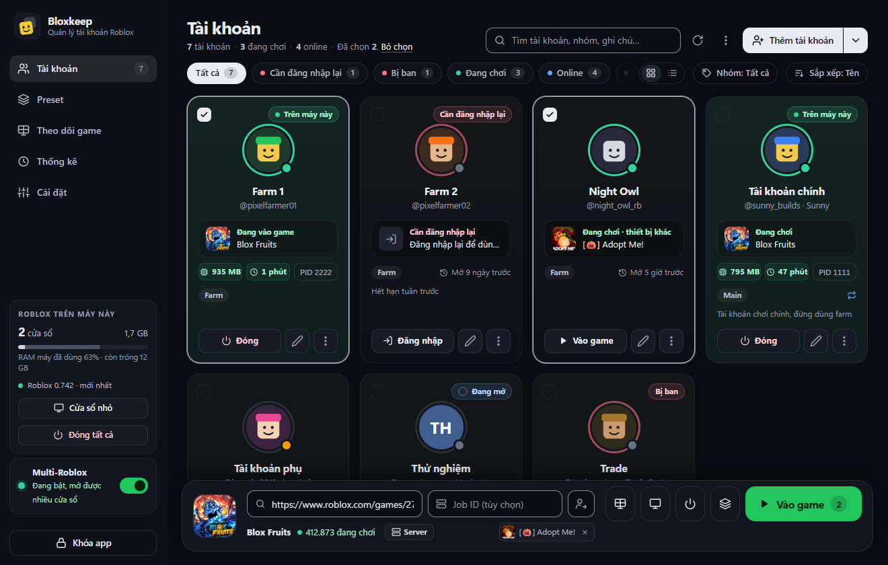</p>

Bloxkeep dành cho người chơi nhiều tài khoản Roblox trên một máy Windows: giữ các tài khoản ở một chỗ, chọn game, chọn tài khoản rồi bấm **Vào game**. Dữ liệu chỉ nằm trên máy của bạn, được mã hóa bằng mật khẩu chủ; Bloxkeep không có máy chủ riêng.

*Bloxkeep là dự án độc lập, không liên kết, không được Roblox Corporation bảo trợ hay tài trợ. Roblox là thương hiệu của Roblox Corporation.*

## Tính năng

- Thêm tài khoản bằng tên đăng nhập và mật khẩu (có xác minh 2 bước, captcha giải trong một cửa sổ nhỏ), bằng mã hoặc QR quét bằng app Roblox trên điện thoại, bằng trang roblox.com trong cửa sổ trình duyệt, bằng cookie, hoặc nhập từ một file dữ liệu Bloxkeep khác.
- Xem trạng thái từng tài khoản: online, đang chơi trên máy này hay thiết bị khác, bị văng vì lý do gì, RAM, thời gian đã chơi, PID, cần đăng nhập lại hay bị ban. Tìm, lọc theo trạng thái hoặc nhóm, sắp xếp, xem dạng thẻ hoặc dạng danh sách.
- Chọn game theo tên, link hoặc Place ID. Chọn server (đông nhất, vắng nhất, ping thấp nhất, đủ chỗ cho N tài khoản, ngẫu nhiên), vào cùng bạn bè, hoặc vào đúng server của một người chơi theo tên đăng nhập.
- Chạy nhiều cửa sổ Roblox cùng lúc với Multi-Roblox, mở cửa sổ đồng loạt ở chế độ cửa sổ và tự xếp chúng thành lưới. Tính năng này tắt sẵn, bạn tự bật khi cần.
- Preset: lưu sẵn tài khoản, game và cách chọn server để chạy bằng một lần bấm, có hẹn giờ chạy và dừng, và tùy chọn riêng (chống AFK, tự vào lại game, chế độ treo máy nhẹ, mở lại Roblox theo giờ).
- Tự vào lại game khi Roblox bị văng, bị kick hoặc mất kết nối, thử lại giãn dần chứ không bỏ cuộc.
- Theo dõi game: xem hình trực tiếp của mọi cửa sổ Roblox trong một tab. Thống kê thời gian chơi theo tài khoản và theo game, kèm nhật ký hoạt động.
- Mã 2FA ngay trong app, ẩn tên tài khoản khi chụp màn hình hay livestream, kiểm tra đăng nhập mỗi ngày và phát hiện tài khoản bị ban.
- Gửi tổng kết thời gian chơi, tin trạng thái và cảnh báo lên kênh Discord của bạn.
- Sao lưu vào thư mục OneDrive hoặc Google Drive. Ngoài ra còn có 74 chủ đề, tìm nhanh bằng `Ctrl+K`, giao diện tiếng Anh và tiếng Việt, chạy ngầm ở khay hệ thống và thông báo Windows.

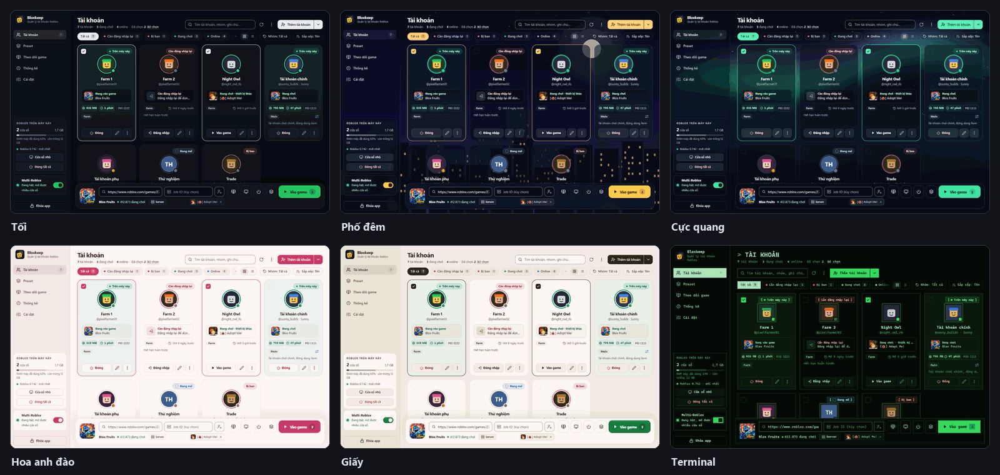

## Tải về và cài đặt

Cần Windows 10 hoặc 11, bản 64-bit. Không cần cài .NET. Bộ cài tự cài Microsoft Edge WebView2 nếu máy chưa có.

Tải ở trang [Releases](../../releases/latest):

| File | Dùng khi |
|---|---|
| `Bloxkeep-Setup.exe` | Cài bình thường. File nhỏ, trong lúc cài sẽ tải bản Bloxkeep mới nhất từ trang này (khoảng 60 MB). Bạn chọn thư mục cài, ở ổ nào cũng được (chọn `D:\` thì cài vào `D:\Bloxkeep`). Cài cho người dùng Windows hiện tại, không cần quyền admin, tạo shortcut ở Start Menu và Desktop. |
| `Bloxkeep-Setup-Offline.exe` | Cùng bộ cài đó nhưng có sẵn mọi thứ bên trong (khoảng 60 MB), để cài trên máy không có mạng hoặc giữ lại dùng sau. |
| `Bloxkeep-Portable.zip` | Không muốn cài. Giải nén rồi chạy `Bloxkeep.exe`; dữ liệu nằm trong thư mục `data` bên cạnh. Bản portable cũng tự cập nhật. |

> [!CAUTION]
> Chỉ tải Bloxkeep ở trang Releases của repo này. Bản tải ở nơi khác có thể đã bị sửa để lấy cắp tài khoản.

File chưa có chữ ký số: Bloxkeep đang đăng ký chữ ký số miễn phí của SignPath Foundation ([code signing policy](CODE_SIGNING_POLICY.md), tiếng Anh). Trong lúc chờ, lần đầu chạy Windows SmartScreen sẽ cảnh báo. Bấm **More info** rồi **Run anyway** (trên Windows tiếng Việt, hai nút này mang tên tiếng Việt tương ứng). Bạn có thể đối chiếu mã SHA-256 của file với `SHA256SUMS.txt` trong cùng bản phát hành. `Bloxkeep-Setup.exe` là cùng một file ở mọi bản phát hành (chỉ phần nó tải về là thay đổi), nên SmartScreen dần dần nhận ra nó; bộ cài này cũng tự đối chiếu file tải về với `SHA256SUMS.txt`.

Bộ cài cho bạn chọn nơi cài (mặc định là `%LOCALAPPDATA%\BloxkeepApp`; chương trình chiếm khoảng 230 MB), chép file kèm thanh tiến trình và có thể mở Bloxkeep khi xong. Tài khoản và cài đặt được lưu riêng với chương trình, trong `%LOCALAPPDATA%\Bloxkeep` (vài MB). Bộ cài và bộ gỡ có tiếng Việt và tiếng Anh.

 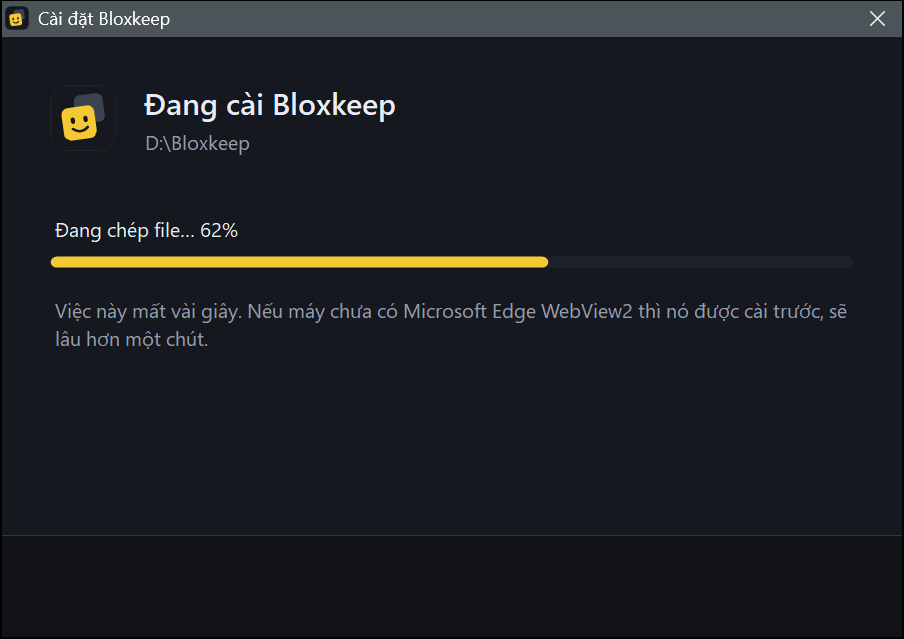 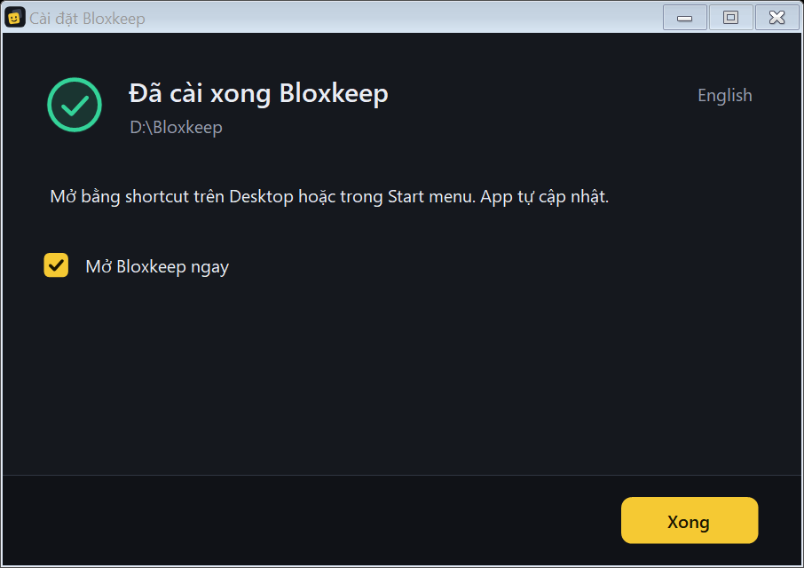

### Cập nhật

Bloxkeep tự kiểm tra bản mới trên GitHub lúc mở và mỗi giờ một lần, rồi tải về ở nền. Sau đó app tự cài vào lần tới bạn không dùng nó, và quay lại sau vài giây y như cũ: vẫn mở khóa, đúng tab đang xem, cửa sổ vẫn ở khay hay vẫn thu nhỏ như trước. Các cửa sổ Roblox chạy suốt và được theo dõi lại như thường.

"Không dùng" nghĩa là cửa sổ đang ở khay hoặc thu nhỏ, hoặc không ai chạm vào máy trong 10 phút, và Bloxkeep không đang làm dở việc gì: không đang mở Roblox, tự vào lại hay khởi động lại theo lịch, không đang đăng nhập, sao lưu, nhập dữ liệu hay điền dở form. Cửa sổ Roblox đang chạy treo không làm việc cập nhật phải chờ.

Muốn cập nhật ngay thì bấm **Khởi động lại để cập nhật** ở thanh bên khi nút hiện ra. Thoát Bloxkeep cũng sẽ cài bản mới. Sau khi cập nhật, app hiện bảng **Có gì mới trong Bloxkeep**.

Để quay lại mà vẫn mở khóa, bản đang chạy chuyển chìa khóa vault cho bản mới qua một file chỉ tài khoản Windows của bạn đọc được (Windows DPAPI, kèm một giá trị ngẫu nhiên chỉ bản mới nhận được). Bản mới đọc xong là xóa ngay, và từ chối file quá 3 phút. Nếu bạn muốn nhập lại mật khẩu chủ sau mỗi lần cập nhật thì khóa Bloxkeep lại: bản đang khóa không chuyển gì cả.

Một chương trình canh nhỏ (chính chương trình gỡ cài đặt, chạy từ một bản sao tạm) chờ bản mới mở lên. Nếu khoảng một phút sau vẫn chưa thấy (cài lỗi, bản mới bị crash), nó xóa file kia và tự mở Bloxkeep: nằm ở khay, đang khóa, kèm một thông báo nói rõ. Bản cập nhật cài không được sẽ không tự thử lại trong một ngày; nút **Khởi động lại để cập nhật** vẫn dùng được.

Tự cập nhật chỉ hoạt động khi repo trên GitHub ở chế độ công khai.

Muốn tắt tự cập nhật: bỏ chọn **Cài đặt › Cập nhật Bloxkeep › Tự động cập nhật**; khi đó app không tự tải hay tự cài gì nữa. Nút **Kiểm tra ngay** vẫn dùng được.

Chạy `Bloxkeep-Setup.exe` bản mới hơn đè lên bản đã cài cũng được: bộ cài cài vào đúng thư mục cũ, đóng Bloxkeep đang chạy trước và giữ nguyên dữ liệu. Muốn chuyển Bloxkeep sang ổ khác thì gỡ cài đặt rồi cài lại vào thư mục mới.

### Gỡ cài đặt

Vào **Settings › Apps › Installed apps** của Windows, tìm **Bloxkeep** (publisher `minhhoang0122`) và chọn **Uninstall**. Bộ gỡ của Bloxkeep hỏi có **Xóa luôn tài khoản và cài đặt** không: để trống thì dữ liệu được giữ cho lần cài sau, đánh dấu thì xóa hẳn. Nếu Bloxkeep đang chạy, bộ gỡ đóng nó trước.


| Luôn bị xóa | Chỉ xóa khi đánh dấu **Xóa luôn tài khoản và cài đặt** | Không bao giờ đụng tới |
|---|---|---|
| Thư mục chương trình (mặc định là `%LOCALAPPDATA%\BloxkeepApp`, hoặc thư mục bạn đã chọn), shortcut ở Start menu và Desktop (kể cả shortcut bạn đã ghim vào Start hay thanh tác vụ), bộ nhớ đệm của giao diện, và mục Bloxkeep trong Installed apps. Bloxkeep không thêm gì khác vào Windows: không có mục khởi động cùng Windows, không có service, không chiếm giao thức `roblox-player:`. | Tài khoản và cài đặt trong `%LOCALAPPDATA%\Bloxkeep`: vault (`vault.rmv` và các bản dự phòng của nó), `prefs.json` và `error.log`. | Các file sao lưu trong thư mục sao lưu, và file nào khác bạn tự để trong `%LOCALAPPDATA%\Bloxkeep`. |

<details>
<summary>Ảnh: cập nhật</summary>

 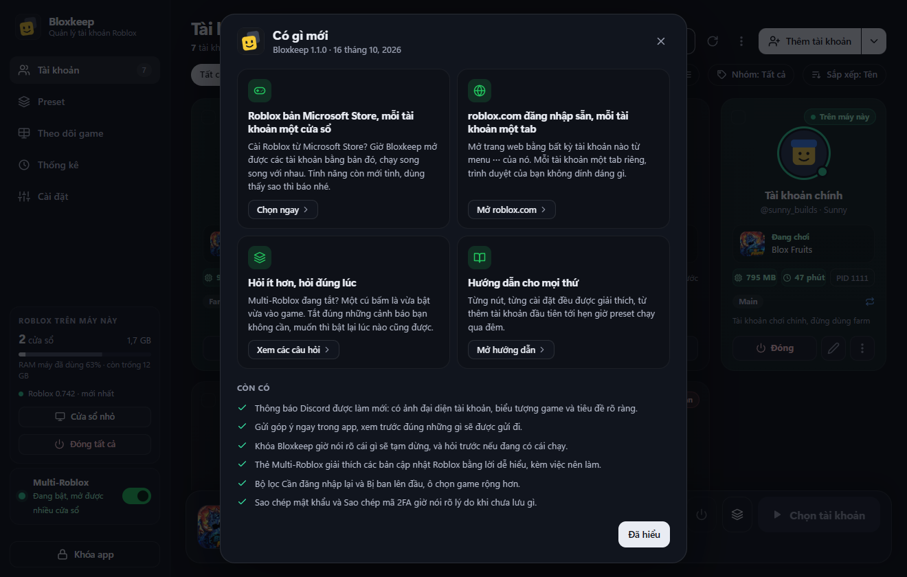 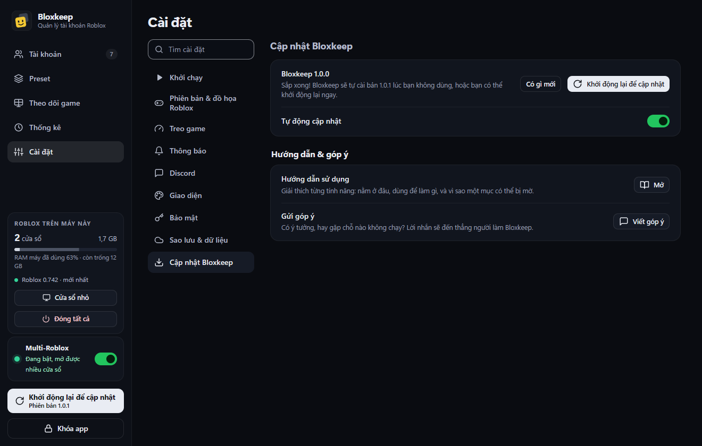
</details>

## Bắt đầu

1. **Đặt mật khẩu chủ** ở lần mở đầu tiên (ít nhất 6 ký tự). Mật khẩu này dùng để mở khóa Bloxkeep và **không khôi phục được** nếu quên, xem [Dữ liệu và bảo mật](#dữ-liệu-và-bảo-mật). Giao diện mặc định là tiếng Anh: bấm nút **VI** ở góc trên màn hình này để chuyển sang tiếng Việt. Nếu đang chuyển sang máy mới, bấm **Khôi phục từ bản sao lưu** thay vì tạo mới, xem [Sao lưu và khôi phục](#sao-lưu-và-khôi-phục).

   

2. **Thêm tài khoản**: bấm **Thêm tài khoản**. Hộp thoại **Đăng nhập Roblox** có các cách:
   - **Đăng nhập bằng điện thoại** (nên dùng): Bloxkeep hiện mã và QR. Trên điện thoại, mở **app Roblox**, vào **Cài đặt › Đăng nhập nhanh**, nhập mã hoặc quét QR rồi xác nhận. Không cần mật khẩu hay giải đố. Thêm xong một tài khoản thì có mã mới cho tài khoản tiếp theo.
   - **Tên đăng nhập** và **Mật khẩu**: mật khẩu chỉ gửi tới máy chủ đăng nhập của Roblox. Đăng nhập bằng mật khẩu không lưu mật khẩu đó. Có **Xác minh 2 bước** (**App xác thực** hoặc **Email**); nếu tài khoản đã có khóa app xác thực trong Bloxkeep thì mã được điền sẵn, bạn chỉ cần bấm xác nhận. Nếu Roblox đòi captcha, bấm **Giải câu đố** và làm trong cửa sổ nhỏ hiện ra.
   - **Cách khác: Đăng nhập bằng trình duyệt**: trang đăng nhập roblox.com chính thức mở trong một cửa sổ tạm. Đăng nhập xong, Bloxkeep lấy phiên đăng nhập rồi xóa cửa sổ tạm đó. Bloxkeep không đọc mật khẩu bạn gõ ở đây.
   - **Cách khác: Dán cookie**, hoặc **Nhập từ: File Bloxkeep**: xem [Chuyển tài khoản từ nơi khác](#chuyển-tài-khoản-từ-nơi-khác).

   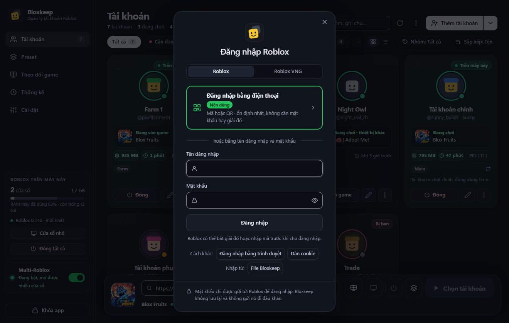

3. **Chọn game, chọn tài khoản, bấm Vào game.** Gõ tên game hoặc dán link / Place ID vào ô ở thanh dưới, bấm vào các thẻ tài khoản để chọn (giữ `Shift` khi bấm để chọn liền một dãy), rồi bấm **Vào game**. Để trống ô game thì nút đổi thành **Mở Roblox**: mỗi tài khoản đã chọn mở Roblox ở trang chủ.

   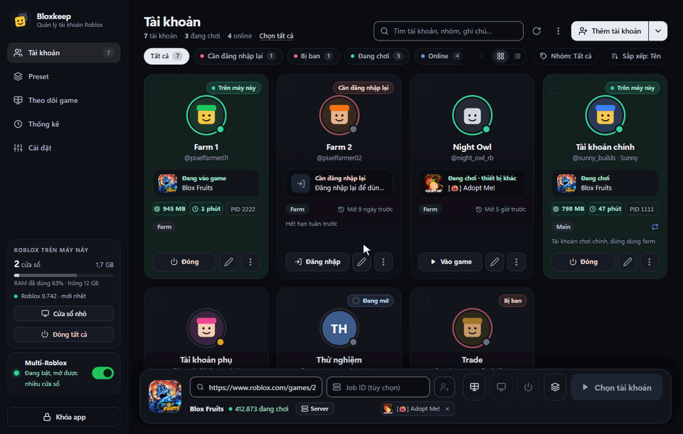

4. Phím tắt: `Ctrl+K` tìm nhanh tài khoản, preset, game và cài đặt; `Ctrl+F` tìm tài khoản; `Ctrl+A` chọn tất cả; `Enter` vào game; `F2` sửa; `Delete` xóa; `Esc` bỏ chọn. Chuột phải vào một tài khoản để xem thêm thao tác.

## Sử dụng

### Danh sách tài khoản

- Lọc theo **Tất cả**, **Đang chơi**, **Online**, **Offline**, **Trên máy này**, **Cần đăng nhập lại**, **Bị ban**, và theo nhóm ở ô **Nhóm**; sắp xếp theo **Tên**, **Trạng thái**, **Chơi gần đây** hoặc **Thứ tự mở**; tìm theo tên, nhóm, ghi chú. Chuyển giữa **Dạng thẻ** và **Dạng danh sách**.
- Trạng thái tự làm mới mỗi 30 giây. Khi bị văng, thẻ ghi rõ lý do đọc từ log của Roblox: **Bị kick vì AFK**, **Bị game kick**, **Đã đăng nhập ở thiết bị khác**, **Rớt mạng**, **Không vào được server**.
- Tài khoản hết phiên được đánh dấu **Cần đăng nhập lại**; bấm **Đăng nhập** để đăng nhập lại. **Kiểm tra đăng nhập** có trong menu ⋯ của từng tài khoản, và **Kiểm tra đăng nhập mọi tài khoản** ở menu ⋯ phía trên danh sách. **Kiểm tra đăng nhập mỗi ngày** (bật sẵn, trong **Cài đặt › Hiệu năng**, có ghi lần chạy gần nhất) tự làm việc này một lần mỗi ngày, để bạn biết trước khi bấm **Vào game**: lần lượt từng tài khoản, cách nhau 2 giây, khoảng 45 giây sau khi mở khóa, trong lúc Bloxkeep đang mở khóa.
- Lúc kiểm tra, Bloxkeep cũng xem tài khoản có **Bị ban** không (thông tin công khai của Roblox). Tài khoản bị ban có nhãn đỏ, và **Vào game** cũng như preset sẽ bỏ qua tài khoản đó.
- **Sửa…** (`F2`) để đặt **Tên gợi nhớ**, **Nhóm**, **Ghi chú**. Tại đây bạn có thể tự lưu **Mật khẩu Roblox** nếu muốn (không bắt buộc); mật khẩu nằm trong kho đã mã hóa.
- **Khóa app xác thực** (trong **Sửa…**): dán khóa 2FA hoặc link `otpauth://` của tài khoản, Bloxkeep hiện mã 6 số đang chạy. **Sao chép mã 2FA** có trong menu ⋯. Ai biết mật khẩu chủ của bạn cũng tạo được mã, nên chỉ lưu khóa khi bạn chấp nhận điều đó.
- **Sao chép mật khẩu** và **Sao chép mã 2FA** không vào lịch sử clipboard của Windows và tự xóa sau 30 giây. Hai mục này dùng được khi bạn đã lưu mật khẩu hoặc khóa app xác thực ở mục **Sửa** (đăng nhập bằng cách nào thì Bloxkeep cũng không giữ mật khẩu).
- **Ẩn tên tài khoản** (trong **Cài đặt › Giao diện**): mọi chỗ hiện **Tài khoản 1**, **Tài khoản 2**… thay cho tên, kể cả tiêu đề cửa sổ Roblox, tiện khi chụp màn hình hay livestream.
- **Mở trang web** (trong menu ⋯ của mỗi tài khoản): roblox.com đã đăng nhập sẵn tài khoản đó, trong cửa sổ riêng của Bloxkeep. Mở nhiều cửa sổ để dùng nhiều tài khoản cùng lúc. Phiên đăng nhập chỉ nằm trong cửa sổ đó (không vào Chrome hay Edge của bạn) và mất khi đóng cửa sổ. Đăng xuất ở đó cũng sẽ đăng xuất tài khoản khỏi Bloxkeep nên Bloxkeep chặn lại: xem xong chỉ cần đóng cửa sổ.
- **Mở roblox.com** (trong menu cạnh **Thêm tài khoản**): cửa sổ trống để tự đăng nhập ngay trên trang web, mỗi cửa sổ một tài khoản, mở bao nhiêu cái cạnh nhau cũng được. Đóng cửa sổ là mất đăng nhập, trừ khi bạn bấm **Lưu vào Bloxkeep**; khi đó tài khoản vào danh sách và lần sau mở là vào thẳng.

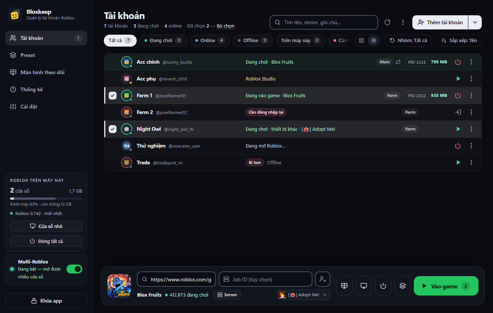

### Chọn game và server

- Ô game nhận tên game, Place ID, link `roblox.com/games/…` (kể cả link server riêng), link chia sẻ server và link `roblox://`. Gõ tên thì chọn game trong danh sách hiện ra.
- Bảng chọn game có các tab **Gần đây**, **Đã ghim**, **Yêu thích trên Roblox**, **Phổ biến**. Bấm ☆ để ghim game.
- **Job ID (tùy chọn)**: vào đúng một server, để nhiều tài khoản vào chung.
- Nút **Server** liệt kê server công khai còn chỗ: sắp theo **Đông nhất**, **Vắng nhất**, **Ping thấp nhất**, **FPS cao nhất**; lọc **Đủ chỗ cho N tài khoản**; hoặc bấm **Server ngẫu nhiên**. Mục **Bạn bè trong game này** cho bạn vào cùng bạn bè của các tài khoản (nếu cài đặt riêng tư của họ cho phép). Ping hiển thị là ping trung bình của người chơi trong server, không phải ping từ máy bạn.
- **Vào cùng người chơi…** (nút cạnh ô Job ID): gõ tên đăng nhập hoặc ID của một người chơi, các tài khoản đang chọn vào đúng server người đó đang ở. Bloxkeep hỏi trạng thái người đó bằng chính các tài khoản bạn chọn; nếu cài đặt riêng tư của họ không cho xem thì app nói rõ, chứ không kết bạn hay theo dõi ai để lách.
- Trên một tài khoản đang chơi, chọn **Vào cùng server** để các tài khoản khác vào đúng server đó.

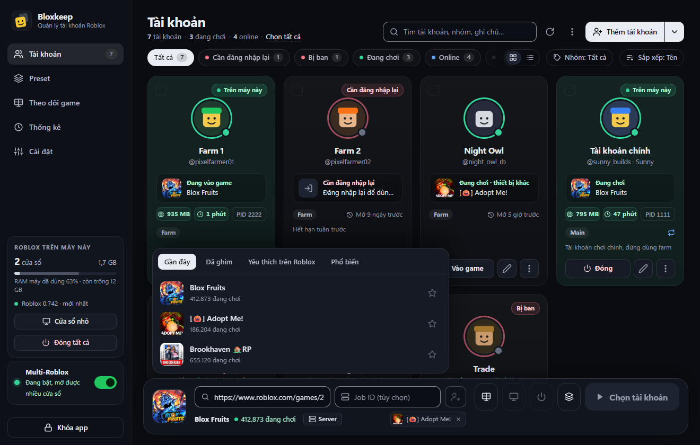

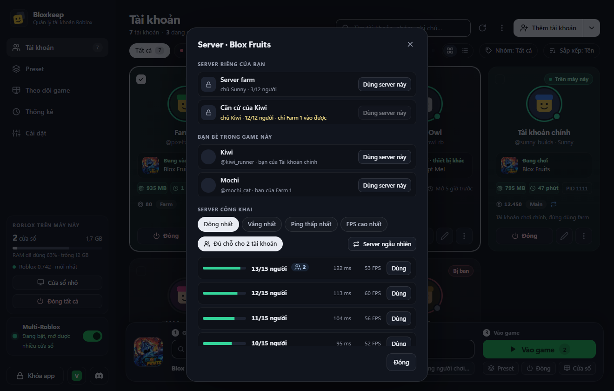

### Preset

Một preset lưu tên, danh sách tài khoản (theo thứ tự), game, cách chọn server và thời gian chờ giữa các tài khoản. Ô **Game** chọn như ở thanh dưới. Để trống thì chỉ mở **Màn hình chính Roblox**. Server có thể là **Bất kỳ (Roblox tự chọn)**, **Đông nhất**, **Vắng nhất**, **Ping thấp nhất**, **Ngẫu nhiên** hoặc **Server cố định (Job ID)**.

Quản lý preset ở tab **Preset**: **Thêm preset**, sửa, nhân bản, đổi thứ tự, **Chạy**. Khi preset đang có cửa sổ mở, dòng của nó ghi số cửa sổ và nút **Chạy** đổi thành **Đóng**, đóng đúng các cửa sổ đó (không đụng cửa sổ khác). Nút preset ở thanh dưới có **Lưu thành preset…** và chạy nhanh. Lưu được tối đa 50 preset.

Phần **Áp dụng cho cửa sổ Roblox** của mỗi preset áp dụng cho các cửa sổ mà preset đó mở (kể cả khi chúng tự vào lại game). Bấm **Vào game** bình thường cho cùng tài khoản thì vẫn theo cài đặt chung.

Thứ tự ưu tiên, tính cho từng cửa sổ Roblox: tùy chọn của preset đặt **Bật** hoặc **Tắt** quyết định cho các cửa sổ preset đó mở, cho tới khi chúng đóng; để **Theo…** thì công tắc riêng của tài khoản quyết định (tự vào lại game), không thì theo **Cài đặt** (chống AFK, xếp cửa sổ, thời gian chờ giữa các tài khoản). Tài khoản nằm trong hai preset thì theo preset đã mở cửa sổ của nó; chạy preset kia sẽ bỏ qua cửa sổ đang mở.

- **Chống AFK**: **Theo Cài đặt**, **Bật** hoặc **Tắt**.
- **Tự vào lại game**: **Theo từng tài khoản**, **Bật** hoặc **Tắt**.
- **Hiệu năng**: **Treo máy nhẹ** chọn đồ họa thấp nhất, 30 FPS, tắt tiếng, và thu nhỏ cửa sổ khi đã vào game. Cửa sổ mở không có tùy chọn này vẫn giữ cài đặt Roblox của bạn.
- **Mở lại Roblox**: mỗi 2, 4, 6 hoặc 12 giờ, từng cửa sổ được đóng rồi mở lại vào đúng game, lần lượt từng cái. Cửa sổ bạn đang dùng sẽ được để sau.
- **Xếp cửa sổ**: **Theo Cài đặt**, **Bật** hoặc **Tắt**: xếp các cửa sổ Roblox sau khi preset mở xong.

**Discord**: preset có thể gửi tin vào **Webhook riêng** thay cho kênh trong Cài đặt: tin hẹn giờ, bản tổng kết sau khi preset hẹn giờ dừng (chỉ tính tài khoản của preset đó), và cảnh báo của các cửa sổ preset đã mở. **Gửi thử** để kiểm tra link trước khi lưu. Các tin khác, cùng công tắc bật/tắt, giờ im lặng và cách nhắc (ping), vẫn nằm ở **Cài đặt › Discord**. Nếu webhook đó bị xóa trên Discord, preset quay về kênh trong Cài đặt.

**Hẹn giờ**: preset tự chạy vào **Giờ bắt đầu**, một lần hoặc lặp lại theo các ngày trong tuần, và có thể **Dừng** sau vài giờ hoặc lúc một giờ nhất định (chỉ đóng các cửa sổ mà lần chạy đó mở). Bloxkeep phải đang chạy và đã mở khóa vào lúc đó.


### Multi-Roblox

Multi-Roblox **tắt sẵn**. Roblox không chính thức hỗ trợ chạy nhiều client cùng lúc; bạn tự chịu rủi ro khi bật. Bật bằng công tắc Multi-Roblox ở thanh bên hoặc trong **Cài đặt › Khởi chạy**.

- Bloxkeep phải mở **trước** Roblox và để mở trong lúc chơi.
- Đèn trạng thái: **Đang tắt**, **Đang bật, mở được nhiều cửa sổ**, hoặc **Chưa hoạt động, bấm để sửa** (đèn vàng). Cách sửa: đóng hết Roblox, kể cả Roblox ở khay hệ thống; nếu Roblox tự chạy cùng Windows, bấm **Tắt tự khởi động** (giống tắt trong Task Manager › Startup apps, bật lại được ở đó). Sau đó đèn chuyển xanh.
- Bấm **Chi tiết** cạnh Multi-Roblox để chỉnh thêm:
  - **Luôn mở Roblox ở chế độ cửa sổ** (bật sẵn): các cửa sổ Roblox dùng chung một cài đặt toàn màn hình nên dễ lệch nhau, cái toàn màn hình cái không. Bloxkeep mở mọi cửa sổ ở chế độ cửa sổ, rồi trả lại cài đặt của bạn.
  - **Xếp các cửa sổ cạnh nhau sau khi mở** (tắt sẵn): mở xong các tài khoản thì các cửa sổ Roblox được xếp thành lưới trên màn hình chính.
- Mỗi tài khoản một trang chủ riêng: chọn các tài khoản, để trống ô game, bấm **Mở Roblox**.

Cách hoạt động: Roblox dùng một đối tượng tên `ROBLOX_singletonEvent` để chỉ cho chạy một cửa sổ; từ bản tháng 10/2026, cửa sổ mới dùng nó để đóng các cửa sổ cũ. Bloxkeep giữ trước cái tên đó khi chưa có Roblox nào chạy, nên Roblox không lập được cơ chế này và các cửa sổ không đóng nhau. Bloxkeep không chèn gì vào Roblox và không đọc gì từ tiến trình Roblox.

Nếu một bản Roblox mới lại đóng cửa sổ khi cửa sổ khác mở, **Cài đặt › Phiên bản & đồ họa Roblox** hiện cảnh báo vàng. Cảnh báo tự mất khi từ 2 tài khoản trở lên cùng ở trong game, khi Roblox cập nhật bản mới, hoặc khi bạn bấm **Ẩn**.

Ngoài ra, máy dò Roblox của Bloxkeep kiểm tra từng bản Roblox mới ngay khi Roblox đưa ra, thường là trước khi bản đó đến tay người chơi: nó tải bản đó về và so khoá mà Multi-Roblox dựa vào với bản trước ([cách hoạt động](docs/roblox-watch.md), tiếng Anh). **Cài đặt › Phiên bản & đồ họa Roblox** cho biết kết quả cho bản Roblox của bạn ở dòng **Kiểm tra Multi-Roblox**, và thẻ Multi-Roblox chuyển vàng khi khoá bị đổi. Lúc đó, mở nhiều tài khoản sẽ được hỏi lại trước, cho đến khi đã có hai cửa sổ cùng chơi được trên bản đó. Nếu Roblox chỉ đổi tên khoá, Bloxkeep giữ luôn tên mới mà không cần cập nhật app. Kết quả kiểm tra không chứng minh được Multi-Roblox chạy; chỉ hai cửa sổ cùng chơi được mới chứng minh, và Bloxkeep nhớ điều đó cho từng bản.

### Chống AFK

Roblox kick tài khoản sau 20 phút không có thao tác. Khi bật **Cài đặt › Treo game › Chống AFK** (preset có thể ghi đè), Bloxkeep đưa từng cửa sổ Roblox đang ở trong game lên trước trong chốc lát, nhích chuột vài pixel rồi trả về, và đưa bạn lại cửa sổ đang dùng. Không bấm phím, không click gì. Chống AFK bắt đầu từ phút thứ 12 kể từ thao tác cuối của cửa sổ, vào phút đầu tiên không ai dùng máy; cửa sổ còn 2 phút là bị kick thì được làm vào lúc bạn ngừng gõ 2 giây, kể cả khi bạn đang dùng máy, nhưng không bao giờ chen ngang ứng dụng toàn màn hình. Không chạy được khi máy đang khóa. Nếu tài khoản vẫn bị kick, Bloxkeep nói rõ lý do.

### Tự vào lại game

Bật cho từng tài khoản trong menu ⋯ › **Tự vào lại game**, hoặc cho mọi tài khoản cùng lúc ở **Cài đặt › Treo game › Tự vào lại game** (preset có thể ghi đè, xem [Preset](#preset)). Nếu Roblox kết thúc phiên đăng nhập của một tài khoản, tự vào lại game tự tắt cho tài khoản đó, và tự bật lại khi tài khoản được đăng nhập lại. Khi Roblox của tài khoản đó bị văng, bị kick hoặc mất kết nối, Bloxkeep vào lại cùng game (hoặc cùng server riêng) sau 10 giây, nhưng không chắc vào đúng server cũ. Nếu cứ bị văng liên tục, từ lần thứ ba Bloxkeep chờ 2, 5, 10 rồi 15 phút giữa các lần thử (thẻ tài khoản hiện thời gian chờ và nút **Hủy**); ở lại trong game 10 phút thì đếm lại từ đầu. Nếu mất mạng, Bloxkeep thử lại mỗi 30 giây, tối đa 20 lần.

Bloxkeep không vào lại khi bạn tự thoát game, khi tài khoản đăng nhập ở thiết bị khác, khi tài khoản bị ban, hoặc khi chính Roblox đóng cửa sổ vì có cửa sổ khác mở. Tự tay đóng cửa sổ Roblox cũng tính là thoát game, nên hãy dùng nút **Đóng** trong app.

### Cấu hình Roblox theo tài khoản

Trong **Cài đặt › Phiên bản & đồ họa Roblox › Cấu hình Roblox**, mục **Áp dụng cho** chọn **Không áp dụng**, **Mọi tài khoản** hoặc **Tài khoản đã chọn** (chọn từng tài khoản bằng **Dùng cấu hình Roblox** trong menu ⋯). Đặt **Đồ họa** từ 1 đến 10, **Giới hạn FPS** 30/60/144/240, **Âm lượng** từ **Tắt tiếng** đến 100 %, hoặc **Giữ nguyên**.

Bloxkeep ghi các giá trị này vào file cài đặt của Roblox ngay trước khi mở tài khoản, rồi trả lại cài đặt của bạn khi Roblox đã chạy.

Cùng trang này, nhóm **Cập nhật Roblox** cho biết bản Roblox đã cài, bản mới nhất Roblox đang phát hành, và lịch sử các bản đã thấy trên máy, mỗi bản có link **Ghi chú** phát hành của Roblox.

### Mở Roblox bằng

Chọn trong **Cài đặt › Khởi chạy › Mở Roblox bằng**. Bloxkeep tự tìm các bản đã cài.

| Lựa chọn | Ghi chú |
|---|---|
| **Mặc định** | Trình đang mở link Roblox trên máy (Roblox, Bloxstrap, Fishstrap…) |
| **Bloxstrap**, **Fishstrap** | Giữ nguyên mod và FFlag của bạn |
| Launcher kiểu Bloxstrap khác | Tự hiện nếu đã cài |
| **Roblox (chính thức)** | Bản cài từ roblox.com |
| **Chạy thẳng RobloxPlayerBeta (bỏ qua launcher)** | Không qua launcher nào; thử khi launcher chặn nhiều cửa sổ |
| **Chọn launcher khác…** | File exe bạn tự chọn |
| **Roblox (Microsoft Store)** | Đang thử nghiệm: mỗi tài khoản mở trong một cửa sổ Roblox Store riêng, bỏ qua trình khởi động của Microsoft. Microsoft Store vẫn tự cập nhật |

### Cửa sổ, RAM và màn hình theo dõi

- Thẻ **Roblox trên máy này** ở thanh bên hiện số cửa sổ Roblox, RAM chúng dùng, RAM máy còn trống, cùng nút **Cửa sổ nhỏ** và **Đóng tất cả**. Dòng phiên bản cho biết bản Roblox đã cài có phải mới nhất không.
- **Theo dõi game** (tab ở thanh bên): hình trực tiếp của mọi cửa sổ Roblox, kèm tên tài khoản, game, RAM và PID. Bấm vào một hình để đưa cửa sổ đó lên trước; chuột phải để xem thêm thao tác. Cửa sổ đang thu nhỏ thì không có hình trực tiếp. Hình do chính Windows vẽ (giống ảnh xem trước khi rê chuột lên taskbar), nên gần như không tốn thêm tài nguyên.
- **Cửa sổ nhỏ**: một cửa sổ gọn để theo dõi các tài khoản đang chơi mà không cần mở cửa sổ chính.
- **Khi cửa sổ Roblox mở ra** (trong **Cài đặt › Khởi chạy**): **Để Roblox tự chọn**, **Phóng to** (vẫn là cửa sổ nên các cửa sổ không giành nhau công tắc toàn màn hình chung của Roblox), hoặc **Xếp cạnh nhau** (cần Multi-Roblox). Preset có thể tự xếp cửa sổ của nó bất kể lựa chọn này.
- **Xếp cửa sổ Roblox** (nút ở thanh dưới) và **Kiểu xếp cửa sổ** (trong **Cài đặt › Khởi chạy**): **Lấp đầy màn hình**, hoặc **Ô nhỏ** / **Ô vừa** / **Ô lớn** xếp từ góc trên bên trái và chừa phần màn hình còn lại. Cửa sổ Roblox càng nhỏ thì card đồ họa càng đỡ tải.
- **Báo khi sắp hết RAM** (bật sẵn): cảnh báo trước khi mở nhiều tài khoản hơn RAM trống chịu được, và khi máy dùng quá 92 % RAM.
- **Tiết kiệm RAM cho cửa sổ chạy nền** (tắt sẵn): khi máy sắp hết RAM, cửa sổ chạy nền nhường RAM cho cửa sổ bạn đang chơi. Roblox có thể không nhả RAM; khi đó Bloxkeep bỏ qua.
- **Hiện tên tài khoản trên cửa sổ** (bật sẵn): ghi tên tài khoản lên tiêu đề cửa sổ Roblox để dễ phân biệt trên taskbar.
- **Chờ giữa các tài khoản**: từ 0 đến 60 giây, mặc định 8 giây. Mở quá nhiều tài khoản cùng lúc dễ bị lỗi.

### Thống kê và hoạt động

Tab **Thống kê** tính thời gian chơi, số lượt chơi và số lần mất kết nối theo **Hôm nay**, **7 ngày** hoặc **30 ngày**, theo từng tài khoản và từng game. Chỉ tính các game mở bằng Bloxkeep. Khi mở rộng cửa sổ, trang còn hiện số tài khoản đã chơi, lượt chơi dài nhất và thời gian chơi theo Preset.

Chuyển sang **Hoạt động** để xem nhật ký: mở tài khoản, vào game, rời game, bị văng (kèm lý do), tự vào lại, preset hẹn giờ chạy và dừng, tài khoản cần đăng nhập lại. Lọc theo tài khoản và loại sự kiện, **Xuất CSV** khi cần. Bloxkeep giữ 1.000 sự kiện gần nhất, trong kho đã mã hóa.

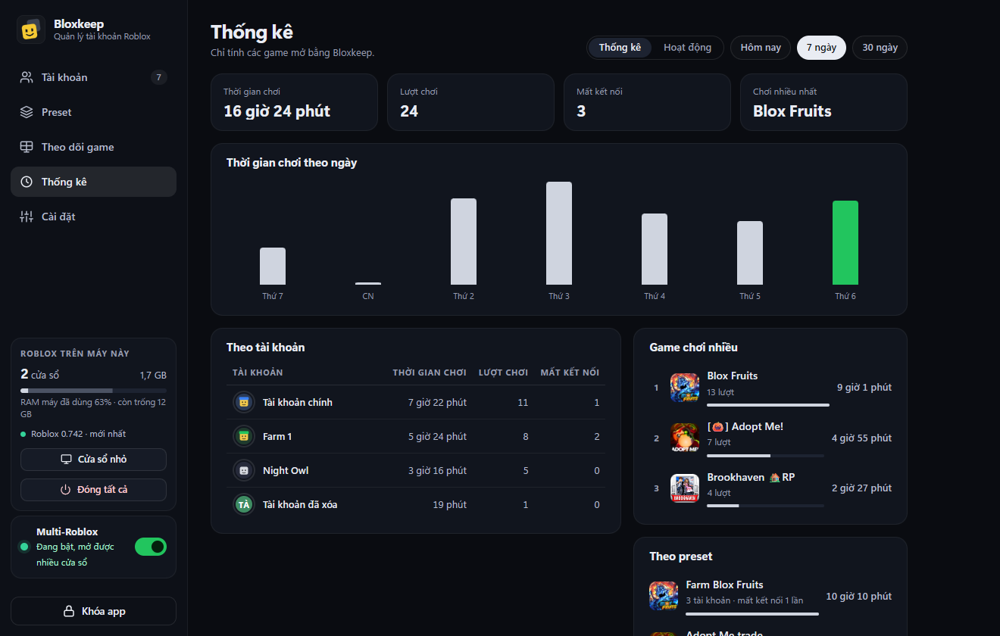

### Chạy ngầm, thông báo, Discord, giao diện

- **Chạy ẩn dưới khay hệ thống khi đóng** (bật sẵn): bấm X thì Bloxkeep thu xuống khay hệ thống, tự vào lại game và Multi-Roblox vẫn chạy. Muốn thoát hẳn, chuột phải biểu tượng ở khay và chọn **Thoát Bloxkeep**. Lần mở sau, cửa sổ Bloxkeep về đúng vị trí, kích thước và trạng thái phóng to như lúc bạn để.
- **Thông báo Windows** (bật sẵn): chỉ khi Bloxkeep chạy nền. Bật tắt từng loại trong **Cài đặt › Thông báo**: tài khoản bị văng hoặc tự vào lại, preset hẹn giờ, tài khoản cần đăng nhập lại, sắp hết RAM, lỗi khi mở game.
- **Discord** (tắt sẵn): dán link webhook của một kênh vào **Cài đặt › Discord** (bật **Gửi lên Discord** khi chưa có link thì app sẽ hỏi link). **Gửi tự động** tổng kết thời gian chơi **Hằng ngày**, **Hằng tuần** hoặc cả hai: ảnh biểu đồ thời gian chơi theo giờ (hoặc ngày) tô màu theo game, mỗi tài khoản một dòng kèm avatar, so với kỳ trước, số lần văng kèm mã lỗi Roblox, lượt chơi dài nhất, số cửa sổ cùng lúc nhiều nhất, game chơi nhiều nhất, và mỗi preset một khung riêng với các tài khoản của nó; một **Tin trạng thái** tự cập nhật; và **Cảnh báo** cho các sự kiện như trên, có **Tag** người hoặc vai trò. Có **Giờ yên lặng**, và **Tùy chỉnh tin nhắn** (tên và ảnh người gửi, ngôn ngữ, kiểu tin, **Ẩn tên tài khoản trong tin nhắn**).
- **Cài đặt › Giao diện**: 74 **Chủ đề** chia năm nhóm (Cơ bản, Phong cảnh, Màu sắc, Phong cách, Theo mùa) cộng **Theo Windows** (mặc định **Tối**). Chủ đề Phong cảnh và Theo mùa có cảnh vẽ phía sau các khung mờ; Phong cách đổi cả hình khối (Windows 98, macOS với nút cửa sổ bấm được, GNOME, Ubuntu, KDE, Game Boy, Vở ô li…). Còn có **Ngôn ngữ** English / Tiếng Việt, và **Ẩn tên tài khoản**.
- **Tăng tốc phần cứng** (trong **Cài đặt › Treo game**): vẽ giao diện bằng card đồ họa thay vì CPU; tự tắt nếu driver card đồ họa gặp lỗi liên tục.

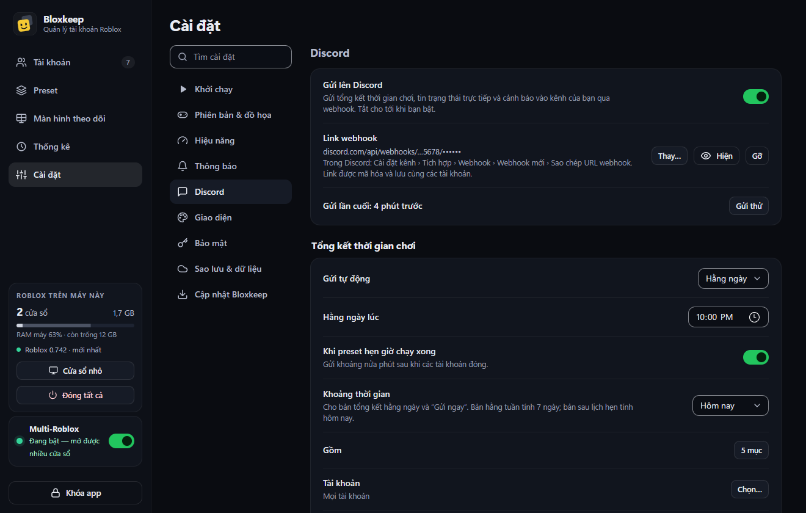

### Chuyển tài khoản từ nơi khác

**File dữ liệu Bloxkeep khác** (ví dụ `vault.rmv` hay bản sao lưu từ máy khác): bấm **Nhập từ: File Bloxkeep**, hoặc **Nhập…** trong **Cài đặt › Sao lưu & dữ liệu**. Nhập mật khẩu chủ của chính file đó, chọn các tài khoản muốn lấy, rồi bấm nhập. File gốc không bị sửa; tài khoản nhập vào được khóa lại bằng mật khẩu chủ hiện tại của bạn.

**Cookie**: chọn **Dán cookie** rồi dán cookie `.ROBLOSECURITY`.

### Roblox VNG

Thêm được tài khoản Roblox VNG bằng tab **Roblox VNG** (đăng nhập bằng điện thoại hoặc bằng mật khẩu). Tài khoản VNG có nhãn "VNG". Hiện Bloxkeep **chưa mở được game** cho tài khoản VNG; nút **Vào game** của chúng tắt và có ghi lý do.

<details>
<summary>Thêm ảnh</summary>

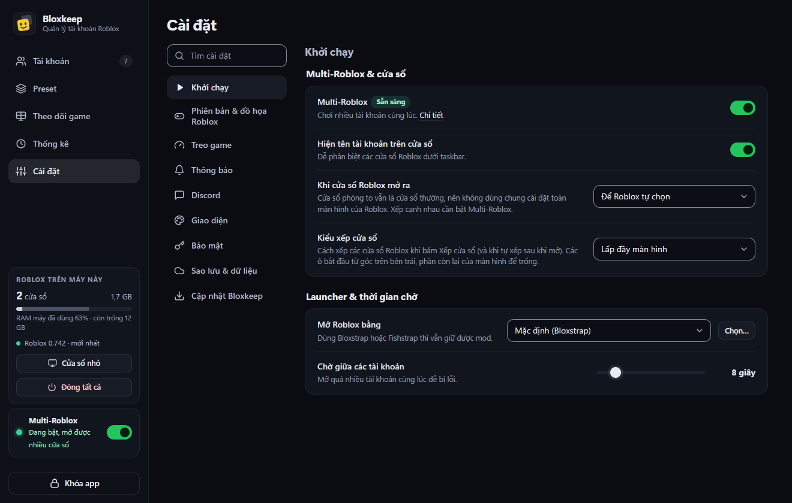 
</details>

## Dữ liệu và bảo mật

**Lưu những gì.** Tài khoản (cookie, tên đăng nhập, ID, tên gợi nhớ, nhóm, ghi chú, mật khẩu và khóa app xác thực nếu bạn tự nhập), cài đặt, preset, game gần đây và đã ghim, lịch sử chơi và nhật ký hoạt động, link webhook Discord.

**Lưu ở đâu.** Mọi thứ nằm trên máy của bạn. **Cài đặt › Sao lưu & dữ liệu › Nơi lưu dữ liệu** hiện thư mục này, có nút **Mở thư mục**.

| Đường dẫn | Nội dung |
|---|---|
| `%LOCALAPPDATA%\Bloxkeep\` | Thư mục dữ liệu (bản cài). Bản portable dùng thư mục `data\` cạnh app. |
| `vault.rmv` | Kho đã mã hóa: tài khoản, cài đặt, preset, game gần đây và đã ghim, lịch sử chơi, nhật ký hoạt động, link webhook |
| `vault.rmv.bak` | Lần lưu trước đó, tự dùng nếu `vault.rmv` bị hỏng |
| `vault.rmv.damaged-…`, `vault.rmv.spare-…`, `vault-before-restore-….rmv` | Bản giữ lại sau khi tự sửa kho hoặc sau khi khôi phục; app không bao giờ xóa |
| `prefs.json` | Cài đặt không bí mật: ngôn ngữ, chủ đề, cập nhật, thông báo, thư mục sao lưu, vị trí cửa sổ, lịch sử bản Roblox |
| `roblox-settings.json` | Cài đặt đồ họa, FPS, âm lượng, toàn màn hình của bạn, để trả lại sau khi mở tài khoản |
| `error.log` | Lỗi và ghi chú ngắn khi đăng nhập, không chứa thông tin tài khoản |
| `webview\`, `webview-safe\` | Bộ nhớ đệm của giao diện, bị xóa khi gỡ app |
| `%LOCALAPPDATA%\BloxkeepApp\`, hoặc thư mục bạn chọn khi cài | Chương trình đã cài (bị xóa khi gỡ) |

**Bảo vệ thế nào.** Kho được mã hóa bằng AES-256-GCM. Khóa sinh từ mật khẩu chủ qua PBKDF2-HMAC-SHA256 với 600.000 vòng và salt ngẫu nhiên. Phần đầu file cũng được xác thực, nên sai mật khẩu hoặc file bị sửa đều bị phát hiện. Mật khẩu chủ không bao giờ được lưu. Mỗi lần lưu được ghi trọn vẹn rồi mới thay file cũ, và lần lưu trước được giữ trong `vault.rmv.bak`. Khi bạn khóa app, Bloxkeep bỏ hết dữ liệu đã giải mã mà nó đang giữ (cookie, mật khẩu, khóa app xác thực).

> [!WARNING]
> Quên mật khẩu chủ thì không khôi phục được tài khoản đã lưu. Bản sao lưu cũng chỉ mở được bằng mật khẩu lúc nó được lưu.

**Những gì rời khỏi máy.** Bloxkeep không có telemetry hay analytics. Dữ liệu chỉ đi tới:

| Nơi nhận | Khi nào, gửi gì |
|---|---|
| Máy chủ API của Roblox (`auth`, `users`, `presence`, `friends`, `games`… `.roblox.com`) | Đăng nhập (mật khẩu chỉ gửi tới `auth.roblox.com`), kiểm tra phiên và tình trạng ban, trạng thái mỗi 30 giây, tìm game, server, bạn bè, người chơi, vé vào game, phiên bản Roblox mới nhất |
| `www.roblox.com` | Cửa sổ đăng nhập bằng trình duyệt, trang cá nhân, link vào game giao cho Roblox |
| `*.rbxcdn.com` | Ảnh đại diện và ảnh game |
| `*.robloxapp.vnggames.com` | Như trên, chỉ cho tài khoản Roblox VNG |
| Nhà cung cấp captcha của Roblox (Arkose Labs, HUMAN Security) | Chỉ trong cửa sổ câu đố, khi Roblox đòi captcha lúc đăng nhập bằng mật khẩu |
| GitHub | Kiểm tra và tải bản cập nhật, không gửi dữ liệu tài khoản (tắt được), và đọc kết quả của [Roblox watch](docs/roblox-watch.md) |
| Dịch vụ góp ý của Bloxkeep (một Cloudflare Worker chuyển tiếp vào Discord của nhà phát triển) | Chỉ khi bạn bấm **Gửi** trong **Gửi góp ý**, và chỉ những gì **Xem chính xác những gì sẽ được gửi** hiển thị ([chi tiết](docs/feedback.md), tiếng Anh) |
| Microsoft (`go.microsoft.com`) | Chỉ khi phải cài WebView2 |
| Thư mục sao lưu bạn chọn | Bản sao của kho đã mã hóa; app OneDrive / Google Drive của bạn có thể đồng bộ nó |
| Webhook Discord của bạn (`discord.com`) | Chỉ khi bạn bật **Cài đặt › Discord** (tắt sẵn): tên tài khoản (hoặc **Tài khoản 1**, **Tài khoản 2**… nếu bật **Ẩn tên tài khoản trong tin nhắn**), tên game, thời gian chơi, số lượt, PID, RAM, và link tới ảnh của game và avatar tài khoản trên máy chủ của Roblox (không kèm avatar khi tên được ẩn). Không bao giờ gửi cookie, mật khẩu hay chính link webhook; link được lưu trong kho đã mã hóa |

**Trong app.** Giao diện bị khóa bằng Content Security Policy nên không tự gửi request ra mạng; mọi kết nối đi qua phần lõi của app. Mật khẩu hay cookie chỉ tới giao diện khi bạn bấm hiện hoặc sao chép. Bản sao chép không vào lịch sử clipboard và tự xóa sau 30 giây. `error.log` không chứa thông tin tài khoản.

**Giữ cookie an toàn.** Cookie là chìa khóa đăng nhập đầy đủ của tài khoản. Đừng gửi cookie, file `vault.rmv` hay file sao lưu cho ai. Nếu lỡ lộ, hãy đăng xuất khỏi mọi phiên khác trong phần cài đặt của Roblox (trên roblox.com hoặc trong app Roblox).

**Tự kiểm tra.** Đối chiếu SHA-256 với `SHA256SUMS.txt`, đọc mã nguồn, hoặc [tự build](#tự-build-từ-mã-nguồn).

## Sao lưu và khôi phục

Bật **Cài đặt › Sao lưu & dữ liệu › Sao lưu vào thư mục**, rồi bấm **Chọn…** hoặc dùng gợi ý thư mục OneDrive / Google Drive mà Bloxkeep tìm thấy trên máy (ví dụ **Dùng Google Drive**). Bloxkeep chỉ chép file vào thư mục đó; app OneDrive hoặc Google Drive của bạn tự tải lên.

- Bản sao lưu là bản sao của kho đã mã hóa, tên bắt đầu bằng `Bloxkeep-backup-` và kèm ngày giờ sao lưu.
- Sao lưu sau mỗi thay đổi (tối đa 10 phút một lần), khi khóa hoặc tắt app nếu có thay đổi, và ngay sau khi đổi mật khẩu chủ hay chọn thư mục mới. Bấm **Sao lưu ngay** để sao lưu tức thì.
- Giữ 10 bản mới nhất, cộng bản mới nhất của mỗi ngày trong 30 ngày gần đây. Bản vừa sao lưu không bao giờ bị dọn, kể cả khi đồng hồ máy bị chỉnh lùi. Bloxkeep chỉ dọn bản sao lưu của chính kho này, nên hai máy dùng chung một thư mục không xóa bản của nhau.
- Nếu mật khẩu chủ dễ đoán và thư mục là thư mục đám mây, app sẽ nhắc bạn đặt mật khẩu dài hơn.

**Khôi phục**: bấm **Khôi phục…** trong **Cài đặt › Sao lưu & dữ liệu**, hoặc **Khôi phục từ bản sao lưu** ở màn hình đầu tiên trên máy mới. Dữ liệu hiện tại được giữ lại thành `vault-before-restore-….rmv`, sau đó app khóa lại; mở khóa bằng mật khẩu lúc bản sao lưu được lưu.

**Chuyển sang máy mới**: cài Bloxkeep, bấm **Khôi phục từ bản sao lưu**, chọn file sao lưu mới nhất, nhập mật khẩu lúc nó được lưu. Muốn gộp tài khoản của hai máy thay vì thay hẳn, dùng **Nhập…** (xem [Chuyển tài khoản từ nơi khác](#chuyển-tài-khoản-từ-nơi-khác)).

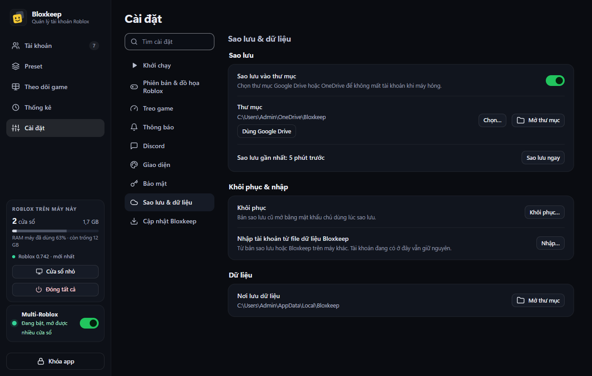

## Giới hạn và tình trạng thử nghiệm

- Trạng thái online của Roblox bị trễ: thoát game rồi mà Roblox vẫn có thể báo "đang chơi" thêm vài phút.
- Roblox bản Microsoft Store vẫn đang thử nghiệm (**Cài đặt › Khởi chạy › Mở Roblox bằng**). Các cài đặt cửa sổ và đồ họa Roblox của Bloxkeep chưa áp dụng cho bản này.
- Roblox VNG: thêm được tài khoản, chưa mở được game.
- Multi-Roblox: Bloxkeep phải mở trước Roblox và để mở trong lúc chơi. Nếu Roblox (kể cả bản ở khay hệ thống) mở trước, đèn sẽ vàng đến khi đóng hết Roblox. Roblox không chính thức hỗ trợ nhiều client, và một bản Roblox sau này có thể đổi cách chặn.
- VPN chỉ áp cho một số app: nếu Roblox đi qua VPN mà Bloxkeep thì không, mở game có thể báo lỗi 403. Xem [câu hỏi thường gặp](#câu-hỏi-thường-gặp).
- Ping của server là ping trung bình của người chơi, không phải của bạn. Server của bạn bè hay của người chơi bạn tìm chỉ hiện nếu cài đặt riêng tư của họ cho phép.
- Tiết kiệm RAM: Roblox có thể không nhả RAM.
- File chưa có chữ ký số nên SmartScreen cảnh báo lần đầu. Tự cập nhật chỉ hoạt động khi repo GitHub để công khai.
- Quên mật khẩu chủ thì không khôi phục được dữ liệu.

Đã thử với tài khoản thật trên Windows 11 (Roblox 0.742 và 0.743, tháng 10/2026): đăng nhập bằng mật khẩu qua bước proof-of-work và captcha nhấn-giữ của HUMAN, vào game, 5 tài khoản cùng vào một game bằng Multi-Roblox với bản Roblox tháng 10/2026, mở nhiều trang chủ riêng.

**Chưa thử với tài khoản thật:**

- Tự vào lại game và **Mở lại Roblox** theo giờ trong thời gian dài.
- Hẹn giờ preset, gửi lên Discord, **Treo máy nhẹ**, kiểu xếp **Ô nhỏ**.
- Mã 2FA điền sẵn khi đăng nhập, nhãn **Bị ban** với một tài khoản bị ban thật, **Vào cùng người chơi…** với người chơi thật.
- Bước cuối của **Đăng nhập bằng điện thoại**, xác minh 2 bước, và captcha xoay hình (Arkose).
- Chạy trên Windows 10.

Nếu gặp lỗi, bạn báo ngay trong app: **Cài đặt › Cập nhật Bloxkeep › Gửi góp ý** (hoặc `Ctrl+K`, gõ "góp ý"). Có thể gửi kèm nhật ký lỗi của Bloxkeep, đã xoá tên tài khoản, ID, mật khẩu và cookie; bấm **Xem đúng những gì sẽ gửi đi** để xem trước khi gửi ([cách hoạt động](docs/feedback.md), tiếng Anh). Hoặc [mở issue](../../issues) kèm nội dung lỗi.

## Câu hỏi thường gặp

Từng tính năng được giải thích từng bước trong [hướng dẫn sử dụng](docs/guide.vi.md).

### **H:** Đây có phải virus không? Sao Windows hay antivirus cảnh báo?

**Đ:** Không. File chưa có chữ ký số (Bloxkeep đang xin ký miễn phí qua SignPath Foundation), nên SmartScreen và một số antivirus cảnh báo với mọi file mới. Bạn có thể đối chiếu SHA-256 với `SHA256SUMS.txt`, đọc mã nguồn trong repo này, hoặc [tự build](#tự-build-từ-mã-nguồn).

### **H:** Antivirus xóa mất Bloxkeep. Có nên dùng tiếp không?

**Đ:** Kiểm tra file trước: SHA-256 phải khớp với `SHA256SUMS.txt` trên trang phát hành, và file phải tải từ [Releases](https://github.com/minhhoang0122/bloxkeep/releases) của repo này. Nếu khớp, khôi phục file từ khu cách ly của antivirus và báo là nhận nhầm (với Windows Defender: [microsoft.com/wdsi/filesubmission](https://www.microsoft.com/wdsi/filesubmission)). Đừng bao giờ dùng "Bloxkeep" tải từ nơi khác.

### **H:** Bật Multi-Roblox thế nào?

**Đ:** Gạt công tắc **Multi-Roblox** ở cuối thanh bên (hoặc **Cài đặt › Khởi chạy › Multi-Roblox**) rồi xác nhận. Mở Bloxkeep trước Roblox và để nó mở trong lúc chơi. Màu đèn cho biết tình trạng:

| Đèn | Ý nghĩa |
|---|---|
| Xanh | Đang bật: mở được nhiều tài khoản cùng lúc |
| Vàng | Chưa hoạt động (đã có Roblox mở từ trước), hoặc bản Roblox mới có thể chặn. Bấm vào thẻ để xem cách xử lý |
| Xám | Đang tắt: mỗi lần mở Roblox mới, cửa sổ cũ bị đóng |

Nếu bấm **Vào game** cho hai tài khoản khi Multi-Roblox đang tắt, Bloxkeep sẽ gợi ý **Bật Multi-Roblox rồi chơi**.

### **H:** Đèn Multi-Roblox màu vàng.

**Đ:** Có Roblox đã mở trước Bloxkeep. Đóng hết Roblox, kể cả Roblox ở khay hệ thống. Nếu Roblox tự chạy cùng Windows, bấm **Tắt tự khởi động** trong bảng hướng dẫn. Đèn sẽ chuyển xanh. Lần sau hãy mở Bloxkeep trước Roblox. Nếu thẻ báo bản Roblox mới có thể chặn, bạn cứ chơi bình thường; nếu Roblox bắt đầu đóng cửa sổ, Bloxkeep sẽ báo, và cập nhật Bloxkeep là sửa được.

### **H:** Không mở được nhiều tài khoản: cửa sổ mới mở là cửa sổ cũ bị đóng.

**Đ:** Multi-Roblox đang tắt hoặc chưa hoạt động: xem hai câu ở trên. Nếu đèn đã xanh mà cửa sổ vẫn bị đóng, tức là Roblox đã đổi cách chặn mở nhiều cửa sổ. Hãy kiểm tra bản cập nhật Bloxkeep (**Cài đặt › Cập nhật Bloxkeep › Kiểm tra ngay**) và [gửi góp ý](#h-bạn-nên-thêm-tính-năng--tôi-gặp-lỗi).

### **H:** Mấy chấm màu trên tài khoản nghĩa là gì?

**Đ:** Chấm trên ảnh đại diện cho biết tài khoản đang ở đâu: **xanh lá** đang trong game, **xanh dương** online trên web hoặc app, **cam** đang ở Roblox Studio, **vàng** bị ngắt kết nối nhưng cửa sổ vẫn mở, **xám** offline. **Viền đỏ** nghĩa là tài khoản cần đăng nhập lại hoặc đã bị ban. Bộ lọc **Cần đăng nhập lại** và **Bị ban** phía trên danh sách lọc riêng những tài khoản đó.

### **H:** Thêm tài khoản không được.

**Đ:** Thử cách khác trong **Thêm tài khoản**: **Đăng nhập bằng điện thoại** (mã hoặc QR, không cần mật khẩu hay giải câu đố; tốt nhất khi tài khoản đã đăng nhập trên điện thoại), **Đăng nhập bằng trình duyệt**, **Mở roblox.com** (đăng nhập trên web rồi bấm **Lưu vào Bloxkeep**), hoặc **Dán cookie**. Nếu đăng nhập bằng mật khẩu cứ bắt giải câu đố, dùng điện thoại là nhanh nhất.

### **H:** Sao chép mật khẩu báo chưa lưu mật khẩu.

**Đ:** Đăng nhập bằng cách nào thì Bloxkeep cũng không giữ mật khẩu: cách điện thoại, trình duyệt và cookie không hề thấy mật khẩu, còn cách mật khẩu thì gửi thẳng cho Roblox rồi bỏ đi. Muốn sao chép được, hãy gõ mật khẩu ở **Sửa (F2) › Mật khẩu Roblox**. **Sao chép mã 2FA** cũng vậy: dán khóa app xác thực của tài khoản ở mục **Sửa**.

### **H:** Vào được server riêng (VIP) không?

**Đ:** Được. Dán link server riêng vào ô chọn game rồi bấm **Vào game**; Bloxkeep mở đúng server đó cho mọi tài khoản đã chọn. Ô **Job ID** đưa các tài khoản vào một server cụ thể, còn nút **Vào cùng người chơi** (cạnh ô chọn game) tìm server mà một người chơi đang ở.

### **H:** Cửa sổ Roblox lúc toàn màn hình, lúc không.

**Đ:** Các cửa sổ Roblox dùng chung một cài đặt toàn màn hình, nên khi mở nhiều cái dễ bị lệch nhau. Bật **Luôn mở Roblox ở chế độ cửa sổ** trong bảng **Chi tiết** của Multi-Roblox (bật sẵn): mọi cửa sổ mở ở chế độ cửa sổ, cài đặt của bạn được trả lại sau đó. Muốn mỗi cửa sổ choán cả màn hình thì chọn **Phóng to** ở **Khi cửa sổ Roblox mở ra**; muốn xếp cạnh nhau thì chọn **Xếp cạnh nhau** hoặc dùng **Kiểu xếp cửa sổ**.

### **H:** Dùng Bloxstrap / Fishstrap thì mod còn không?

**Đ:** Còn, nếu chọn **Bloxstrap** hoặc **Fishstrap** trong **Mở Roblox bằng**. Nếu launcher chặn nhiều cửa sổ, chọn **Chạy thẳng RobloxPlayerBeta (bỏ qua launcher)**; khi đó Roblox mở không qua launcher.

### **H:** Dùng Roblox bản Microsoft Store được không?

**Đ:** Được, trong lúc tính năng này còn thử nghiệm: chọn **Roblox (Microsoft Store)** ở **Cài đặt › Khởi chạy › Mở Roblox bằng**. Trình khởi động của Microsoft chỉ cho chạy một Roblox bản Store, nên Bloxkeep tự mở Roblox của bản Store, mỗi tài khoản với phiên đăng nhập riêng trong một cửa sổ riêng. Bản cập nhật vẫn do Microsoft Store cài. Nếu không chạy được, Roblox tải từ roblox.com cũng dùng y như vậy, kèm Bloxstrap hay Fishstrap tùy bạn.

### **H:** Thoát game rồi mà vẫn hiện "đang chơi".

**Đ:** Trạng thái của Roblox bị trễ, có khi vài phút. Với cửa sổ chạy trên máy này, Bloxkeep tự bỏ qua báo cáo cũ; trạng thái từ thiết bị khác vẫn có thể trễ.

### **H:** Mở game báo lỗi 403 "An error was encountered during authentication".

**Đ:** Thường do VPN chỉ áp cho một số app: Roblox đi qua VPN còn Bloxkeep thì không. Vé vào game gắn với địa chỉ IP đã xin nó, nên hãy cho Bloxkeep đi cùng đường với Roblox.

### **H:** Ở Việt Nam không vào được roblox.com thì có dùng được không?

**Đ:** Thêm tài khoản thì được. Đăng nhập bằng tên và mật khẩu, hay bằng điện thoại, không cần vào www.roblox.com, vì chỉ gọi tới máy chủ API và captcha của Roblox. Cách **Đăng nhập bằng trình duyệt** thì cần roblox.com. Bloxkeep không có VPN hay cách vượt chặn theo vùng nào. Tài khoản Roblox VNG thêm được nhưng chưa mở được game.

### **H:** Sao lưu tài khoản thế nào?

**Đ:** Bật **Cài đặt › Sao lưu & dữ liệu › Tự động sao lưu** và chọn một thư mục, tốt nhất là thư mục được OneDrive hay Google Drive đồng bộ. Mỗi bản sao lưu được mã hóa bằng mật khẩu chủ của bạn. Xem [Sao lưu và khôi phục](#sao-lưu-và-khôi-phục).

### **H:** Làm sao chuyển sang máy mới?

**Đ:** Bật sao lưu vào thư mục OneDrive hoặc Google Drive trên máy cũ. Trên máy mới, cài Bloxkeep, bấm **Khôi phục từ bản sao lưu** và nhập mật khẩu lúc sao lưu.

### **H:** Tôi quên mật khẩu chủ.

**Đ:** Không khôi phục được. Mật khẩu chủ không được lưu ở đâu cả. Bạn có thể xóa `vault.rmv` và `vault.rmv.bak` trong `%LOCALAPPDATA%\Bloxkeep` (mất toàn bộ tài khoản đã lưu) rồi thiết lập lại, hoặc khôi phục một bản sao lưu mà bạn còn nhớ mật khẩu.

### **H:** Bloxkeep có gửi mật khẩu hay cookie đi đâu không?

**Đ:** Chỉ tới Roblox. Mật khẩu chỉ gửi tới máy chủ đăng nhập của Roblox, cookie chỉ dùng để gọi máy chủ Roblox cho chính tài khoản đó. Danh sách đầy đủ ở bảng [Những gì rời khỏi máy](#dữ-liệu-và-bảo-mật).

### **H:** Dùng trên Mac hay Linux được không?

**Đ:** Không. Bloxkeep chỉ chạy trên Windows 10 và 11 (64-bit).

### **H:** Tài khoản của tôi có bị ban không?

**Đ:** Không ai đảm bảo được. Roblox không chính thức hỗ trợ chạy nhiều client cùng lúc, nên dùng Multi-Roblox là bạn tự chịu rủi ro. Bloxkeep đăng nhập và mở game theo cùng cách trang roblox.com làm, và không đụng vào bộ nhớ của game. Một số game cấm dùng tài khoản phụ; hãy đọc luật của game bạn chơi.

### **H:** Bạn nên thêm (tính năng) / Tôi gặp lỗi.

**Đ:** Báo ngay trong app: **Cài đặt › Cập nhật Bloxkeep › Gửi góp ý** (hoặc Ctrl+K). Khi báo lỗi có thể gửi kèm nhật ký lỗi của Bloxkeep (đã xóa tên tài khoản, mật khẩu và cookie), và bạn xem trước đúng những gì được gửi. Bạn cũng có thể mở [issue](https://github.com/minhhoang0122/bloxkeep/issues) trên GitHub.

### **H:** Làm sao xóa sạch Bloxkeep?

**Đ:** Gỡ Bloxkeep trong **Settings › Apps** của Windows và đánh dấu **Xóa luôn tài khoản và cài đặt**. Các bản sao lưu trong thư mục sao lưu vẫn còn; muốn thì tự xóa. Với bản portable, xóa thư mục chứa app (gồm cả `data`).

## Tự build từ mã nguồn

Cần Windows và **.NET 10 SDK**. App gồm phần lõi C# (.NET 10, WinForms) và giao diện HTML/CSS/JS chạy trong WebView2. Công cụ đóng gói [Velopack](https://velopack.io) (`vpk`) được khai báo trong `dotnet-tools.json` và script tự tải.

```bat
build.bat 1.0.1
```

Lệnh này chạy các bài kiểm tra trong `Tests\Bloxkeep.Tests` trước và dừng nếu có bài hỏng (chạy riêng bằng `dotnet run --project Tests\Bloxkeep.Tests`; thêm `--online` cho các bài cần hỏi máy chủ Roblox). Mỗi bài chạy trong tiến trình riêng với dữ liệu tạm, không bao giờ đụng dữ liệu của bạn. Kết quả nằm trong `dist\releases\`: `Bloxkeep-Setup.exe` (bộ cài tải qua mạng, chép nguyên từ `Installer\Web`), `Bloxkeep-Setup-Offline.exe`, `Bloxkeep-Portable.zip`, các gói cập nhật và `SHA256SUMS.txt`. Bộ cài tải qua mạng chỉ build lại khi thật cần, bằng `Installer\Web\make.bat`: mỗi lần build là một file mới đối với SmartScreen. Tham số thứ hai là link repo GitHub mà bản build sẽ tìm cập nhật (mặc định là repo này); truyền repo khác khi build bản fork.

```bat
release.bat 1.0.1 https://github.com/minhhoang0122/bloxkeep
```

`release.bat` đăng lên GitHub Releases, cần biến môi trường `GITHUB_TOKEN` có quyền ghi release. Mỗi phiên bản cần ghi chú (tiếng Anh và tiếng Việt) trong `RobloxManager\whatsnew.json`; ghi chú này hiện trong app sau khi cập nhật và trên trang phát hành. Để thử cập nhật trước khi đăng, đặt `BLOXKEEP_UPDATE_SOURCE` là một thư mục chứa các file phát hành.

**Xem thử giao diện không cần build**: chạy một web server tĩnh ở thư mục gốc repo (ví dụ `python -m http.server 5178`), rồi mở `http://127.0.0.1:5178/dev/preview.html`. Trang này dùng dữ liệu giả trong `dev/mock.js`.

```
RobloxManager/             mã nguồn C#
  wwwroot/                 giao diện (nhúng vào exe); chuỗi EN/VI trong i18n.js
  AppController*.cs        nhận lệnh từ giao diện, mở game, theo dõi tiến trình, tự vào lại game, preset,
                           hẹn giờ, Discord, thống kê, sao lưu (mỗi phần một file)
  RobloxApi.cs             gọi API Roblox (đăng nhập, trạng thái, game, server)
  RobloxLauncher.cs        mở Roblox qua launcher đã chọn
  RobloxLogWatcher.cs      đọc log của Roblox để biết vào game / bị kick
  RobloxGameSettings.cs    ghi cấu hình Roblox trước khi mở tài khoản rồi trả lại
  MultiInstance.cs         Multi-Roblox
  MonitorTab.cs            tab Theo dõi game
  Vault.cs                 kho mã hóa
  AppUpdater.cs            tự cập nhật (Velopack)
  whatsnew.json            ghi chú từng phiên bản
Installer/                 ảnh màn hình chờ của bộ cài; Setup/ là cửa sổ cài và gỡ cài đặt
dev/                       xem thử giao diện với dữ liệu giả (không đóng gói)
docs/screenshots/          ảnh chụp màn hình (vi/: ảnh giao diện tiếng Việt)
```

## Code signing policy

Các bản phát hành được build từ repo này bằng [workflow Release](.github/workflows/release.yml) trên máy Windows của chính GitHub. Bloxkeep đang đăng ký chữ ký số miễn phí của SignPath Foundation; file nào được ký, ký thế nào và ai duyệt nằm trong [code signing policy](CODE_SIGNING_POLICY.md). App gửi gì và gửi đi đâu nằm trong [chính sách quyền riêng tư](PRIVACY.md) (tiếng Anh).

## Giấy phép

[MIT](LICENSE) © 2026 minhhoang0122

*Bloxkeep là dự án độc lập, không liên kết, không được Roblox Corporation bảo trợ hay tài trợ. Roblox là thương hiệu của Roblox Corporation.*
