<p align="center">
  
</p>
<h1 align="center">Bloxkeep</h1>
<p align="center">Quản lý và mở nhiều tài khoản Roblox trên Windows. Tài khoản được mã hóa và chỉ lưu trên máy của bạn.</p>
<p align="center"><a href="README.md">English</a> | Tiếng Việt</p>
<p align="center"><a href="https://github.com/Bloxkeep/roblox-account-manager/releases/latest"></a> <a href="https://github.com/Bloxkeep/roblox-account-manager/releases"></a>   <a href="LICENSE"></a> <a href="https://bloxkeep-bot.bloxkeep-app.workers.dev/discord"></a></p>
<p align="center"><a href="https://github.com/Bloxkeep/roblox-account-manager/releases/latest/download/Bloxkeep-Setup.exe"></a> <a href="https://bloxkeep-bot.bloxkeep-app.workers.dev/discord"></a></p>
<p align="center"><a href="#tải-về-và-cài-đặt">Tải về</a> · <a href="#bắt-đầu">Bắt đầu</a> · <a href="https://bloxkeep.github.io/roblox-account-manager/vi/guide/">Hướng dẫn</a> · <a href="https://bloxkeep.github.io/roblox-account-manager/vi/">Trang web</a> · <a href="https://bloxkeep.github.io/roblox-account-manager/vi/whats-new/">Có gì mới</a> · <a href="#cộng-đồng">Cộng đồng</a> · <a href="#dữ-liệu-và-bảo-mật">Bảo mật</a> · <a href="#câu-hỏi-thường-gặp">Câu hỏi thường gặp</a> · <a href="PRIVACY.md">Quyền riêng tư</a></p>

<p align="center">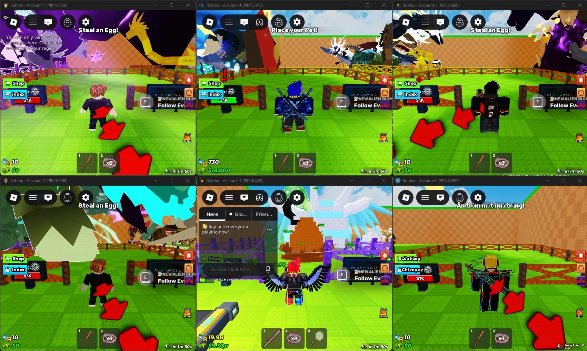</p>

Giữ các tài khoản Roblox ở một chỗ, chọn game, chọn tài khoản, bấm **Vào game**. Mọi thứ nằm trên máy của bạn, được mã hóa bằng mật khẩu chủ. Bloxkeep không có máy chủ riêng.

Repo này chứa mã nguồn, các bản phát hành và nơi báo lỗi của Bloxkeep. Hướng dẫn sử dụng nằm trên [trang web](https://bloxkeep.github.io/roblox-account-manager/vi/).

*Bloxkeep là dự án độc lập, không liên kết và không được Roblox Corporation bảo trợ. Roblox là thương hiệu của Roblox Corporation.*

## Tính năng

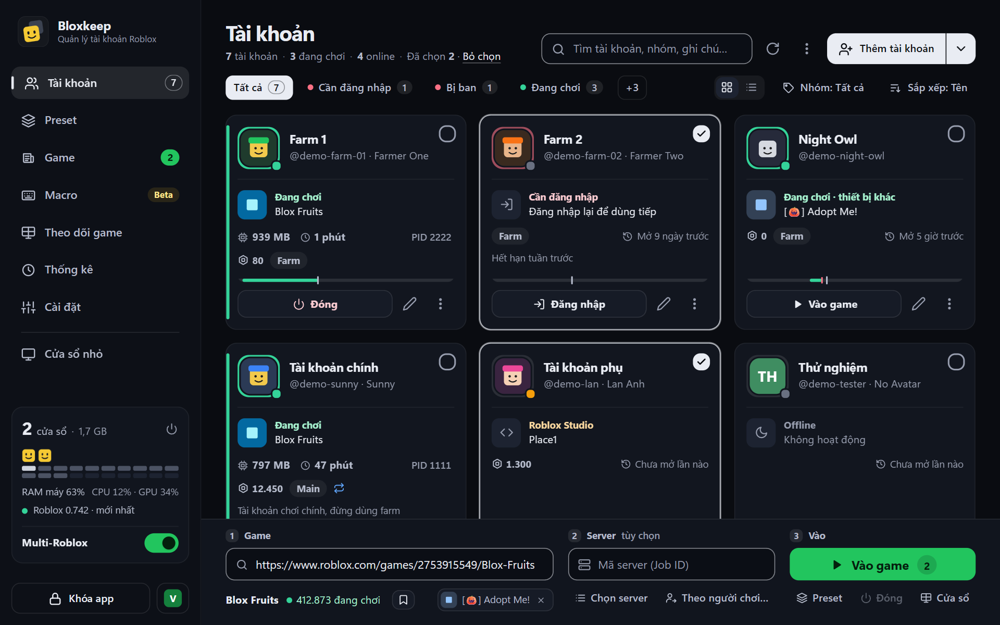

<table>
<tr>
<td width="50%" valign="top"><a href="https://bloxkeep.github.io/roblox-account-manager/vi/guide/accounts/">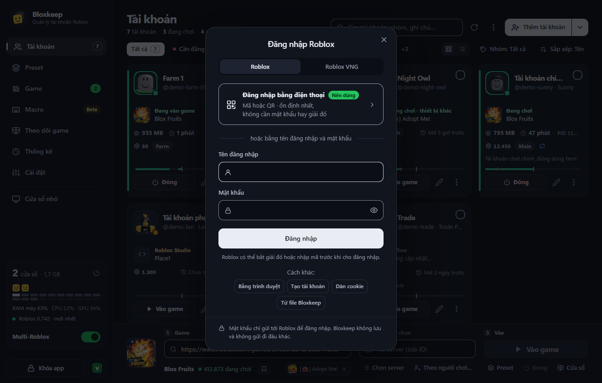</a><br><b>Thêm tài khoản</b><br>Bằng điện thoại (mã hoặc QR), tên đăng nhập và mật khẩu (có xác minh 2 bước và captcha), cửa sổ trình duyệt, cookie hoặc file Bloxkeep khác. <a href="https://bloxkeep.github.io/roblox-account-manager/vi/guide/accounts/">Tài khoản</a></td>
<td width="50%" valign="top"><a href="https://bloxkeep.github.io/roblox-account-manager/vi/guide/accounts/">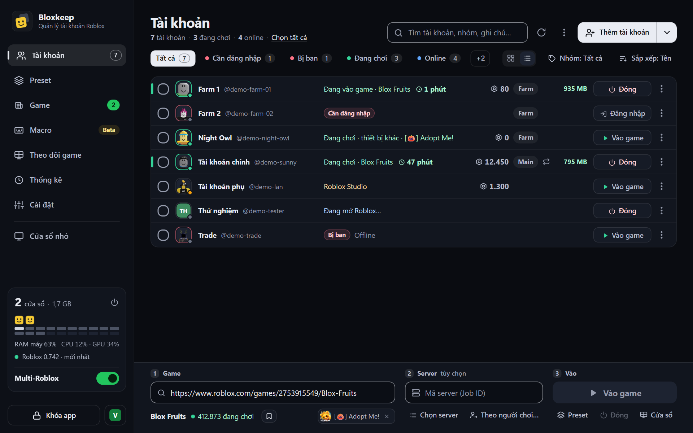</a><br><b>Xem mọi tài khoản</b><br>Đang online, đang chơi trên máy này hay thiết bị khác, vì sao bị văng, RAM, thời gian chơi, cần đăng nhập lại, bị ban. Tìm kiếm, nhóm, dạng thẻ hoặc danh sách. Đánh dấu tài khoản chính, cho các tài khoản kết bạn với nhau. <a href="https://bloxkeep.github.io/roblox-account-manager/vi/guide/accounts/">Tài khoản</a></td>
</tr>
<tr>
<td width="50%" valign="top"><a href="https://bloxkeep.github.io/roblox-account-manager/vi/guide/playing/">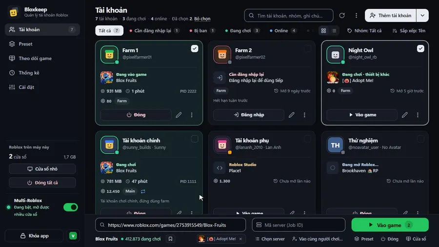</a><br><b>Vào game</b><br>Chọn game theo tên, link hoặc Place ID, và chọn server: đông nhất, vắng nhất, ping thấp nhất, đủ chỗ cho N tài khoản, server riêng của bạn, server của bạn bè hay của một người chơi bất kỳ. <a href="https://bloxkeep.github.io/roblox-account-manager/vi/guide/playing/">Chơi game</a></td>
<td width="50%" valign="top"><a href="https://bloxkeep.github.io/roblox-account-manager/vi/guide/multi-roblox/">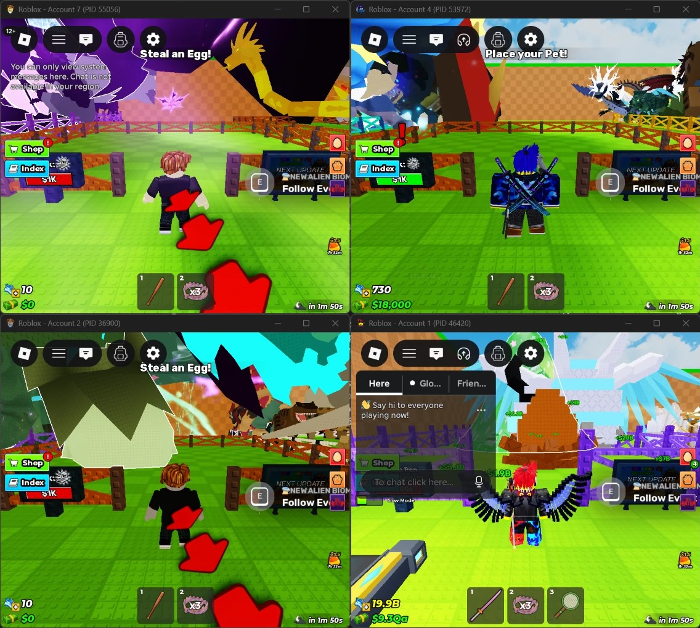</a><br><b>Multi-Roblox</b><br>Mở nhiều cửa sổ Roblox cùng lúc. Tắt sẵn cho tới khi bạn bật; mỗi bản Roblox mới đều được kiểm tra. <a href="https://bloxkeep.github.io/roblox-account-manager/vi/guide/multi-roblox/">Multi-Roblox</a></td>
</tr>
<tr>
<td width="50%" valign="top"><a href="https://bloxkeep.github.io/roblox-account-manager/vi/guide/presets/">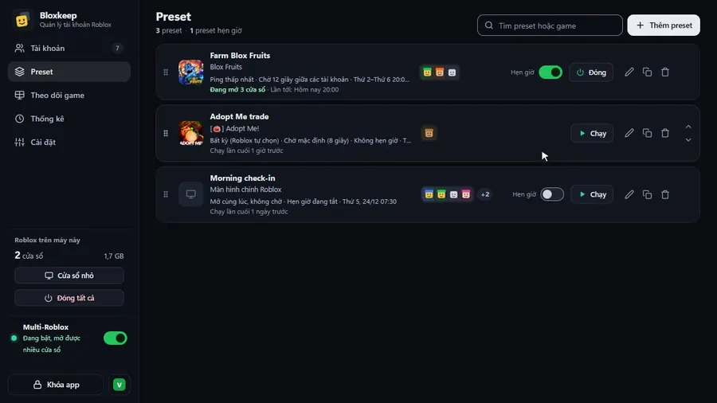</a><br><b>Preset</b><br>Lưu sẵn tài khoản, game và server để mở bằng một cú bấm, có hẹn giờ mở và tắt. <a href="https://bloxkeep.github.io/roblox-account-manager/vi/guide/presets/">Preset</a></td>
<td width="50%" valign="top"><a href="https://bloxkeep.github.io/roblox-account-manager/vi/guide/staying-in-game/">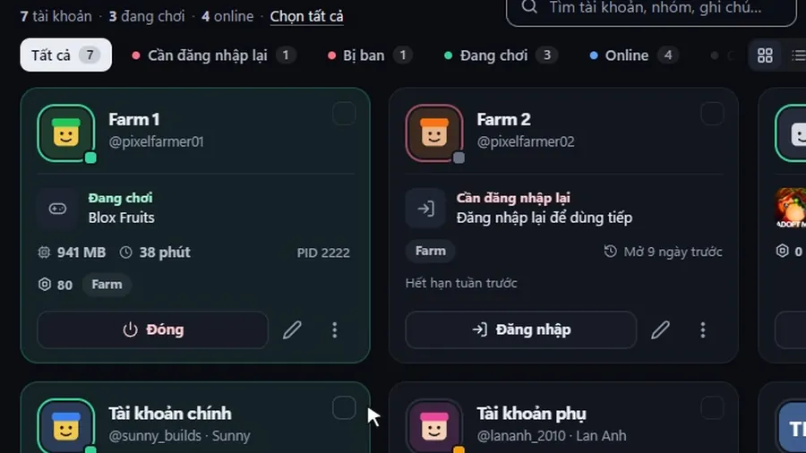</a><br><b>Ở lại trong game</b><br>Chống AFK để không bị đá vì đứng yên, tự vào lại khi bị văng. <a href="https://bloxkeep.github.io/roblox-account-manager/vi/guide/staying-in-game/">Ở lại trong game</a></td>
</tr>
<tr>
<td width="50%" valign="top"><a href="https://bloxkeep.github.io/roblox-account-manager/vi/guide/macros/">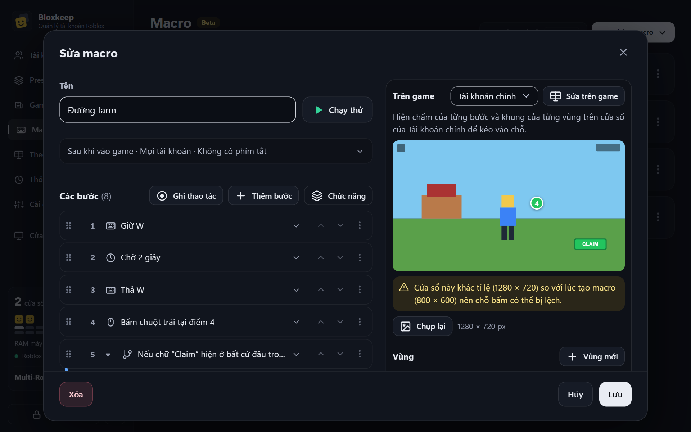</a><br><b>Macro (Beta)</b><br>Các bước viết thành câu dễ hiểu: bấm phím, bấm chuột, chờ hình, màu hoặc chữ, lặp lại, Nếu. Ghi lại thao tác hoặc bắt đầu từ mẫu, chạy thử, rồi kéo điểm và vùng ngay trên game. Mỗi macro có bảng nhỏ cạnh game với tab, công tắc, danh sách tích chọn và điểm do người chơi tự đặt. Bị kẹt thì macro tự chạy các bước gỡ kẹt. <a href="https://bloxkeep.github.io/roblox-account-manager/vi/guide/macros/">Macro</a></td>
<td width="50%" valign="top"><a href="https://bloxkeep.github.io/roblox-account-manager/vi/guide/windows-and-stats/">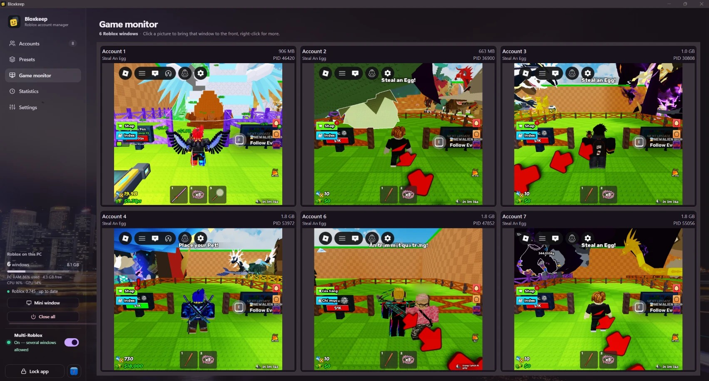</a><br><b>Cửa sổ</b><br>Xếp cửa sổ bằng hình mẫu (giống Snap của Windows) hoặc kích thước tự chọn, Theo dõi game có nút thu nhỏ từng cửa sổ, cửa sổ nhỏ, cảnh báo sắp hết RAM. <a href="https://bloxkeep.github.io/roblox-account-manager/vi/guide/windows-and-stats/">Cửa sổ và thống kê</a></td>
</tr>
<tr>
<td width="50%" valign="top"><a href="https://bloxkeep.github.io/roblox-account-manager/vi/guide/settings/">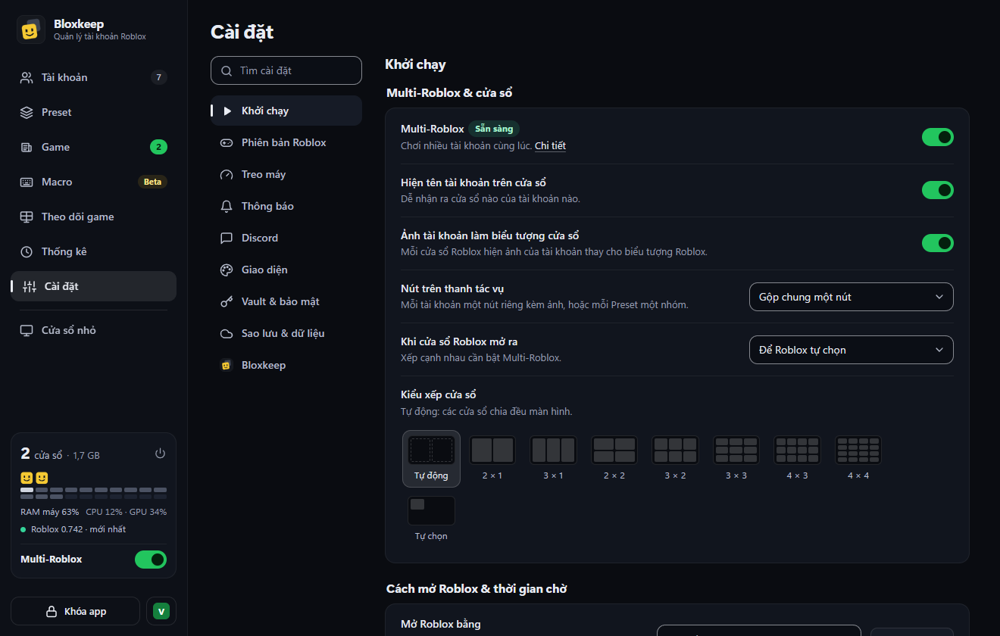</a><br><b>Roblox theo ý bạn</b><br>Đồ họa, FPS, âm lượng riêng cho từng tài khoản; mở bằng Roblox, Bloxstrap, Fishstrap, Voidstrap hoặc trình mở của bạn. <a href="https://bloxkeep.github.io/roblox-account-manager/vi/guide/settings/">Cài đặt</a></td>
<td width="50%" valign="top"><a href="https://bloxkeep.github.io/roblox-account-manager/vi/guide/discord/">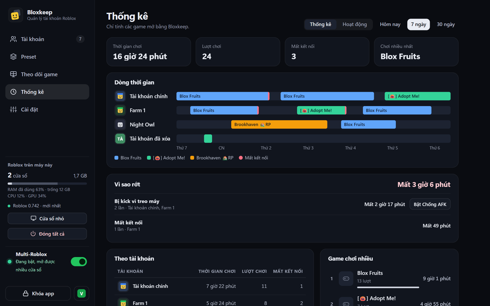</a><br><b>Thống kê và thông báo</b><br>Giờ chơi so với những ngày trước, dòng thời gian của từng tài khoản, vì sao rớt và mất bao lâu; cảnh báo và trạng thái trực tiếp trong kênh Discord của bạn hoặc trên điện thoại (ntfy); gõ <code>/pc</code> trong Discord để xem và điều khiển máy từ xa, <code>/pc screenshot</code> để xem ảnh cửa sổ Roblox của các tài khoản. <a href="https://bloxkeep.github.io/roblox-account-manager/vi/guide/discord/">Discord</a></td>
</tr>
<tr>
<td width="50%" valign="top"><a href="https://bloxkeep.github.io/roblox-account-manager/vi/guide/playing/#tab-game">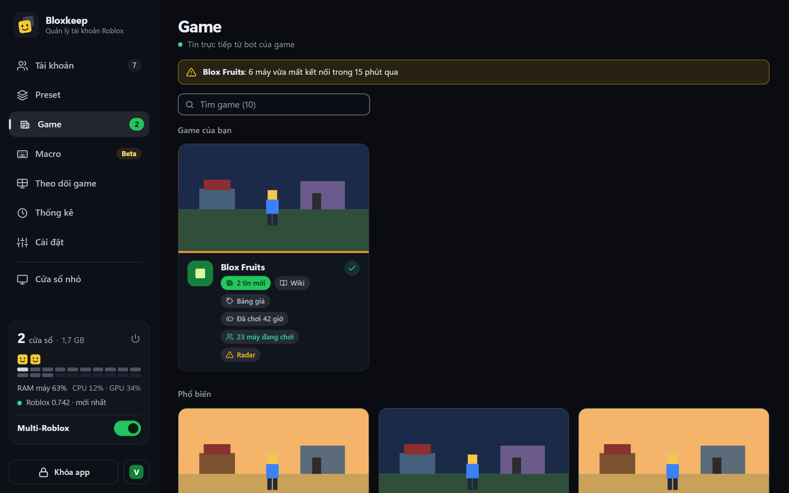</a><br><b>Game</b><br>Game phổ biến có sẵn wiki ngay trong Bloxkeep: tìm, bảng tra, món vừa buff/nerf, stock và spawn trực tiếp, bảng giá Blox Fruits. <a href="https://bloxkeep.github.io/roblox-account-manager/vi/guide/playing/#tab-game">Tab Game</a></td>
<td width="50%" valign="top"><a href="https://bloxkeep.github.io/roblox-account-manager/vi/guide/backup-and-security/">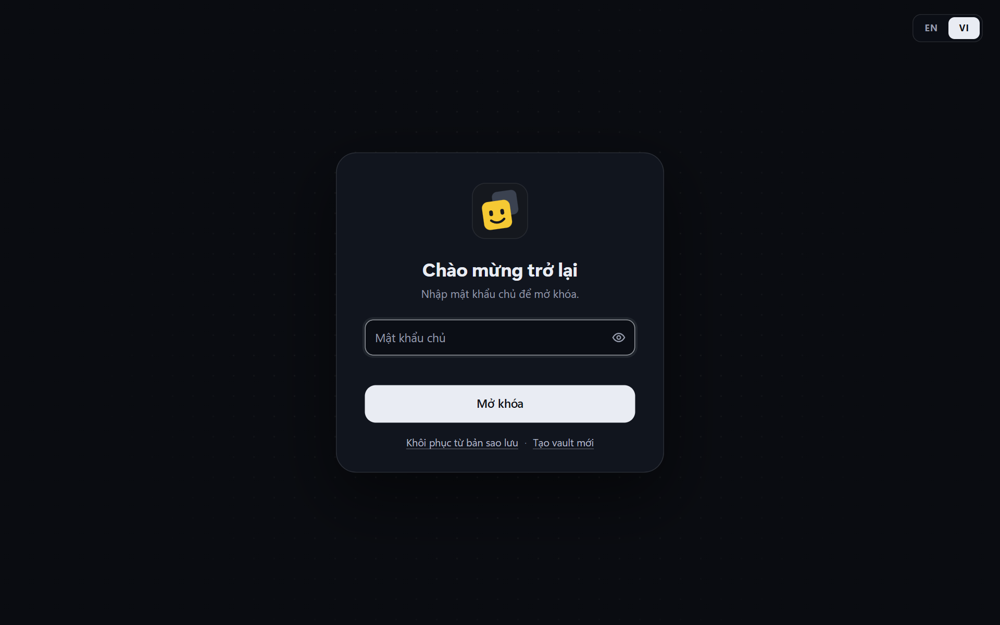</a><br><b>An toàn sẵn</b><br>Kho mã hóa, khóa app, sao lưu vào thư mục OneDrive hoặc Google Drive, ẩn tên khi livestream. <a href="https://bloxkeep.github.io/roblox-account-manager/vi/guide/backup-and-security/">Sao lưu và bảo mật</a></td>
</tr>
<tr>
<td width="50%" valign="top">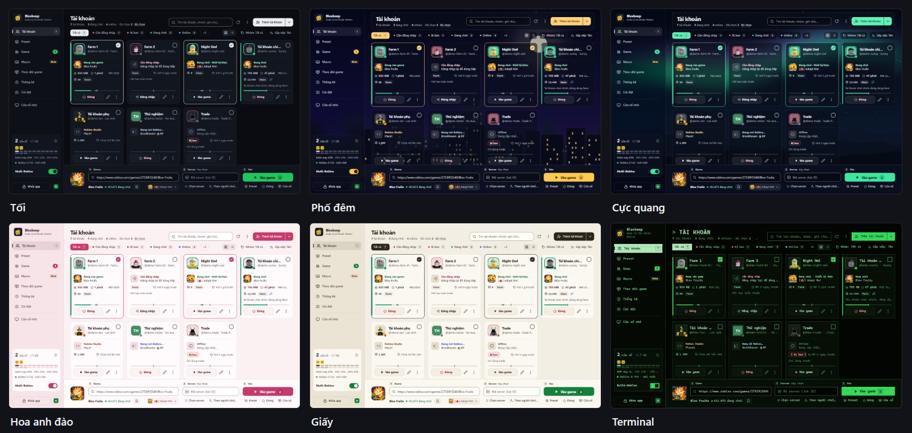<br><b>Của riêng bạn</b><br>98 giao diện, tiếng Việt và tiếng Anh, tìm nhanh bằng <code>Ctrl+K</code>.</td>
<td width="50%"></td>
</tr>
</table>

Danh sách đầy đủ mọi tính năng, hướng dẫn có ảnh và bản chạy thử ngay trên trình duyệt: [trang web của Bloxkeep](https://bloxkeep.github.io/roblox-account-manager/vi/#all).

## Tải về và cài đặt

Windows 10 hoặc 11, 64-bit. Không cần cài thêm gì trước.

| File | Dùng khi |
|---|---|
| [`Bloxkeep-Setup.exe`](https://github.com/Bloxkeep/roblox-account-manager/releases/latest/download/Bloxkeep-Setup.exe) | Cài bình thường: file nhỏ, tự tải bản mới nhất, chọn thư mục tùy ý, không cần quyền admin. |
| `Bloxkeep-Setup-Offline.exe` | Giống trên nhưng có sẵn mọi thứ bên trong, cho máy không có mạng. |
| `Bloxkeep-Portable.zip` | Không muốn cài: giải nén rồi chạy `Bloxkeep.exe`. |

Cả ba đều có ở trang [Releases](https://github.com/Bloxkeep/roblox-account-manager/releases/latest).

> [!CAUTION]
> Chỉ tải Bloxkeep từ trang Releases của repo này. Bản lấy từ nơi khác có thể bị sửa để lấy cắp tài khoản.

File chưa được ký số nên lần đầu SmartScreen sẽ cảnh báo: bấm **More info › Run anyway**. Muốn chắc thì so file với `SHA256SUMS.txt` trong cùng bản phát hành. Chi tiết: [Cài đặt](https://bloxkeep.github.io/roblox-account-manager/vi/guide/getting-started/#cài-đặt).

### Cập nhật

Bloxkeep tự tải bản mới khi đang chạy và cài vào lúc bạn không dùng, mở lại vẫn đang mở khóa, đúng chỗ bạn đang làm. Bấm **Khởi động lại để cập nhật** để cập nhật ngay. Vào **Cài đặt › Bloxkeep** để tắt tự cập nhật hoặc nhận cả bản beta. [Cập nhật](https://bloxkeep.github.io/roblox-account-manager/vi/guide/getting-started/#cập-nhật)

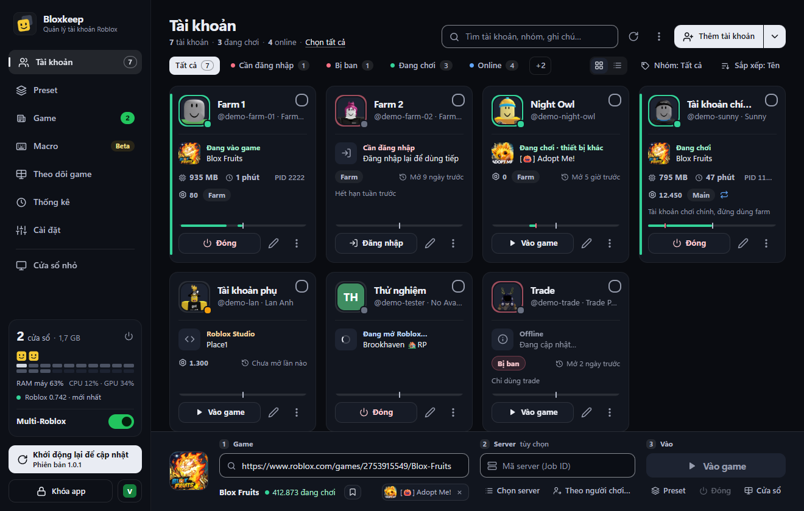

### Gỡ cài đặt

Windows **Settings › Apps › Installed apps › Bloxkeep › Uninstall**. Tích **Xóa luôn tài khoản và cài đặt** nếu muốn xóa cả dữ liệu, không thì dữ liệu được giữ lại để cài lại sau. [Gỡ cài đặt](https://bloxkeep.github.io/roblox-account-manager/vi/guide/getting-started/#gỡ-cài-đặt)

## Bắt đầu

1. **Đặt mật khẩu chủ.** Mật khẩu này dùng để mở khóa Bloxkeep và **không lấy lại được** nếu quên. Sang máy mới thì chọn **Khôi phục từ bản sao lưu**.
2. **Thêm tài khoản.** Bấm **Thêm tài khoản**, rồi chọn **Đăng nhập bằng điện thoại** (nên dùng), tên đăng nhập và mật khẩu, hoặc cửa sổ trình duyệt.
3. **Vào game.** Gõ tên game ở thanh dưới, bấm vào các tài khoản để chọn, rồi bấm **Vào game**.

<table>
<tr>
<td width="33%" valign="top"><br><b>1.</b> Mật khẩu chủ</td>
<td width="33%" valign="top"><br><b>2.</b> Thêm tài khoản</td>
<td width="33%" valign="top">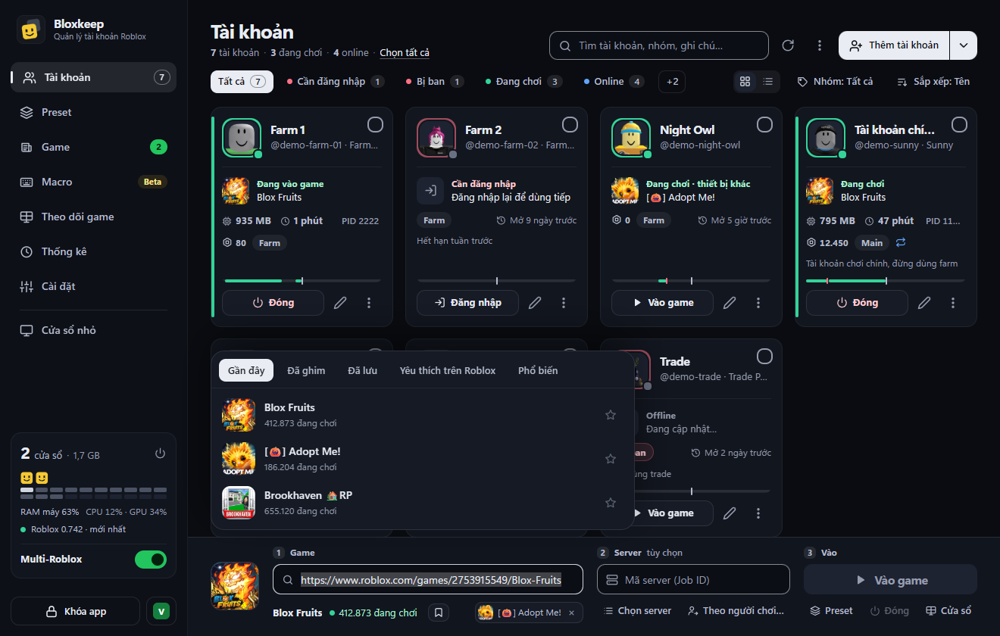<br><b>3.</b> Chọn game, bấm Vào game</td>
</tr>
</table>

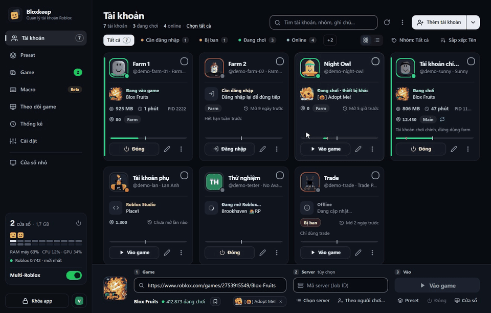

Hướng dẫn từng bước có hình: [Bắt đầu](https://bloxkeep.github.io/roblox-account-manager/vi/guide/getting-started/).

## Cộng đồng

<a href="https://bloxkeep-bot.bloxkeep-app.workers.dev/discord"></a>

Hỏi khi cần giúp, góp ý tưởng, và biết ngay khi Roblox cập nhật hay Bloxkeep ra bản mới. Lúc vào server có bước xác minh nhanh để chặn bot lừa đảo.

| Kênh | Dùng để |
|---|---|
| `#announcements` | Bloxkeep ra bản mới và tin tức |
| `#roblox-updates` | Bản Roblox sắp ra, đã ra, và khi Roblox lỗi |
| `#help` | Mỗi câu hỏi một bài: bạn làm gì, chuyện gì xảy ra, bản nào |
| `#bug-reports` | Gặp lỗi? Ghi các bước và chuyện gì xảy ra |
| `#ideas` | Mỗi ý tưởng một bài, thả cảm xúc cho ý bạn thích |
| `#general-vn` | Trò chuyện bằng tiếng Việt |

Gõ `/multi` cho bot để biết Multi-Roblox có chạy trên bản Roblox hiện tại và bản sắp ra không. Không ai của Bloxkeep hỏi cookie, mật khẩu hay mã 2 bước của bạn.

## Phím tắt

`Ctrl+K` tìm nhanh · `Ctrl+F` tìm kiếm · `Ctrl+L` ô chọn game · `Ctrl+A` chọn tất cả · `Enter` vào game · `F2` sửa · `Delete` xóa · `Esc` bỏ chọn · `Ctrl+Alt+1`–`9` chạy macro, `Ctrl+Alt+0` dừng mọi macro. Chuột phải vào tài khoản để mở menu của nó. Đầy đủ: [Phím tắt](https://bloxkeep.github.io/roblox-account-manager/vi/guide/troubleshooting/#phím-tắt).

## Dữ liệu và bảo mật

- **Chỉ nằm trên máy bạn**, trong `%LOCALAPPDATA%\Bloxkeep` (bản portable: thư mục `data` ngay cạnh app).
- **Được mã hóa** bằng AES-256-GCM, khóa tạo từ mật khẩu chủ (PBKDF2-HMAC-SHA256, 600.000 vòng). Mật khẩu chủ không bao giờ được lưu.
- **Mật khẩu và cookie chỉ gửi tới Roblox.** Bloxkeep không thu thập dữ liệu sử dụng. Ngoài Roblox, app chỉ liên lạc với GitHub (cập nhật), bên cung cấp captcha của Roblox (chỉ trong cửa sổ giải đố), và bot của Bloxkeep để đếm số người đang dùng, tắt được (một mã tạo từ máy này, không lần ngược ra được, phiên bản, ngôn ngữ, các game tài khoản của bạn đang ở, số cửa sổ đang chạy và vì sao một tài khoản bị văng; không bao giờ gửi tài khoản). Còn lại là thứ bạn tự chọn gửi: góp ý, webhook Discord của bạn, thư mục sao lưu. Danh sách đầy đủ: [chính sách quyền riêng tư](PRIVACY.md) (tiếng Anh).
- **Khóa app** là xóa mọi cookie và mật khẩu đã giải mã khỏi bộ nhớ. Thứ bí mật bạn sao chép sẽ bị xóa khỏi clipboard sau 30 giây.

> [!WARNING]
> Quên mật khẩu chủ là mất các tài khoản đã lưu. Bản sao lưu cũng chỉ mở được bằng mật khẩu lúc tạo ra nó.

Đừng bao giờ gửi cho ai cookie, file `vault.rmv` hay bản sao lưu: mỗi thứ đều là chìa khóa đăng nhập đầy đủ vào tài khoản của bạn. Xem thêm: [Sao lưu và bảo mật](https://bloxkeep.github.io/roblox-account-manager/vi/guide/backup-and-security/).

## Sao lưu và khôi phục

Bật **Cài đặt › Sao lưu và dữ liệu › Sao lưu vào thư mục** rồi chọn một thư mục OneDrive hoặc Google Drive: kho mã hóa được chép vào đó sau mỗi lần thay đổi. Sang máy mới: cài Bloxkeep, chọn **Khôi phục từ bản sao lưu**, nhập mật khẩu lúc tạo bản sao lưu. [Sao lưu tự động](https://bloxkeep.github.io/roblox-account-manager/vi/guide/backup-and-security/#sao-lưu-tự-động)

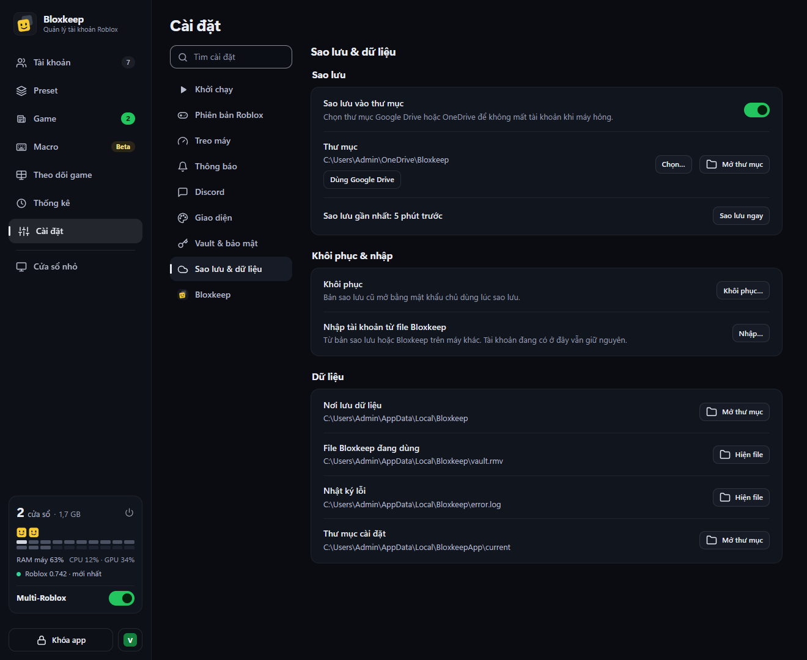

## Câu hỏi thường gặp

**Có phải virus không?** Không. File mới và chưa ký số thì hay bị cảnh báo. Bạn có thể so SHA-256 với `SHA256SUMS.txt`, đọc mã nguồn, hoặc [tự build](#tự-build-từ-mã-nguồn). Nếu antivirus xóa mất thì báo với hãng đó là nhận nhầm.

**Gặp lỗi hoặc muốn thêm tính năng?** Vào **Cài đặt › Bloxkeep › Gửi góp ý** (app cho xem trước đúng những gì sẽ gửi), đăng vào `#bug-reports` hay `#ideas` trên [Discord](#cộng-đồng), hoặc [mở issue](https://github.com/Bloxkeep/roblox-account-manager/issues).

Các câu hỏi khác (ban tài khoản, macro, dùng ở Việt Nam, quên mật khẩu chủ): [trang web](https://bloxkeep.github.io/roblox-account-manager/vi/#faq) và [Khắc phục sự cố](https://bloxkeep.github.io/roblox-account-manager/vi/guide/troubleshooting/).

## Chưa thử với tài khoản thật

Macro trong game thật nhiều giờ liền · tự vào lại game và **Mở lại Roblox** trong nhiều giờ · Preset hẹn giờ · Discord · **Treo máy nhẹ** · cửa sổ rất nhỏ · điền sẵn mã 2FA · tài khoản bị ban thật · **Vào cùng người chơi…** · bước cuối của đăng nhập bằng điện thoại · Windows 10. Gặp lỗi thì gửi góp ý ngay trong app giúp mình nhé.

## Tự build từ mã nguồn

Cần Windows và .NET 10 SDK. Phần lõi viết bằng C# (.NET 10, WinForms), giao diện HTML/React chạy trong WebView2.

```bat
scripts\build.bat 1.0.1
```

Lệnh này chạy các bài kiểm tra trong `Tests\Bloxkeep.Tests` trước, rồi đặt file cài, bản portable, gói cập nhật và `SHA256SUMS.txt` vào `dist\releases\`. Mỗi phiên bản cần ghi chú tiếng Anh và tiếng Việt trong `RobloxManager\whatsnew.json`. Muốn xem thử giao diện mà không cần build: chạy web server ở thư mục gốc của repo (`python -m http.server 5178`) rồi mở `/ui/dev/preview.html`.

| Thư mục | Chứa gì |
|---|---|
| `RobloxManager/` | App: phần lõi C#, giao diện `wwwroot/`, `whatsnew.json` |
| `ui/` | Các phần giao diện viết bằng React |
| `Tests/` | Bài kiểm tra của app và của giao diện |
| `services/` | Bot Discord, dịch vụ góp ý, trình theo dõi Roblox và tên miền |
| `site/`, `docs/` | Trang web và hướng dẫn sử dụng |

## Code signing policy

Các bản phát hành được build từ repo này bằng [Release workflow](.github/workflows/release.yml) trên máy Windows của GitHub. Hiện chưa được ký số: xem [code signing policy](docs/CODE_SIGNING_POLICY.md).

## Giấy phép

[MIT](LICENSE) © 2026 minhhoang0122

Bạn làm bản riêng với tính năng khác? Hãy đặt tên và logo riêng để mọi người phân biệt được với Bloxkeep. Xem [TRADEMARKS.md](TRADEMARKS.md).
