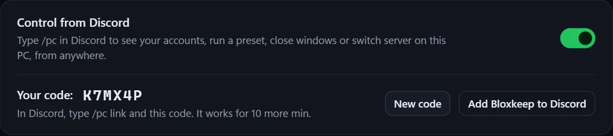

[Tiếng Việt](discord.vi.md)

# Sending to Discord

Bloxkeep can post play-time summaries, a live status message and alerts to a Discord channel of yours. It is off until you turn it on.

## Quick steps

1. In Discord: **Channel settings › Integrations › Webhooks › New Webhook › Copy Webhook URL**.
2. In Bloxkeep: **Settings › Discord › Webhook link › Paste link…**, paste it and press **Save**. The link looks like `https://discord.com/api/webhooks/…`.
3. Turn on **Send to Discord**, then press **Send test**: "Test message sent. Check the channel."

Turning on **Send to Discord** without a link asks for it.

## On your Discord profile

**Show on my Discord profile** (at the top of Settings › Discord) puts "Playing Bloxkeep" on your own Discord profile: how many Roblox windows are open, the game (or how many games), since when, and a **Get Bloxkeep** button to the website. It never shows an account's name. It works through the Discord app running on this PC, needs no webhook, and is off until you turn it on. Quitting Bloxkeep takes it away.

## Control from Discord

Type `/pc` in Discord to see how your accounts are doing, run a preset, close windows or switch server on your PC, from anywhere. It is off until you turn it on.

1. In Bloxkeep: **Settings › Discord › Control from Discord**, turn it on. A six-letter code shows; it works for 10 minutes (**New code** for another).
2. Press **Add Bloxkeep to Discord** and accept, so `/pc` works in any chat.
3. In Discord, type `/pc link` and the code.
4. Bloxkeep asks whether to allow that Discord account: press **Allow**. Nothing is linked until you do, so a code someone else saw (on a stream, say) is no use to them.

| Command | What it does |
|---|---|
| `/pc status` | The status card: each account with a Roblox window, its game and how it's doing. |
| `/pc preset` | Runs a preset (Discord suggests your presets as you type). Once its windows are open, how it went follows. |
| `/pc close` | Closes one account's Roblox window, or **All accounts**. |
| `/pc switch` | Moves an account to another server of its game. |
| `/pc unlink` | Stops controlling that PC from Discord. |

- The answers are seen only by you.
- With more than one PC linked, pick it in the `pc` box.
- While Bloxkeep is locked, it only answers that it is locked.
- A preset that would ask something first (Multi-Roblox off, say) isn't run from Discord: Bloxkeep says why.
- Turning **Control from Discord** off unlinks the PC.

## What it does

Bloxkeep posts through a webhook: a link that lets a program post to one channel. Nothing is sent while Bloxkeep is locked.

## The three kinds of message

| Kind | What it shows |
|---|---|
| **Play time summary** | Total play time, time per account, top games, sessions and disconnects. |
| **Alerts** | Account dropped or auto-rejoin, scheduled presets, sign-in needs renewing (bans too), low RAM, launch problems. Alerts within 10 seconds go out as one message. |
| **Status message** | One message, edited in place: the accounts open, their game, time playing, PID and RAM. |

| An alert | Several alerts in one message |
|---|---|
|  |  |

| The status message | A play-time summary |
|---|---|
|  |  |

## Play time summary

**Settings › Discord › Play time summary**:

| Row | Choices |
|---|---|
| **Send automatically** | **Never**, **Every day**, **Every week**, **Both**. Then **Every day at** a time, **Every week on** a day and time. |
| **When a scheduled preset finishes** | Sent half a minute after its accounts close, counting that preset's accounts only. |
| **Covers** | **Last 24 hours**, **Last 7 days**, **Last 30 days**. |
| **Includes** | **Total play time**, **Time per account**, **Top games**, **Sessions**, **Disconnects** (at least one). |
| **Accounts** | **All accounts**, or **Choose…** some. |
| **Ping** | See [Pings](#pings). |
| **Send one now** | **Send summary** sends it now, with the choices above. |

More details

**Covers** is for the daily summary and **Send one now**. The weekly summary always covers 7 days; the one after a schedule covers today so far, and goes to the preset's own channel when it has one.

## Alerts

- **Send alerts** turns every kind on or off.
- **Ping** sets the same ping for every kind ("Varies by alert" when they differ).
- **Choose which alerts** opens one switch and one ping per kind: **Account dropped or auto-rejoin**, **Scheduled presets**, **Sign-in needs renewing** (bans too), **Low RAM**, **Launch problems**.
- They are separate from Windows notifications.

## Status message

**Keep a status message up to date**, with **Every 2 / 5 / 10 / 15 / 30 / 60 min**. It never pings. When Bloxkeep is locked or closed, it says so.

## Pings

Each kind of message can ping **Nobody**, **@here**, **@everyone**, **A person…** or **A role…**. A person or a role needs its ID (17 to 20 digits): in Discord turn on **Settings › Advanced › Developer Mode**, then right-click the person or role › **Copy ID**.

## Quiet hours

Turn on **Quiet hours** and set **From** and **To**: messages still arrive, without pings. If From and To are the same time, quiet hours never apply.

## Customise messages

Open **Customise messages**:

- **Sender name**: up to 80 characters, without "discord" or "clyde".
- **Sender picture**: an `https://` link; empty uses Bloxkeep's logo.
- **Language**: **Same as Bloxkeep**, English or Tiếng Việt.
- **Message style**: **Cards** (easier to read) or **Plain text**.
- **Hide account names in messages**: "Account 1", "Account 2"… instead of names.

> [!TIP]
> **Plain text** suits phone notifications.

## A webhook for one preset

In a [preset](presets.md), **Send this preset's messages to** is **The channel in Settings** or **A webhook of its own** (paste its link; **Send test** checks it). The preset's own webhook gets its schedule messages, its summary after a scheduled stop and the alerts about the windows it opened. Everything else goes to the channel in Settings.

If **Send to Discord** is off, nothing goes out. If Discord deletes the preset's webhook, its messages go to the channel in Settings again.

## Managing the link

- **Show** displays the link for 30 seconds. **Replace…** pastes another. **Remove** asks first; messages already in the channel stay.
- The status line says "Last sent: …", "Nothing sent yet", how many messages are waiting, or the last error.

> [!NOTE]
> If Discord says the webhook no longer exists (deleted, or its link reset), sending stops, a note says so and the **Discord** page gets a red dot. Paste a new link.

More details

Messages that couldn't go while you were offline wait. Very old ones are dropped, and the next message says so.

## Safety

- The link is kept encrypted with your accounts.
- Messages carry account names (or "Account N"), game names, play time, sessions, PID, RAM and links to Roblox's own pictures.
- They never carry cookies, passwords or the webhook link.

> [!WARNING]
> Anyone who has the webhook link can post in that channel, so keep it to yourself.

← [User guide](../guide.md) · Next: [Settings](settings.md) →
