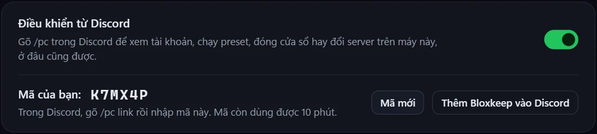
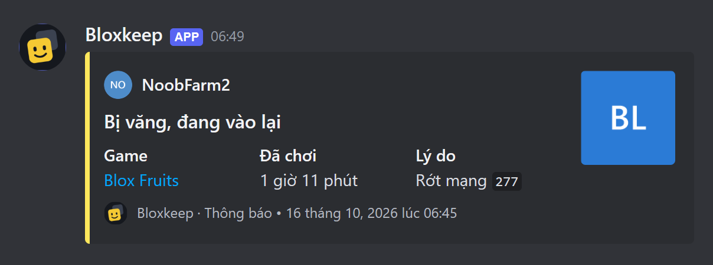
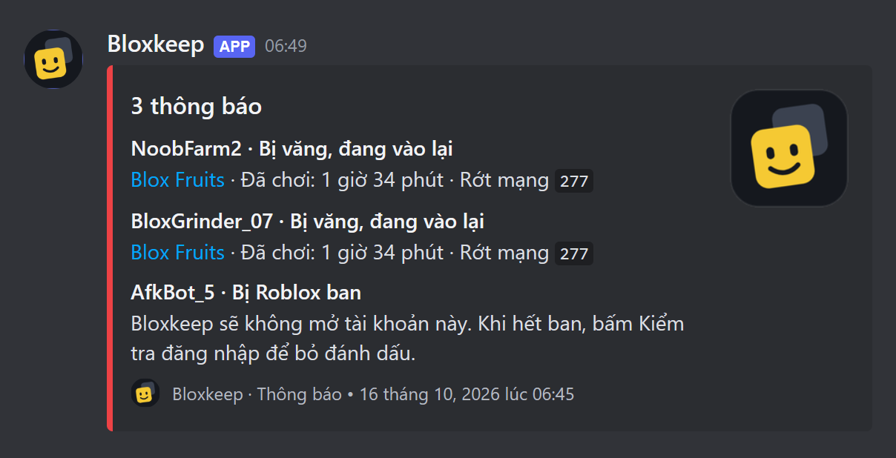
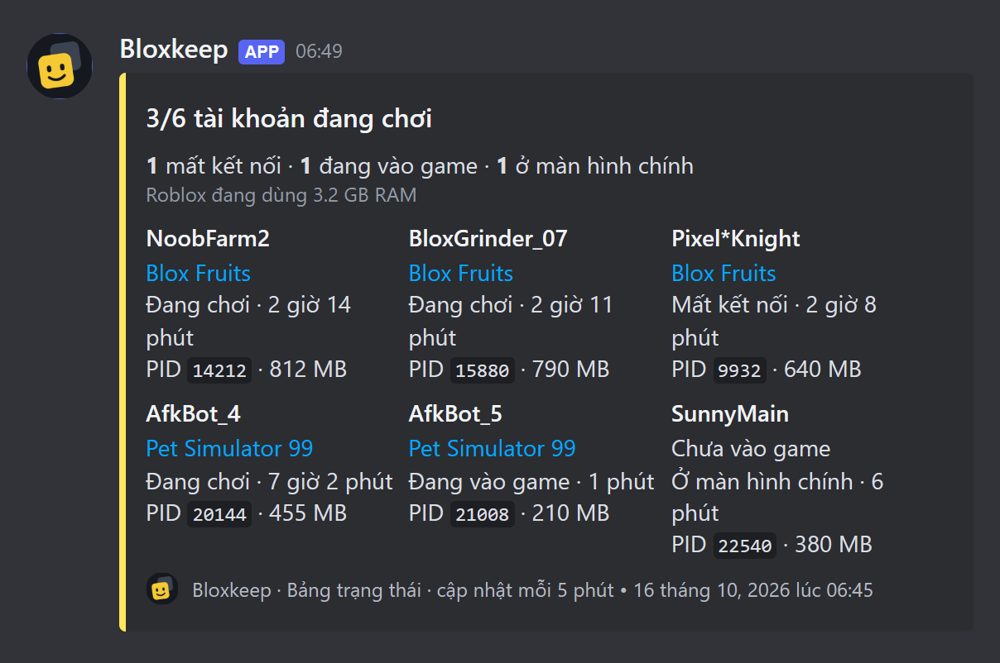
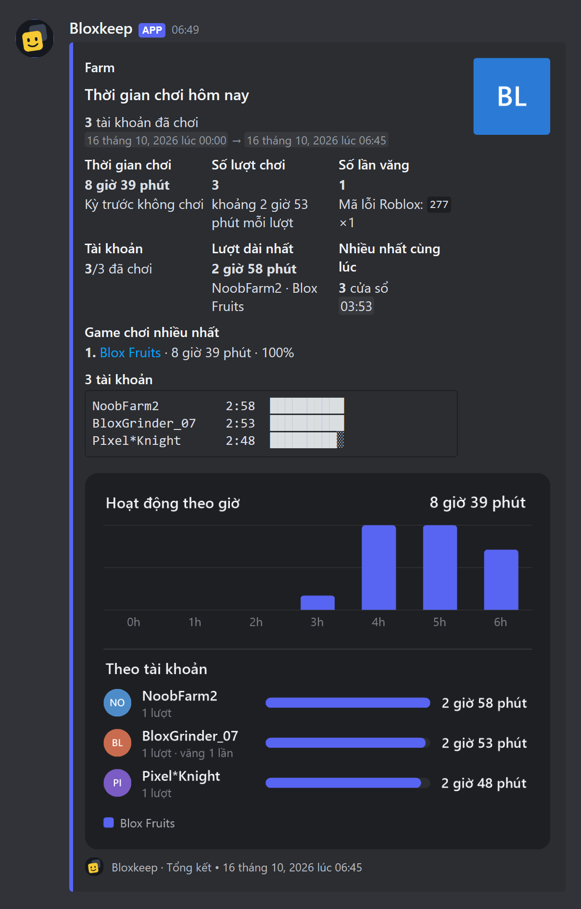

[English](discord.md)

# Gửi lên Discord

Bloxkeep có thể gửi tổng kết thời gian chơi, một tin trạng thái tự cập nhật và các cảnh báo vào kênh Discord của bạn. Mặc định tắt, chỉ gửi khi bạn bật.

## Làm nhanh

1. Trong Discord: **Cài đặt kênh › Tích hợp › Webhook › Webhook mới › Sao chép URL webhook**.
2. Trong Bloxkeep: **Cài đặt › Discord › Link webhook › Dán link…**, dán vào rồi bấm **Lưu**. Link đúng có dạng `https://discord.com/api/webhooks/…`.
3. Bật **Gửi lên Discord**, rồi bấm **Gửi thử**: "Đã gửi tin thử. Hãy xem trong kênh."

Bật **Gửi lên Discord** khi chưa có link thì app cũng hỏi link.

## Trên hồ sơ Discord của bạn

**Hiện trên hồ sơ Discord** (trên cùng của Cài đặt › Discord) cho hồ sơ Discord của bạn hiện "Đang chơi Bloxkeep": số cửa sổ Roblox đang mở, tên game (hoặc số game), chơi từ lúc nào, kèm nút **Tải Bloxkeep** dẫn tới website. Không bao giờ hiện tên tài khoản. Tính năng này chạy qua app Discord đang mở trên máy, không cần webhook, và tắt cho tới khi bạn bật. Thoát Bloxkeep thì dòng này cũng mất.

## Điều khiển từ Discord

Gõ `/pc` trong Discord để xem tài khoản đang thế nào, chạy preset, đóng cửa sổ hay đổi server trên máy, ở đâu cũng được. Mặc định tắt.

1. Trong Bloxkeep: **Cài đặt › Discord › Điều khiển từ Discord**, bật lên. Bloxkeep hiện mã 6 ký tự, dùng được 10 phút (**Mã mới** để lấy mã khác).
2. Bấm **Thêm Bloxkeep vào Discord** rồi đồng ý, để gõ được `/pc` ở mọi nơi.
3. Trong Discord, gõ `/pc link` và nhập mã.
4. Bloxkeep hỏi có cho tài khoản Discord đó điều khiển không: bấm **Cho phép**. Chưa bấm thì chưa liên kết, nên người khác lỡ thấy mã (khi bạn stream chẳng hạn) cũng không dùng được.

| Lệnh | Làm gì |
|---|---|
| `/pc status` | Thẻ trạng thái: từng tài khoản đang mở Roblox, game và tình trạng. |
| `/pc preset` | Chạy preset (Discord gợi ý preset khi bạn gõ). Mở xong thì báo kết quả. |
| `/pc close` | Đóng cửa sổ Roblox của một tài khoản, hoặc **Tất cả tài khoản**. |
| `/pc switch` | Cho một tài khoản sang server khác cùng game. |
| `/pc unlink` | Thôi điều khiển máy đó từ Discord. |

- Chỉ bạn thấy câu trả lời.
- Liên kết nhiều máy thì chọn máy ở ô `pc`.
- Khi Bloxkeep đang khóa, nó chỉ báo là đang khóa.
- Preset cần hỏi trước (ví dụ Multi-Roblox đang tắt) không chạy từ Discord, Bloxkeep sẽ nói lý do.
- Tắt **Điều khiển từ Discord** là hủy liên kết máy.

## Cách hoạt động

Bloxkeep gửi qua webhook: một đường link cho phép chương trình gửi tin vào đúng một kênh. Khi Bloxkeep đang khóa thì không gửi gì.

## Ba loại tin nhắn

| Loại | Nội dung |
|---|---|
| **Tổng kết thời gian chơi** | Tổng thời gian chơi, thời gian từng tài khoản, game chơi nhiều, số lượt chơi và số lần mất kết nối. |
| **Cảnh báo** | Tài khoản bị văng hoặc tự vào lại, preset hẹn giờ, tài khoản cần đăng nhập lại (gồm cả bị ban), sắp hết RAM, lỗi khi mở game. Các cảnh báo cách nhau dưới 10 giây được gộp thành một tin. |
| **Tin trạng thái** | Chỉ một tin, được sửa liên tục: tài khoản nào đang mở, game gì, đã chơi bao lâu, PID và RAM. |

| Một cảnh báo | Nhiều cảnh báo gộp một tin |
|---|---|
|  |  |

| Tin trạng thái | Bản tổng kết thời gian chơi |
|---|---|
|  |  |

## Tổng kết thời gian chơi

**Cài đặt › Discord › Tổng kết thời gian chơi**:

| Dòng | Lựa chọn |
|---|---|
| **Gửi tự động** | **Không**, **Hằng ngày**, **Hằng tuần**, **Cả hai**. Rồi **Hằng ngày lúc** một giờ; **Hằng tuần vào** một ngày và giờ. |
| **Khi preset hẹn giờ chạy xong** | Gửi khoảng nửa phút sau khi các tài khoản đóng, chỉ tính tài khoản của preset đó. |
| **Khoảng thời gian** | **24 giờ qua**, **7 ngày qua**, **30 ngày qua**. |
| **Gồm** | **Tổng thời gian chơi**, **Thời gian từng tài khoản**, **Game chơi nhiều**, **Số lượt chơi**, **Số lần mất kết nối** (ít nhất một mục). |
| **Tài khoản** | **Mọi tài khoản**, hoặc **Chọn…** một số tài khoản. |
| **Tag** | Xem [Tag](#tag). |
| **Gửi ngay** | **Gửi tổng kết** gửi luôn, theo các lựa chọn ở trên. |

Chi tiết thêm

**Khoảng thời gian** áp dụng cho bản tổng kết hằng ngày và **Gửi ngay**. Bản hằng tuần luôn tính 7 ngày; bản gửi sau preset hẹn giờ tính từ đầu hôm nay và vào kênh riêng nếu preset có.

## Cảnh báo

- **Gửi cảnh báo** bật hoặc tắt mọi loại cùng lúc.
- **Tag** đặt cùng một kiểu tag cho mọi loại (ghi "Tùy từng loại" khi các loại khác nhau).
- **Chọn loại cảnh báo** mở ra một công tắc và một ô tag cho từng loại: **Tài khoản bị văng hoặc tự vào lại**, **Preset hẹn giờ**, **Tài khoản cần đăng nhập lại** (gồm cả bị ban), **Sắp hết RAM**, **Lỗi khi mở game**.
- Phần này tách riêng với thông báo Windows.

## Tin trạng thái

**Luôn cập nhật tin trạng thái**, chọn **Mỗi 2 / 5 / 10 / 15 / 30 / 60 phút**. Tin này không bao giờ tag ai. Khi Bloxkeep khóa hoặc tắt, tin ghi rõ điều đó.

## Tag

Mỗi loại tin có thể tag **Không ai**, **@here**, **@everyone**, **Một người…** hoặc **Một vai trò…**. Tag một người hay một vai trò thì cần ID (17 đến 20 chữ số): trong Discord bật **Cài đặt › Nâng cao › Chế độ nhà phát triển**, rồi bấm chuột phải vào người hoặc vai trò › **Sao chép ID**.

## Giờ yên lặng

Bật **Giờ yên lặng** rồi đặt **Từ** và **Đến**: tin vẫn được gửi nhưng không tag ai. Nếu giờ bắt đầu và giờ kết thúc trùng nhau thì giờ yên lặng không có tác dụng.

## Tùy chỉnh tin nhắn

Mở **Tùy chỉnh tin nhắn**:

- **Tên người gửi**: tối đa 80 ký tự, không chứa "discord" hay "clyde".
- **Ảnh người gửi**: link `https://`; để trống thì dùng logo Bloxkeep.
- **Ngôn ngữ**: **Giống Bloxkeep**, English hoặc Tiếng Việt.
- **Kiểu tin**: **Thẻ** (dễ đọc hơn) hoặc **Văn bản thường**.
- **Ẩn tên tài khoản trong tin nhắn**: ghi "Tài khoản 1", "Tài khoản 2"… thay cho tên.

> [!TIP]
> **Văn bản thường** hợp với thông báo trên điện thoại.

## Webhook riêng cho một preset

Trong [preset](presets.vi.md), **Gửi tin của preset này vào** có hai lựa chọn: **Kênh trong Cài đặt** hoặc **Webhook riêng** (dán link; bấm **Gửi thử** để kiểm tra). Webhook riêng nhận tin hẹn giờ của preset, bản tổng kết sau khi preset hẹn giờ dừng, và cảnh báo của các cửa sổ do preset mở. Các tin khác vẫn vào kênh trong Cài đặt.

Nếu **Gửi lên Discord** đang tắt thì chưa có tin nào được gửi. Nếu Discord xóa webhook của preset, tin của preset lại vào kênh trong Cài đặt.

## Quản lý link

- **Hiện** cho xem link trong 30 giây. **Thay…** để dán link khác. **Gỡ** có hỏi trước; các tin đã có trong kênh vẫn giữ nguyên.
- Dòng trạng thái ghi "Gửi lần cuối: …", "Chưa gửi gì", số tin đang chờ gửi, hoặc lỗi gần nhất.

> [!NOTE]
> Nếu Discord báo webhook không còn nữa (đã bị xóa hoặc link bị đặt lại), Bloxkeep ngừng gửi, hiện dòng báo, và trang **Discord** có chấm đỏ. Hãy dán link mới.

Chi tiết thêm

Tin không gửi được lúc mất mạng sẽ chờ. Tin quá cũ bị bỏ và tin tiếp theo có ghi rõ.

## An toàn

- Link được mã hóa và lưu cùng các tài khoản.
- Tin nhắn có tên tài khoản (hoặc "Tài khoản N"), tên game, thời gian chơi, số lượt, PID, RAM và link tới ảnh của chính Roblox.
- Không bao giờ có cookie, mật khẩu hay link webhook.

> [!WARNING]
> Ai có link webhook cũng gửi được tin vào kênh đó, nên đừng đưa cho người khác.

← [Hướng dẫn](../guide.vi.md) · Tiếp: [Cài đặt](settings.vi.md) →
