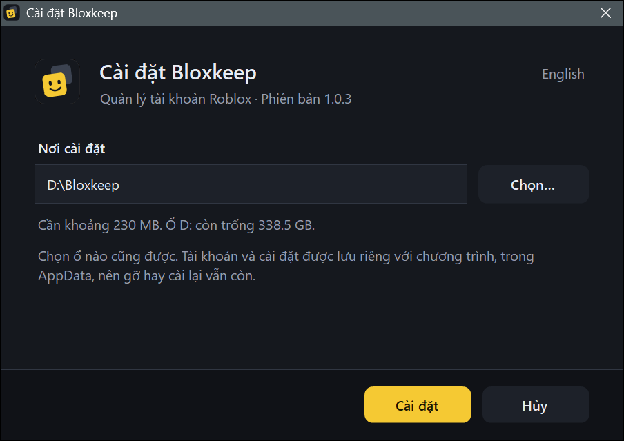
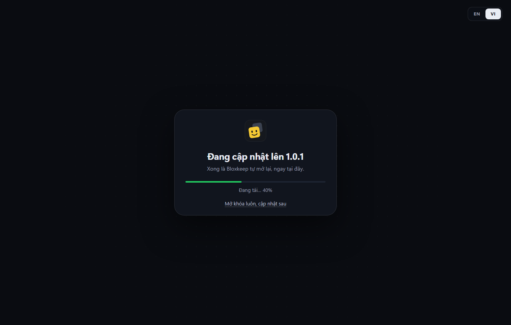
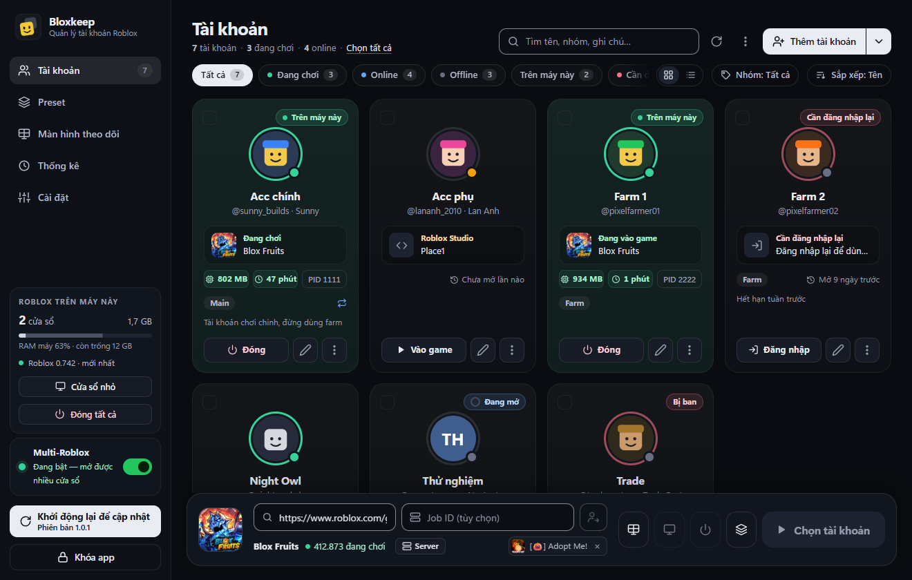
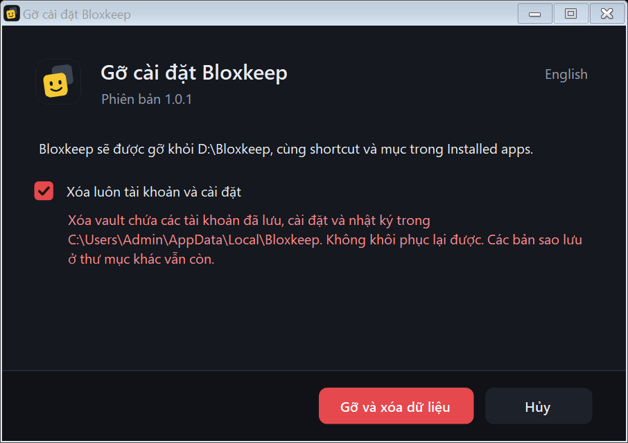

[English](getting-started.md)

# Bắt đầu

Cách cài Bloxkeep, đặt mật khẩu chủ, và việc mở khóa, khóa app và cập nhật sẽ làm gì.

## Làm nhanh

1. Tải Bloxkeep ở [trang Releases](https://github.com/Bloxkeep/roblox-account-manager/releases/latest) rồi chạy `Bloxkeep-Setup.exe`.
2. Chọn thư mục cài và đợi bộ cài chạy xong.
3. Lần đầu mở Bloxkeep, **Đặt mật khẩu chủ** (ít nhất 6 ký tự).
4. Bật sao lưu: **Cài đặt › Sao lưu & dữ liệu › Sao lưu vào thư mục**.
5. Bấm **Thêm tài khoản** (xem [Tài khoản](accounts.vi.md)).

## Cài đặt

Bloxkeep chạy trên Windows 10 hoặc 11, bản 64-bit. Không cần cài .NET: bộ cài tự cài Microsoft Edge WebView2 nếu máy chưa có.

| File | Dùng khi |
|---|---|
| `Bloxkeep-Setup.exe` | Cài bình thường. File nhỏ, trong lúc cài sẽ tải bản Bloxkeep mới nhất (khoảng 60 MB). Bạn chọn thư mục cài, ở ổ nào cũng được. Cài cho người dùng Windows hiện tại, không cần quyền admin, tạo shortcut ở Start Menu và Desktop. |
| `Bloxkeep-Setup-Offline.exe` | Cùng bộ cài đó nhưng có sẵn mọi thứ bên trong, dùng cho máy không có mạng. |
| `Bloxkeep-Portable.zip` | Không muốn cài. Giải nén rồi chạy `Bloxkeep.exe`; dữ liệu nằm trong thư mục `data` bên cạnh. |

> [!WARNING]
> Chỉ tải Bloxkeep ở trang Releases. Bản tải ở nơi khác có thể đã bị sửa để lấy cắp tài khoản.

Các file chưa có chữ ký số nên lần đầu chạy, Windows SmartScreen sẽ cảnh báo. Bấm **More info** rồi **Run anyway** (trên Windows tiếng Việt, hai nút này mang tên tiếng Việt tương ứng).

## Mật khẩu chủ

Mọi thứ bạn lưu trong Bloxkeep đều được mã hóa bằng mật khẩu này, nên lần đầu mở app sẽ hỏi.

- Ít nhất 6 ký tự và không được chỉ toàn dấu cách. Thanh **Yếu / Tạm được / Mạnh** chỉ để tham khảo.
- Bloxkeep không lưu mật khẩu này ở đâu cả, nên nó **không lấy lại được**. Quên là mất hết tài khoản đã lưu. Cách duy nhất để lấy lại là một bản sao lưu mà bạn còn nhớ mật khẩu.
- Nên bật sao lưu sớm: **Cài đặt › Sao lưu & dữ liệu › Sao lưu vào thư mục**. Bản sao lưu mở bằng mật khẩu dùng lúc sao lưu.
- Chuyển sang máy mới? Ở màn hình đầu tiên, bấm **Khôi phục từ bản sao lưu** thay vì đặt mật khẩu mới.
- Muốn đổi mật khẩu sau này: **Cài đặt › Bảo mật**.
- Nút **EN / VI** ở góc trên dùng để đổi ngôn ngữ (cũng có ở **Cài đặt › Giao diện › Ngôn ngữ**).

## Mở khóa và khóa app

Mỗi lần khởi động, Bloxkeep hiện **Chào mừng trở lại**: nhập mật khẩu chủ rồi bấm **Mở khóa**. Đang bật Caps Lock thì app sẽ nhắc. Nút **Khóa app** nằm cuối thanh bên.

| Khi đang khóa | Chuyện gì xảy ra |
|---|---|
| Vẫn chạy tiếp | Mọi cửa sổ Roblox vẫn mở. Preset đến giờ dừng vẫn đóng cửa sổ đúng giờ. |
| Tạm dừng tới khi bạn mở khóa | Tự vào lại game, preset hẹn giờ bắt đầu và tin nhắn Discord. |
| Bị dừng hoặc xóa | Lượt mở tài khoản đang chạy dở, cửa sổ trình duyệt của Bloxkeep ([Mở trang web](playing.vi.md#mở-trang-web)), mật khẩu hay mã 2FA vừa sao chép, và mọi dữ liệu đã giải mã trong bộ nhớ. |

Nếu có thứ sẽ bị tạm dừng (ví dụ "Tự vào lại game của 3 tài khoản" hay "2 preset hẹn giờ"), Bloxkeep hỏi **Khóa Bloxkeep?** và liệt kê ra. Tích **Không hỏi lại** nếu không muốn bị hỏi nữa.

Chi tiết thêm

- Preset đến giờ bắt đầu lúc đang khóa sẽ không chạy, và cũng không được chạy bù. Mở khóa xong, Bloxkeep báo một lần: "*Preset* không chạy lúc *giờ*: Bloxkeep đang khóa."
- Màn hình khóa nhắc rằng các cửa sổ Roblox vẫn đang mở.

## Cập nhật

Bloxkeep kiểm tra bản mới trên GitHub ngay khi mở và sau đó mỗi giờ một lần. Có bản mới trước khi bạn mở khóa thì cài luôn: màn hình mở khóa hiện **Đang cập nhật lên** *phiên bản* kèm tiến độ, rồi Bloxkeep mở lại ở bản mới, ngay màn hình mở khóa. Bản tìm thấy sau đó thì tải về ở nền và tự cài vào lần tới bạn không dùng Bloxkeep; vài giây sau app quay lại y như cũ: vẫn mở khóa, đúng tab đang xem. Các cửa sổ Roblox vẫn chạy suốt.

- **Khởi động lại để cập nhật** ở thanh bên cài ngay. Thoát Bloxkeep cũng sẽ cài bản mới.
- Sau khi cập nhật, **Có gì mới** cho biết đã thay đổi những gì.
- **Cài đặt › Cập nhật Bloxkeep** hiện phiên bản và trạng thái. **Kiểm tra ngay** tìm bản mới. **Tự động cập nhật** bật sẵn; tắt đi thì app không tự tải hay tự cài gì.
- **Tự động cập nhật** bị mờ trên bản không tự cập nhật được ("Chỉ có bản cài đặt là tự cập nhật được").

Chi tiết thêm

- Ở màn hình mở khóa, **Mở khóa luôn, cập nhật sau** trả lại ô mật khẩu; bản cập nhật sẽ chờ tới lúc bạn không dùng Bloxkeep. Nếu bạn đang gõ dở mật khẩu lúc tìm thấy bản mới thì màn hình mở khóa giữ nguyên.
- "Không dùng" nghĩa là cửa sổ đang ở khay hoặc thu nhỏ, hoặc không ai chạm vào máy trong 10 phút, và Bloxkeep không làm dở việc gì (không đang mở Roblox, đăng nhập, sao lưu hay điền dở form). Cửa sổ Roblox đang chạy treo không làm việc cập nhật phải chờ.
- Muốn nhập lại mật khẩu chủ sau mỗi lần cập nhật thì khóa Bloxkeep trước: bản đang khóa không chuyển gì cho bản mới.
- Nếu khoảng một phút sau vẫn chưa thấy bản mới mở lên, Bloxkeep tự mở lại ở khay, đang khóa, kèm một thông báo. Bản cập nhật đó không tự thử lại trong một ngày; nút **Khởi động lại để cập nhật** vẫn dùng được.

## Gỡ cài đặt

Vào **Settings › Apps › Installed apps** của Windows, tìm **Bloxkeep** và chọn **Uninstall**. Nếu Bloxkeep đang chạy, bộ gỡ sẽ đóng nó trước.

- Để trống ô **Xóa luôn tài khoản và cài đặt** thì vault và cài đặt được giữ cho lần cài sau. Đánh dấu thì xóa hẳn.
- Các file sao lưu trong thư mục sao lưu không bao giờ bị đụng tới. Muốn xóa thì bạn tự xóa.
- Bản portable không có bộ gỡ: xóa thư mục của nó, kèm thư mục `data`.

← [Hướng dẫn](../guide.vi.md) · Tiếp: [Tài khoản](accounts.vi.md) →
