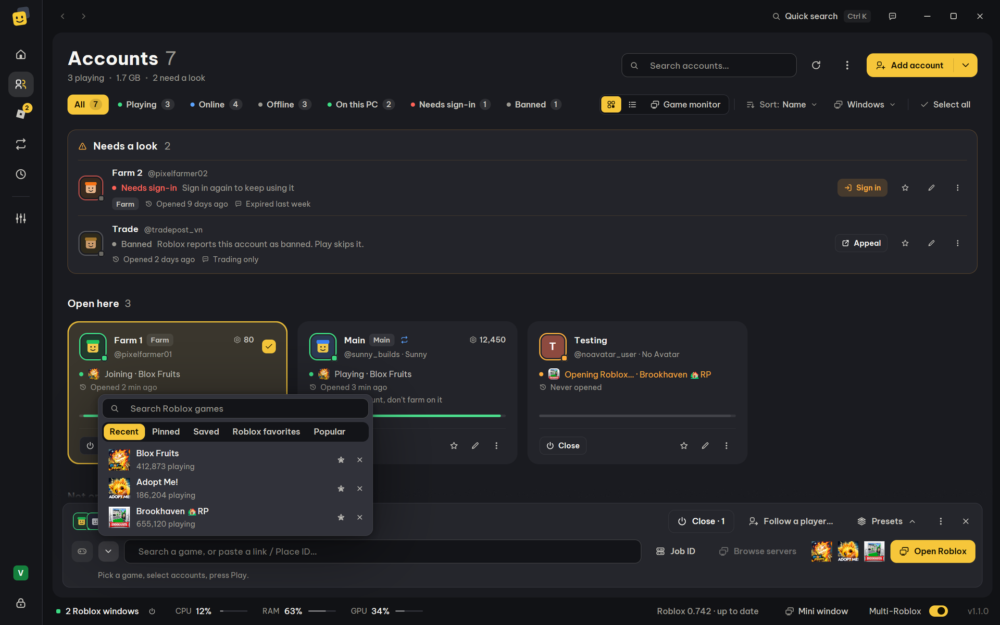
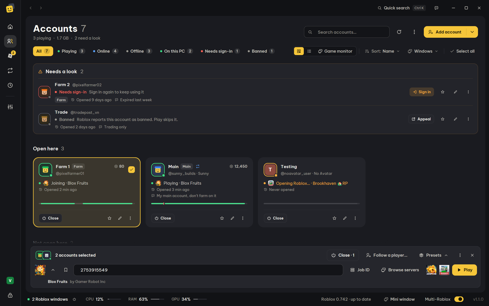
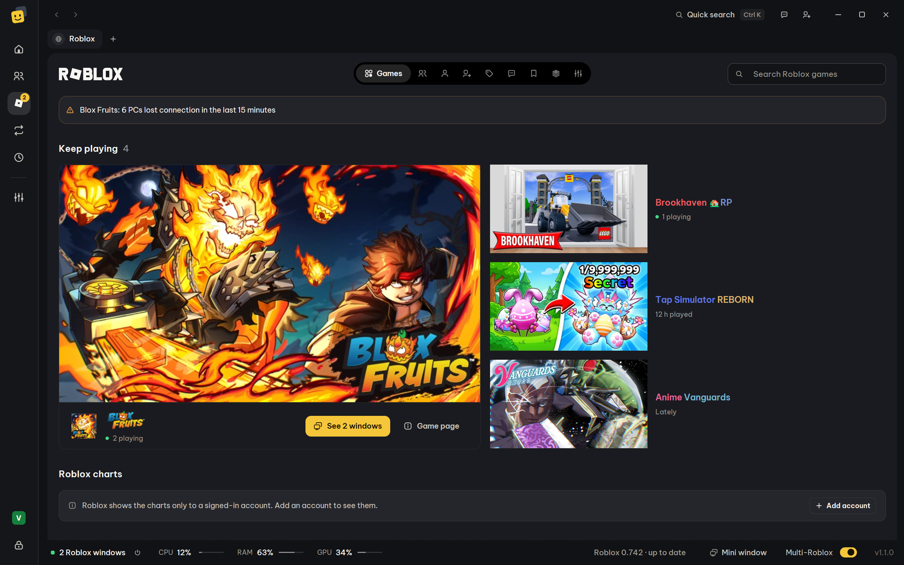
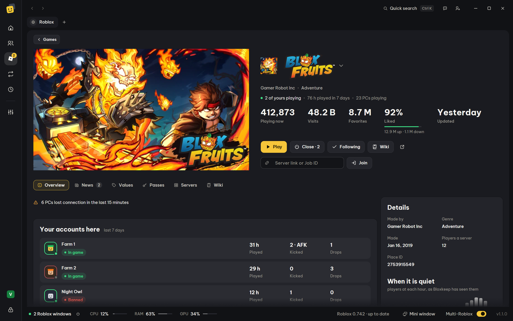
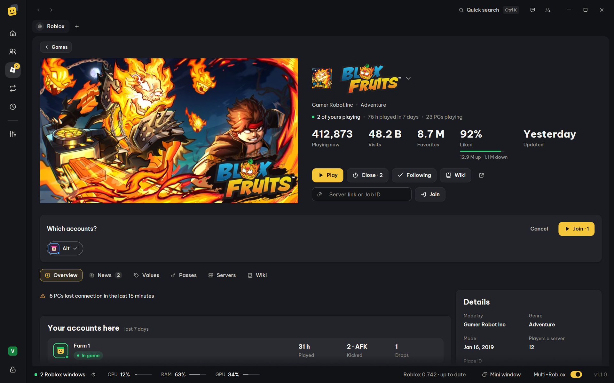
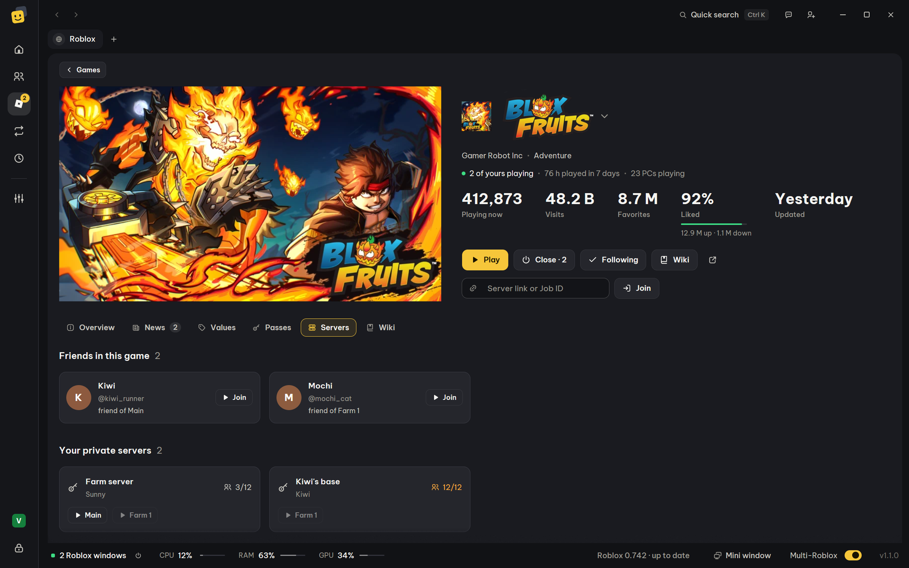
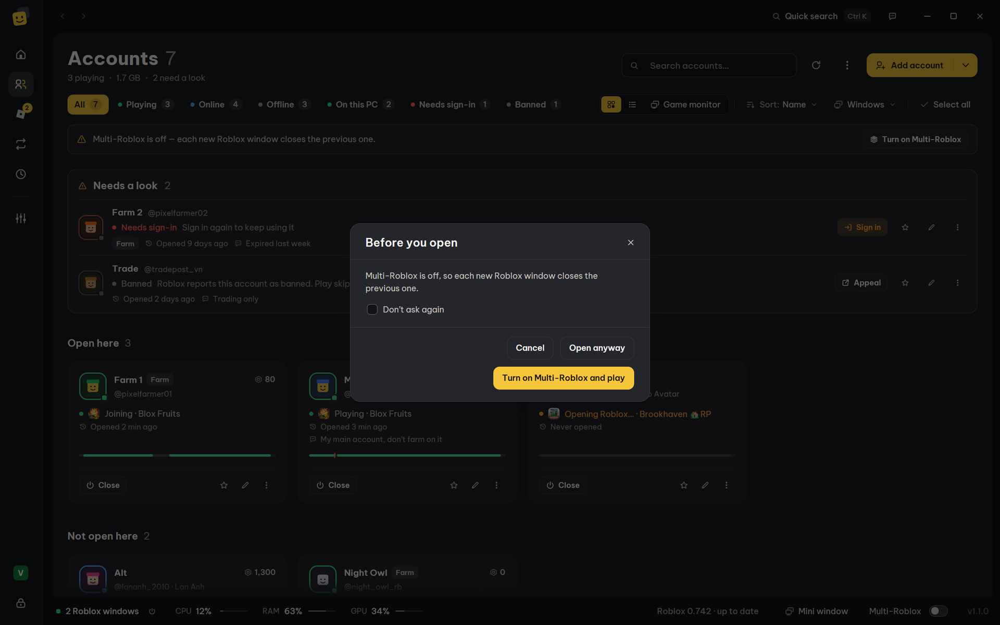

[Tiếng Việt](playing.vi.md)

# Playing

How to pick a game and a server, open Roblox for your accounts, and find your way around the Roblox tab.

## Quick steps

1. On **Accounts**, click the accounts you want to open. A bar comes up at the bottom: **2 accounts selected**.
2. In its game box, type a game's name, a Place ID or a link, and pick the game. The arrow beside the box opens the game list.
3. To land in one exact server (optional): **Job ID**, **Browse servers** or **Follow a player…**.
4. Press **Play**. If Bloxkeep asks **Before you open**, read it and press **Open anyway**.
5. To stop opening early, press **Stop**. To close Roblox, press **Close**.

Or start from the game: open it from **Home** or the **Roblox** tab, press **Play**, tick the accounts under **Which accounts?** and press **Join**.

Until Bloxkeep has opened an account once, **Get started** on Home and Accounts shows these steps (add an account, pick a game, select accounts and press **Play**) and ticks each one off as you do it.

## The bar at the bottom of Accounts

It shows while accounts are selected; ✕ unselects them all and puts it away.

| Part | What it holds |
|---|---|
| Top row | The selected accounts' faces and how many, **Close** (with how many of them are open), **Follow a player…**, **Presets** and ⋮. |
| Game row | The game's picture, the arrow for the game list, **Save server**, the game box, **Job ID**, **Browse servers**, recent games as pictures, and **Play**. |
| Under the box | The game found and its maker, or a hint of what to do next. |

The game box ("Search a game, or paste a link / Place ID…", Ctrl+L or `/`) takes:

| You type or paste | Notes |
|---|---|
| A game's name | Pick it from the list. A name you typed but didn't pick doesn't count. |
| A Place ID | |
| A `roblox.com/games/…` link | Private server links work too. |
| A private server share link | `roblox.com/share?…type=Server` |
| A `roblox://` link | |

A private server shows **Private server**, a game with a Job ID shows **Specific server**, and a share link shows "Private server link — Bloxkeep opens this link when you join." Click a recent game's picture to put it back in the box.

**The game list**: the arrow beside the box, or a click in the empty box. The tabs are **Recent**, **Pinned**, **Saved** (see [Saved servers](#saved-servers)), **Roblox favorites** (games your accounts favorited on Roblox) and **Popular** (when available). Click ☆ to pin a game, ✕ to take one off Recent.

**Job ID** (optional) is the ID of one exact server (`xxxxxxxx-xxxx-xxxx-xxxx-xxxxxxxxxxxx`), so several accounts land together. Changing to another game clears a Job ID left from the previous one. Enter in this box presses **Play**.

> [!TIP]
> To put several accounts in one server, pick it under **Browse servers** (**Use**), or use **Join this server** on an account already there. Then select the others and press **Play**.

## The Roblox tab

**Roblox** in the bar on the left (Roblox's own mark) is Roblox inside Bloxkeep. Each account gets a tab of its own along the top: **+** adds one, so you can look at Roblox as any of your accounts without signing in anywhere.

The row at the top switches between its pages:

| Page | What it has |
|---|---|
| **Games** | **Keep playing** (the games your accounts play, the one being played first), **Roblox charts**, and **Search Roblox games** at the top right, which finds games as you type, even short names (gpo, ps99) or a typo. |
| **Friends** | The account's friends and where each is now (in a game, online, offline), **Join** for a friend whose server Roblox shows, friend requests and **Add friend**. |
| **Avatar** | Its avatar (in 3D too), what it wears, its outfits and its inventory to dress it; and every look Bloxkeep has seen it in, to put on again. |
| **Profile** | Who it is, its friends and followers, its Robux and its communities. |
| **Marketplace** | Roblox's catalog: an item's page says which of your accounts own it already. |
| **Inbox** | Its chats, messages, notifications, Robux lines and trades (with Accept and Decline). |
| **Inventory** | What your accounts own, with every account's private servers together first. |
| **Mods** | Roblox mods to put in with one click, each on or off; they apply to every account on this PC. |
| **Settings** | The account's own Roblox settings, such as **Account status** and **Privacy**. |

These use the account's own sign-in, as Roblox's app does.

## A game's page

Click a game anywhere (Home, the Roblox tab, the game's name under the game box) to open its page.

| Part | What it shows |
|---|---|
| Top | Its picture, maker and genre; how many of your accounts play it, the hours played in 7 days and how many PCs with Bloxkeep play it now. |
| Figures | **Playing now**, **Visits**, **Favorites**, **Liked** and **Updated**. Roblox shows players and visits only to a signed-in account, so they need one in Bloxkeep. |
| Buttons | **Play** (asks **Which accounts?**, then **Join**), **Close** (with how many are open), **Follow** for the game's news, **Wiki**, and the arrow to open it on roblox.com. |
| Server link or Job ID | Paste a private server link or a Job ID and press **Join** to send the accounts there. |
| **Overview** | **Your accounts here**: each account that played it in the last 7 days, how long, kicks (by the game, or AFK for idling) and other drops, and whether it's in it now or banned from it. **Details** and **When it is quiet** (players at each hour, filled in as Bloxkeep notes the games you use every half hour; the quietest hours make a good time for a scheduled preset). |
| **News** | Posts live from the game's own alerts, such as stock and spawns. News works in the installed Bloxkeep only. |
| **Values**, **Passes** | Price lists (such as Blox Fruits'), and the game's passes. |
| **Servers** | The game's servers (see [Servers](#servers)). |
| **Wiki** | The game's wiki inside Bloxkeep: search, item tables, compare, new pages and recent buffs and nerfs. |

When Roblox has updated the game in the last 24 hours, the page says so: Roblox may be shutting old servers down, so a window that drops now rejoins a new one.

## Servers

**Browse servers** in the bar at the bottom of Accounts opens the game's server list; so does the **Servers** tab on a game's page. It is greyed out until a game is in the box, and for a private server.

- **Your private servers**: the private servers of this game that your selected accounts own or were invited to (with none selected, your first signed-in accounts), each with its owner, how many are playing and **Use**. Roblox lets only those accounts in, so a server some selected accounts can't join says "only *account* can join". **Use** puts it in the game box as a private server (`roblox://placeId=…&accessCode=…`); press **Play**, and Bloxkeep joins it the way the Join button on its Roblox page does.
- **Friends in this game**: friends of your accounts who are in this game, each "friend of *account*", with **Use**. Their privacy settings may hide them.
- **Public servers**: sort by **Most players**, **Fewest players**, **Lowest ping** or **Best FPS**. **Room for N** (with 2 or more accounts selected) shows only servers with room for all of them. **Random server** picks one.
- **Use** puts that server's Job ID in the bar at the bottom of Accounts ("Server chosen — select accounts and press Play."). A full server is greyed out.
- The ping is the average of the players in that server, not your own. When Roblox is busy, the list tries again by itself, then offers **Try again**.
- Empty servers aren't listed: a server whose last player has left is closing, and joining it ends on "This experience has ended".
- Several accounts sent to one server: the first one to open shows whether the server lets it in (a normal join gets a server in about a second). If it doesn't within 12 seconds (the server is full or has closed), that account and the rest go to another server with room for them all.

## Saved servers

Keep the servers you go back to in the game box's **Saved** tab.

- **Save server** (the bookmark beside the game box) saves what the box holds: a private server's link (`privateServerLinkCode`, or a share link), or the game with the **code it asks for** when it has private servers of its own that you join by typing a code in the game. Give it a name; the same link saved again updates the one saved.
- Pick a saved server in the **Saved** tab: a link goes in the game box, so **Play** sends the selected accounts straight there. A code goes on the clipboard and its game in the box: once in the game, paste the code where the game asks for it. Bloxkeep never types your saved codes; a [macro](macros.md) types only what you put in its steps.
- **Copy** next to a saved server copies its code again; **×** deletes it.

## Follow a player

**Follow a player…** in the bar at the bottom of Accounts (also in Ctrl+K) opens **Join a player**. With no account selected it says to select accounts first. Type a player's **Roblox username or user ID** (a profile link works too) and press **Find and join**: the selected accounts open into the server that player is in. When that can't happen, the dialog says why:

- no Roblox user has that name (it needs the username, not the display name);
- the player is in a game but their privacy settings don't show your accounts which server;
- the player is offline, or hides when they're online;
- the player is on the Roblox website or app, or in Roblox Studio, not in a game.

Bloxkeep only asks Roblox where the player is, using your selected accounts. It never follows or friends anyone to get past their privacy settings.

**When these accounts rejoin, look this player up again and join their server** (ticked until you untick it): each time one of these accounts is brought back by auto-rejoin, Bloxkeep asks Roblox again where the player is and joins that server, even in another game. While that can't happen, the rejoin waits and looks again every minute, and tells you why once:

- the player is offline, on the website or in Studio, or their server is hidden from your accounts;
- the player's server is full or has just ended;
- the game the player is in has banned this account, or Roblox won't let it in.

A preset can do the same: choose **A player's server** as its server (see [Presets](presets.md)).

## Play, Open Roblox, Close and Stop

| Button | What it does |
|---|---|
| **Play** | Reads **Select accounts first** (greyed out) while nothing is selected. With a game in the box it reads **Play** and the number of accounts. With the game box empty it reads **Open Roblox**: each account opens Roblox's home screen. |
| **Windows › Open Roblox only** | At the top of Accounts: the same home-screen launch, whatever is in the game box. Greyed out until you select accounts. |
| **Close** | Greyed out unless a selected account is open on this PC. |
| **Stop** | Replaces **Play** while accounts are opening: "Opened 2 accounts (stopped early)." |

How a launch goes:

- Accounts open one after another, with **Wait between accounts** in between (**Settings › Launching**, 8 seconds by default; a preset can have its own).
- An account already in this game is left as it is. An account in another game is asked about first, then closed and opened again in the new game.
- Before opening, Bloxkeep asks Roblox whether each account can play the game, as Roblox's own app does. If Roblox says one can't (an age check, its region, a restricted account, a game to buy, a private or friends-only game…), you're told why and asked whether to open it anyway. With no answer within 6 seconds, Play goes on as usual.
- Banned accounts are skipped, with a line in the result. If some accounts fail, **Some accounts didn't open** lists why.
- Afterwards the windows can arrange themselves: see [Windows and statistics](windows-and-stats.md).

## Launch order

**⋮ › Launch order…** at the top of Accounts lists every account: drag the handle or use the arrows, then press **Done**. **Play** opens the selected accounts in this order, and accounts added later go last. **Sort › Launch order** shows the list in that order. A preset keeps its own order.

## Before you open

Before opening, Bloxkeep may stop and ask in a dialog titled **Before you open**. Every question has **Cancel** and **Open anyway**.

| Question | When it appears | Don't ask again? |
|---|---|---|
| "*Account* will leave what they're playing now and open this game instead." | A selected account is already in another game or server. | No, always asked. |
| "Multi-Roblox is off, so each new Roblox window closes the previous one." | You open more than one account, or one while another Roblox window is open, with Multi-Roblox off. It also offers **Turn on Multi-Roblox and play**. | Yes |
| "Multi-Roblox isn't working yet: Roblox was already open before it was turned on." | Multi-Roblox is on but not ready. It also offers **Fix Multi-Roblox**. | No |
| The Multi-Roblox check's warning | You open several windows on a Roblox build where two windows haven't played together yet. | Yes |
| "Only *X* of RAM is free, and *N* more Roblox windows need about *Y*." | **Low RAM warning** is on and RAM would run short. | Yes |
| "RAM is free, but Windows' virtual memory is almost full, so *N* more Roblox windows may crash as they open." | **Low RAM warning** is on, RAM is enough, but Windows' virtual memory would run short. See [Troubleshooting](troubleshooting.md#q-a-roblox-window-crashes-as-it-opens-memory-dump-captured-or-bloxstraps-roblox-failed-to-launch). | Yes |

- **Don't ask again** shows only when every warning in the dialog can be skipped. Tick it and press **Open anyway**: each of those kinds is skipped from then on, on its own. A scheduled preset isn't stopped by a skipped warning either.
- To get them back, use **Settings › Notifications › Questions › Ask again**. The row **Questions you skipped** says how many there are. For Multi-Roblox itself, see [Multi-Roblox](multi-roblox.md).

More details

Other questions also have **Don't ask again**: deleting a preset, **Close all Roblox**, **Force close all Roblox**, **Turn on Multi-Roblox?**, **Discard changes?** and **Lock Bloxkeep?**. **Ask again** brings these back too. Deleting accounts, restoring a backup and removing the Discord link always ask.

## Open website

**Open website** in the account menu opens roblox.com signed in as that account, in the Bloxkeep browser window. The window has one tab per account. It isn't available for Roblox VNG accounts.

- Each tab has its own private sign-in, kept in memory only. Nothing goes into your own browser.
- Opening an account that already has a tab switches to it. Each tab has its own Back, Forward and Reload.
- **+** at the end of the tab strip opens a blank tab. Sign in on roblox.com, then press **Save to Bloxkeep** to add the account (or renew its sign-in). Without saving, closing the tab signs it out there.
- Closing the window closes all its tabs. Locking Bloxkeep closes it too.

| Keys | What they do |
|---|---|
| Ctrl+T | Open a blank tab. |
| Ctrl+W, ✕ or middle-click | Close the tab. |
| Ctrl+Tab | Switch tabs. |

More details

Signing out in a saved account's tab would also sign it out of Bloxkeep, so Bloxkeep stops it and explains. Choose **Close tab** or **Keep browsing**.

← [User guide](../guide.md) · Next: [Multi-Roblox](multi-roblox.md) →
