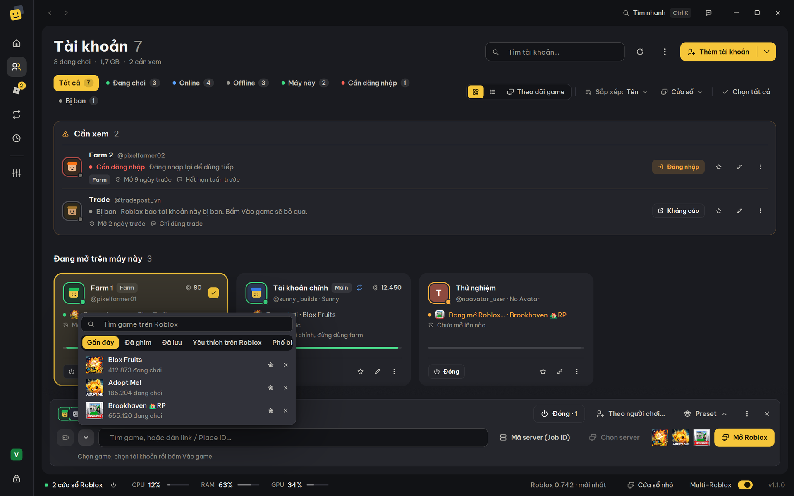
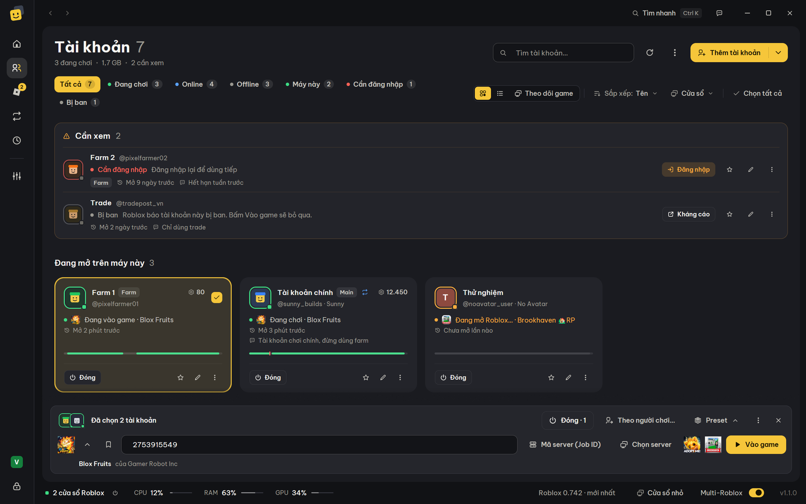
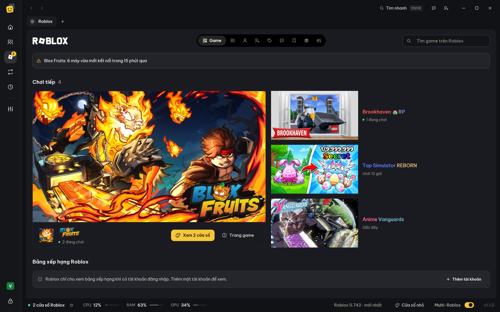
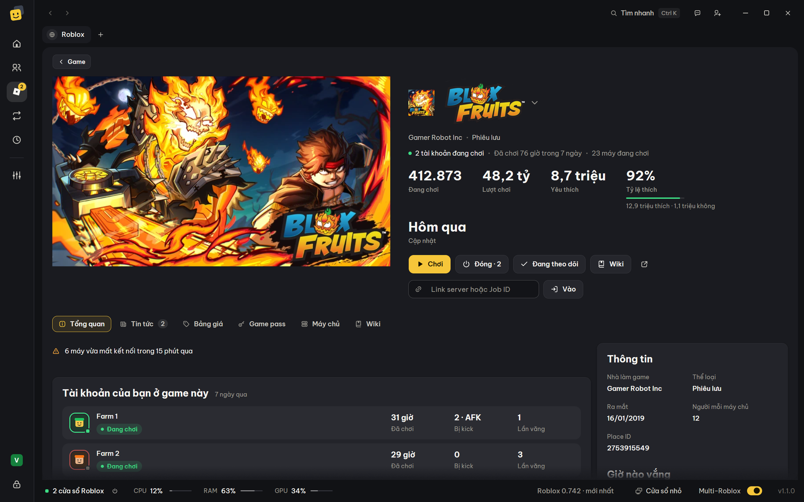
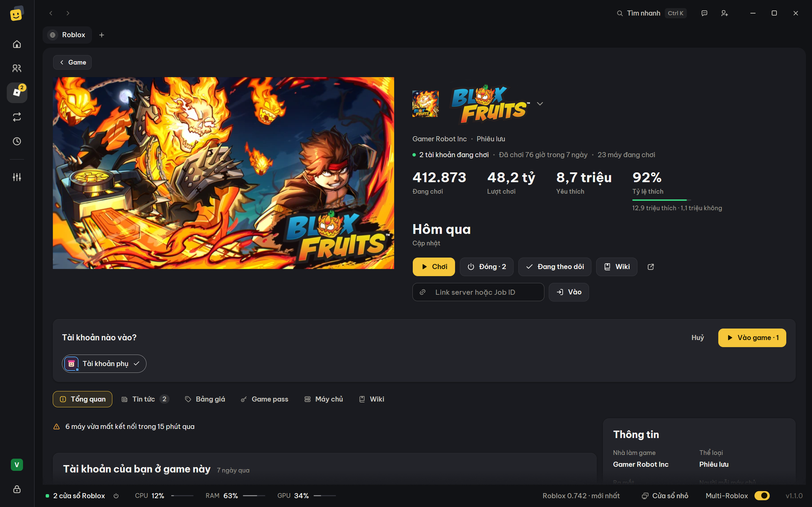
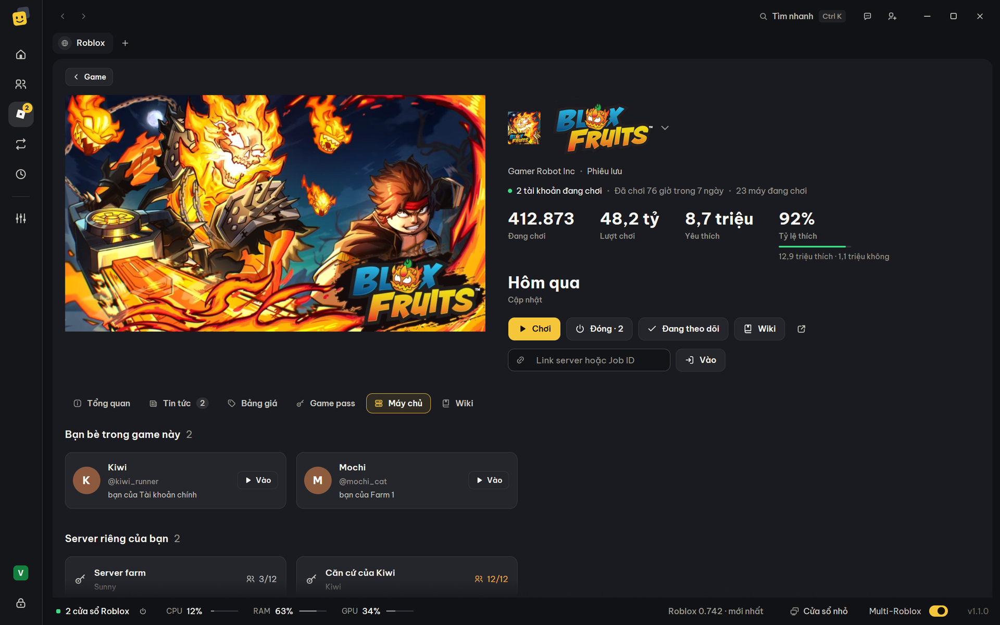
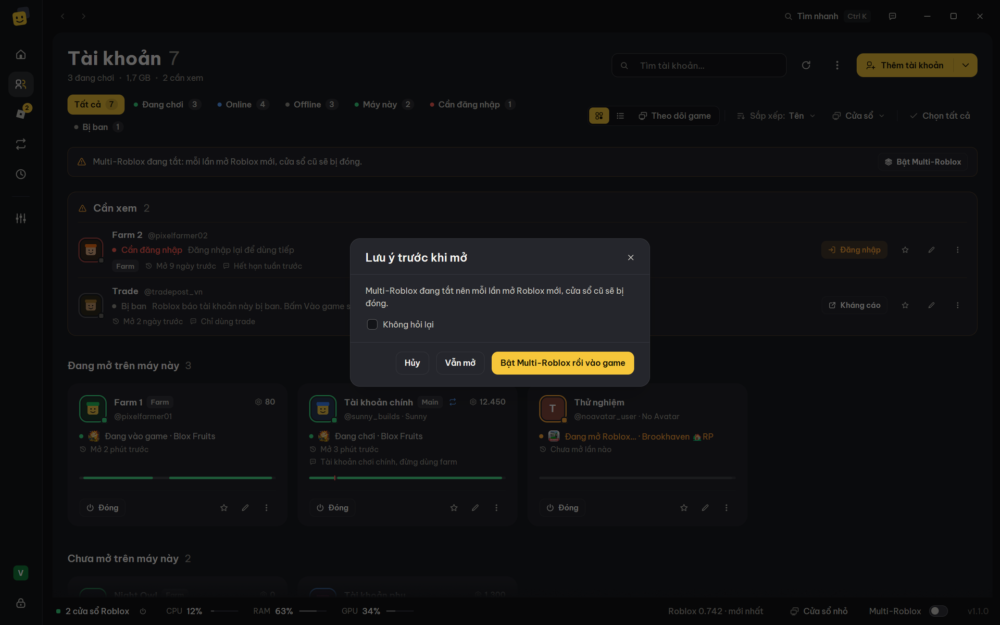

[English](playing.md)

# Vào game

Cách chọn game và server, mở Roblox cho các tài khoản, và dùng tab Roblox.

## Làm nhanh

1. Ở tab **Tài khoản**, bấm chọn những tài khoản muốn mở. Một thanh hiện lên ở dưới cùng: **Đã chọn 2 tài khoản**.
2. Gõ tên game, Place ID hoặc link vào ô game của thanh đó, rồi chọn game. Mũi tên cạnh ô mở danh sách game.
3. Muốn vào đúng một server (tùy chọn): **Job ID**, **Chọn server** hoặc **Theo người chơi…**.
4. Bấm **Vào game**. Nếu Bloxkeep hỏi **Lưu ý trước khi mở**, đọc rồi bấm **Vẫn mở**.
5. Muốn dừng giữa chừng thì bấm **Dừng**. Muốn đóng Roblox thì bấm **Đóng**.

Hoặc bắt đầu từ game: mở game ở **Trang chủ** hay tab **Roblox**, bấm **Chơi**, tích tài khoản ở **Tài khoản nào vào?** rồi bấm **Vào game**.

Cho tới khi Bloxkeep mở một tài khoản lần đầu, mục **Bắt đầu** ở Trang chủ và tab Tài khoản hiện các bước này (thêm tài khoản, chọn game, chọn tài khoản rồi bấm **Vào game**) và đánh dấu từng bước khi bạn làm xong.

## Thanh dưới cùng của tab Tài khoản

Thanh này hiện khi có tài khoản được chọn; dấu ✕ bỏ chọn hết và cất thanh đi.

| Phần | Có gì |
|---|---|
| Hàng trên | Mặt và số tài khoản đã chọn, **Đóng** (kèm số tài khoản đang mở), **Theo người chơi…**, **Preset** và ⋮. |
| Hàng game | Ảnh game, mũi tên mở danh sách game, **Lưu server**, ô game, **Job ID**, **Chọn server**, ảnh các game gần đây và **Vào game**. |
| Dưới ô game | Game tìm được và người làm game, hoặc gợi ý bước tiếp theo. |

Ô game ("Tìm game, hoặc dán link / Place ID…", Ctrl+L hoặc `/`) nhận:

| Bạn gõ hoặc dán | Ghi chú |
|---|---|
| Tên game | Chọn game trong danh sách. Gõ tên mà không chọn thì không tính. |
| Place ID | |
| Link `roblox.com/games/…` | Link server riêng cũng được. |
| Link chia sẻ server riêng | `roblox.com/share?…type=Server` |
| Link `roblox://` | |

Server riêng có nhãn **Server riêng**, game có Job ID ghi **Server cụ thể**, còn link chia sẻ ghi "Link server riêng: Bloxkeep sẽ mở link này khi vào game." Bấm ảnh một game gần đây để đưa nó lại vào ô.

**Danh sách game**: bấm mũi tên cạnh ô, hoặc bấm vào ô game khi đang trống. Các tab gồm **Gần đây**, **Đã ghim**, **Đã lưu** (xem [Server đã lưu](#server-đã-lưu)), **Yêu thích trên Roblox** (game mà các tài khoản của bạn đã thích trên Roblox) và **Phổ biến** (khi lấy được danh sách). Bấm ☆ để ghim game, ✕ để bỏ khỏi Gần đây.

**Job ID** (tùy chọn) là mã của đúng một server (`xxxxxxxx-xxxx-xxxx-xxxx-xxxxxxxxxxxx`), để nhiều tài khoản vào chung. Đổi sang game khác thì Job ID của game cũ tự bị xóa. Nhấn Enter trong ô này là **Vào game**.

> [!TIP]
> Muốn đưa nhiều tài khoản vào chung một server, chọn server ở **Chọn server** (**Dùng**), hoặc dùng **Vào cùng server** trên một tài khoản đang ở đó. Sau đó chọn các tài khoản còn lại rồi bấm **Vào game**.

## Tab Roblox

**Roblox** ở thanh bên trái (có logo của Roblox) là Roblox ngay trong Bloxkeep. Mỗi tài khoản một tab ở trên cùng: **+** để thêm, nên bạn xem Roblox dưới tên tài khoản nào cũng được mà không phải đăng nhập ở đâu.

Hàng ở trên cùng chuyển giữa các trang:

| Trang | Có gì |
|---|---|
| **Game** | **Chơi tiếp** (các game tài khoản của bạn đang chơi, game đang chơi đứng đầu), **Bảng xếp hạng Roblox**, và ô **Tìm game trên Roblox** ở góc phải: tìm ngay khi gõ, gõ tắt (gpo, ps99) hay gõ sai vẫn ra. |
| **Bạn bè** | Bạn bè của tài khoản và mỗi người đang ở đâu (trong game, online, offline), **Vào** để vào cùng một người bạn khi Roblox cho thấy server, lời mời kết bạn và **Thêm bạn**. |
| **Avatar** | Avatar (cả 3D), đồ đang mặc, các bộ đồ và kho đồ để thay; kèm mọi lần Bloxkeep từng thấy avatar đó, mặc lại được. |
| **Hồ sơ** | Tài khoản là ai, bạn bè và người theo dõi, Robux và các nhóm đang tham gia. |
| **Cửa hàng** | Danh mục đồ của Roblox: trang của món đồ cho biết tài khoản nào của bạn đã có. |
| **Hộp thư** | Tin chat, tin nhắn, thông báo, lịch sử Robux và giao dịch (có Nhận và Từ chối). |
| **Kho đồ** | Những gì các tài khoản của bạn có, server riêng của mọi tài khoản gom lại ở đầu. |
| **Mod** | Mod Roblox, cài bằng một cú bấm, bật tắt từng cái; áp dụng cho mọi tài khoản trên máy này. |
| **Cài đặt** | Cài đặt Roblox của tài khoản, như **Tình trạng tài khoản** và **Riêng tư**. |

Các trang này dùng phiên đăng nhập của chính tài khoản đó, giống app Roblox.

## Trang của game

Bấm vào một game ở bất kỳ đâu (Trang chủ, tab Roblox, tên game dưới ô game) để mở trang của game đó.

| Phần | Hiện gì |
|---|---|
| Đầu trang | Ảnh, người làm và thể loại; bao nhiêu tài khoản của bạn đang chơi, số giờ chơi trong 7 ngày và số máy dùng Bloxkeep đang chơi. |
| Số liệu | Đang chơi, lượt chơi, yêu thích, lượt thích và lần cập nhật gần nhất. Roblox chỉ cho xem số người chơi và lượt chơi khi đã đăng nhập, nên cần có tài khoản trong Bloxkeep. |
| Các nút | **Chơi** (hỏi **Tài khoản nào vào?**, rồi **Vào game**), **Đóng** (kèm số đang mở), **Theo dõi** để nhận tin của game, **Wiki**, và mũi tên để mở game trên roblox.com. |
| Link server hoặc Job ID | Dán link server riêng hoặc Job ID rồi bấm **Vào game** để đưa các tài khoản tới đó. |
| **Tổng quan** | **Tài khoản của bạn ở game này**: từng tài khoản đã chơi trong 7 ngày qua, chơi bao lâu, bị kick (bởi game, hoặc AFK vì treo lâu) và rớt mạng, giờ có đang chơi hay bị cấm game không. Kèm thông tin game và giờ nào vắng (số người chơi theo giờ, Bloxkeep ghi lại nửa tiếng một lần với các game bạn dùng; giờ vắng nhất hợp để hẹn giờ Preset). |
| **Tin tức** | Tin trực tiếp từ bot của game, như stock và spawn. Tin game chỉ có ở bản Bloxkeep đã cài. |
| **Bảng giá**, **Game pass** | Bảng giá (như của Blox Fruits) và các game pass của game. |
| **Máy chủ** | Các server của game (xem [Server](#server)). |
| **Wiki** | Wiki của game ngay trong Bloxkeep: tìm, bảng tra, so sánh, trang mới và món vừa buff/nerf. |

Khi Roblox vừa cập nhật game trong 24 giờ qua, trang sẽ báo: Roblox có thể đang tắt dần server cũ, tài khoản nào rớt lúc này sẽ vào lại server mới.

## Server

Nút **Chọn server** ở thanh dưới cùng của tab Tài khoản mở danh sách server của game; tab **Máy chủ** trên trang game cũng vậy. Nút bị mờ khi ô game chưa có game, và với server riêng.

- **Server riêng của bạn**: các server riêng của game này mà tài khoản đang chọn là chủ hoặc được mời vào (chưa chọn tài khoản nào thì dùng vài tài khoản đã đăng nhập đầu tiên), mỗi server ghi chủ server, số người đang chơi và nút **Dùng**. Roblox chỉ cho đúng các tài khoản đó vào, nên server mà vài tài khoản đang chọn không vào được sẽ ghi "chỉ *tài khoản* vào được". **Dùng** điền server đó vào ô game dưới dạng server riêng (`roblox://placeId=…&accessCode=…`); bấm **Vào game** là Bloxkeep vào đúng server đó, giống nút Join trên trang Roblox của game.
- **Bạn bè trong game này**: bạn bè của các tài khoản của bạn đang ở trong game này, mỗi người ghi "bạn của *tài khoản*", kèm nút **Dùng**. Quyền riêng tư của họ có thể che đi.
- **Server công khai**: sắp xếp theo **Đông nhất**, **Vắng nhất**, **Ping thấp nhất** hoặc **FPS cao nhất**. **Đủ chỗ cho N tài khoản** (khi chọn từ 2 tài khoản) chỉ hiện server còn đủ chỗ cho tất cả. **Server ngẫu nhiên** chọn bừa một server.
- **Dùng** điền Job ID của server đó vào thanh dưới cùng của tab Tài khoản ("Đã chọn server. Giờ chọn tài khoản rồi bấm Vào game."). Server đã đầy thì nút bị mờ.
- Ping hiển thị là ping trung bình của người chơi trong server, không phải ping từ máy bạn. Khi Roblox đang bận, danh sách tự thử lại, sau đó hiện nút **Thử lại**.
- Server không còn ai thì không hiện trong danh sách: người cuối cùng đã thoát nên server đang đóng, vào sẽ gặp lỗi "This experience has ended".
- Khi gửi nhiều tài khoản vào một server: tài khoản mở đầu tiên sẽ cho biết server có nhận hay không (bình thường chỉ khoảng 1 giây là được xếp vào server). Nếu sau 12 giây vẫn chưa vào được (server đã đầy hoặc đã đóng), tài khoản đó và các tài khoản còn lại sẽ chuyển sang một server khác còn đủ chỗ cho tất cả.

## Server đã lưu

Giữ các server bạn hay vào lại trong tab **Đã lưu** của ô game.

- **Lưu server** (hình dấu trang cạnh ô game) lưu thứ đang có trong ô: link server riêng (`privateServerLinkCode` hoặc link share), hoặc game kèm **code mà game yêu cầu**, với game có server riêng của nó phải gõ code vào trong game. Đặt tên cho dễ nhớ; lưu lại cùng một link thì Bloxkeep cập nhật server đã lưu chứ không thêm bản mới.
- Chọn một server ở tab **Đã lưu**: link sẽ vào ô game, nên bấm **Vào game** là các tài khoản đang chọn vào thẳng server đó. Code sẽ được sao chép, game của nó vào ô game: vào game rồi dán code vào chỗ game yêu cầu. Bloxkeep không bao giờ tự gõ code đã lưu; [macro](macros.vi.md) chỉ gõ những gì bạn ghi trong bước của nó.
- Nút **sao chép** cạnh server đã lưu sao chép lại code; nút **×** để xóa.

## Theo người chơi

Nút **Theo người chơi…** ở thanh dưới cùng của tab Tài khoản (cũng có trong Ctrl+K) mở hộp **Vào cùng người chơi**. Chưa chọn tài khoản nào thì app nhắc chọn tài khoản trước. Gõ **Tên đăng nhập Roblox hoặc ID người dùng** (dán link trang cá nhân cũng được) rồi bấm **Tìm và vào**: các tài khoản đã chọn sẽ vào đúng server người đó đang ở. Nếu không được, hộp thoại nói rõ lý do:

- không có tài khoản Roblox nào tên như vậy (cần tên đăng nhập, không phải tên hiển thị);
- người đó đang trong game nhưng quyền riêng tư không cho các tài khoản của bạn biết họ ở server nào;
- người đó đang offline, hoặc ẩn trạng thái online;
- người đó đang trên web hoặc app Roblox, hoặc ở Roblox Studio, chứ không ở trong game.

Bloxkeep chỉ dùng các tài khoản đã chọn để hỏi Roblox người đó đang ở đâu. Bloxkeep không bao giờ theo dõi hay kết bạn với ai để lách quyền riêng tư của họ.

**Khi các tài khoản này vào lại, tìm lại người chơi này và vào server họ đang chơi** (giữ tích cho tới khi bạn bỏ): mỗi lần tự vào lại đưa một trong các tài khoản này trở lại, Bloxkeep hỏi lại Roblox người đó đang ở đâu rồi vào đúng server đó, kể cả khi họ đã sang game khác. Khi chưa vào được, Bloxkeep chờ, cứ mỗi phút tìm lại, và báo lý do một lần:

- người đó offline, đang ở web hoặc Studio, hoặc server của họ bị ẩn với các tài khoản của bạn;
- server của người đó đã đầy hoặc vừa đóng;
- game người đó đang chơi đã cấm tài khoản này, hoặc Roblox không cho vào.

Preset cũng làm được như vậy: chọn **Server của một người chơi** ở mục Server (xem [Preset](presets.vi.md)).

## Vào game, Mở Roblox, Đóng và Dừng

| Nút | Làm gì |
|---|---|
| **Vào game** | Ghi **Chọn tài khoản trước** (bị mờ) khi chưa chọn ai. Có game trong ô thì ghi **Vào game** kèm số tài khoản. Ô game để trống thì ghi **Mở Roblox**: mỗi tài khoản mở Roblox ở màn hình chính. |
| **Cửa sổ › Chỉ mở Roblox** | Ở đầu tab Tài khoản: cũng mở Roblox ở màn hình chính, bất kể ô game có gì. Bị mờ khi chưa chọn tài khoản. |
| **Đóng** | Bị mờ nếu không tài khoản nào đã chọn đang mở trên máy này. |
| **Dừng** | Thay cho **Vào game** trong lúc đang mở: "Đã mở 2 tài khoản (dừng giữa chừng)." |

Một lượt mở diễn ra thế này:

- Các tài khoản mở lần lượt, cách nhau một khoảng **Chờ giữa các tài khoản** (**Cài đặt › Khởi chạy**, mặc định 8 giây; preset có thể đặt riêng).
- Tài khoản đang ở đúng game này thì được giữ nguyên. Tài khoản đang ở game khác thì Bloxkeep hỏi trước, rồi đóng và mở lại vào game mới.
- Trước khi mở, Bloxkeep hỏi Roblox xem từng tài khoản có vào được game không, giống app Roblox vẫn làm. Nếu Roblox bảo không (cần xác minh tuổi, khu vực không có game, tài khoản bị hạn chế, phải mua game, game riêng tư hay chỉ cho bạn bè…), Bloxkeep báo lý do và hỏi có mở luôn không. Sau 6 giây Roblox chưa trả lời thì vẫn mở như bình thường.
- Tài khoản bị ban bị bỏ qua, có ghi trong kết quả. Nếu có tài khoản không mở được, hộp **Một số tài khoản chưa mở được** liệt kê lý do.
- Mở xong, các cửa sổ có thể tự xếp: xem [Cửa sổ và thống kê](windows-and-stats.vi.md).

## Thứ tự mở tài khoản

**⋮ › Thứ tự mở tài khoản…** ở đầu tab Tài khoản liệt kê mọi tài khoản: kéo tay nắm hoặc bấm mũi tên để đổi chỗ, rồi bấm **Xong**. **Vào game** mở các tài khoản đã chọn theo thứ tự này, tài khoản thêm sau xếp cuối. **Sắp xếp › Thứ tự mở** cho danh sách hiện theo đúng thứ tự đó. Preset có thứ tự riêng của nó.

## Lưu ý trước khi mở

Trước khi mở, Bloxkeep có thể dừng lại hỏi trong hộp thoại **Lưu ý trước khi mở**. Câu hỏi nào cũng có nút **Hủy** và **Vẫn mở**.

| Câu hỏi | Khi nào hiện | Không hỏi lại? |
|---|---|---|
| "*Tài khoản* sẽ thoát game đang chơi để vào game này." | Tài khoản đã chọn đang ở game hay server khác. | Không, luôn hỏi. |
| "Multi-Roblox đang tắt nên mỗi lần mở Roblox mới, cửa sổ cũ sẽ bị đóng." | Mở nhiều tài khoản, hoặc mở một tài khoản khi đang có cửa sổ Roblox khác, trong lúc Multi-Roblox tắt. Có thêm nút **Bật Multi-Roblox rồi chơi**. | Có |
| "Multi-Roblox chưa hoạt động: Roblox đã mở từ trước khi bật Multi-Roblox." | Multi-Roblox đã bật nhưng chưa sẵn sàng. Có thêm nút **Sửa Multi-Roblox**. | Không |
| Cảnh báo của Kiểm tra Multi-Roblox | Mở nhiều cửa sổ trên một bản Roblox mà chưa có hai cửa sổ nào cùng chơi được. | Có |
| "RAM chỉ còn trống *X*, mà mở thêm *N* cửa sổ Roblox cần khoảng *Y*." | Đang bật **Báo khi sắp hết RAM** và RAM sắp không đủ. | Có |
| "RAM vẫn còn trống, nhưng bộ nhớ ảo của Windows sắp đầy nên mở thêm *N* cửa sổ Roblox có thể bị văng." | Đang bật **Báo khi sắp hết RAM**, RAM vẫn đủ nhưng bộ nhớ ảo của Windows sắp không đủ. Xem [Gỡ rối](troubleshooting.vi.md#h-cửa-sổ-roblox-bị-văng-ngay-khi-mở-memory-dump-captured-hoặc-bloxstrap-báo-roblox-failed-to-launch). | Có |

- Ô **Không hỏi lại** chỉ hiện khi mọi cảnh báo trong hộp thoại đều bỏ qua được. Tích vào rồi bấm **Vẫn mở** thì từ đó những loại cảnh báo này không hỏi nữa, mỗi loại tính riêng. Cảnh báo đã bỏ qua cũng không chặn preset hẹn giờ.
- Muốn được hỏi lại: **Cài đặt › Thông báo › Câu hỏi xác nhận › Hỏi lại**. Dòng **Câu hỏi đã bỏ qua** cho biết đang có bao nhiêu câu. Về chính Multi-Roblox, xem [Multi-Roblox](multi-roblox.vi.md).

Chi tiết thêm

Các câu hỏi khác cũng có **Không hỏi lại**: xóa preset, **Đóng tất cả Roblox**, **Buộc tắt tất cả Roblox**, **Bật Multi-Roblox?**, **Bỏ các thay đổi?** và **Khóa Bloxkeep?**. Nút **Hỏi lại** cũng đưa các câu này trở lại. Riêng xóa tài khoản, khôi phục bản sao lưu và gỡ link Discord thì lúc nào cũng hỏi.

## Mở trang web

**Mở trang web** trong menu của tài khoản mở roblox.com với tài khoản đó đã đăng nhập sẵn, trong cửa sổ trình duyệt của Bloxkeep. Cửa sổ này có mỗi tài khoản một tab. Không dùng được với tài khoản Roblox VNG.

- Mỗi tab có phiên đăng nhập riêng, chỉ nằm trong bộ nhớ. Không có gì lọt vào trình duyệt của bạn.
- Mở một tài khoản đã có tab thì Bloxkeep chuyển sang tab đó. Mỗi tab có nút Quay lại, Tiến tới và Tải lại riêng.
- Dấu **+** ở cuối dải tab mở một tab trống. Đăng nhập trên roblox.com rồi bấm **Lưu vào Bloxkeep** để thêm tài khoản (hoặc làm mới phiên đăng nhập). Không lưu thì đóng tab là mất đăng nhập ở đó.
- Đóng cửa sổ là đóng hết các tab. Khóa Bloxkeep cũng đóng cửa sổ này.

| Phím | Làm gì |
|---|---|
| Ctrl+T | Mở tab trống. |
| Ctrl+W, ✕ hoặc bấm chuột giữa | Đóng tab. |
| Ctrl+Tab | Chuyển tab. |

Chi tiết thêm

Đăng xuất trong tab của một tài khoản đã lưu cũng sẽ đăng xuất tài khoản đó khỏi Bloxkeep, nên Bloxkeep chặn lại và giải thích. Chọn **Đóng tab** hoặc **Xem tiếp**.

← [Hướng dẫn](../guide.vi.md) · Tiếp: [Multi-Roblox](multi-roblox.vi.md) →
