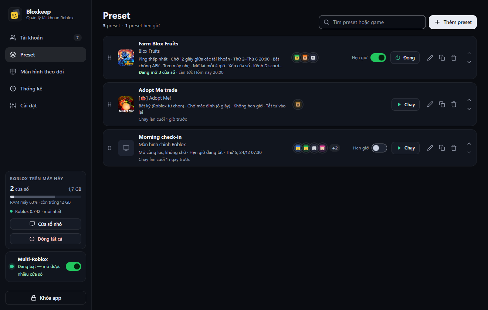
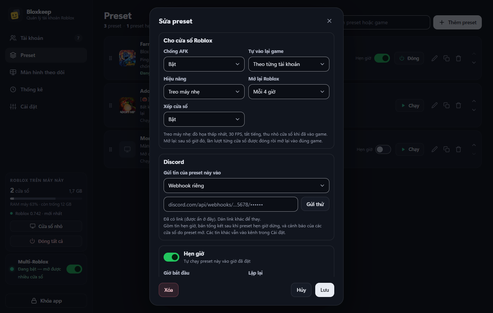

[English](presets.md)

# Preset

Preset lưu sẵn một nhóm tài khoản, một game và cách mở chúng, để bạn chạy bằng một cú bấm hoặc cho tự chạy theo lịch.

## Làm nhanh

1. Mở tab **Preset** rồi bấm **Thêm preset**.
2. Gõ **Tên** và chọn **Game**. Để trống game thì chỉ mở màn hình chính Roblox.
3. Chọn **Server** và tích các **Tài khoản**, theo đúng thứ tự muốn mở.
4. Bấm **Lưu**, rồi bấm **Chạy** ở dòng của preset.

Một preset lưu sẵn các tài khoản (theo thứ tự), game, cách chọn server, thời gian chờ giữa các tài khoản, tùy chọn cho cửa sổ, nơi gửi tin Discord và lịch hẹn giờ. Lưu được tối đa 50 preset.

## Tạo preset

- Tab **Preset** › **Thêm preset**.
- Nút **Preset** trên thanh chọn game › **Lưu thành preset…**. Preset được điền sẵn từ thanh chọn game: các tài khoản đang chọn, game, Job ID thành **Server cố định**, và tên game thành tên preset.
- Ctrl+K › "Lưu thành preset…".

| Ô | Ý nghĩa |
|---|---|
| **Tên** | Bắt buộc. |
| **Game** | Giống ô game ở thanh dưới. Để trống thì chỉ mở Roblox. |
| **Server** | **Bất kỳ (Roblox tự chọn)**, **Đông nhất**, **Vắng nhất**, **Ping thấp nhất**, **Ngẫu nhiên**, hoặc **Server cố định (Job ID)**. |
| **Job ID** | Chỉ dùng cho **Server cố định**. |
| **Chờ giữa các tài khoản (giây)** | Từ 0 đến 120. Để trống thì dùng giá trị trong Cài đặt. |
| **Tài khoản** | Tích chọn. Các tài khoản đã tích mở theo thứ tự này: kéo tay nắm hoặc bấm mũi tên để đổi. |

Chi tiết thêm

- Server được chọn lúc preset chạy, trong số server còn đủ chỗ cho các tài khoản của preset. Không có server nào đủ chỗ thì để Roblox tự chọn.
- Nếu server được chọn không cho tài khoản đầu tiên vào (đã đầy hoặc đã đóng), các tài khoản sẽ chuyển sang server khác còn đủ chỗ cho tất cả.
- Nếu có tài khoản đã bị xóa, form sẽ báo; khi lưu chúng bị bỏ ra.
- Nếu không lưu được, lý do hiện ngay trên các nút và ô cần sửa được đưa con trỏ tới.

## Tùy chọn cho cửa sổ Roblox

Các tùy chọn này áp dụng cho các cửa sổ mà preset mở, cho tới khi chúng đóng (kể cả khi chúng tự vào lại game). Bấm **Vào game** bình thường thì vẫn theo Cài đặt chung. Tài khoản nằm trong hai preset thì theo preset đã mở cửa sổ của nó.

| Tùy chọn | Lựa chọn |
|---|---|
| **Chống AFK** | **Theo Cài đặt (đang bật/đang tắt)**, **Bật**, **Tắt** |
| **Tự vào lại game** | **Theo từng tài khoản**, **Bật**, **Tắt** |
| **Hiệu năng** | **Bình thường**, hoặc **Treo máy nhẹ**: đồ họa thấp nhất, 30 FPS, tắt tiếng, thu nhỏ cửa sổ khi đã vào game. |
| **Mở lại Roblox** | **Không**, hoặc **Mỗi 2 / 4 / 6 / 12 giờ**: lần lượt đóng từng cửa sổ rồi mở lại vào đúng game cũ (hoặc game bạn đã tự chuyển sang trong cửa sổ đó). Cần có game. |
| **Xếp cửa sổ** | **Theo Cài đặt (đang bật/đang tắt)**, **Bật**, **Tắt**: xếp các cửa sổ sau khi preset mở xong. |

### Discord cho từng preset

**Gửi tin của preset này vào**: **Kênh trong Cài đặt**, hoặc **Webhook riêng** (dán link; bấm **Gửi thử** để kiểm tra). Gồm tin hẹn giờ, bản tổng kết sau khi preset hẹn giờ dừng, và cảnh báo của các cửa sổ do preset mở. Các tin khác vẫn vào kênh trong Cài đặt.

Nếu **Gửi lên Discord** đang tắt ở **Cài đặt › Discord** thì chưa có tin nào được gửi. Nếu Discord xóa webhook của preset, tin của preset lại vào kênh trong Cài đặt. Xem thêm ở [Discord](discord.vi.md).

## Hẹn giờ và giờ dừng

Bật **Hẹn giờ** ("Tự chạy preset này vào giờ đã đặt") trong cửa sổ sửa preset.

| Mục | Lựa chọn |
|---|---|
| **Giờ bắt đầu** | Giờ preset bắt đầu chạy. |
| **Lặp lại** | **Các ngày trong tuần** (bấm chọn các ngày) hoặc **Một lần, vào ngày**. |
| **Dừng** | **Không dừng (chơi tiếp)**, **Sau vài giờ** (từ ½ đến 168, mỗi bước nửa giờ), hoặc **Vào giờ**. |

- Bloxkeep phải đang chạy (chạy ẩn dưới khay cũng được) và đã mở khóa.
- Đến giờ dừng, chỉ những tài khoản do lần chạy này mở mới bị đóng.
- Giờ dừng vẫn có tác dụng khi Bloxkeep đang khóa. Giờ dừng rơi vào lúc máy ngủ thì được thực hiện ngay khi máy thức dậy.
- Hẹn giờ một lần tự tắt sau khi đã chạy (hoặc khi giờ đó đã qua).

## Lần chạy bị lỡ

> [!WARNING]
> Đến giờ bắt đầu mà Bloxkeep đang tắt, đang khóa hoặc máy đang ngủ thì lần đó bị bỏ, không chạy bù.

- Nếu là do đang khóa hoặc máy ngủ, Bloxkeep báo một lần ("…không chạy lúc 20:00: Bloxkeep đang khóa." hoặc "…máy đang ngủ hoặc bận.").
- Nếu cần bạn xác nhận mới mở được (Multi-Roblox tắt hoặc chưa sẵn sàng, thiếu RAM, có tài khoản đang ở game khác), lần chạy đó bị bỏ qua và Bloxkeep báo cho bạn. Cảnh báo bạn đã chọn **Không hỏi lại** thì không chặn.

Muốn tìm nguyên nhân, xem [Gỡ rối](troubleshooting.vi.md).

## Tab Preset

Mỗi dòng hiện biểu tượng game, tên preset, game ("Màn hình chính Roblox" nếu không có game), và một dòng tóm tắt: server, thời gian chờ, lịch hẹn, và những tùy chọn khác với Cài đặt. Bên dưới là "Lần tới: Hôm nay 20:00", "Chạy lần cuối 2 giờ trước", hoặc "Đang mở 3 cửa sổ". Bên phải là ảnh đại diện các tài khoản, công tắc **Hẹn giờ** (chỉ có khi lịch hẹn đã có giờ bắt đầu), rồi:

| Nút | Tác dụng |
|---|---|
| **Chạy** | Mở preset. Bị mờ khi preset không còn tài khoản nào, hoặc khi đang có lượt mở khác. Khi cửa sổ của preset đang mở, nút đổi thành **Đóng**, chỉ đóng đúng các cửa sổ do preset này mở. |
| **Sửa** | Mở cửa sổ sửa preset. |
| **Nhân bản** | Tạo bản sao. Nếu preset gốc đang bật hẹn giờ thì hẹn giờ của bản sao bị tắt. |
| **Xóa** | Có hỏi lại, có thể chọn **Không hỏi lại**. |

- Tay nắm và mũi tên để đổi thứ tự (ẩn đi khi đang tìm kiếm). Menu **Preset** ở thanh dưới dùng đúng thứ tự này.
- Phần đầu trang đếm số preset và số preset hẹn giờ, và ghi "đã đạt mức tối đa" khi đủ 50.
- Ô **Tìm preset hoặc game** (Ctrl+F) để lọc danh sách. Preset mà mọi tài khoản đều đã bị xóa sẽ ghi **Không còn tài khoản nào**.

> [!TIP]
> Nút **Preset** ở thanh chọn game liệt kê mọi preset (bấm vào để chạy), rồi **Lưu thành preset…** và **Sửa preset…**. Trong Ctrl+K, gõ tên preset để chạy nó.

← [Hướng dẫn](../guide.vi.md) · Tiếp: [Giữ tài khoản trong game](staying-in-game.vi.md) →
