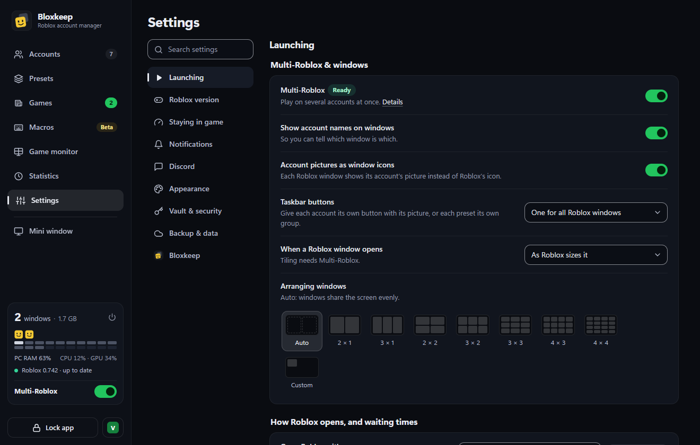
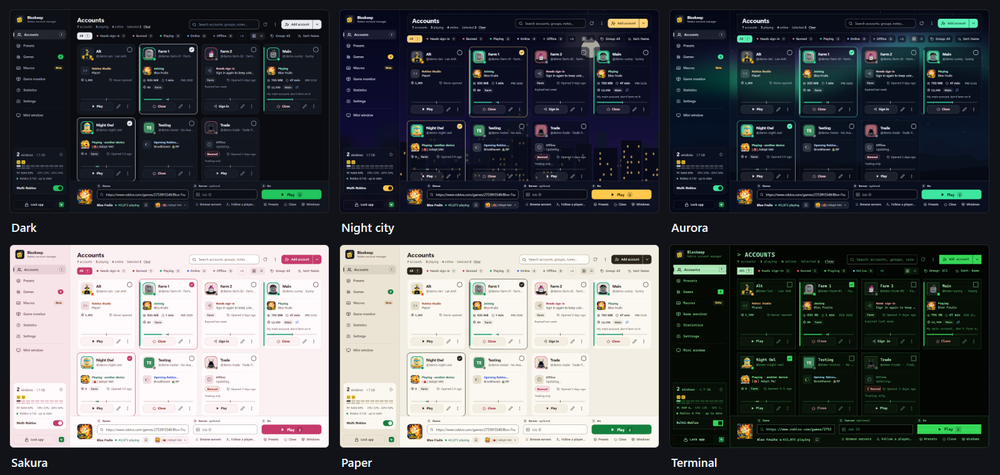
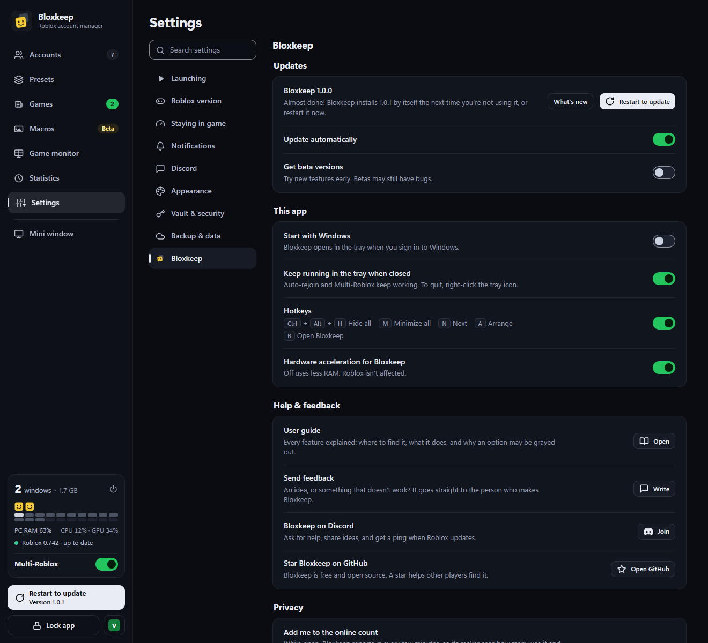

[Tiếng Việt](settings.vi.md)

# Settings

Every page of **Settings** as one compact table: each row, what it does and its default.

**Settings** in the sidebar lists its pages on the left. **Search settings** at the top (Ctrl+F while in Settings) finds rows on every page; Esc clears it. A red dot on a page means it needs a look: Roblox closed windows or a Multi-Roblox warning (**Roblox version**), or Discord stopped sending (**Discord**). A dash (—) under **Default** means the row is a button or only shows information.

## Launching

| Row | What it does | Default |
|---|---|---|
| **Multi-Roblox** | Play on several accounts at once. **Details** opens the steps. See [Multi-Roblox](multi-roblox.md). | Off |
| **Show account names on windows** | Puts the account's name and the window's process ID in the Roblox window title ("Roblox - Main (PID 33588)"), to tell windows apart on the taskbar and in Alt+Tab, and to find one in Task Manager. | On |
| **Account pictures as window icons** | Each Roblox window shows its account's picture instead of Roblox's icon. | On |
| **Taskbar buttons** | One button for all Roblox windows (Windows' own), one for each account (with its picture), or one group for each preset. | One for all |
| **When a Roblox window opens** | **As Roblox sizes it**, **Maximize it** or **Tile windows side by side** (needs Multi-Roblox). | As Roblox sizes it |
| **Arranging windows** | How **Arrange windows** (and tiling after opening) lays them out, picked from pictures: **Auto**, a grid from **2 × 1** to **4 × 4** (each window one cell, however many are open), or a size of your own (width × height in pixels). | Auto |
| **Open Roblox with** | Which program opens Roblox (below). **Other launcher…** picks your own. | Default |
| **Wait between accounts** | 0–120 seconds. Opening too many at once can fail. | 8 s |

**Open Roblox with**:

| Option | Notes |
|---|---|
| **Default** (*name*) | Whatever opens Roblox links on this PC, but never Roblox VNG's client, for any account: Roblox VNG's installer takes the links, so then (or when nothing opens them) Bloxstrap, Fishstrap, Voidstrap or the Roblox on this PC opens it instead. |
| **Bloxstrap**, **Fishstrap**, **Voidstrap** | They keep your mods. Other Bloxstrap-style launchers are listed when found. |
| **Roblox (official)** | The client from roblox.com. |
| **Roblox directly (no launcher)** | No launcher at all. Try it when a launcher blocks several windows. |
| **Roblox (Microsoft Store) — being tested** | Listed when the Microsoft Store's Roblox is installed. Each account opens in a window of its own. |
| **Your launcher:** *name* | A program you picked with **Other launcher…**. If it is moved or deleted, launching says so. |
| **Roblox VNG** | Roblox VNG's own client. Always last, and used only when you pick it. |

An option that isn't installed shows "*name* — not installed" and is greyed out.

More details

For the Microsoft Store option, Bloxkeep starts the Store's Roblox inside its package with each account's own sign-in, skipping Microsoft's launcher screen (which allows only one window). The Microsoft Store still installs its updates. If it doesn't work, say so under **Settings › Bloxkeep › Send feedback**. When the Store's Roblox is the only Roblox on the PC, a note says so.

## Roblox version

| Row | What it does | Default |
|---|---|---|
| **Roblox version** | "Up to date", or that a newer one is out and how to get it. Roblox updates the next time it opens; with **Roblox directly (no launcher)**, open Roblox normally once; the Microsoft Store's Roblox updates through the Store. | — |
| **Close, update, reopen** | Shown when a window runs an old build. Closes the Roblox windows, updates Roblox and reopens the ones in a game. It asks first. | — |
| **Update automatically** | A launcher updates Roblox while no Roblox window is open. | On |
| **Installed**, **Newest from Roblox** | The build on this PC and the launcher it comes from; the newest build, only when different. | — |
| **Multi-Roblox check**, **Coming next (not out yet)** | Checks each new Roblox build for changes that could stop Multi-Roblox. **How it works** explains it; a warning offers **Check for a Bloxkeep update**. | — |
| **Update history** | Every Roblox build seen on this PC, newest first, with **Notes** (Roblox's release notes for game creators). | — |

## Staying in game

Details for each row are in [Staying in game](staying-in-game.md).

| Row | What it does | Default |
|---|---|---|
| **Mode** | **AFK farming**, **Play and farm**, **Roblox as is** or **Custom**. Each one shows what it sets; **Custom** opens the rows below. | Roblox as is |
| **Apply to** | Who gets the three values below: **Nobody**, **All accounts**, **Chosen accounts** (**Choose accounts…**, or **⋯ › Use Roblox settings** on each account). | Nobody |
| **Graphics quality** | **Leave as is**, 1–10. | Leave as is |
| **Frame rate limit** | **Leave as is**, 15 / 20 / 30 / 45 / 60 / 120 / 144 / 240 FPS. An account's own limit (**⋯ › FPS limit in Roblox**) goes over this one. | Leave as is |
| **Volume** | **Leave as is**, **Muted**, 25 / 50 / 75 / 100 %. | Leave as is |
| **Fast Flags** | Grey sky, no grass, lowest graphics, for a little less RAM. Same accounts as these settings, never the main one. See [Staying in game](staying-in-game.md#fast-flags). | Off |
| **Auto-rejoin** | A switch for all accounts ("3/10 accounts" when only some have it). Each account's ⋯ menu sets it for that one. | Off |
| **Anti-AFK** | Stay in game while you're away or busy in another window. Doesn't work when the PC is locked. | Off |
| **Leave crowded servers** | **Off**, or **Over *n* other players** (1 to 20): a window in a fuller public server moves to a quieter one. Your accounts aren't counted. See [Staying in game](staying-in-game.md#leave-crowded-servers). | Off |
| **Check sign-ins every day** | Finds accounts Roblox signed out, before you press Play. Shows "Last check: …". | On |
| **Low RAM warning** | Asks before opening when RAM or Windows' virtual memory is short, and warns while playing. | On |
| **Save RAM on background windows** | Roblox windows you aren't playing in get a low memory priority, so Windows takes RAM from them first. One minimized or hidden for a minute has its RAM emptied once. | Off |
| **RAM limit when minimized or hidden** | **No limit**, **Auto (per game)**, **512 MB**, **768 MB**, **1 GB**, **1.5 GB**, **2 GB**: the most a minimized or hidden Roblox window keeps in RAM, the rest in virtual memory. See [Staying in game](staying-in-game.md). | No limit |
| **Restart a heavy window** | **Never**, or **Above 3 / 4 / 6 / 8 GB**: a window in a game that stays above that much RAM for 3 minutes closes and goes back into its server. Never the main account. See [Staying in game](staying-in-game.md#restart-a-heavy-window). | Never |
| **Prioritize the window you play** | Roblox windows in the background run in Windows' efficiency mode: they give way to the one you play and lean on the CPU's efficiency cores. | Off |

The three value rows and **Fast Flags** show once **Apply to** isn't **Nobody**. Bloxkeep writes them into Roblox's settings just before opening an account and puts your own back once Roblox is running.

## Notifications

| Row | What it does | Default |
|---|---|---|
| **Windows notifications** | Only while Bloxkeep is in the background (hidden, minimised or behind another window). At most one per account and kind every 5 minutes. Messages inside Bloxkeep show either way. | On |
| **Which events** | **Account dropped or auto-rejoin**, **Scheduled presets**, **Sign-in needs renewing** (bans too), **Low RAM**, **Launch problems**. Greyed out while **Windows notifications** is off. | All on |
| **Phone › Alerts on your phone** | The same events, sent to your phone through ntfy, a free app: install ntfy and subscribe to the **Topic** shown (**Copy**). **Send a test** checks it. Anyone who knows the topic can read your alerts. | Off |
| **Questions › Questions you skipped** | How many questions you answered **Don't ask again**. See [Playing](playing.md). | — |
| **Questions › Ask again** | Brings them all back. Greyed out when there are none. | — |

## Discord

Every row is explained in [Sending to Discord](discord.md): **Show on my Discord profile**, **Send to Discord**, **Webhook link**, **Send test**, **Play time summary**, **Alerts**, **Keep a status message up to date**, **Quiet hours** and **Customise messages**. **Send to Discord** is off until you turn it on.

## Appearance

| Row | What it does | Default |
|---|---|---|
| **Theme** | **Sync with Windows** (light or dark like Windows), or one of 98 themes in **Basic**, **Scenery**, **Colorful**, **Styles**, **Seasonal**, **Animated** and **Paintings**. Arrow keys try them; the pick is saved once you stop. | Dark |
| **Your own › Custom** | Pick a **Background color** and an **Accent color** (buttons, switches, what is selected); the words turn light or dark to stay readable. **Choose…** puts a picture or a video (MP4, WebM) from your PC behind the page; **Background color over the picture** sets how much it shows through and **Blur the background** blurs it. A video plays muted, only while the window is open. Bloxkeep keeps a copy in its data folder. **Save this theme** keeps it under a name. | — |
| **Your themes** | The themes you saved: click one to use it. **Save as a file** shares one as a `.bloxkeeptheme` file, and **Add from file…** adds one someone shared. | — |
| **Language** | EN / VI. | EN |
| **Hide account names** | Shows "Account 1", "Account 2"… everywhere instead of names. See [Backup and security](backup-and-security.md). | Off |

## Vault & security

| Row | What it does | Default |
|---|---|---|
| **Vault name** and **Picture** | What this vault shows on the lock screen and in the picker. Anyone at the PC sees them before unlocking. | Vault 1, its first letter |
| **Ask which vault to use each time Bloxkeep starts** | With two vaults or more, Bloxkeep starts on the picker (like Steam's "Who's playing?") instead of the last vault used. | Off |
| **Switch vault** | Shows the picker over this vault. **Back** (or picking this vault) returns to it as it was; picking another locks this one. Its Roblox windows keep running; its auto-rejoin, scheduled presets and Discord wait until it is unlocked again. | — |
| **Lock automatically** | **Never**, or after 5, 10, 15 or 30 minutes, 1 or 2 hours nobody uses the PC: asks for the master password. Roblox keeps running. See [Backup and security](backup-and-security.md). | Never |
| **Master password** | **Current password**, **New password (6+ characters)**, **Confirm new password**, then **Change password**. | Set on first run |

Each vault has its own accounts, presets, settings, backups and master password. Add one with **+** in the picker or **Create a new vault** on the lock screen. **×** on a tile takes a vault off the list; its file stays in Bloxkeep's data folder, and **Restore from a backup** opens it again.

The strength shows as you type. Bloxkeep refuses a wrong current password, a new one shorter than 6 characters or only spaces, and the same password again. Backups made before the change still open only with the old password.

## Backup & data

Details are in [Backup and security](backup-and-security.md).

| Row | What it does | Default |
|---|---|---|
| **Back up to a folder** | Copies the encrypted vault into a folder, so your accounts survive a dead PC. | No folder chosen |
| **Folder** | **Choose…**, or a synced folder Bloxkeep found (**Use Google Drive**, **Use OneDrive**). **Open folder** opens it. | — |
| **Last backup** | "Last backup: …" or "No backups yet", with **Back up now** (greyed out until a folder is chosen). | — |
| **Restore › Restore…** | Replaces your data with a backup. Always asks first; your current data is kept as a copy. | — |
| **Import accounts from a Bloxkeep file › Import…** | Adds accounts from another vault or backup; yours stay. | — |
| **Data location › Open folder** | Opens the folder where Bloxkeep keeps your data. | — |
| **Bloxkeep file in use**, **Error log** › **Show file** | Shows that file in File Explorer. | — |
| **Program folder › Open folder** | Opens the folder Bloxkeep runs from. | — |

## Bloxkeep

| Row | What it does | Default |
|---|---|---|
| **Bloxkeep** *version* | Shows the update state, with **What's new** and **Check now** (greyed out while checking or downloading) or **Restart to update**. | — |
| **Update automatically** | Downloads new versions and installs them by itself the next time you're not using it. One found before you unlock installs at once, on the lock screen (Roblox windows stay open). Off: nothing is downloaded by itself, but **Check now** still works. Greyed out on a copy that can't update itself. | On |
| **Get beta versions** | Updates also bring beta versions: new features before everyone else, which may still have bugs. Turned off on a beta, you keep it until the next regular version. Greyed out on a copy that can't update itself. | Off |
| **Start with Windows** | Bloxkeep opens in the tray when you sign in to Windows. | Off |
| **Keep running in the tray when closed** | The ✕ button hides Bloxkeep to the tray instead of quitting. | On |
| **Hotkeys** | From any app: **Ctrl+Alt+H** hides every Roblox window (their games keep running) or shows them again, **Ctrl+Alt+M** minimizes them all or opens them again, **Ctrl+Alt+N** brings the next account's window to the front, **Ctrl+Alt+A** arranges them on the screen the mouse is on, **Ctrl+Alt+B** opens Bloxkeep. If another app already uses one, it says so under the switch. | On |
| **Hardware acceleration for Bloxkeep** | Draws Bloxkeep's window with the graphics card. Off, the window uses less RAM (about 90 MB less on a PC with an NVIDIA card). Turns itself off if the driver acts up. Switching reloads the window. | On |
| **User guide › Open** | Opens this guide. | — |
| **Send feedback › Write** | An idea, or something that doesn't work. It goes to Bloxkeep's developer. See [Troubleshooting](troubleshooting.md). | — |
| **Bloxkeep on Discord › Join** | Opens Bloxkeep's Discord server: help, ideas, and a ping when Roblox updates. | — |
| **Star Bloxkeep on GitHub › Open GitHub** | Opens Bloxkeep's GitHub page. | — |
| **Privacy › Add me to the online count** | While Bloxkeep is open, it reports in every few minutes (and once as it closes) so its maker sees how many use it, and everyone sees what Bloxkeep users play. It sends a code made from this PC (it can't be traced back), the version, the language, the games your accounts are in, how many run and why one dropped out; never an account. It also puts this PC on the **Most alts now** board in **Statistics**. Off: one last note that you've gone, nothing after. See [What leaves the PC](backup-and-security.md#what-leaves-the-pc). | On |

When an update is ready, **Restart to update** shows in the sidebar. Roblox keeps running while Bloxkeep restarts, and **What's new** then shows what changed. Small fixes between versions install by themselves the same way, without the button or **What's new**, and the version number stays the same.

← [User guide](../guide.md) · Next: [Backup and security](backup-and-security.md) →
