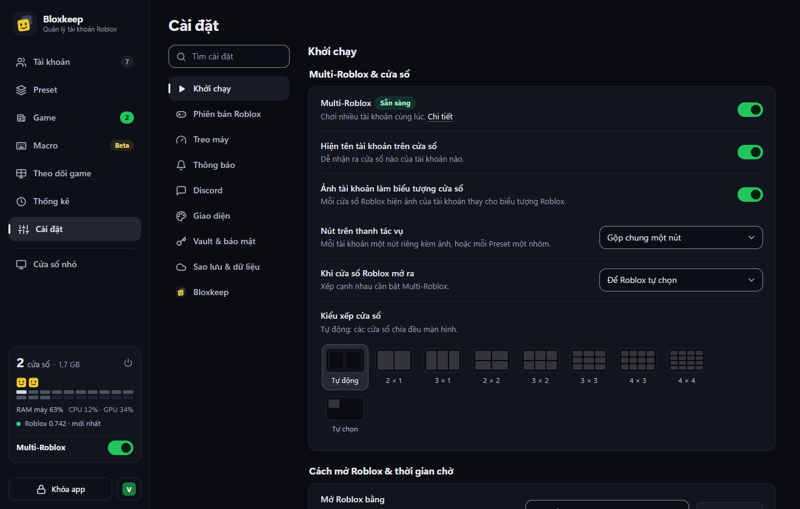
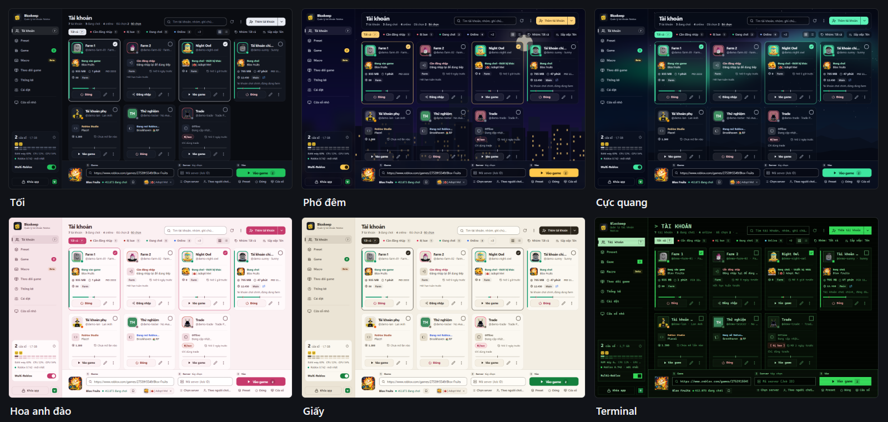
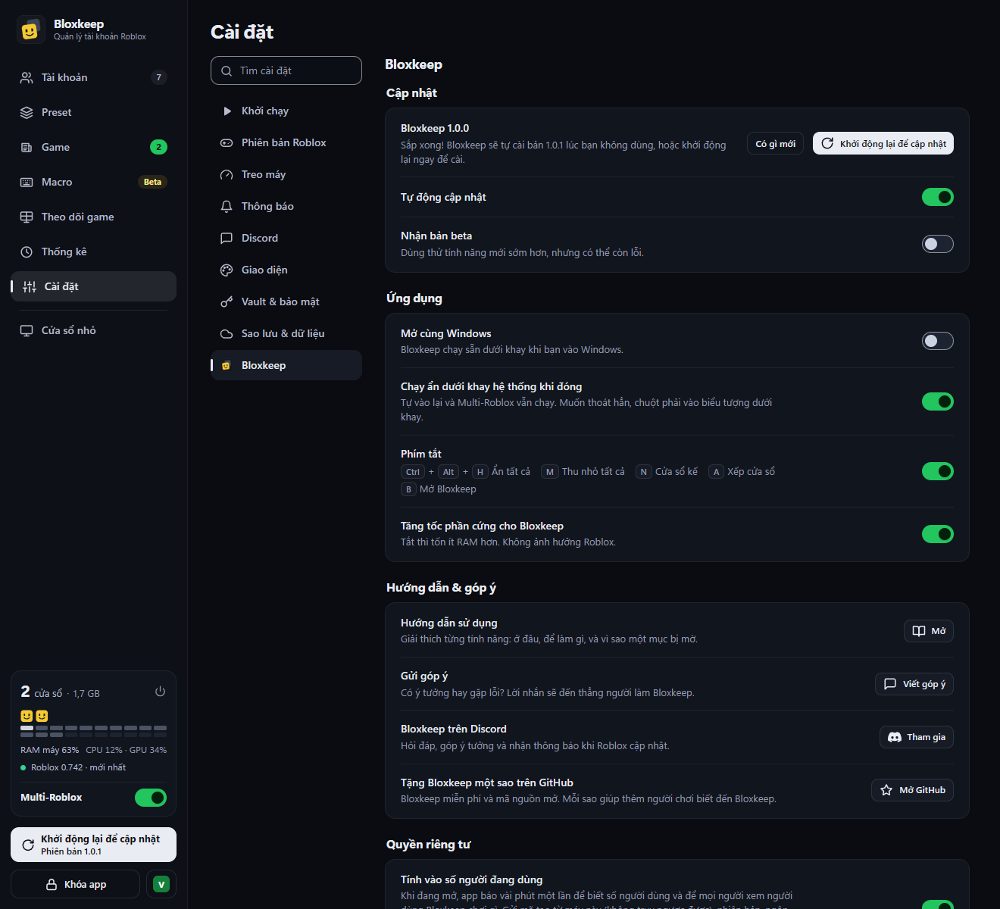

[English](settings.md)

# Cài đặt

Mọi trang của **Cài đặt**, mỗi trang một bảng gọn: từng dòng, tác dụng và giá trị mặc định.

**Cài đặt** ở thanh bên liệt kê các trang ở bên trái. Ô **Tìm cài đặt** ở trên cùng (Ctrl+F khi đang ở Cài đặt) tìm các dòng trên mọi trang; nhấn Esc để xóa. Chấm đỏ cạnh tên trang nghĩa là có chỗ cần xem lại: Roblox đã đóng cửa sổ hoặc có cảnh báo Multi-Roblox (trang **Phiên bản Roblox**), hoặc Discord đã ngừng gửi (trang **Discord**). Dấu gạch (—) ở cột **Mặc định** nghĩa là dòng đó là một nút bấm hoặc chỉ hiện thông tin.

## Khởi chạy

| Dòng | Tác dụng | Mặc định |
|---|---|---|
| **Multi-Roblox** | Chơi nhiều tài khoản cùng lúc. **Chi tiết** mở các bước. Xem [Multi-Roblox](multi-roblox.vi.md). | Tắt |
| **Hiện tên tài khoản trên cửa sổ** | Ghi tên tài khoản và mã tiến trình (PID) lên tiêu đề cửa sổ Roblox ("Roblox - Main (PID 33588)"), dễ phân biệt dưới taskbar và khi bấm Alt+Tab, và dễ tìm trong Task Manager. | Bật |
| **Ảnh tài khoản làm biểu tượng cửa sổ** | Mỗi cửa sổ Roblox hiện ảnh của tài khoản thay cho biểu tượng Roblox. | Bật |
| **Nút trên thanh tác vụ** | Gộp chung mọi cửa sổ Roblox (như Windows vẫn làm), mỗi tài khoản một nút (kèm ảnh), hoặc mỗi preset một nhóm. | Gộp chung |
| **Khi cửa sổ Roblox mở ra** | **Để Roblox tự chọn**, **Phóng to** hoặc **Xếp cửa sổ cạnh nhau** (cần bật Multi-Roblox). | Để Roblox tự chọn |
| **Kiểu xếp cửa sổ** | Cách xếp khi bấm **Xếp cửa sổ** (và khi tự xếp sau khi mở), chọn bằng hình mẫu: **Tự vừa**, lưới từ **2 × 1** đến **4 × 4** (mỗi cửa sổ một ô, dù mở bao nhiêu), hoặc kích thước tự chọn (rộng × cao, tính bằng pixel). | Tự vừa |
| **Mở Roblox bằng** | Chương trình dùng để mở Roblox (bảng dưới). **Launcher khác…** để chọn chương trình của bạn. | Mặc định |
| **Chờ giữa các tài khoản** | 0–120 giây. Mở quá nhiều tài khoản cùng lúc dễ bị lỗi. | 8 giây |

**Mở Roblox bằng**:

| Lựa chọn | Ghi chú |
|---|---|
| **Mặc định** (*tên*) | Chương trình đang mở link Roblox trên máy, nhưng không bao giờ là bản Roblox VNG, với mọi tài khoản: bộ cài Roblox VNG chiếm link Roblox, nên khi đó (hoặc khi không còn gì mở link) Bloxkeep dùng Bloxstrap, Fishstrap, Voidstrap hoặc bản Roblox có trên máy. |
| **Bloxstrap**, **Fishstrap**, **Voidstrap** | Giữ nguyên mod của bạn. Launcher kiểu Bloxstrap khác tự hiện nếu tìm thấy. |
| **Roblox (chính thức)** | Bản cài từ roblox.com. |
| **Roblox trực tiếp (không qua launcher)** | Không qua launcher nào. Nên thử khi launcher chặn mở nhiều cửa sổ. |
| **Roblox (Microsoft Store, thử nghiệm)** | Chỉ hiện khi máy có Roblox bản Microsoft Store. Mỗi tài khoản mở trong một cửa sổ riêng. |
| **Launcher của bạn:** *tên* | Chương trình bạn chọn bằng nút **Launcher khác…**. Nếu file đó bị chuyển đi hoặc xóa, lúc mở game app sẽ báo. |
| **Roblox VNG** | Bản Roblox của VNG. Luôn nằm cuối, chỉ dùng khi bạn tự chọn. |

Lựa chọn chưa cài sẽ ghi "*tên* (chưa cài)" và bị mờ.

Chi tiết thêm

Với lựa chọn Microsoft Store, Bloxkeep mở Roblox của Store ngay bên trong gói cài của nó, với phiên đăng nhập riêng của từng tài khoản, bỏ qua màn hình khởi động của Microsoft (vốn chỉ cho một cửa sổ). Microsoft Store vẫn tự cài các bản cập nhật như thường. Nếu không chạy được, hãy báo ở **Cài đặt › Bloxkeep › Gửi góp ý**. Nếu máy chỉ có Roblox bản Microsoft Store, ở đây có dòng ghi chú nói rõ.

## Phiên bản Roblox

| Dòng | Tác dụng | Mặc định |
|---|---|---|
| **Phiên bản Roblox** | "Đã là bản mới nhất", hoặc đã có bản mới và cách lấy về. Roblox tự cập nhật lần mở tới; nếu dùng **Roblox trực tiếp (không qua launcher)** thì mở Roblox bình thường một lần; Roblox bản Microsoft Store cập nhật qua Store. | — |
| **Đóng, cập nhật, mở lại** | Hiện khi có cửa sổ chạy bản cũ. Đóng các cửa sổ Roblox, cập nhật, rồi mở lại cửa sổ đang trong game. Có hỏi trước. | — |
| **Tự cập nhật** | Launcher cập nhật Roblox khi không mở cửa sổ nào. | Bật |
| **Đang cài**, **Bản mới nhất của Roblox** | Bản đang cài trên máy kèm launcher nó đến từ; bản mới nhất, chỉ hiện khi khác bản đang cài. | — |
| **Kiểm tra Multi-Roblox**, **Sắp ra (chưa phát hành)** | Kiểm tra từng bản Roblox mới xem có thay đổi nào có thể chặn Multi-Roblox không. **Cách hoạt động** giải thích; khi có cảnh báo sẽ có nút **Kiểm tra cập nhật Bloxkeep**. | — |
| **Lịch sử cập nhật** | Mọi bản Roblox đã thấy trên máy, mới nhất ở trên, mỗi bản có link **Ghi chú** (ghi chú phát hành viết cho người làm game). | — |

## Treo máy

Chi tiết từng dòng nằm ở [Giữ tài khoản trong game](staying-in-game.vi.md).

| Dòng | Tác dụng | Mặc định |
|---|---|---|
| **Chế độ** | **Treo máy**, **Vừa treo vừa chơi**, **Roblox gốc** hoặc **Tự chỉnh**. Mỗi chế độ ghi rõ thông số; **Tự chỉnh** mở các dòng bên dưới. | Roblox gốc |
| **Áp dụng cho** | Ai nhận ba giá trị bên dưới: **Không áp dụng**, **Mọi tài khoản**, **Tài khoản đã chọn** (**Chọn tài khoản…**, hoặc **⋯ › Dùng cấu hình Roblox** trên từng tài khoản). | Không áp dụng |
| **Đồ họa** | **Giữ nguyên**, 1–10. | Giữ nguyên |
| **Giới hạn FPS** | **Giữ nguyên**, 15 / 20 / 30 / 45 / 60 / 120 / 144 / 240 FPS. Giới hạn riêng của tài khoản (**⋯ › Giới hạn FPS trong Roblox**) được ưu tiên hơn. | Giữ nguyên |
| **Âm lượng** | **Giữ nguyên**, **Tắt tiếng**, 25 / 50 / 75 / 100 %. | Giữ nguyên |
| **Fast Flags** | Trời xám, không cỏ, đồ họa thấp nhất, bớt chút RAM. Áp cho cùng các tài khoản dùng cấu hình này, trừ tài khoản chính. Xem [Treo game](staying-in-game.vi.md#fast-flags). | Tắt |
| **Tự vào lại** | Công tắc cho mọi tài khoản (khi chỉ một số tài khoản bật sẽ ghi "3/10 tài khoản"). Menu ⋯ của từng tài khoản bật/tắt riêng cho tài khoản đó. | Tắt |
| **Chống AFK** | Treo máy không lo bị kick, kể cả khi bạn đi vắng hay đang dùng cửa sổ khác. Không hoạt động khi máy đang khóa. | Tắt |
| **Rời server đông** | **Tắt**, hoặc **Hơn *n* người khác** (1 đến 20): cửa sổ ở server công khai đông hơn sẽ chuyển sang server vắng hơn. Không tính tài khoản của bạn. Xem [Treo game](staying-in-game.vi.md#rời-server-đông). | Tắt |
| **Kiểm tra đăng nhập mỗi ngày** | Tìm các tài khoản Roblox đã đăng xuất, để bạn biết trước khi bấm Vào game. Ghi "Lần kiểm tra gần nhất: …". | Bật |
| **Báo khi sắp hết RAM** | Hỏi trước khi mở nếu thiếu RAM hoặc bộ nhớ ảo của Windows, và cảnh báo khi đang chơi. | Bật |
| **Tiết kiệm RAM cho cửa sổ chạy nền** | Cửa sổ Roblox bạn không chơi bị hạ mức ưu tiên bộ nhớ, nên Windows lấy RAM của chúng trước. Cửa sổ thu nhỏ hoặc ẩn được 1 phút được dọn RAM một lần. | Tắt |
| **Giới hạn RAM khi thu nhỏ hoặc ẩn** | **Không giới hạn**, **Tự động (theo game)**, **512 MB**, **768 MB**, **1 GB**, **1.5 GB**, **2 GB**: mức RAM tối đa cửa sổ Roblox thu nhỏ hoặc đang ẩn được giữ, phần còn lại ở bộ nhớ ảo. Xem [Treo game](staying-in-game.vi.md). | Không giới hạn |
| **Mở lại cửa sổ nặng** | **Không bao giờ**, hoặc **Trên 3 / 4 / 6 / 8 GB**: cửa sổ đang trong game dùng quá mức RAM đó suốt 3 phút sẽ tự đóng rồi vào lại đúng server. Không áp cho tài khoản chính. Xem [Treo game](staying-in-game.vi.md#mở-lại-cửa-sổ-nặng). | Không bao giờ |
| **Ưu tiên cửa sổ đang chơi** | Cửa sổ Roblox chạy nền dùng chế độ hiệu quả của Windows: nhường cửa sổ bạn đang chơi và chạy chủ yếu trên nhân tiết kiệm của CPU. | Tắt |

Ba dòng giá trị và **Fast Flags** chỉ hiện khi **Áp dụng cho** khác **Không áp dụng**. Bloxkeep ghi các giá trị này vào cài đặt của Roblox ngay trước khi mở tài khoản, rồi trả lại cài đặt của bạn khi Roblox đã chạy.

## Thông báo

| Dòng | Tác dụng | Mặc định |
|---|---|---|
| **Thông báo Windows** | Chỉ hiện khi Bloxkeep chạy nền (đang ẩn, thu nhỏ, hoặc bị cửa sổ khác che). Mỗi tài khoản, mỗi loại tối đa một thông báo trong 5 phút. Thông báo bên trong Bloxkeep thì vẫn hiện như thường. | Bật |
| **Loại sự kiện** | **Tài khoản bị văng hoặc tự vào lại**, **Preset hẹn giờ**, **Tài khoản cần đăng nhập lại** (gồm cả bị ban), **Sắp hết RAM**, **Lỗi khi mở game**. Bị mờ khi **Thông báo Windows** đang tắt. | Bật hết |
| **Điện thoại › Báo về điện thoại** | Các sự kiện trên, gửi về điện thoại qua app ntfy miễn phí: cài ntfy rồi đăng ký **Kênh** hiện ở đây (**Chép**). **Gửi thử** để kiểm tra. Ai biết tên kênh cũng đọc được thông báo của bạn. | Tắt |
| **Câu hỏi xác nhận › Câu hỏi đã bỏ qua** | Số câu hỏi bạn đã tích **Không hỏi lại**. Xem [Vào game](playing.vi.md). | — |
| **Câu hỏi xác nhận › Hỏi lại** | Đưa tất cả trở lại. Bị mờ khi chưa bỏ qua câu nào. | — |

## Discord

Từng dòng được giải thích ở [Gửi lên Discord](discord.vi.md): **Hiện trên hồ sơ Discord**, **Gửi lên Discord**, **Link webhook**, **Gửi thử**, **Tổng kết thời gian chơi**, **Cảnh báo**, **Luôn cập nhật tin trạng thái**, **Giờ yên tĩnh** và **Tùy chỉnh tin nhắn**. **Gửi lên Discord** tắt cho tới khi bạn bật.

## Giao diện

| Dòng | Tác dụng | Mặc định |
|---|---|---|
| **Chủ đề** | **Theo Windows** (sáng hay tối theo Windows), hoặc một trong 98 chủ đề thuộc các nhóm **Cơ bản**, **Phong cảnh**, **Màu sắc**, **Phong cách**, **Theo mùa**, **Động** và **Tranh**. Dùng phím mũi tên để xem thử; chủ đề được lưu khi bạn dừng tay. | Tối |
| **Của bạn › Tùy chỉnh** | Chọn **Màu nền** và **Màu nhấn** (nút, công tắc, mục đang chọn); chữ tự sáng hay tối để luôn dễ đọc. **Chọn…** đặt một ảnh hoặc video (MP4, WebM) trên máy làm nền phía sau. **Phủ màu nền lên ảnh** chỉnh mức nền hiện qua, **Làm mờ nền** làm nền mờ đi. Video không có tiếng, chỉ chạy khi cửa sổ đang mở. Bloxkeep giữ một bản sao trong thư mục dữ liệu. **Lưu chủ đề này** lưu theme lại kèm tên. | — |
| **Chủ đề của bạn** | Các theme bạn đã lưu, bấm vào để dùng. **Lưu thành file** để gửi một theme dưới dạng file `.bloxkeeptheme`, **Thêm từ file…** để thêm theme người khác gửi. | — |
| **Ngôn ngữ** | EN / VI. | EN |
| **Ẩn tên tài khoản** | Rút gọn mọi tên còn chữ cái đầu ("F…") như chế độ streamer của Discord; vẫn giữ ảnh. Xem [Sao lưu và bảo mật](backup-and-security.vi.md). | Tắt |

## Vault & bảo mật

| Dòng | Tác dụng | Mặc định |
|---|---|---|
| **Tên vault** và **Ảnh** | Thứ vault này hiện ở màn hình khóa và màn hình chọn vault. Ai ngồi vào máy cũng thấy, kể cả khi chưa mở khóa. | Vault 1, chữ cái đầu |
| **Hỏi chọn vault mỗi lần mở Bloxkeep** | Khi có từ 2 vault trở lên, mở Bloxkeep sẽ hiện màn hình chọn vault (giống "Who's playing?" của Steam) thay vì vào thẳng vault dùng lần trước. | Tắt |
| **Đổi vault** | Mở màn hình chọn vault. Bấm **Quay lại** (hoặc chọn lại chính vault này) là về như cũ, không cần nhập mật khẩu; chọn vault khác thì vault này mới bị khóa. Các cửa sổ Roblox của nó vẫn chạy; tự vào lại game, preset hẹn giờ và Discord của nó chờ tới lúc mở khóa lại. | — |
| **Tự khóa** | **Không bao giờ**, hoặc sau 5, 10, 15, 30 phút, 1 hay 2 giờ không ai dùng máy: hỏi lại mật khẩu chủ. Roblox vẫn chạy. Xem [Sao lưu và bảo mật](backup-and-security.vi.md). | Không bao giờ |
| **Mật khẩu chủ** | **Mật khẩu hiện tại**, **Mật khẩu mới (ít nhất 6 ký tự)**, **Nhập lại mật khẩu mới**, rồi bấm **Đổi mật khẩu**. | Đặt lúc mở app lần đầu |

Mỗi vault có tài khoản, preset, cài đặt, bản sao lưu và mật khẩu chủ riêng. Thêm vault bằng nút **+** ở màn hình chọn vault, hoặc **Tạo vault mới** ở màn hình khóa. Nút **×** trên một ô sẽ gỡ vault đó khỏi danh sách; file của nó vẫn nằm trong thư mục dữ liệu của Bloxkeep, và **Khôi phục từ bản sao lưu** có thể mở lại.

Độ mạnh hiện ra khi bạn gõ. App không chấp nhận mật khẩu hiện tại sai, mật khẩu mới ngắn hơn 6 ký tự hoặc chỉ toàn dấu cách, hay trùng mật khẩu cũ. Các bản sao lưu làm trước khi đổi vẫn chỉ mở được bằng mật khẩu cũ.

## Sao lưu & dữ liệu

Chi tiết nằm ở [Sao lưu và bảo mật](backup-and-security.vi.md).

| Dòng | Tác dụng | Mặc định |
|---|---|---|
| **Sao lưu vào thư mục** | Chép kho dữ liệu đã mã hóa vào một thư mục, để không mất tài khoản khi máy hỏng. | Chưa chọn thư mục |
| **Thư mục** | **Chọn…**, hoặc thư mục đồng bộ mà Bloxkeep tìm thấy (**Dùng Google Drive**, **Dùng OneDrive**). **Mở thư mục** để mở ra xem. | — |
| **Lần sao lưu gần nhất** | "Sao lưu gần nhất: …" hoặc "Chưa có bản sao lưu", kèm nút **Sao lưu ngay** (bị mờ khi chưa chọn thư mục). | — |
| **Khôi phục** › **Khôi phục…** | Thay dữ liệu hiện tại bằng một bản sao lưu. Luôn hỏi trước; dữ liệu hiện tại được giữ lại một bản. | — |
| **Nhập tài khoản từ file Bloxkeep** › **Nhập…** | Thêm tài khoản từ một file dữ liệu hay bản sao lưu khác; tài khoản đang có vẫn giữ nguyên. | — |
| **Nơi lưu dữ liệu** › **Mở thư mục** | Mở thư mục Bloxkeep cất dữ liệu của bạn. | — |
| **File Bloxkeep đang dùng**, **Nhật ký lỗi** › **Hiện file** | Mở File Explorer và chọn sẵn file đó. | — |
| **Thư mục cài đặt** › **Mở thư mục** | Mở thư mục chứa chương trình Bloxkeep. | — |

## Bloxkeep

| Dòng | Tác dụng | Mặc định |
|---|---|---|
| **Bloxkeep** *phiên bản* | Cho biết trạng thái cập nhật, kèm **Có gì mới** và **Kiểm tra ngay** (bị mờ khi đang kiểm tra hoặc đang tải) hay **Khởi động lại để cập nhật**. | — |
| **Tự động cập nhật** | Tự tải bản mới và tự cài vào lúc bạn không dùng. Bản mới tìm thấy trước khi bạn mở khóa thì được cài luôn, ngay ở màn hình mở khóa (các cửa sổ Roblox vẫn mở). Tắt đi thì không có gì tự tải về, nhưng **Kiểm tra ngay** vẫn dùng được. Bị mờ với bản không tự cập nhật được. | Bật |
| **Nhận bản beta** | Cập nhật cả lên bản beta: có tính năng mới sớm hơn mọi người, nhưng có thể còn lỗi. Đang dùng bản beta mà tắt đi thì bạn vẫn giữ bản đó tới khi có bản chính thức tiếp theo. Bị mờ với bản không tự cập nhật được. | Tắt |
| **Mở cùng Windows** | Bloxkeep chạy sẵn dưới khay khi bạn vào Windows. | Tắt |
| **Chạy ẩn dưới khay hệ thống khi đóng** | Nút ✕ thu Bloxkeep xuống khay hệ thống thay vì thoát. | Bật |
| **Phím tắt** | Dùng được trong mọi app: **Ctrl+Alt+H** ẩn mọi cửa sổ Roblox (game vẫn chạy) hoặc hiện lại, **Ctrl+Alt+M** thu nhỏ tất cả hoặc mở lại, **Ctrl+Alt+N** đưa cửa sổ của tài khoản kế tiếp lên trước, **Ctrl+Alt+A** xếp cửa sổ trên màn hình đang có chuột, **Ctrl+Alt+B** mở Bloxkeep. Nếu app khác đang dùng một tổ hợp, dòng dưới công tắc sẽ báo. | Bật |
| **Tăng tốc phần cứng cho Bloxkeep** | Vẽ cửa sổ Bloxkeep bằng card đồ họa. Tắt đi thì cửa sổ đỡ tốn RAM (khoảng 90 MB trên máy dùng card NVIDIA). Tự tắt nếu driver card đồ họa bị lỗi. Bật hay tắt thì cửa sổ được tải lại. | Bật |
| **Hướng dẫn sử dụng › Mở** | Mở chính hướng dẫn này. | — |
| **Gửi góp ý › Viết góp ý** | Một ý tưởng, hoặc lỗi gặp phải. Lời nhắn đi thẳng tới người làm Bloxkeep. Xem [Gỡ rối](troubleshooting.vi.md). | — |
| **Bloxkeep trên Discord › Tham gia** | Mở server Discord của Bloxkeep: hỏi đáp, góp ý tưởng, nhận thông báo khi Roblox cập nhật. | — |
| **Tặng Bloxkeep một sao trên GitHub › Mở GitHub** | Mở trang GitHub của Bloxkeep. | — |
| **Quyền riêng tư › Tính vào số người đang dùng** | Khi Bloxkeep đang mở, vài phút app báo một lần (và một lần khi tắt) để người làm Bloxkeep biết có bao nhiêu người dùng, và mọi người xem được người dùng Bloxkeep đang chơi gì. App gửi một mã tạo từ máy này (không lần ngược ra được), phiên bản, ngôn ngữ, các game tài khoản của bạn đang ở, số cửa sổ đang chạy, vì sao một tài khoản bị văng và theme bạn chọn (cho nhóm **Phổ biến** ở Giao diện); không bao giờ gửi tài khoản. Máy này cũng hiện trên bảng **Treo nhiều alt nhất** ở **Thống kê**. Tắt đi thì app báo lần cuối là bạn đã rời, sau đó không gửi gì nữa. Xem [Những gì rời khỏi máy](backup-and-security.vi.md#những-gì-rời-khỏi-máy). | Bật |

Khi bản cập nhật đã sẵn sàng, nút **Khởi động lại để cập nhật** hiện ở thanh bên. Roblox vẫn chạy bình thường trong lúc Bloxkeep khởi động lại, và mục **Có gì mới** cho biết những gì đã thay đổi. Các bản vá nhỏ giữa hai phiên bản cũng tự cài như vậy, không hiện nút hay **Có gì mới**, và số phiên bản giữ nguyên.

← [Hướng dẫn](../guide.vi.md) · Tiếp: [Sao lưu và bảo mật](backup-and-security.vi.md) →
