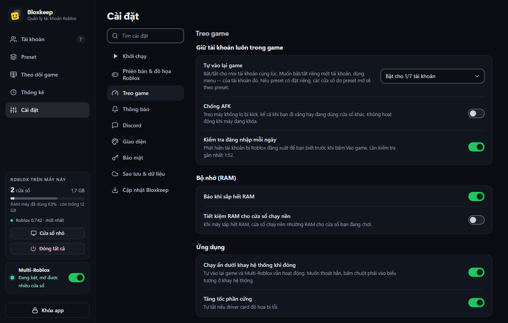
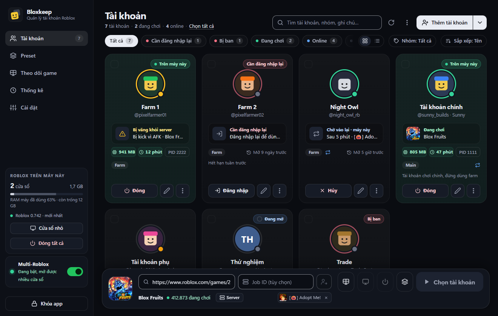

[English](staying-in-game.md)

# Giữ tài khoản trong game

Cách Bloxkeep giữ các tài khoản luôn ở trong game: Tự vào lại game, Chống AFK, kiểm tra đăng nhập mỗi ngày, và các tùy chọn về RAM, nằm ở **Cài đặt › Treo game**; chạy ẩn dưới khay hệ thống nằm ở **Cài đặt › Bloxkeep**.

## Làm nhanh

1. Mở **Cài đặt › Treo game**.
2. Ở dòng **Tự vào lại game**, chọn **Bật cho mọi tài khoản**. Muốn bật riêng cho một tài khoản thì dùng **⋯ › Tự vào lại game** của tài khoản đó.
3. Bật **Chống AFK**.
4. Ở **Cài đặt › Bloxkeep**, để nguyên **Chạy ẩn dưới khay hệ thống khi đóng** ở trạng thái bật, để bấm ✕ chỉ thu Bloxkeep xuống khay chứ không thoát.

## Tự vào lại game

Khi Roblox của một tài khoản bị văng, bị kick hoặc mất kết nối, Bloxkeep mở lại đúng game đó (hoặc đúng server riêng), nhưng không chắc vào lại đúng server cũ. Nếu bạn đã tự chuyển sang game khác ngay trong cửa sổ Roblox đó, Bloxkeep mở lại game bạn vừa chuyển sang.

| Bật cho | Ở đâu |
|---|---|
| Một tài khoản | **⋯ › Tự vào lại game** của tài khoản đó. |
| Mọi tài khoản | **Cài đặt › Treo game › Tự vào lại game › Bật cho mọi tài khoản** (khi chỗ bật chỗ tắt sẽ ghi "Bật cho 3/10 tài khoản"). |
| Cửa sổ của một preset | Tùy chọn **Tự vào lại game** của preset đó (xem [Preset](presets.vi.md)). |

### Chờ bao lâu

| Tình huống | Bloxkeep làm gì |
|---|---|
| Roblox bị văng | Mở lại game sau 10 giây. |
| Không vào được server (server được chọn đã đầy hoặc đã đóng) | Sau một phút vẫn chưa vào được, đóng cửa sổ đó và mở lại đúng game, vào server nào cũng được. Game bạn tự mở trong cửa sổ thì Bloxkeep để bạn tự lo. |
| Cứ bị văng liên tục | Vẫn tự vào lại sau mỗi 10 giây, và báo một lần. Bị game ban thì dừng hẳn (Bloxkeep có báo). |
| Ở trong game 10 phút, kể cả khi game chuyển bạn qua server khác | Đếm lại từ đầu. |
| Mất mạng | Thử lại mỗi 30 giây, tối đa 20 lần. |
| Máy vừa thức dậy | Chờ có mạng rồi mới vào lại. |

### Khi nào không vào lại

- Bạn tự thoát game, hoặc tự tay đóng cửa sổ Roblox.
- Tài khoản đăng nhập ở thiết bị khác.
- Chính Roblox không cho kết nối lại sau lỗi này (mất quyền vào server riêng, Roblox cần cập nhật, tài khoản đang ở game khác…). Cửa sổ giữ nguyên thông báo của Roblox và Bloxkeep báo lý do. Bị game kick thì vẫn tự vào lại.
- Tài khoản bị ban.
- Chính Roblox đóng cửa sổ vì có cửa sổ khác mở ra.
- Bloxkeep đang khóa. Mở khóa xong thì tính năng chạy lại.

Chi tiết thêm

- Nếu Roblox kết thúc phiên đăng nhập của tài khoản, tự vào lại game tự tắt cho tài khoản đó, và tự bật lại khi bạn đăng nhập lại.
- Khi Multi-Roblox chưa sẵn sàng, Bloxkeep không vào lại (vì cửa sổ mới sẽ đóng mất cửa sổ đang mở) và báo cho bạn. Xem [Multi-Roblox](multi-roblox.vi.md).

## Chống AFK

**Cài đặt › Treo game › Chống AFK** (preset có thể ghi đè). Roblox kick tài khoản sau 20 phút không có thao tác. Bloxkeep lần lượt chuyển sang từng cửa sổ Roblox đang ở trong game trong chốc lát mà bạn không thấy: cửa sổ được làm trong suốt và cho bấm xuyên qua (lỡ bấm chuột lúc đó thì vẫn trúng cửa sổ bạn đang dùng), được bấm phím F15 một lần (bàn phím thường không có phím này nên game cũng không dùng), rồi bạn về lại cửa sổ đang dùng. Chuột không di chuyển, không click gì, cửa sổ đang thu nhỏ vẫn thu nhỏ.

- Bắt đầu từ phút thứ 12 kể từ thao tác cuối của cửa sổ, vào phút đầu tiên không ai dùng máy.
- Cửa sổ còn 2 phút nữa là bị kick thì được xử lý ngay cả khi bạn đang dùng máy, vào lúc bạn ngừng tay 2 giây, nhưng không bao giờ chen ngang ứng dụng toàn màn hình.

> [!WARNING]
> Chống AFK không chạy được khi máy đang khóa.

Nếu tài khoản vẫn bị kick, Bloxkeep nói rõ lý do: bạn dùng máy liên tục, máy đang khóa, có ứng dụng toàn màn hình phía trước, hoặc Windows không cho đưa cửa sổ lên trước.

## Kiểm tra đăng nhập mỗi ngày

**Cài đặt › Treo game › Kiểm tra đăng nhập mỗi ngày** (bật sẵn). Roblox có thể kết thúc phiên đăng nhập mà không báo ai.

- Mỗi ngày một lần, khoảng 45 giây sau khi bạn mở khóa, Bloxkeep kiểm tra đăng nhập của từng tài khoản, lần lượt, cách nhau 2 giây. Bloxkeep cũng xem Roblox có báo bị ban không.
- Một thông báo duy nhất nêu tên các tài khoản cần đăng nhập lại. Dòng cài đặt có ghi "Lần kiểm tra gần nhất: …".
- Muốn kiểm tra ngay: **⋯ › Kiểm tra đăng nhập** trên một tài khoản, hoặc **⋯ Tùy chọn khác › Kiểm tra đăng nhập mọi tài khoản**.

## Báo khi sắp hết RAM

**Cài đặt › Treo game › Báo khi sắp hết RAM** (bật sẵn).

- Trước khi mở, hỏi lại nếu RAM trống không đủ cho các cửa sổ mới (hộp thoại **Lưu ý trước khi mở**, xem [Vào game](playing.vi.md)).
- Trong lúc chơi, báo khi máy dùng từ 92 % RAM trở lên, tối đa 5 phút một lần.
- Nếu RAM vẫn trống mà bộ nhớ ảo của Windows sắp đầy thì báo chuyện đó, cả trước khi mở lẫn lúc đang chơi: khi ấy cửa sổ Roblox sẽ bị văng ngay khi mở. Xem [Gỡ rối](troubleshooting.vi.md#h-cửa-sổ-roblox-bị-văng-ngay-khi-mở-memory-dump-captured-hoặc-bloxstrap-báo-roblox-failed-to-launch).
- Thanh RAM trong thẻ **Roblox trên máy này** ở thanh bên chuyển đỏ từ 90 % (xem [Cửa sổ và thống kê](windows-and-stats.vi.md)).

## Tiết kiệm RAM cho cửa sổ chạy nền

**Cài đặt › Treo game › Tiết kiệm RAM cho cửa sổ chạy nền** (tắt sẵn). Các cửa sổ Roblox bạn không chơi được đặt mức ưu tiên bộ nhớ thấp, nên Windows lấy RAM của chúng trước, chỉ khi máy thiếu RAM. Bloxkeep không ép xả hết RAM của chúng: làm vậy game bị giật khi cần RAM lại.

Cửa sổ ở phía trước được trả lại mức ưu tiên bình thường. Nếu Windows không cho, cửa sổ đó chạy như thường.

Game mà RAM cứ tăng dần sau nhiều giờ chỉ trả lại RAM khi Roblox mở lại: dùng **Mở lại Roblox** của Preset (xem [Preset](presets.vi.md)).

## Giới hạn RAM cửa sổ treo

**Cài đặt › Treo game › Giới hạn RAM cửa sổ treo**: **Không giới hạn** (mặc định), **Tự động (theo game)**, **1 GB**, **1.5 GB** hoặc **2 GB**. Cửa sổ Roblox thu nhỏ, hoặc bị Bloxkeep ẩn, chỉ giữ tối đa chừng đó trong RAM; phần còn lại của game nằm ở bộ nhớ ảo của Windows. Game để treo dùng rất ít trong số bộ nhớ nó giữ, nên một máy chạy được nhiều tài khoản hơn.

**Tự động** đặt mức riêng cho từng game: bắt đầu khi cửa sổ đã nghỉ một phút và máy dùng tới 60 % RAM, giảm dần khi game ổn, nới thêm khi game cần.

| | |
|---|---|
| Tác dụng | Trong một lần thử, game giữ khoảng 3 GB vẫn chạy bình thường với 1 GB trong RAM. |
| Khi nào gỡ | Ngay khi bạn mở cửa sổ, đưa nó lên trước, chọn **Không giới hạn**, hoặc tắt Bloxkeep. |
| Cửa sổ đang hiện | Không bị giới hạn, kể cả khi bị cửa sổ khác che: nó vẫn vẽ hình, giới hạn thì tốn CPU hơn. |
| Cần gì | Bộ nhớ ảo đủ lớn, tốt nhất trên SSD. Bloxkeep sẽ báo khi bộ nhớ ảo sắp đầy. |

Preset Light AFK tự thu nhỏ cửa sổ, nên cũng được giới hạn.

## Nhường nhân mạnh cho cửa sổ đang chơi

**Cài đặt › Treo game › Nhường nhân mạnh cho cửa sổ đang chơi** (tắt sẵn). Phần lớn CPU đời mới có hai loại nhân: nhân mạnh và nhân tiết kiệm (Intel đời 12 trở lên, nhiều laptop đời mới). Khi bật, mọi cửa sổ Roblox chạy nền dùng chế độ hiệu quả của Windows, giống trong Task Manager: nhường cửa sổ bạn đang chơi và chạy chủ yếu trên nhân tiết kiệm, chỉ dùng nhân mạnh khi có nhân đang rảnh, nên không cửa sổ nào bị thiếu CPU. Bấm sang cửa sổ Roblox khác thì cửa sổ đó chạy hết tốc lực ngay.

- Treo nhiều acc mà cửa sổ đang chơi vẫn mượt, laptop mát hơn.
- CPU chỉ có một loại nhân thì cửa sổ nền chỉ được đặt chế độ tiết kiệm điện.
- Đây là các công tắc của chính Windows (mục "Set affinity" và chế độ hiệu quả trong Task Manager): không có gì trong Roblox bị thay đổi. Tắt tính năng hoặc đóng Bloxkeep thì các cửa sổ về lại mặc định của Windows.

## Chạy ẩn dưới khay hệ thống

**Cài đặt › Bloxkeep › Chạy ẩn dưới khay hệ thống khi đóng** (bật sẵn). Bấm ✕ thì Bloxkeep thu xuống khay hệ thống. Tự vào lại game, Multi-Roblox và preset hẹn giờ vẫn chạy.

**Bấm vào biểu tượng ở khay** để mở bảng nhanh, giống bảng nhanh của Windows 11:

- Số cửa sổ Roblox đang chạy và RAM của chúng, kèm nút mở cửa sổ nhỏ và mở Bloxkeep.
- **Multi-Roblox** kèm công tắc. Khi đã mở khóa, bạn tắt được ngay tại đây; bật thì Bloxkeep mở ra và hỏi trước.
- Các tài khoản đang chơi: bấm vào một tài khoản để hiện cửa sổ Roblox của nó, hoặc dùng nút con mắt và nút ✕ hiện ra khi rê chuột vào. **Đóng tất cả** phải bấm thêm lần nữa mới đóng.
- **Vào game** liệt kê tài khoản để mở, **Preset** liệt kê các preset, còn **Roblox mới** mở một cửa sổ Roblox để đăng nhập riêng.

**Bấm chuột phải vào biểu tượng ở khay** để mở menu:

| Mục | Tác dụng |
|---|---|
| Dòng đầu tiên | Trạng thái Multi-Roblox và số cửa sổ Roblox đang chạy. |
| **Mở Bloxkeep**, **Cửa sổ nhỏ** | Hiện lại cửa sổ chính, hoặc mở cửa sổ nhỏ luôn nằm trên cùng. |
| **Vào game bằng**, **Chạy preset** | Mở một tài khoản (vào game đang chọn ở thanh dưới) hoặc chạy một preset. Tài khoản đang chơi có dấu tích. |
| **Mở Roblox để đăng nhập riêng** | Một cửa sổ Roblox để bạn tự đăng nhập; đăng nhập đó không được lưu. |
| **Multi-Roblox** | Ghi Bật, Chưa sẵn sàng hoặc Tắt; menu con dùng để tắt (hoặc mở Bloxkeep để bật hay sửa). |
| **Đóng tất cả Roblox** | Menu con đóng mọi cửa sổ Roblox, kèm số cửa sổ. |
| **Thoát Bloxkeep** | Thoát Bloxkeep. |

Tắt tùy chọn này thì bấm ✕ là thoát hẳn.

← [Hướng dẫn](../guide.vi.md) · Tiếp: [Cửa sổ và thống kê](windows-and-stats.vi.md) →
