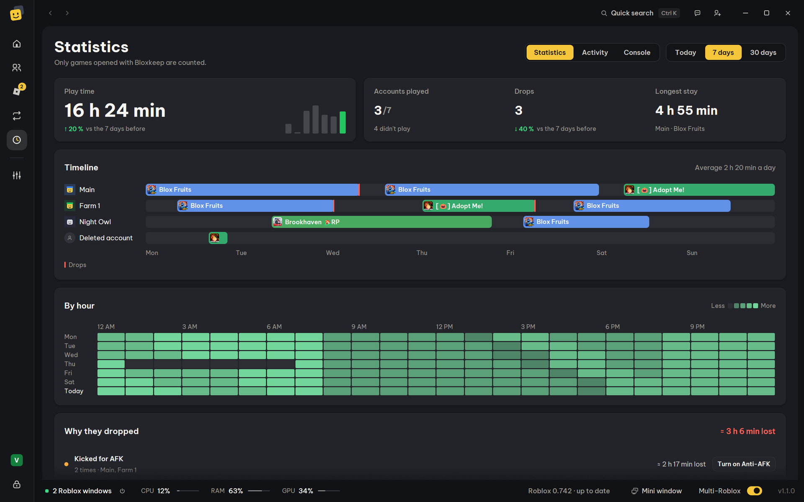
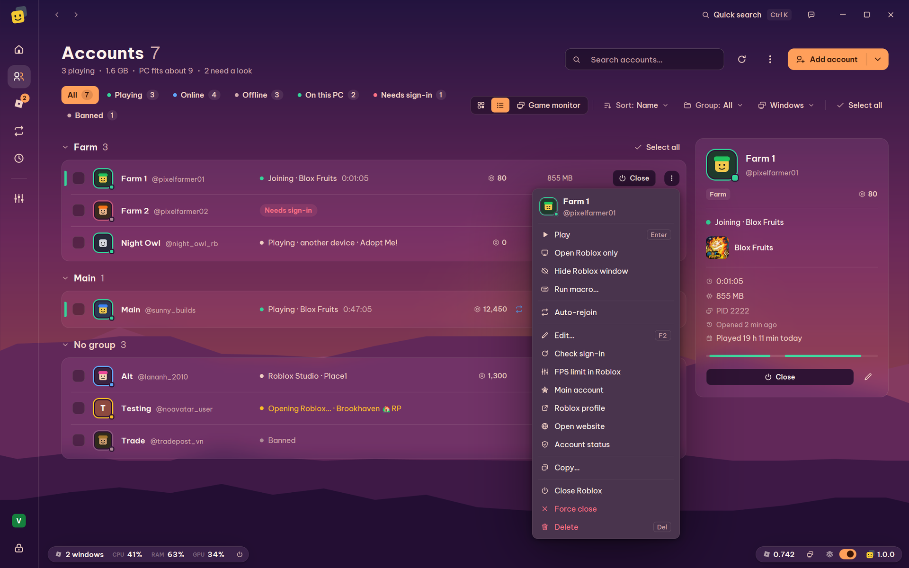
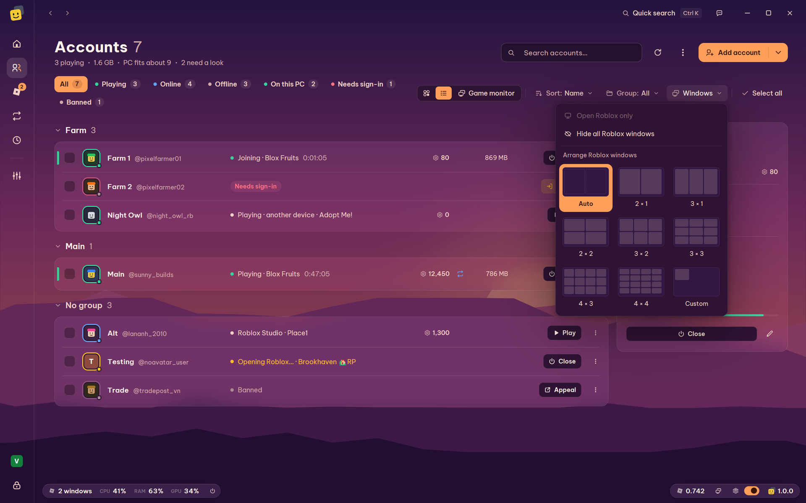

[Tiếng Việt](windows-and-stats.vi.md)

# Windows and statistics

How to see, arrange and count your Roblox windows: the bar at the bottom, Game monitor, Mini window, window layouts, Statistics and the Activity log.

## Quick steps

1. On **Accounts**, press **Game monitor** at the top: a live picture of every Roblox window.
2. Click a picture to bring that window to the front.
3. To tidy the windows, press **Windows** at the top of Accounts and pick a layout (with several screens, pick one first).
4. Press **Mini window** in the bar at the bottom for a small list that stays on top.
5. Open **Statistics** (the clock on the left) to see play time, and its **Activity** tab to see what happened.

## The bar at the bottom

It is on every page. From left to right:

- how many Roblox windows are open ("2 Roblox windows", or "No Roblox open"), with **Close all** (the power button) while Roblox is running (it asks first). Beside it, **PC fits about N**: about how many Roblox windows this PC can run at once, going by what your own windows take; point at the count to see how much each takes and what runs out first (RAM, Windows' memory limit, the CPU or the GPU);
- **CPU**, **RAM** and **GPU**, each with a bar: the CPU and GPU your Roblox windows use, and the PC's RAM in use (point at it for the free RAM);
- your Roblox version and whether it is up to date; when it isn't, a click leads to **Settings › Roblox version**;
- **Mini window**, with a green light while it is open;
- **Restart to update** with the new version, when a Bloxkeep update is ready ([Getting started](getting-started.md#updates));
- the **Multi-Roblox** switch ([Multi-Roblox](multi-roblox.md)), then Bloxkeep's version.

If Roblox isn't installed, the bar says "Roblox doesn't seem to be installed on this PC."

## Game monitor

**Game monitor**, at the top of **Accounts** beside **Cards** and **List**, shows a live picture of every Roblox window, with its account, game, RAM and PID.

- Windows are grouped by game. Each group's line counts how many are playing, joining or cut off, and has **Fold**, **Minimize all** (or **Open all again**), **Only this game** and **Close all** (it asks with a second click).
- A tag like **Server A** marks windows in the same server: the same letter, the same server.
- Click a picture to bring that window to the front. An arranged window keeps its tile.
- The **–** at a tile's top right minimises that window without bringing it up; click it again to open it again.
- Right-click for **Show**, **Minimise** (or **Open again**), **Close Roblox** and **Copy PID**.
- A minimised window shows "Minimized: no live picture".
- The pictures step aside while a dialog or menu is open.

## Mini window

A small window that stays on top. Open it from **Mini window** in the bar at the bottom, the tray menu or Ctrl+K.

- It lists the accounts playing now with their game, RAM and PID, each with **Show** and **Close**.
- It also has **Close all** (asks first) and **Open Bloxkeep**.
- It keeps working while the main window is in the tray.
- Esc hides it. While it is open, **Mini window** in the bar shows a green light; a click hides it.
- It remembers its place and height.

## Hide Roblox windows

Hide a Roblox window while its game keeps running: right-click the account (or **⋮**) › **Hide Roblox window**; **Show Roblox window** brings it back. From any app (turn them off in **Settings › Bloxkeep**):

| Keys | What they do |
|---|---|
| **Ctrl+Alt+H** | Hides every Roblox window, or shows them again. |
| **Ctrl+Alt+M** | Minimizes every Roblox window, or opens them all again. Hidden ones stay hidden. |
| **Ctrl+Alt+N** | Brings the next account's window to the front, in the list's order. |
| **Ctrl+Alt+A** | Arranges the windows on the screen the mouse is on. |
| **Ctrl+Alt+B** | Opens Bloxkeep, from the tray too. |

- A hidden window keeps playing; anti-AFK and auto-rejoin go on as usual, and a window that rejoins is hidden again once in its game.
- If Bloxkeep closes unexpectedly, hidden windows are shown again the next time it starts.

## Arrange windows

Press **Windows** at the top of **Accounts** and pick a layout from its pictures, as with Windows' snap layouts: pointing at one lights the cells your open windows would take, and a click arranges them in it (and keeps it for next time). **Arrange Roblox windows** under ⋮ in the bar at the bottom of Accounts, Ctrl+Alt+A and Ctrl+K use the layout you picked. With several screens, pick one first ("main" marks the main screen).

| Layout | What it does |
|---|---|
| **Auto** | The windows fill the whole screen, as many tiles as windows. |
| **2 × 1** to **4 × 4** | The screen cut into that grid; each window takes one cell from the top-left, however many windows are open. 2 windows in a 4 × 4 grid are a sixteenth of the screen each. More windows than cells overlap evenly. |
| **640 × 480** (your own size) | Every window that size, side by side from the top-left. Pick a common size (16:9 from 1920 × 1080 down to 320 × 180, or 4:3 from 1024 × 768 down to 320 × 240) or type the width and height in **Settings › Launching › Arranging windows** (**Windows › Window size of your own…**). It can be smaller than Roblox lets you drag a window to. |

To make one window smaller by hand, drag its edge: while you drag, the frame stops at Roblox's smallest size; let go and Bloxkeep gives the window the size you let go at (no smaller than 160 × 120). Moving a window by its title bar is left to Windows.

> [!TIP]
> Smaller windows are less work for the graphics card.

## When a Roblox window opens

**Settings › Launching › When a Roblox window opens** chooses what happens to each new window:

| Choice | What it does |
|---|---|
| **As Roblox sizes it** | Roblox decides the size of the window. |
| **Maximize it** | Maximised windows are still windows, so they don't share Roblox's one fullscreen setting. |
| **Tile windows side by side** | Arranges the windows by themselves once opened, with the layout above. Needs [Multi-Roblox](multi-roblox.md). |

A [preset](presets.md) has its own **Arrange windows** option (**Follow Settings**, **On**, **Off**). Windows of a **Light AFK** preset aren't tiled: they are minimised.

## Statistics

**Statistics** (the clock in the bar on the left) has three tabs: **Statistics**, **Activity** and **Console**. On **Statistics**, pick **Today**, **7 days** or **30 days**:

- Tiles: **Play time**, **Accounts played**, **Drops** and **Longest stay**, with the change from the period before.
- **Today**: a 24-hour clock with a ring for each account, coloured by game, a notch where it dropped, and the hand at now.
- **7 days** and **30 days**: **Timeline**, what each account played day by day with its drops marked, and **By hour**, a grid of how many windows ran at each hour.
- **Why they dropped**: the time lost to each reason (from the drop to the next session, 12 h at most), with a button where a setting helps.
- **Top games**: a map of your games sized by play time. Click one to count only that game on the whole page (**All games** goes back).
- **By account**: each account with its play time, drops, main game and its run of full days.
- **By preset**.
- The figures refresh every 30 seconds while the tab is open.

> [!NOTE]
> Only games opened with Bloxkeep are counted.

More details

A deleted account's play time stays in the figures, shown as "Deleted account".

## Activity log

The **Activity** tab lists what Bloxkeep saw happen, newest first: accounts opened, games joined and left, disconnects with the reason, rejoins, schedules, sign-ins and updates. The last 1,000 events are kept.

- Filter by **Account** and **Kind of event**: **Games**, **Drops and errors**, **Schedules**, **Sign-in**, **Updates**.
- **Show more** loads older events.
- **Export CSV** saves what the filters show to a file. It is also in Ctrl+K as "Export the activity log (CSV)".

## Console

The **Console** tab is Bloxkeep's own log of this run, line by line as a log reads: oldest at the top, the newest at the bottom, and it follows new lines while you are at the bottom. It helps when something went wrong and you want to see what Bloxkeep did just before.

← [User guide](../guide.md) · Next: [Discord](discord.md) →
