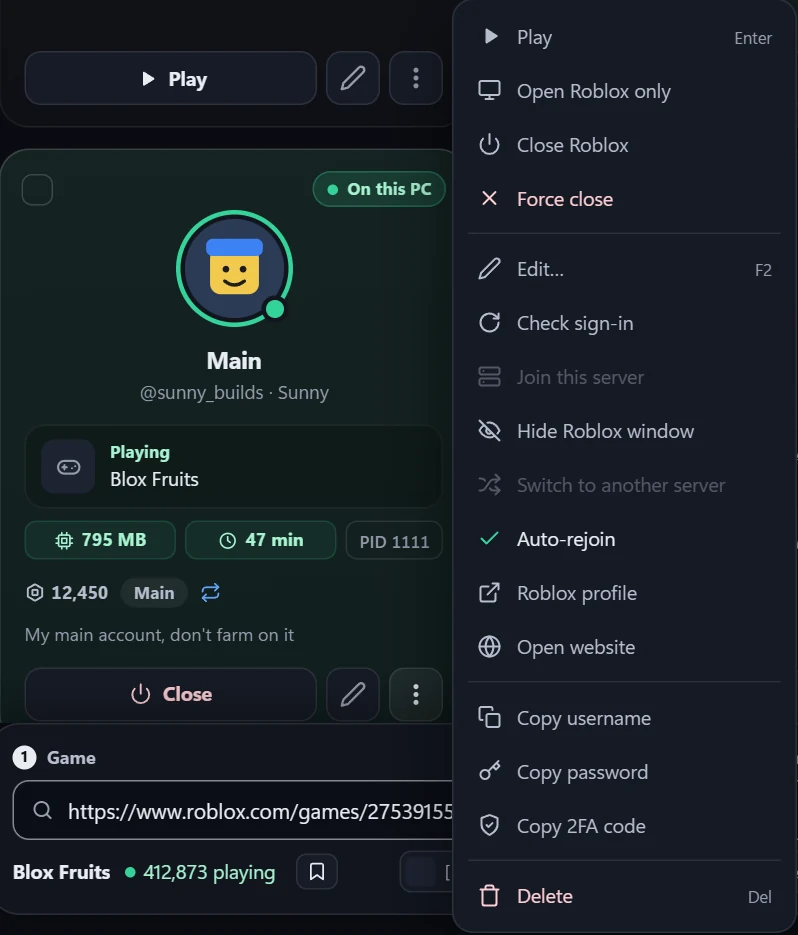
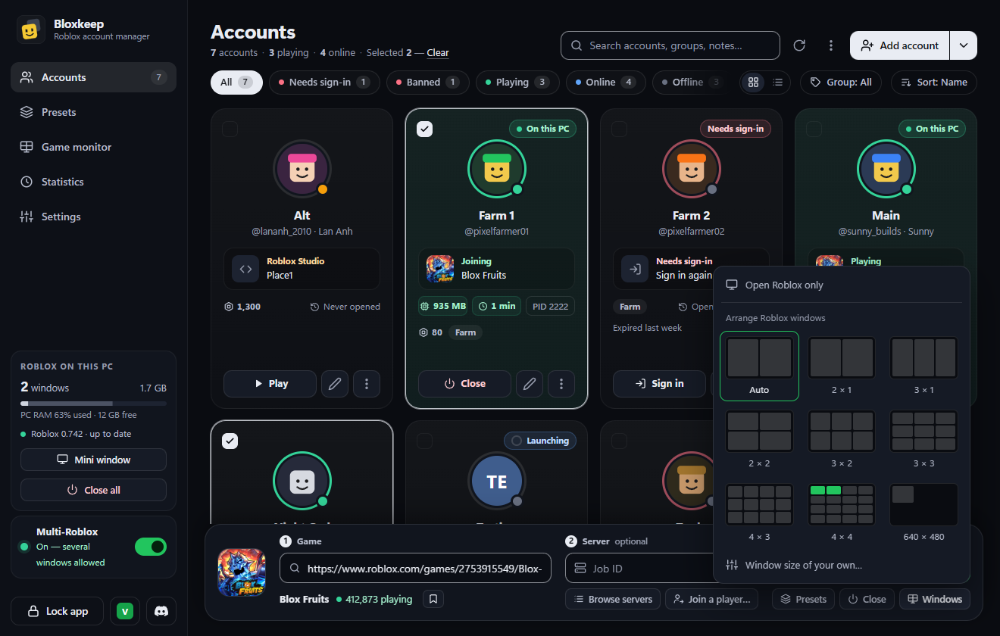

[Tiếng Việt](windows-and-stats.vi.md)

# Windows and statistics

How to see, arrange and count your Roblox windows: the **Roblox on this PC** card, Game monitor, Mini window, window layouts, Statistics and the Activity log.

## Quick steps

1. Open **Game monitor** in the sidebar: a live picture of every Roblox window.
2. Click a picture to bring that window to the front.
3. To tidy the windows, press **Windows › Arrange Roblox windows** in the game bar (with several screens, pick one first).
4. Open **Mini window** for a small list that stays on top.
5. Open **Statistics** to see play time, and its **Activity** tab to see what happened.

## Roblox on this PC

This card sits in the sidebar and shows:

- how many Roblox windows are open (point at the number to see each account and PID) and the RAM they use;
- a bar of the PC's RAM: Roblox's share, then the rest in use, for example "PC RAM 64% used · 5.2 GB free";
- your Roblox version with a light: green is "up to date", yellow means a newer one is out ("0.744 available", or "update available" for a new build of the same version);
- **Mini window**, and **Close all** while Roblox is running (it asks first).

If Roblox isn't installed, a warning card says "Roblox doesn't seem to be installed on this PC."

## Game monitor

**Game monitor** in the sidebar shows a live picture of every Roblox window, with its account, game, RAM and PID.

- Click a picture to bring that window to the front.
- Right-click for **Show**, **Close Roblox** and **Copy PID**.
- A minimised window shows "Minimised — no live picture".
- The pictures step aside while a dialog or menu is open.

## Mini window

A small window that stays on top. Open it from **Mini window** in the sidebar, the tray menu or Ctrl+K.

- It lists the accounts playing now with their game, RAM and PID, each with **Show** and **Close**.
- It also has **Close all** (asks first) and **Open Bloxkeep**.
- It keeps working while the main window is in the tray.
- Esc hides it. While it is open, the sidebar button reads **Hide mini window**.
- It remembers its place and height.

## Hide Roblox windows

Hide a Roblox window while its game keeps running: right-click the account (or **⋮**) › **Hide Roblox window**; **Show Roblox window** brings it back. **Ctrl+Alt+H** hides or shows every Roblox window from any app, and **Ctrl+Alt+A** arranges them (turn the hotkeys off in **Settings › Bloxkeep**).

- A hidden window keeps playing; anti-AFK and auto-rejoin go on as usual, and a window that rejoins is hidden again once in its game.
- The eye before its PID on the card shows it again.
- If Bloxkeep closes unexpectedly, hidden windows are shown again the next time it starts.

## Arrange windows

Press **Windows** in the game bar and pick a layout from its pictures, as with Windows' snap layouts: pointing at one lights the cells your open windows would take, and a click arranges them in it (and keeps it for next time). **⋯ More › Arrange Roblox windows** and Ctrl+K use the layout you picked. With several screens, pick one first ("main" marks the main screen).

| Layout | What it does |
|---|---|
| **Auto** | The windows fill the whole screen, as many tiles as windows. |
| **2 × 1** to **4 × 4** | The screen cut into that grid; each window takes one cell from the top-left, however many windows are open. 2 windows in a 4 × 4 grid are a sixteenth of the screen each. More windows than cells overlap evenly. |
| **640 × 480** (your own size) | Every window that size, side by side from the top-left. Pick a common size (16:9 from 1920 × 1080 down to 320 × 180, or 4:3 from 1024 × 768 down to 320 × 240) or type the width and height in **Settings › Launching › Arranging windows** (**Windows › Window size of your own…**). It can be smaller than Roblox lets you drag a window to. |

To make one window smaller by hand, drag its edge: while you drag, the frame stops at Roblox's smallest size; let go and Bloxkeep gives the window the size you let go at (no smaller than 160 × 120). Moving a window by its title bar is left to Windows.

> [!TIP]
> Smaller windows are less work for the graphics card.

## When a Roblox window opens

**Settings › Launching › When a Roblox window opens** chooses what happens to each new window:

| Choice | What it does |
|---|---|
| **As Roblox sizes it** | Roblox decides the size of the window. |
| **Maximise it** | Maximised windows are still windows, so they don't share Roblox's one fullscreen setting. |
| **Tile them side by side** | Arranges the windows by themselves once opened, with the layout above. Needs [Multi-Roblox](multi-roblox.md). |

A [preset](presets.md) has its own **Arrange windows** option (**Follow Settings**, **On**, **Off**). Windows of a **Light AFK** preset aren't tiled: they are minimised.

## Statistics

**Statistics** in the sidebar has two tabs, **Statistics** and **Activity**.

> [!NOTE]
> Only games opened with Bloxkeep are counted.

On the **Statistics** tab, pick **Today**, **7 days** or **30 days**:

- Tiles: **Play time**, **Sessions**, **Disconnects**, **Most played**. A wide window adds **Accounts played** and **Longest stay**.
- **Play time by hour** (Today) or **Play time by day**.
- **By account**: play time, sessions and disconnects for each account.
- **Top games** and **By preset**.
- The figures refresh every 30 seconds while the tab is open.

More details

A deleted account's play time stays in the figures, shown as "Deleted account".

## Activity log

The **Activity** tab lists what Bloxkeep saw happen, newest first: accounts opened, games joined and left, disconnects with the reason, rejoins, schedules, sign-ins and updates. The last 1,000 events are kept.

- Filter by **Account** and **Kind of event**: **Games**, **Disconnects and problems**, **Schedules**, **Sign-in**, **Updates**.
- **Show more** loads older events.
- **Export CSV** saves what the filters show to a file. It is also in Ctrl+K as "Export the activity log (CSV)".

← [User guide](../guide.md) · Next: [Discord](discord.md) →
