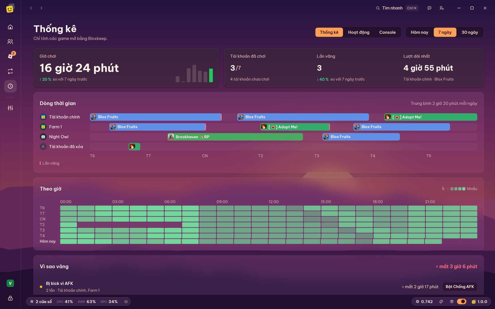
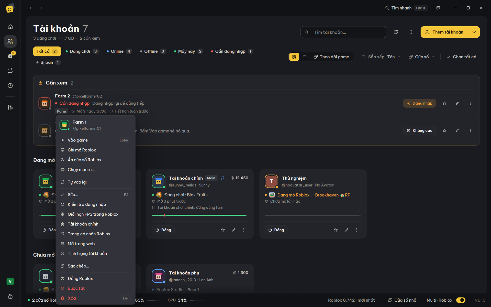
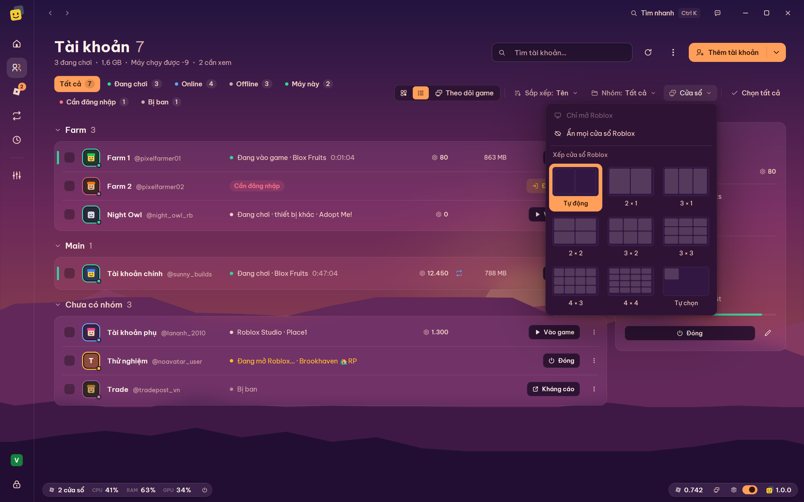

[English](windows-and-stats.md)

# Cửa sổ và thống kê

Cách xem, xếp gọn và thống kê các cửa sổ Roblox: thanh dưới cùng, Theo dõi game, Cửa sổ nhỏ, kiểu xếp cửa sổ, Thống kê và nhật ký Hoạt động.

## Làm nhanh

1. Ở tab **Tài khoản**, bấm **Theo dõi game** ở đầu trang: hình trực tiếp của mọi cửa sổ Roblox.
2. Bấm vào một hình để đưa cửa sổ đó lên trên cùng.
3. Muốn xếp gọn các cửa sổ, bấm **Cửa sổ** ở đầu tab Tài khoản rồi chọn một kiểu xếp (máy có nhiều màn hình thì chọn màn hình trước).
4. Bấm **Cửa sổ nhỏ** ở thanh dưới cùng để có một danh sách nhỏ luôn nằm trên cùng.
5. Mở **Thống kê** (hình đồng hồ bên trái) để xem thời gian chơi, và tab **Hoạt động** để xem những gì đã xảy ra.

## Thanh dưới cùng

Thanh này có ở mọi trang. Từ trái sang phải:

- số cửa sổ Roblox đang mở ("2 cửa sổ Roblox", hoặc "Chưa mở Roblox"), kèm nút **Đóng tất cả** (nút nguồn) khi đang có Roblox chạy (có hỏi trước). Bên cạnh là **Máy chạy được ~N**: máy này chạy được khoảng bao nhiêu cửa sổ Roblox cùng lúc, tính theo các cửa sổ của bạn; rê chuột lên con số để xem mỗi cửa sổ tốn bao nhiêu và cái gì hết trước (RAM, giới hạn bộ nhớ của Windows, CPU hay GPU);
- **CPU**, **RAM** và **GPU**, mỗi cái một thanh: CPU và GPU mà các cửa sổ Roblox dùng, và RAM đã dùng của cả máy (rê chuột để xem còn trống bao nhiêu);
- phiên bản Roblox và có phải bản mới nhất không; nếu chưa, bấm vào sẽ tới **Cài đặt › Phiên bản Roblox**;
- **Cửa sổ nhỏ**, có đèn xanh khi đang mở;
- **Khởi động lại để cập nhật** kèm số phiên bản, khi đã có bản Bloxkeep mới ([Bắt đầu](getting-started.vi.md#cập-nhật));
- công tắc **Multi-Roblox** ([Multi-Roblox](multi-roblox.vi.md)), rồi phiên bản của Bloxkeep.

Nếu máy chưa cài Roblox, thanh này ghi "Hình như máy này chưa cài Roblox."

## Theo dõi game

**Theo dõi game**, ở đầu tab **Tài khoản** cạnh **Dạng thẻ** và **Dạng danh sách**, hiện hình trực tiếp của mọi cửa sổ Roblox, kèm tài khoản, game, RAM và PID.

- Cửa sổ được gom theo game. Dòng đầu mỗi nhóm đếm số cửa sổ đang chơi, đang vào và bị rớt, kèm các nút **Thu gọn**, **Thu nhỏ hết** (hoặc **Mở lại hết**), **Chỉ xem game này** và **Đóng hết** (bấm lần hai để xác nhận).
- Nhãn như **Server A** đánh dấu cửa sổ cùng server: cùng chữ là cùng server.
- Bấm vào hình để đưa cửa sổ đó lên trên cùng. Cửa sổ đã xếp vẫn giữ nguyên ô.
- Nút **–** ở góc phải mỗi ô thu nhỏ cửa sổ đó mà không cần mở nó lên; bấm lần nữa để mở lại.
- Chuột phải để chọn **Hiện**, **Thu nhỏ** (hoặc **Mở lại**), **Đóng Roblox** hay **Sao chép PID**.
- Cửa sổ đang thu nhỏ thì ghi "Đang thu nhỏ, không có hình".
- Khi có hộp thoại hay menu mở, các hình tạm ẩn đi.

## Cửa sổ nhỏ

Một cửa sổ nhỏ luôn nằm trên cùng. Mở bằng nút **Cửa sổ nhỏ** ở thanh dưới cùng, menu ở khay hoặc Ctrl+K.

- Nó liệt kê các tài khoản đang chơi, kèm game, RAM và PID; mỗi tài khoản có nút **Hiện** và **Đóng**.
- Ngoài ra có **Đóng tất cả** (có hỏi trước) và **Mở Bloxkeep**.
- Cửa sổ nhỏ vẫn chạy khi cửa sổ chính đang ẩn dưới khay.
- Nhấn Esc để ẩn. Trong lúc nó đang mở, nút **Cửa sổ nhỏ** ở thanh dưới có đèn xanh; bấm vào để ẩn.
- Vị trí và chiều cao được nhớ lại.

## Ẩn cửa sổ Roblox

Ẩn cửa sổ Roblox mà game vẫn chạy: bấm chuột phải vào tài khoản (hoặc **⋮**) › **Ẩn cửa sổ Roblox**; **Hiện cửa sổ Roblox** để hiện lại. Dùng được trong mọi app (tắt ở **Cài đặt › Bloxkeep**):

| Phím | Tác dụng |
|---|---|
| **Ctrl+Alt+H** | Ẩn mọi cửa sổ Roblox, hoặc hiện lại. |
| **Ctrl+Alt+M** | Thu nhỏ mọi cửa sổ Roblox, hoặc mở lại tất cả. Cửa sổ đang ẩn vẫn ẩn. |
| **Ctrl+Alt+N** | Đưa cửa sổ của tài khoản kế tiếp lên trước, theo thứ tự trong danh sách. |
| **Ctrl+Alt+A** | Xếp cửa sổ trên màn hình đang có chuột. |
| **Ctrl+Alt+B** | Mở Bloxkeep, kể cả khi đang ở khay. |

- Cửa sổ bị ẩn vẫn chơi bình thường; chống AFK và tự vào lại vẫn chạy, cửa sổ vào lại game sẽ được ẩn lại.
- Nếu Bloxkeep tắt đột ngột, lần mở sau các cửa sổ đã ẩn sẽ hiện lại.

## Xếp cửa sổ

Bấm **Cửa sổ** ở đầu tab **Tài khoản** rồi chọn một kiểu xếp trong các hình mẫu, giống Snap của Windows: rê chuột lên hình nào thì các ô mà cửa sổ đang mở sẽ chiếm sáng lên, bấm vào là xếp ngay (và nhớ cho lần sau). **Xếp cửa sổ Roblox** trong ⋮ ở thanh dưới cùng của tab Tài khoản, Ctrl+Alt+A và Ctrl+K dùng kiểu bạn đã chọn. Máy có nhiều màn hình thì chọn màn hình trước (chữ "chính" đánh dấu màn hình chính).

| Kiểu | Kết quả |
|---|---|
| **Tự vừa** | Các cửa sổ lấp đầy cả màn hình, mở bao nhiêu cửa sổ thì chia bấy nhiêu ô. |
| **2 × 1** đến **4 × 4** | Màn hình chia thành lưới đó; mỗi cửa sổ chiếm một ô tính từ góc trên bên trái, dù mở bao nhiêu cửa sổ. 2 cửa sổ trong lưới 4 × 4 thì mỗi cái bằng 1/16 màn hình. Nhiều cửa sổ hơn số ô thì xếp chồng so le đều nhau. |
| **640 × 480** (kích thước tự chọn) | Mọi cửa sổ đúng kích thước đó, xếp cạnh nhau từ góc trên bên trái. Chọn một kích thước mẫu (16:9 từ 1920 × 1080 xuống 320 × 180, hoặc 4:3 từ 1024 × 768 xuống 320 × 240) hoặc nhập rộng và cao ở **Cài đặt › Khởi chạy › Kiểu xếp cửa sổ** (**Cửa sổ › Tự chọn kích thước cửa sổ…**). Có thể nhỏ hơn mức Roblox cho phép khi tự kéo cửa sổ. |

Muốn thu nhỏ một cửa sổ bằng tay thì kéo mép của nó: lúc kéo, khung dừng ở cỡ nhỏ nhất của Roblox; thả chuột ra là Bloxkeep đưa cửa sổ về đúng cỡ chỗ bạn thả (không nhỏ hơn 160 × 120). Di chuyển cửa sổ bằng thanh tiêu đề thì vẫn do Windows lo.

> [!TIP]
> Cửa sổ càng nhỏ thì card đồ họa càng đỡ tải.

## Khi cửa sổ Roblox mở ra

**Cài đặt › Khởi chạy › Khi cửa sổ Roblox mở ra** chọn việc làm với mỗi cửa sổ mới:

| Lựa chọn | Kết quả |
|---|---|
| **Để Roblox tự chọn** | Roblox tự quyết định kích thước cửa sổ. |
| **Phóng to** | Cửa sổ phóng to vẫn là cửa sổ thường, nên không dùng chung cài đặt toàn màn hình của Roblox. |
| **Xếp cửa sổ cạnh nhau** | Tự xếp các cửa sổ sau khi mở, theo kiểu xếp ở trên. Cần bật [Multi-Roblox](multi-roblox.vi.md). |

[Preset](presets.vi.md) có tùy chọn **Xếp cửa sổ** riêng (**Theo Cài đặt**, **Bật**, **Tắt**). Cửa sổ của preset dùng **Treo máy nhẹ** không được xếp: chúng được thu nhỏ.

## Thống kê

**Thống kê** (hình đồng hồ ở thanh bên trái) có ba tab: **Thống kê**, **Hoạt động** và **Console**. Ở tab **Thống kê**, chọn **Hôm nay**, **7 ngày** hoặc **30 ngày**:

- Các ô số liệu: **Giờ chơi**, **Tài khoản đã chơi**, **Lần văng** và **Lượt dài nhất**, kèm mức tăng giảm so với kỳ trước.
- **Hôm nay**: đồng hồ 24 giờ, mỗi tài khoản một vòng tô màu theo game, vạch đỏ là lúc văng, kim chỉ giờ hiện tại.
- **7 ngày** và **30 ngày**: **Dòng thời gian**, từng tài khoản chơi gì mỗi ngày kèm lúc văng, và **Theo giờ**, bảng ô cho biết mỗi giờ có bao nhiêu cửa sổ chạy.
- **Vì sao văng**: thời gian mất theo từng lý do (từ lúc văng đến lượt chơi kế tiếp, tối đa 12 giờ mỗi lần), kèm nút khi có cài đặt giúp được.
- **Game chơi nhiều**: bản đồ các game, ô càng to là chơi càng lâu. Bấm một game để cả trang chỉ tính game đó (**Tất cả game** để quay lại).
- **Theo tài khoản**: mỗi tài khoản với giờ chơi, số lần văng, game chơi nhiều nhất và số ngày treo trọn liền.
- **Theo Preset**.
- Số liệu tự làm mới mỗi 30 giây khi tab đang mở.

> [!NOTE]
> Chỉ tính các game mở bằng Bloxkeep.

Chi tiết thêm

Thời gian chơi của tài khoản đã xóa vẫn nằm trong số liệu, hiện là "Tài khoản đã xóa".

## Nhật ký Hoạt động

Tab **Hoạt động** liệt kê những gì Bloxkeep ghi nhận được, mới nhất ở trên: mở tài khoản, vào và rời game, bị văng kèm lý do, tự vào lại, hẹn giờ, đăng nhập, cập nhật. Chỉ giữ 1.000 sự kiện gần nhất.

- Lọc theo **Tài khoản** và **Loại sự kiện**: **Vào/ra game**, **Văng và lỗi**, **Hẹn giờ**, **Đăng nhập**, **Cập nhật**.
- **Xem thêm** để tải các sự kiện cũ hơn.
- **Xuất CSV** lưu những gì đang lọc ra file. Cũng có trong Ctrl+K: "Xuất nhật ký hoạt động (CSV)".

## Console

Tab **Console** là nhật ký của chính Bloxkeep trong lần chạy này, từng dòng như một file log: cũ nhất ở trên, mới nhất ở dưới, và tự chạy theo dòng mới khi bạn đang ở cuối. Hữu ích khi có gì trục trặc và bạn muốn xem Bloxkeep vừa làm gì ngay trước đó.

← [Hướng dẫn](../guide.vi.md) · Tiếp: [Discord](discord.vi.md) →
