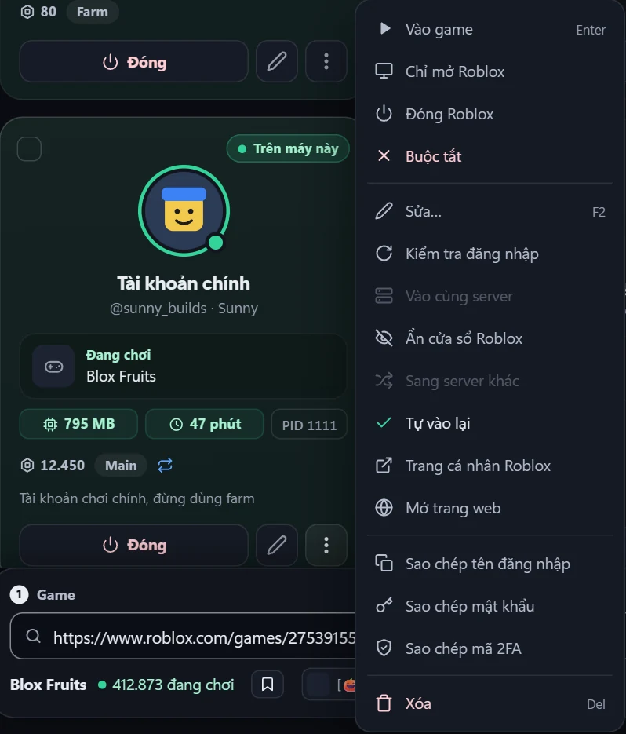
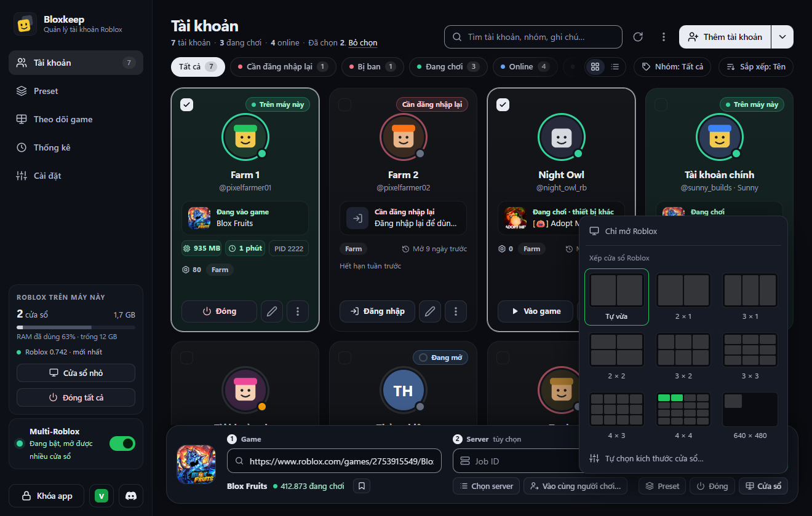

[English](windows-and-stats.md)

# Cửa sổ và thống kê

Cách xem, xếp gọn và thống kê các cửa sổ Roblox: thẻ **Roblox trên máy này**, Theo dõi game, Cửa sổ nhỏ, kiểu xếp cửa sổ, Thống kê và nhật ký Hoạt động.

## Làm nhanh

1. Mở **Theo dõi game** ở thanh bên: hình trực tiếp của mọi cửa sổ Roblox.
2. Bấm vào một hình để đưa cửa sổ đó lên trên cùng.
3. Muốn xếp gọn các cửa sổ, bấm **Cửa sổ › Xếp cửa sổ Roblox** ở thanh chọn game (máy có nhiều màn hình thì chọn màn hình trước).
4. Mở **Cửa sổ nhỏ** để có một danh sách nhỏ luôn nằm trên cùng.
5. Mở **Thống kê** để xem thời gian chơi, và tab **Hoạt động** để xem những gì đã xảy ra.

## Roblox trên máy này

Thẻ này nằm ở thanh bên và cho biết:

- số cửa sổ Roblox đang mở (rê chuột lên con số để xem từng tài khoản và PID) và lượng RAM chúng dùng;
- thanh RAM của cả máy: phần của Roblox, rồi phần còn lại đang dùng, ví dụ "RAM máy đã dùng 64% · còn trống 5,2 GB";
- phiên bản Roblox kèm đèn: xanh là "mới nhất", vàng là đã có bản mới ("có bản 0.744", hoặc "có bản mới" khi chỉ là bản vá cùng số phiên bản);
- nút **Cửa sổ nhỏ**, và **Đóng tất cả** khi đang có Roblox chạy (có hỏi trước).

Nếu máy chưa cài Roblox, một thẻ cảnh báo ghi "Hình như máy này chưa cài Roblox."

## Theo dõi game

**Theo dõi game** ở thanh bên hiện hình trực tiếp của mọi cửa sổ Roblox, kèm tài khoản, game, RAM và PID.

- Bấm vào hình để đưa cửa sổ đó lên trên cùng.
- Chuột phải để chọn **Hiện**, **Đóng Roblox** hoặc **Sao chép PID**.
- Cửa sổ đang thu nhỏ thì ghi "Đang thu nhỏ, không có hình trực tiếp".
- Khi có hộp thoại hay menu mở, các hình tạm ẩn đi.

## Cửa sổ nhỏ

Một cửa sổ nhỏ luôn nằm trên cùng. Mở bằng nút **Cửa sổ nhỏ** ở thanh bên, menu ở khay hoặc Ctrl+K.

- Nó liệt kê các tài khoản đang chơi, kèm game, RAM và PID; mỗi tài khoản có nút **Hiện** và **Đóng**.
- Ngoài ra có **Đóng tất cả** (có hỏi trước) và **Mở Bloxkeep**.
- Cửa sổ nhỏ vẫn chạy khi cửa sổ chính đang ẩn dưới khay.
- Nhấn Esc để ẩn. Trong lúc nó đang mở, nút ở thanh bên ghi **Ẩn cửa sổ nhỏ**.
- Vị trí và chiều cao được nhớ lại.

## Ẩn cửa sổ Roblox

Ẩn cửa sổ Roblox mà game vẫn chạy: bấm chuột phải vào tài khoản (hoặc **⋮**) › **Ẩn cửa sổ Roblox**; **Hiện cửa sổ Roblox** để hiện lại. **Ctrl+Alt+H** ẩn hoặc hiện mọi cửa sổ Roblox, dùng được trong mọi app, còn **Ctrl+Alt+A** để xếp cửa sổ (tắt phím tắt ở **Cài đặt › Bloxkeep**).

- Cửa sổ bị ẩn vẫn chơi bình thường; chống AFK và tự vào lại vẫn chạy, cửa sổ vào lại game sẽ được ẩn lại.
- Con mắt trước PID trên thẻ tài khoản để hiện lại.
- Nếu Bloxkeep tắt đột ngột, lần mở sau các cửa sổ đã ẩn sẽ hiện lại.

## Xếp cửa sổ

Bấm **Cửa sổ** ở thanh chọn game rồi chọn một kiểu xếp trong các hình mẫu, giống Snap của Windows: rê chuột lên hình nào thì các ô mà cửa sổ đang mở sẽ chiếm sáng lên, bấm vào là xếp ngay (và nhớ cho lần sau). **⋯ Tùy chọn khác › Xếp cửa sổ Roblox** và Ctrl+K dùng kiểu bạn đã chọn. Máy có nhiều màn hình thì chọn màn hình trước (chữ "chính" đánh dấu màn hình chính).

| Kiểu | Kết quả |
|---|---|
| **Tự vừa** | Các cửa sổ lấp đầy cả màn hình, mở bao nhiêu cửa sổ thì chia bấy nhiêu ô. |
| **2 × 1** đến **4 × 4** | Màn hình chia thành lưới đó; mỗi cửa sổ chiếm một ô tính từ góc trên bên trái, dù mở bao nhiêu cửa sổ. 2 cửa sổ trong lưới 4 × 4 thì mỗi cái bằng 1/16 màn hình. Nhiều cửa sổ hơn số ô thì xếp chồng so le đều nhau. |
| **640 × 480** (kích thước tự chọn) | Mọi cửa sổ đúng kích thước đó, xếp cạnh nhau từ góc trên bên trái. Chọn một kích thước mẫu (16:9 từ 1920 × 1080 xuống 320 × 180, hoặc 4:3 từ 1024 × 768 xuống 320 × 240) hoặc nhập rộng và cao ở **Cài đặt › Khởi chạy › Kiểu xếp cửa sổ** (**Cửa sổ › Tự chọn kích thước cửa sổ…**). Có thể nhỏ hơn mức Roblox cho phép khi tự kéo cửa sổ. |

Muốn thu nhỏ một cửa sổ bằng tay thì kéo mép của nó: lúc kéo, khung dừng ở cỡ nhỏ nhất của Roblox; thả chuột ra là Bloxkeep đưa cửa sổ về đúng cỡ chỗ bạn thả (không nhỏ hơn 160 × 120). Di chuyển cửa sổ bằng thanh tiêu đề thì vẫn do Windows lo.

> [!TIP]
> Cửa sổ càng nhỏ thì card đồ họa càng đỡ tải.

## Khi cửa sổ Roblox mở ra

**Cài đặt › Khởi chạy › Khi cửa sổ Roblox mở ra** chọn việc làm với mỗi cửa sổ mới:

| Lựa chọn | Kết quả |
|---|---|
| **Để Roblox tự chọn** | Roblox tự quyết định kích thước cửa sổ. |
| **Phóng to** | Cửa sổ phóng to vẫn là cửa sổ thường, nên không dùng chung cài đặt toàn màn hình của Roblox. |
| **Xếp cạnh nhau** | Tự xếp các cửa sổ sau khi mở, theo kiểu xếp ở trên. Cần bật [Multi-Roblox](multi-roblox.vi.md). |

[Preset](presets.vi.md) có tùy chọn **Xếp cửa sổ** riêng (**Theo Cài đặt**, **Bật**, **Tắt**). Cửa sổ của preset dùng **Treo máy nhẹ** không được xếp: chúng được thu nhỏ.

## Thống kê

**Thống kê** ở thanh bên có hai tab: **Thống kê** và **Hoạt động**.

> [!NOTE]
> Chỉ tính các game mở bằng Bloxkeep.

Ở tab **Thống kê**, chọn **Hôm nay**, **7 ngày** hoặc **30 ngày**:

- Các ô số liệu: **Thời gian chơi**, **Lượt chơi**, **Mất kết nối**, **Chơi nhiều nhất**. Cửa sổ đủ rộng thì có thêm **Tài khoản đã chơi** và **Lượt dài nhất**.
- **Thời gian chơi theo giờ** (Hôm nay) hoặc **Thời gian chơi theo ngày**.
- **Theo tài khoản**: thời gian chơi, số lượt và số lần mất kết nối của từng tài khoản.
- **Game chơi nhiều** và **Theo preset**.
- Số liệu tự làm mới mỗi 30 giây khi tab đang mở.

Chi tiết thêm

Thời gian chơi của tài khoản đã xóa vẫn nằm trong số liệu, hiện là "Tài khoản đã xóa".

## Nhật ký Hoạt động

Tab **Hoạt động** liệt kê những gì Bloxkeep ghi nhận được, mới nhất ở trên: mở tài khoản, vào và rời game, bị văng kèm lý do, tự vào lại, hẹn giờ, đăng nhập, cập nhật. Chỉ giữ 1.000 sự kiện gần nhất.

- Lọc theo **Tài khoản** và **Loại sự kiện**: **Vào/ra game**, **Văng và lỗi**, **Hẹn giờ**, **Đăng nhập**, **Cập nhật**.
- **Xem thêm** để tải các sự kiện cũ hơn.
- **Xuất CSV** lưu những gì đang lọc ra file. Cũng có trong Ctrl+K: "Xuất nhật ký hoạt động (CSV)".

← [Hướng dẫn](../guide.vi.md) · Tiếp: [Discord](discord.vi.md) →
